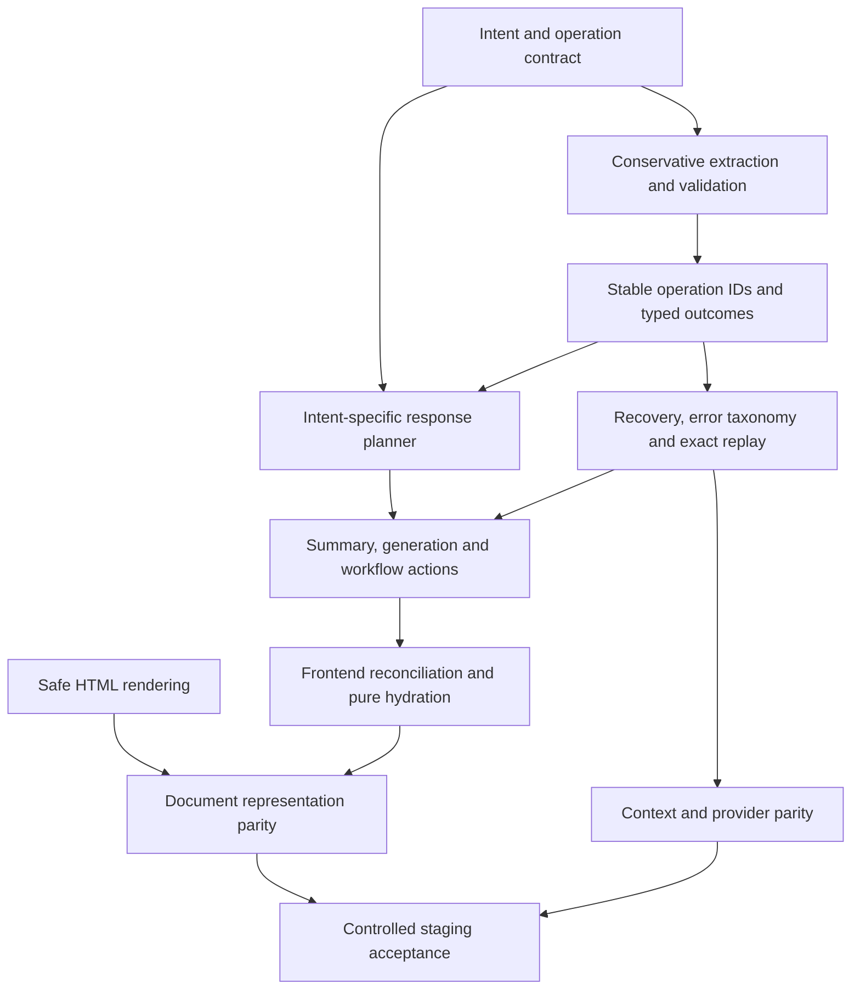

# DocCraft Chat Response Implementation Plan

Prepared 2026-10-13. **Planning only: no application fixes have been implemented.** This plan depends on review of [CHAT_RESPONSE_INTELLIGENCE_AUDIT.md](CHAT_RESPONSE_INTELLIGENCE_AUDIT.md) and uses test IDs from [CHAT_RESPONSE_TEST_SCENARIOS.md](CHAT_RESPONSE_TEST_SCENARIOS.md).

## Intended result

The assistant responds to the user's current intent, saves only validated supported information, explains rejected or ambiguous operations, and remains useful after required fields are complete. A correct model answer survives the backend/frontend pipeline. Retry and restoration preserve committed facts without duplicating billable items. Document preview/export preserve literal user data and exclude fabricated optional details.

Retain the existing frontend, gateway, Fastify chat service, shared contract, scoped MCP and Prisma repository. Keep Redis for capacity. Do not add AI agents, vector databases or a new orchestration framework to compensate for missing response planning.

## Priority and dependency order

Safety fixes in HTML rendering can proceed independently after approval. Intent, extraction, tool outcomes and response planning require coordinated contracts; replacing the generic completion sentence alone is insufficient. Each phase must add desired-behavior tests before its changes are considered complete.

## Phase 0 — Preserve the current baseline and make diagnosis possible

**Findings:** R14/R24/R25. **Priority:** P1; small coordinated foundation.

Record the reviewed working-tree baseline, preserve the earlier audit and implementation work, and add a versioned error/terminal schema with safe codes, phase, retryability, session/turn/request IDs and committed revision. Parse non-2xx bodies in the adapter and preserve safe upstream category/state at the gateway. Validate response/snapshot types at runtime. Add redacted structured failure logging before changing recovery behavior.

Likely files:

- `shared/chat-stream.mjs`, `shared/chat-stream.d.mts`
- `services/chat/src/routes/chat.routes.ts`
- `services/chat/src/services/groq.service.ts`, `mcp.service.ts`, `metrics.service.ts`
- `services/gateway/src/services/sseRelay.service.ts`
- `user-frontend/src/api/ai.ts`, `user-frontend/src/types/index.ts`

Acceptance: injected provider, tool, persistence, quota, authorization, incompatible-schema and transport failures are distinguishable end to end; no raw conversation/contact/bank values or credentials enter logs. Malformed successful snapshots fail at the parser boundary. T34/T35/T45/T46 pass.

For the original address incident, obtain an authorized redacted trace containing build version, session/turn/request IDs, pending field, lifecycle, provider/tool error category and committed revision. Do not request or export a full private transcript to identify the failing phase. The current ASCII pending-address sequence already succeeds in isolation; deployment/state evidence is necessary to identify that incident's actual cause.

## Phase 1 — Protect document rendering

**Findings:** R19 first; R18/R20 next. **Priority:** P0 for unsafe HTML; P1 for document integrity. Independent of intent implementation.

Escape text values before HTML interpolation. Treat supported markdown formatting as a separate allowlisted rendering operation. Replace production sample fallback values with absent-value handling; exclude editor placeholders from browser export. Resolve labels by document type before inserting user values, and remove whole-document/all-text regex rewriting of literal data.

Likely files:

- `user-frontend/src/utils/templateRenderer.ts`, `invoiceElements.ts`
- `user-frontend/src/pages/BuilderPage.tsx`
- `user-frontend/src/components/builder/DocumentPreview.tsx`, `TemplateSelector.tsx`
- `user-frontend/src/store/documentStore.ts`
- Server templates/`services/document/app/services/sidecar.py` only where parity fixtures show an actual discrepancy

Acceptance: harmless markup renders as text, unsafe attributes cannot reach HTML execution sinks, and missing optional contact/address data never becomes a sample address/email/phone in a real artifact. Company Invoice Solutions and item Invoice integration remain exact across all document types. T39–T41 pass for representative HTML, canvas and server templates, then expand to every shipped template whose renderer shares the affected pattern.

Risk: changing legacy HTML rendering can affect intentional rich-text formatting. Preserve only explicitly supported formatting through a safe parser; do not strip user facts at storage time. Canvas and server Jinja are distinct paths and need their own fixtures.

## Phase 2 — Establish current intent and safe extraction

**Findings:** R02–R05/R08/R10/R22. **Priority:** P1.

Introduce a small versioned intent/operation proposal, using the shared document contract:

- Intent kinds: provide, request field value, add, update/correct, clear/remove, question, summary/review, generate, change document type, clarify, temporary topic, return to field and authorized reuse.
- Targets: canonical field, stable item ID or explicit unresolved role/source.
- Candidates: source span/evidence, supported operation, uncertainty and unconsumed input.
- Pending conversation: requested action/field, existing-value context and cancellation state.

Keep deterministic parsing for genuinely unambiguous supported input. A parsed candidate alone must not suppress processing of other intents or unsupported syntax. Reject unrelated short messages as field answers. Add conservative conjunction/span boundaries, date parsing outcomes and explicit clear operations. Known address requests should acknowledge existing data and invite an update. Clear pending intent after a valid identical answer or cancellation, independently of changed[]; compute conflict precedence once.

Likely files:

- `shared/conversation-state.mjs`, `.d.mts`
- `shared/document-contract.json`, `document-contract.mjs`, `.d.mts`
- `services/chat/src/services/context.service.ts`
- `services/chat/src/routes/chat.routes.ts`
- `services/chat/src/services/mcp.service.ts`

Acceptance: T01–T04/T10–T11/T19–T26/T28–T31/T43 pass. The exact supplied address and Sri Lankan spelling are preserved without invented geography. `Tell me a joke` and `thanks` never become company/address facts. Unsupported date expressions reach semantic extraction or precise clarification. Multiple fields and a summary request in one turn are all processed.

Dependencies: error/outcome contract from Phase 0; response planner from Phase 4 needed for user-visible end-to-end acceptance. Decide weekday/relative anchor conventions before locking calendar assertions; do not silently invent a meaning for ambiguous “next Friday.”

## Phase 3 — Make committed operations and retries reliable

**Findings:** R07/R09/R11/R12/R15. **Priority:** P1.

Return per-operation committed/rejected/unchanged/conflicting/needs-value outcomes with stable IDs and revisions. Validate the projected whole item set and each changed component's relevant evidence before commit. Do not permit an inferred description change during a price-only correction. Replace raw JSON serialization hashes and item-count-derived IDs as the sole recovery identities.

Keep the short optimistic transaction and lease fencing. Persist enough operation/response checkpoints to recover after a tool commit without regenerating the same mutation. Replay the exact saved response for a successful turn; reconcile the current snapshot separately. Specify quota reservation identity/refund semantics for failed turns. Align gateway, queue and turn budgets, and check cancellation around context/storage work; do not extend one timeout to conceal an unbounded phase.

Likely files:

- `services/chat/src/services/conversation.repository.ts`
- `shared/conversation-state.mjs`, `shared/document-contract.mjs`
- `services/chat/src/services/mcp.service.ts`, `groq.service.ts`, `quotaClient.service.ts`
- `services/chat/src/routes/chat.routes.ts`
- `services/quota/src/services/quota.service.ts` and its controller/route only if idempotent reservation needs a cross-service API extension

Acceptance: T05–T07/T12–T14/T18/T28/T30/T32/T36 pass. One semantic operation produces one item regardless of key order or regenerated tool IDs. Invalid aggregate arrays are rejected before commit. Partial success is accurately reported. A cached retry preserves the original response without a second assistant row or unwanted quota reservation.

Risk: legacy operation hashes and item IDs already exist. Version metadata and support old records without reapplying known effects. The memory adapter does not prove PostgreSQL contention; run real concurrency tests only against an explicitly isolated disposable database after code review.

## Phase 4 — Implement one authoritative response planner

**Findings:** R01/R02/R06/R17. **Priority:** P1 for relevance; P2 for UI/stage completeness.

Plan according to the current intent and committed operation outcomes before deciding what the assistant says next. Determine data validity, canGenerate, conversation stage and pending turn in one snapshot function. Use deterministic grounded acknowledgements, summaries and totals; retain relevant provider wording for clarification or open questions after verifying factual claims. Provider adapters must expose final text or structured response-plan data instead of throwing it away. The backend selects and persists one approved response; the frontend renders it.

Emit completion wording for a readiness transition or explicit status query. After an address update, say the address was saved; after a summary request, summarize; after a question, answer it. Choose no next collection question when none is relevant. Handle multiple intents and rejected operations explicitly.

Likely files:

- `shared/conversation-state.mjs` (`planResponse`, `snapshot`) and types
- `services/chat/src/services/groq.service.ts`, `context.service.ts`
- `services/chat/src/routes/chat.routes.ts`
- `user-frontend/src/api/ai.ts`, `store/chatStore.ts`, `types/index.ts`
- `user-frontend/src/components/builder/ChatPanel.tsx`, `pages/BuilderPage.tsx`

Acceptance: T08/T10/T16–T18/T21/T24/T27/T38 pass. Correct answer text survives provider → planner → storage → SSE → parser → displayed transcript. A failed turn's stage/readiness matches restored history. Partial documents can be reviewed. No independent frontend question generator is introduced.

Risk: accepting free-form provider text verbatim can reintroduce false save claims. Treat text as a proposal constrained by committed outcomes; a model saying Saved cannot override a rejected tool operation. Sanitizing HTML is unrelated to this response-authority check.

## Phase 5 — Connect workflow actions and frontend restoration

**Findings:** R02/R13/R17/R21. **Priority:** P2, depends on Phases 2–4.

Route chat summary/review to committed state and render it in the active builder. Route generation to the existing document service or an explicit typed frontend action; distinguish queued from generated and persist artifact/job/revision identity. Add authorized document conversion/new-draft selection and company-detail reuse, clarifying ambiguous source rather than broad cross-session search.

Choose an explicit reopen/full-revision policy for finalized documents. Preserve artifact revisions. Add pure presentation hydration setters, reset all session-scoped document state, and fence template/accent async effects. Restoration must not write back merely to display a saved document.

Likely files:

- `services/chat/src/routes/chat.routes.ts`, `services/chat/src/services/session.service.ts`
- `services/chat/src/services/conversation.repository.ts`, `mcp.service.ts`
- `user-frontend/src/store/chatStore.ts`, `documentStore.ts`
- `user-frontend/src/components/builder/ChatPanel.tsx`, `DocumentPreview.tsx`
- `user-frontend/src/pages/BuilderPage.tsx`, `api/documents.ts`
- `services/document/app/routers/document.py`, `app/workers/pdf_worker.py` only for agreed artifact-status/idempotency integration

Acceptance: T09/T14–T15/T20/T22/T33/T38/T42 pass. Chat can trigger an authorized generation action once, show useful review, and continue after readiness. Loading a history entry has zero mutation side effects. Switching documents cannot redirect a prior template write or keep an unrelated documentId.

Risk: frontend template IDs currently map to server classic layout. Do not promise the generated server PDF has the same layout as browser export until that mapping is explicitly tested or changed. Do not mark the chat COMPLETED simply because a job was queued.

## Phase 6 — Context, alternate-provider parity and quality monitoring

**Findings:** R16/R23/R24. **Priority:** P2.

Retain structured state and bounded recent/older SQL retrieval. Exclude already-recent evidence before it exhausts the historical selection budget, preserve chronological source IDs, budget the full payload and avoid turning a context limit into an opaque retry. Store compact pending intent/correction provenance when needed; do not start by adding a memory framework.

Before activating Claude or changing model routing, align discovery/runtime guardrails, completion/error handling, response output and cancellation with Groq. Verify deployed model availability/configuration in controlled staging; source inspection alone cannot establish it.

Measure fulfilled-intent rate, response relevance, silently rejected operations, repeated irrelevant completion messages, incorrect saves, recoveries without duplicated effects and rendering/state disagreement. Use labeled synthetic fixtures and redacted IDs/statuses; baseline production rates were not measured in this audit.

Acceptance: T35/T37/T44/T45 pass and the existing auth/stream/revision tests remain green. Error-to-question conversion stays absent. Model-quality staging results are reported with sample sizes and categories instead of claiming all orchestration tests prove semantic accuracy.

## Regression strategy and release acceptance

The current baseline is 63 shared tests and 57 Vitest tests passing. The temporary audit suite verifies 24 current behaviors, including defects; invert those defect expectations into desired assertions as implementation proceeds. Document pytest currently cannot initialize due to missing Pygments components; establish an isolated repeatable test environment before claiming Python regression coverage. Do not use the live `test-chat.ts`/`test-mcp.ts` scripts to validate these changes.

Run checks scoped to changed phases, then run the complete existing chat/shared/gateway/frontend suite. Exercise parser fragmentation, tool transport, store reconciliation and rendering as separate isolated layers. Add component tests for Review/generation actions and pure hydration. Document router/queue tests must mock HTTP, storage, ORM and notifications. Broaden testing only for actual changed boundaries or unresolved concerns.

Release criteria:

1. Every Critical/High finding has passing desired-behavior regressions, and no known unsafe preview sink remains.
2. The exact four-turn item → currency → optional-address request → address submission persists and displays correctly in a controlled staging build.
3. All thirteen required intent classes have explicit supported behavior or a relevant clarification, including after readiness.
4. Assistant acknowledgements match committed operation outcomes; correct explanations/summaries are not overwritten.
5. Failed/retried turns preserve prior facts, do not duplicate items/jobs/reservations and provide actionable recovery categories.
6. Authoritative state is consistent on success, error, resume and document switch; frontend renders safe literal data without production samples.
7. Required/optional/conditional/computed-field semantics remain compatible across chat, preview and server generation.
8. Ownership, unique authenticated guests, lifecycle guards, revision checks, lease fencing and redacted analytics remain intact.

## Compatibility and review decisions

Version `_chat` and transport metadata; retain legacy slots/state/response fields until all clients migrate. Legacy aliases should normalize without silently overwriting confirmed values. Use the existing slot JSON where practical; do not introduce database migrations unless a reviewed constraint requires them. If migrations become necessary, prepare and review them separately; this audit authorizes none.

Review these product decisions before implementation: weekday/relative date conventions; how temporary topics are handled; what cancel/skip means for an existing optional value; document conversion versus new draft; authorized reuse source selection; generation confirmation/queued wording; and finalized/expired revision policy. These decisions can be documented with concrete fixtures while independent safety work proceeds after approval.

Current user instruction is audit only. The next action is review of these three reports; application changes remain pending explicit approval.
