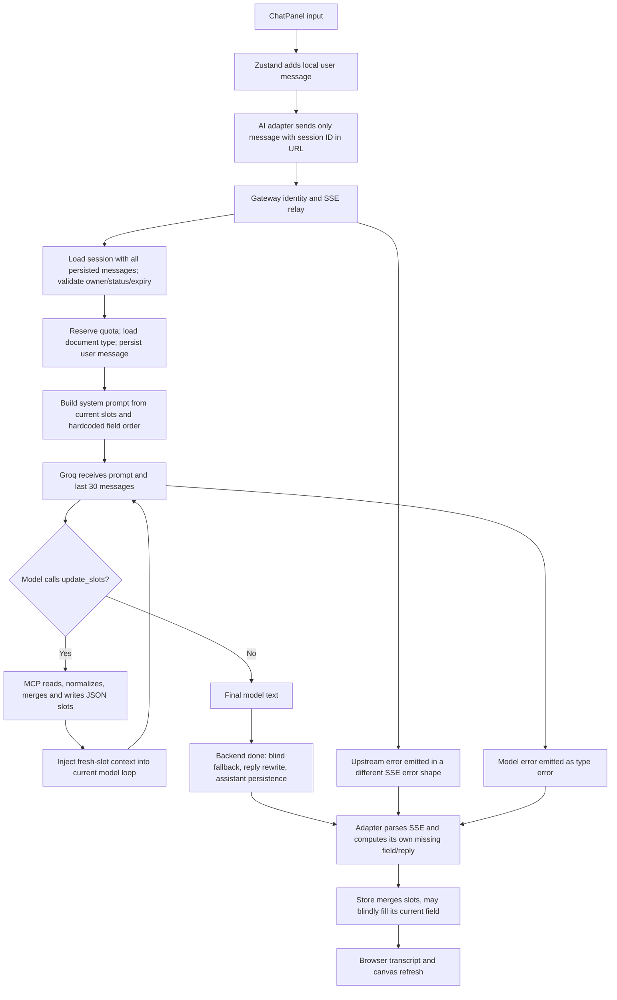

# Chat Service Intelligence Audit

Audit date: 2026-10-12. Scope: the current working tree, including existing uncommitted changes. Audit and documentation only; no application, prompt, configuration, schema, dependency, or database changes were made for this audit.

Evidence labels used throughout:

- **Verified — static:** behavior or a missing safeguard established by inspecting the executing code path. This does not mean its production frequency was measured.
- **Verified — isolated:** existing functions executed with synthetic values and mocked dependencies in memory, without network calls or database writes.
- **Conditional:** the implementation allows the outcome, but a particular model response, interleaving, deployment exposure, or outage is needed. Production occurrence is unverified.
- **Unverified:** requires runtime traces, an isolated integration environment, or deployment inspection.

No private conversation records, environment secret values, or provider credentials are reproduced. Existing end-to-end scripts were inspected but not run because they create/delete database records and invoke external AI services. Session-list endpoints were also not called: `SessionService.listSessions` performs deletion as part of listing.

## 1. Executive Summary

The chat service has a workable foundation: persisted messages, a session JSON slot map, ownership checks on the normal message endpoint, an isolated MCP server per model turn, and explicit prompt instructions to reuse collected values. Replacing the architecture is not justified by the evidence.

Its main weakness is inconsistent orchestration across the frontend, backend, and model. Three layers independently determine missing fields and rewrite replies. Their field order, alias handling, validation, and completion rules disagree. The system sometimes presents successful collection or a follow-up question even when retrieval, model execution, or persistence failed.

The strongest direct explanation for the reported repeated-business-name symptom is **failure being interpreted as missing information**. An isolated check of the real frontend parser showed that an SSE model error becomes a successful response containing empty slots and the business-name question. An isolated check of the real store then showed that it displays that question even while its own `collectedSlots.businessName` remains `SENYX Software`. This requires no speculative model forgetfulness.

Other confirmed defects can cause incorrect collection and apparent forgetting: the browser and server track different next fields; whole messages can be assigned to the next field without semantic extraction; restored sessions retain fields from the previously open session; alias recognition differs; context outside the last 30 messages disappears unless saved as slots; concurrent updates replace the same JSON object without version checks. Several outcomes are conditional on model behavior or timing and are labeled accordingly below.

There is also an independent **Critical context-isolation defect**: unauthenticated callers share `guest_user`, and history access does not consistently require an owner. Fix this before adding broader context reuse. A credential-shaped provider key is hardcoded in source defaults; its validity was not tested, and its value is omitted here.

Recommended order: protect identity boundaries; propagate failures accurately; establish one authoritative field/schema/state contract; remove blind field assignment; make updates and retries reliable; repair resume; then improve extraction, profile reuse, and bounded context retrieval. Prompts already say not to repeat questions. More such instructions alone will not fix these defects.

## 2. Current Architecture

### Components and source map

| Component | Actual responsibility | Evidence |
|---|---|---|
| Builder page | Starts document sessions and restores URL-selected sessions | [BuilderPage.tsx](user-frontend/src/pages/BuilderPage.tsx), lines 115–153, 880–890 |
| Chat panel | Input submission, history selection, loading UI | [ChatPanel.tsx](user-frontend/src/components/builder/ChatPanel.tsx), lines 181–198, 424–426 |
| Zustand chat store | Browser transcript, independent field progress, local fallback, resume | [chatStore.ts](user-frontend/src/store/chatStore.ts), lines 144–327, 437–524 |
| Browser AI adapter | REST/SSE calls; independent questions, aliases, response rewriting | [ai.ts](user-frontend/src/api/ai.ts), lines 28–174, 177–359 |
| Gateway | Soft authentication for chat; REST forwarding and SSE relay | [auth.middleware.ts](services/gateway/src/middleware/auth.middleware.ts), lines 90–138; [chat.routes.ts](services/gateway/src/routes/chat.routes.ts), lines 8–18; [sseRelay.service.ts](services/gateway/src/services/sseRelay.service.ts), lines 14–119 |
| Chat routes | Session/history retrieval, prompts, quota, provider invocation, final rewriting and persistence | [chat.routes.ts](services/chat/src/routes/chat.routes.ts), lines 273–345, 366–632, 639–741 |
| Session controller/service | Create, list, patch, ownership and 24-hour expiry | [session.controller.ts](services/chat/src/controllers/session.controller.ts), lines 35–145; [session.service.ts](services/chat/src/services/session.service.ts), lines 15–137, 179–233 |
| Active provider | Groq function-call loop, provider-model fallback, recent-message window | [groq.service.ts](services/chat/src/services/groq.service.ts), lines 20–302 |
| Alternate provider | Claude loop and deterministic local fallback; not invoked by the current message route | [claude.service.ts](services/chat/src/services/claude.service.ts), lines 37–113, 125–327 |
| MCP server | Normalize and merge slots; advertise document, correction and completion tools | [mcp.service.ts](services/chat/src/services/mcp.service.ts), lines 114–194, 202–439 |
| Database | Prisma/PostgreSQL session and message storage | [schema.prisma](services/chat/prisma/schema.prisma), lines 44–150; [db.service.ts](services/chat/src/services/db.service.ts), lines 1–9 |
| Redis | Rate limiting and global concurrency capacity; not conversation memory | [concurrency.ts](services/chat/src/middleware/concurrency.ts), lines 17–65; [redis.service.ts](services/chat/src/services/redis.service.ts), lines 5–22 |
| Metrics/analytics | Capacity metrics and fire-and-forget model/tool spans | [metrics.service.ts](services/chat/src/services/metrics.service.ts), lines 13–44; [posthogTracking.service.ts](services/chat/src/services/posthogTracking.service.ts), lines 14–71 |

### Actual message lifecycle

Important distinctions:

- The store passes `conversation_history` and `current_field` to the adapter, but `sendChatMessage` transmits only `{ message }` (`ai.ts:239`). This is **not inherently a bug**: the server retrieves its own history (`chat.routes.ts:378–380,469–473`). It becomes a problem when browser-only fields/messages are treated as authoritative elsewhere.
- Groq is always used by the current message handler (`chat.routes.ts:510`). The calculated Claude model/plan ceiling at lines 453–463 is not passed into that call. There are no cooperating AI agents in this active flow.
- Groq retries provider models with the same `conversationHistory`; ordinary provider fallback does **not** discard that history (`groq.service.ts:93–119`).
- `ChatSession.slots` stores collected data, `ChatMessage` stores plain transcript text, and tool results live in the current loop. The inspected chat runtime does not write `ToolExecution` or `AIUsage` records despite those models existing.
- A history response returns raw messages and slots, not a generated conversation summary (`chat.routes.ts:653–660`).

## 3. Observed and Potential Failure Scenarios

### Repeated business name: verified application-generated scenario

1. A session/store already has `businessName: "SENYX Software"`.
2. A later message encounters a model error, interrupted stream, or upstream failure that supplies no successful `done` slots.
3. `sendChatMessage` starts with an empty slot object, logs `type: error` without rejecting, and uses that empty object to compute a business-name question (`ai.ts:256–257,283–287,322–340`). Gateway errors do not even have the `type` property this parser checks.
4. The store merges those empty slots with its existing known name but retains the adapter's nonempty question (`chatStore.ts:282–305`).
5. The browser displays **“What is your business or company name?”** while the name is still locally known.

**Isolated result:** with synthetic dependencies, the real store returned `slots.businessName = "SENYX Software"`, `currentField = "clientName"`, and assistant text `"What is your business or company name?"`. Repeating the outage path can repeat the same question. The production frequency and initiating outage remain unverified.

Expected: “I couldn't finish that response. Your business name is still saved. Please retry.” A retry must reconcile the existing turn rather than ask the user for already known data or create a duplicate message.

### Natural-language business information: conditional model/tool scenario

Input: **“My business is SENYX Software, and we specialize in software development, AI services, and production.”**

The model is instructed to extract all fields in one `update_slots` call. If it does so correctly, `businessName` can persist and be reused. However, the route's deterministic fallback validates the **whole message** as a name; this exact 102-character example fails the 80-character limit (`chat.routes.ts:215–218,543`). The name remains absent if the model fails to save it. Services have no dedicated canonical business-services field in the active schema/prompt, so durable retention of that detail is not guaranteed. It should not automatically become billable line items with invented prices.

Expected: extract `SENYX Software`; retain the service description in task-relevant context; ask the next genuinely missing field. Saving these two facts is different from fabricating an invoice item.

### Other scenarios

| Scenario | Evidence status | Current consequence | Expected behavior |
|---|---|---|---|
| Model acknowledges “business name” while asking for the next field | Verified rewrite condition; model wording conditional | Server replaces even a valid acknowledgement/explanation. Browser can independently replace responses when it recognizes a name that the server has not canonicalized | One authoritative next-field decision; preserve correct acknowledgements |
| User answers a displayed client-name question while server still lacks sender address | Verified conflicting order; incorrect assignment conditional on no tool save | Server may store the client name as `senderAddress` | Use persisted question intent plus semantic extraction |
| Answer uses `companyName`, `senderName` or buyer/vendor aliases | Verified helper discrepancy | Browser considers it present while server canonical field remains missing | Normalize once under shared rules |
| Legitimate name is “Broadway Software”, “Roadrunner Labs” or “Hello World Studio” | Verified isolated validator result | Backend fallback rejects each; repeated collection remains possible if model does not save it | Validate extracted names without conversational substring false positives |
| Old facts occur outside the last 30 messages | Verified truncation | Unsaved preferences, services and corrections are unavailable to the model | Preserve relevant facts/state and retrieve older evidence selectively |
| Resume incomplete session after another draft | Verified isolated store result | Old `currentField`, pending fields/correction and summary survive; readiness is true | Recompute/reset all workflow state from restored session |
| Retry a correction to an existing line item | Verified merge logic; concrete model payload conditional | New priced item appends instead of replacing the previous item | Explicit add/update/remove operation with stable item identity |
| Two requests write different slots concurrently | Verified unprotected read/replace pattern; occurrence conditional | Last writer can erase other committed fields; later questions repeat | Serialize per session or detect/rebase conflicting revisions |
| User types a business name into the canvas | Verified one-way synchronization | Model cannot see it; next AI refresh strips data-element text override | Persist semantic data edits separately from presentation edits |
| Browser refresh or document-type switch | Verified restore/start behavior | Active pointer is not persisted; type switch starts a new blank session | Explicit resume identity; scoped reuse of confirmed business facts |
| User logs out then another account opens builder in the same SPA | Verified missing store reset; UI exposure conditional | Previous in-memory transcript can remain | Clear or namespace stores on identity change |
| Expired/completed session selected from history | Verified backend rejection and frontend readiness mismatch | UI offers continuation that backend rejects; gateway/parser may turn rejection into another collection question | Surface lifecycle state and provide an explicit recovery path |

## 4. Root Cause Analysis

The finding IDs below link root causes to severity, recommendations and tests.

### F01 — Errors become collection questions

**Verified — isolated and static.** `ai.ts:256–340` does not require successful completion. `type: error` is only logged; parse errors are swallowed; an EOF without `done` still returns `status: 'ok'`/`'complete'`. Empty returned slots trigger a business-name question. `chatStore.ts:282–305` retains that question after merging existing slots. The gateway flushes HTTP headers before the upstream request and writes `event: error` with `{code,status}` instead of `{type:'error'}` (`sseRelay.service.ts:29–30,84–95,108–116`). The browser ignores those error shapes. A genuine retrieval/status/model failure is therefore misreported as information being missing.

### F02 — Multiple incompatible workflow authorities

**Verified — isolated and static.** Server invoice order is business name → sender address → sender email → sender phone → client name (`chat.routes.ts:167`). Browser order is business name → client name → line items → reference/date/email/address (`ai.ts:161`). The session adapter invents six required fields (`ai.ts:214–223`); the demo uses seven (`chatStore.ts:39`); the server walks 15 fields, or 13 for receipts. `buildSystemPrompt` accepts `slotSchema` but does not use it for required-field decisions (`chat.routes.ts:273–345`). `taxRate:null` counts as complete in one browser helper but missing on the server; `lineItems:[]` is treated oppositely. The store records only the next field as `pendingRequired`, rather than the full missing set. No layer persists the identity of the question actually displayed.

### F03 — Blind fallback collection occurs after model generation

**Verified — static; erroneous values are conditional.** The prompt is built from pre-turn slots and includes a fixed “YOUR NEXT QUESTION” (`chat.routes.ts:475–480,309`). Model extraction/tool use is optional in practice (`groq.service.ts:104–106`). Only after the model has generated its answer does the route assign the entire message to `targetFieldBeforeTurn` (`chat.routes.ts:505–550`). That target uses only `=== undefined`, unlike later missing checks, so `null` or empty-string fields are skipped here. The browser separately assigns the entire message to its own `currentField` (`chatStore.ts:281–289`) without persisting that assignment to the server. Generic text fields pass permissive validation. A short unrelated answer can become an address, date, subject or item string; a long valid multi-field answer can remain unsaved. The fallback attempts to hide missed extraction rather than fix it.

### F04 — Alias, validation and skip rules differ

**Verified — isolated and static.** Server `normalizeSlotMap` maps `company_name` but leaves `companyName`, `senderName`, `buyerName`, `vendorName` and several browser-recognized aliases unchanged (`mcp.service.ts:116–138`; `ai.ts:122–139`). An isolated check established `hasSlotValue('businessName', {companyName:'SENYX Software'}) === true`, while server normalization kept only `companyName`. Alias collisions are last-write-wins based on input property order, without conflict detection. Backend name rejection matches `road`/`phone`/`street` as substrings and rejects greeting prefixes; all three legitimate test names above failed (`chat.routes.ts:193–218`). Optional emails/phones advertised as skippable still fail fallback validators for `skip`; empty values remain missing in next-question logic. MCP tool writes bypass these semantic validators entirely.

### F05 — Repetition suppression rewrites meaning, not just questions

**Verified — static.** Server suppression triggers whenever saved `businessName` exists and response text mentions “business name” or “business or company name” (`chat.routes.ts:558–565`), including a correct acknowledgement. Browser suppression runs the same broad pattern and uses a different field order (`ai.ts:326–330`). Neither checks whether the text is actually a repeated question, and neither protects other fields. A correction explanation can be replaced with generic “recorded” text. If a model says “company name”, “agency name” or “store name” without the matching phrase, repetition is not caught. This mechanism masks symptoms and can itself change the question users answer.

### F06 — Context truncation without durable coverage

**Verified — static.** The route loads all persisted messages, but Groq passes only `messages.slice(-30)` (`groq.service.ts:74–80`); Claude does the same (`claude.service.ts:155–160`). There is no implemented conversation summarization, token budgeting, or selective retrieval of older facts. Canonical saved slots remain visible in the system prompt, so truncation alone does **not** explain forgetting a correctly saved business name. It does explain loss of facts that never became slots, unresolved corrections, or constraints omitted from those slots. Reading the entire database transcript first also increases database/serialization work without increasing model-visible history.

### F07 — Slot writes and turns are not concurrency-safe or idempotent

**Verified — static; lost-update timing conditional.** MCP reads the slot object, shallow-merges, then replaces it (`mcp.service.ts:326–378`). Session PATCH uses the same pattern (`session.service.ts:179–187`); route fallback also replaces a previously read object (`chat.routes.ts:536–550`). No revision condition or transaction joins these writes. The Redis limiter controls global capacity, not session ordering (`concurrency.ts:17–19`). Message payloads have no client turn ID (`chat.routes.ts:42–44`). Parallel snapshots can omit each other's messages and fields; retries append duplicate USER messages. Tool effects may persist before an aborted turn's assistant response, with no durable turn checkpoint.

### F08 — Restore and recovery do not reconstruct workflow state

**Verified — isolated and static.** `loadSessionFromDb` restores messages/slots but sets `readyToGenerate:true` unconditionally and does not reset/recompute `currentField`, pending lists, pending correction, schema summary, existing summary or demo index (`chatStore.ts:437–482`). An isolated restore of an ACTIVE session with only a business name preserved the previous draft's `dueDate` target, pending correction and old summary. Browser persistence intentionally omits session ID/messages/slots (`chatStore.ts:512–522`); Builder restores only when URL session parameters exist (`BuilderPage.tsx:115–129`). Starting a session does not add its ID to the URL in the inspected start flow, and clicking a history row loads it without updating the URL (`ChatPanel.tsx:424–426`). Sessions have a fixed 24-hour expiry that is not refreshed on messages (`session.service.ts:71`; `chat.routes.ts:395–397`). New document-type selection creates a new empty session rather than migrating state.

### F09 — No profile retrieval or scoped cross-session business reuse

**Verified — static; missing product capability.** Chat only retrieves the current session and document type. It does not query the Auth profile, another business record, or earlier sessions before asking. Auth's `User` schema has identity, name, timezone and plan but no business-name/services/address model (`services/auth/prisma/schema.prisma:15–45`). `users.ts:11–23` exposes that personal profile, and the gateway forwards user email, but `buildSystemPrompt` receives neither. No dedicated user-business profile retrieval was found in the inspected schemas/runtime. This is not evidence that an existing business profile is being fetched incorrectly. Do not substitute a person's full name or login email for business identity without confirmation. Onboarding/registration are separate auth forms, not an implemented chat onboarding agent.

### F10 — Unqualified overwrites and append-only line-item corrections

**Verified — static.** `UpdateSlotsSchema` accepts arbitrary keys/values and optional slots (`mcp.service.ts:16–19`). Incoming scalar data shallow-overwrites existing data, including null/empty values, without provenance, confidence or correction intent (`mcp.service.ts:347–371`). Names are title-cased automatically, changing user spelling/casing. Line items append unless an existing description and total exactly match (`mcp.service.ts:359–367`); changing price/quantity is therefore not an update or deletion. The code cannot distinguish a confirmed fact from an inferred value or a retry from a new item. An uncertain tool result can erase a previously reliable business name and make it missing again.

### F11 — False success and incomplete failure recovery

**Verified — static.** Backend fallback slot persistence swallows a write failure but still uses its locally modified map in a success message and `done` payload (`chat.routes.ts:543–550,558–605`). The next request reloads the old database state. Fresh-slot retrieval errors inside Groq are swallowed (`groq.service.ts:218–235`). Its 10-iteration limit emits `done` rather than an explicit incomplete/error outcome (`groq.service.ts:300–301`), allowing the route fallback to invent progress. Active Groq provider and tool calls use the disconnect signal without configured per-call deadlines (`groq.service.ts:111–118,192–199`), leaving slow failures dependent on external completion/disconnect. Session creation catches all errors and creates a local synthetic `sess_*` ID even outside demo mode (`chatStore.ts:147–172,200–202`), but subsequent non-demo sends still go to the backend and cannot use that ID. Initial database/history lookup failures throw rather than returning an empty history; the dangerous false-missing behavior arises downstream in the gateway/parser, not from a fabricated empty server history.

### F12 — Conversation identity and ownership are insufficiently isolated

**Verified — static; deployment reachability unverified.** Gateway missing/invalid chat tokens are mapped to shared `guest_user` (`auth.middleware.ts:99–103,133–138`). Session create/list use that identity by default, so independent unauthenticated visitors share a namespace. History authorization is conditional on a supplied header and exempts sessions belonging to `guest_user` (`chat.routes.ts:649–650`); direct missing-header requests can bypass the owner check. List controller accepts a query identity when header identity is absent (`session.controller.ts:79–90`). Server authentication hook only runs when an Authorization header exists and `x-user-id` does not (`server.ts:71–76`); caller-provided headers are trusted. External MCP checks header presence but does not bind transport entries/tools to their owner (`mcp.routes.ts:17–29,53–69`; `mcp.service.ts:295–434`). The active internal Groq tool path does have per-turn session binding and `validateToolCall`; those protections do not cover raw external MCP calls. A UUID is not authorization. No attempt was made to access other users' real data.

### F13 — Completion, review, correction and schema contracts are disconnected

**Verified — static.** Groq exposes only `update_slots`; its fixed function properties omit `lineItems`, receipt payment/reference fields and currency even though prompt/schema instructions refer to them (`groq.service.ts:36–72`; `chat.routes.ts:95–108,319–336`). Additional properties are not explicitly forbidden, so this is incomplete tool guidance, not proof those fields cannot be submitted. Completion inference counts object keys against schema length, not valid required fields (`chat.routes.ts:453–455`), and the computed model decision is unused. The HTTP complete endpoint permits marking incomplete or non-ACTIVE sessions complete, and Groq cannot call it. The browser marks collection complete independently. `getSummary` usually receives a raw-history shape but `fetchSummary` reads `summary`, `collected_data`, and `ready_to_generate` fields that this route does not send (`ai.ts:355–359`; `chatStore.ts:424–429`). Legacy `/ai/missing-fields`, `/ai/correction/confirm`, and `/ai/summary` requests have no matching handlers in the inspected chat registration. They need contract repair, not another independent workflow.

### F14 — Capacity permits are not released on all rejected turns

**Verified — static; capacity exhaustion frequency unverified.** The message preHandler acquires a global permit before validation/history/status/quota checks. Its release is called in the flagged-message path and the streaming `finally` only (`chat.routes.ts:366,433–435,629–631`). Early 400/403/404/409/410 returns and exceptions before that `try` do not call it. Lock expiry/refresh behavior depends on the installed semaphore implementation, but route-level cleanup is demonstrably missing. Retries and validation failures can degrade capacity and increase error-driven repetition. The shared singleton semaphore's overlapping acquire/release behavior should also be checked with a runtime stress test rather than assumed correct.

### F15 — Late responses can mutate a different active conversation

**Verified — static; interleaving conditional.** `sendMessage` snapshots the store, awaits the request, then commits snapshot messages and slots without verifying the active session still matches (`chatStore.ts:205–212,273–321`). History selection is available as another asynchronous action; restore likewise has no request-generation guard. A slow response from session A can overwrite transcript/fields after session B was selected. Normal panel submission prevents a second message while `isLoading` (`ChatPanel.tsx:183,236`), which reduces double clicks in that panel, but the store itself has no send guard and tabs/API requests remain concurrent. Logout clears auth state, not chat/document stores (`authStore.ts:144–159`; `Navbar.tsx:65–70`), creating another identity-change boundary requiring cleanup.

### F16 — Canvas data corrections are not model context

**Verified — static.** Canvas `updateElement`/`updateElements` only update rendering state and overrides (`documentStore.ts:734–769`). Chat refresh consumes collected slots, then removes text overrides from sender/client/header/item/meta elements (`documentStore.ts:855–877`). There is no semantic slot PATCH in these editing methods. A corrected company name may appear on screen, remain absent/old in chat state, and disappear on the next refresh. Presentation changes should remain local where appropriate; semantic data edits require an explicit shared update path.

### F17 — Security and privacy gaps undermine trustworthy context

**Verified — static.** Provider configuration and Groq fallback contain a hardcoded credential-shaped value (`config/env.ts:25`; `groq.service.ts:28`). Its validity/ownership was not tested. Tool spans send complete input/output to Analytics (`posthogTracking.service.ts:62–70`); `update_slots` returns the full updated session (`mcp.service.ts:379–380`), potentially including business contact/bank data. Confirm actual analytics retention/access policy before expanding logged context. Flagged injection messages are persisted, but next-turn history construction does not exclude `flaggedPromptInjection` (`chat.routes.ts:413–421,469–472`); the assertion that they never reach a model is only true on the flagged turn. Chunk sanitation is applied to streamed text but not the final assistant database content or rewritten final token (`chat.routes.ts:523–526,595–603`). This causes differing stored/displayed representations. These are adjacent trust defects, not proof they caused the user's specific repeated question.

### F18 — Normalization has financial/date edge cases

**Verified — static.** Relative date normalization uses a previously encountered `result.issueDate`; input property order affects the reference, and the same relative parser is applied to `issueDate` and `dueDate` (`mcp.service.ts:136–145`). Relative intent is lost once converted to an absolute date; whether an issue-date correction should also shift the due date needs an explicit policy. Currency and symbol share normalization that can overwrite `currency` with a symbol string (`mcp.service.ts:146–148,168`). Item normalization supplies default quantity, zero price, and a generic description rather than marking uncertainty (`mcp.service.ts:150–165`). These values can appear “filled” while still requiring validation; repeated or unnecessary clarifications are one possible user consequence. They also present document accuracy risks independent of context retention.

### F19 — Observability and existing tests do not detect intelligence regressions

**Verified — static.** Existing route tests exercise session CRUD, not repeated-question/model-turn behavior. One still expects UUID validation although the controller accepts any nonempty document type (`routes/__tests__/chat.routes.test.ts:57–70`; `session.controller.ts:6–10`). Session tests mock listing without covering its current purge path (`services/__tests__/session.service.test.ts:24–27,57–61`). `test-chat.ts` contains assumptions about Claude/auth and mutates live-configured data. Prometheus covers capacity and Claude timings, not context availability or field reuse; active Groq spans have useful per-turn trace IDs but no durable workflow checkpoints or repetition counters. There is no evidence of a baseline repeated-question rate.

## 5. Conversation Context and Memory Audit

| Question | Audit result |
|---|---|
| Are previous messages included? | Yes: persisted transcript is loaded in chronological order, current input appended once in that request snapshot, then last 30 messages sent to Groq. Frontend history is not sent. |
| Is history overwritten? | Normal message persistence appends records. Frontend snapshot commits can overwrite the visible transcript under concurrent/switching actions; no systematic DB transcript overwrite was found. |
| Is structured context available? | Yes, `ChatSession.slots` is normalized into the system prompt. It is a plain value map, not a confidence/provenance/workflow map. |
| Is semantic extraction implemented? | Model-driven `update_slots` is instructed, but not guaranteed or semantically validated. Deterministic fallback is whole-message assignment, not natural-language entity extraction. |
| Can one message supply several answers? | Prompt says yes; MCP accepts multiple keys. If the model does not issue the tool call, only one fallback target is attempted. |
| Are summaries reliable? | No implemented model-history summary. Browser summary method usually receives raw history with incompatible fields. |
| Does memory cross sessions? | No automatic business fact reuse. Database sessions retain data, but browser starts/resumes/type-switches are inconsistent. |
| Are confirmed and inferred values distinguished? | No. No source, confidence, confirmation, correction intent or field-level revision is persisted by the active flow. |
| Is an answer pending? | `currentField` is local and computed under browser rules; there is no authoritative persisted pending question/clarification state. |
| Are conflicts resolved? | Scalar last-write-wins and heuristic item append; no explicit resolution policy. |
| Is task completion tracked? | Database ACTIVE/COMPLETED/ABANDONED/EXPIRED states exist, but readiness, field completeness, and endpoint transitions disagree. |
| Does Redis hold memory? | No: concurrency/rate-limit infrastructure. Adding Redis memory is not necessary to resolve the identified problems. |
| Are user, tenant, workspace and business scopes represented? | Sessions have `userId`; no tenant/workspace/business key in chat schema. This is acceptable for a single-user document scope, insufficient for automatic multi-business reuse without explicit selection. |

Existing PostgreSQL/Prisma storage can support reliable conversation and structured task context. Start by repairing its usage. Any small metadata extension should be justified by provenance, revision, skip/uncertainty, or turn-recovery requirements; a vector database or general memory framework is not indicated.

## 6. Prompt and AI Orchestration Audit

- **Useful existing instructions:** reuse collected fields, save updates, extract all fields in one call, acknowledge the save, and ask one next missing field (`chat.routes.ts:302–317`). They are already explicit and should not be mistaken for absent safeguards.
- **Contradiction within a turn:** precomputed next question can refer to the field the current message just supplies. The later Groq context update lists fresh filled values but leaves the original missing list/question in the older system prompt (`groq.service.ts:216–235`). Behavior depends on model interpretation. Recompute the next question after validated extraction; do not strengthen contradictory wording.
- **Required/optional conflict:** optional fields are included in the same hardcoded walk; skip is offered without an authoritative skipped state. The document's actual `slotSchema` does not control that walk.
- **Tool guidance drift:** MCP discovery runs, but Groq uses its own hardcoded schema rather than the discovered schema. Missing `lineItems`/receipt/currency guidance should be repaired with the same canonical definitions that drive completeness.
- **Model configuration disconnect:** calculated Claude routing/caps are unused on the active Groq path. Alternate Claude/local fallbacks are not current root causes. Their blind local collection and invented item price would be unsafe to activate as recovery without redesign (`claude.service.ts:70–87`). No new agent is required.
- **Retries:** model fallbacks keep the in-turn conversation. Tool executions and result messages are retained inside that loop, but not replayable across requests. Empty-response fallback adds a synthetic user instruction with no tools and higher temperature (`groq.service.ts:267–290`), so it can generate text without repairing extraction. Iteration exhaustion is mislabeled done.
- **Timeouts:** Groq fetches and tool calls use the supplied disconnect signal, without applying the configured Claude/MCP per-call timeouts (`groq.service.ts:111–118,192–199`). The Claude path combines those timeouts, but is inactive. A bounded turn/provider/tool deadline is needed for the active path.
- **Question detection:** phrase replacement is neither field-aware nor question-aware. Prefer backend field-intent validation against authoritative state and preserve valid acknowledgements/correction explanations.
- **Context trust:** values are inserted in a system string using JSON formatting without explicit per-source trust metadata; flagged text returns through later history. Keep user data clearly delimited as data and filter policy-rejected content consistently. Specific exploitation was not tested.

## 7. Data Flow and Integration Audit

### Where representations diverge

| Boundary | Reliable element | Failure mechanism | Finding |
|---|---|---|---|
| Input → browser store | Immediate user transcript entry | Failure leaves local-only entry; retry has no ID | F01, F07 |
| Store → HTTP payload | Session ID is in URL | Local history/current field/locally guessed slots are dropped | F02, F03 |
| Gateway → service | Authenticated identity forwarded | Shared anonymous identity, inconsistent external error contract | F01, F12 |
| DB → prompt | Current session/messages/slots retrieved | Snapshot may precede another turn; no profile retrieval; schema ignored | F02, F07, F09 |
| History → model | Last 30 text messages | Older unsaved details unavailable; no token/relevance budget | F06 |
| Model → MCP | Active session binding and allowed-tool check | Arbitrary slot values, no provenance, read/replace races | F07, F10 |
| MCP → model | Fresh collected fields injected | Refresh errors swallowed; older next-question instruction stays | F03, F11 |
| Final result → DB | Assistant text stored after done | Silent fallback write errors; no transactional turn record | F11 |
| SSE → browser | Tokens and done slots parsed | Error shapes ignored; success not required; whole stream buffered before store update | F01 |
| Adapter → store | Returned slots merge | Second missing-field policy/whole-message assignment; stale snapshot | F02, F03, F15 |
| Store ↔ canvas | Slot-driven preview | Data edits flow only to rendering overrides | F16 |
| DB → resumed browser | Messages and slots restored | Incomplete restoration and unconditional readiness | F08, F13 |

Messages order only by `createdAt`; no monotonic turn sequence or explicit reply-to linkage is stored. Equal timestamps and concurrent turns should be tested rather than assumed to produce a dependable user/assistant pairing.

### Error and recovery behavior

| Failure | Current behavior | Audit conclusion |
|---|---|---|
| Initial DB/history lookup fails | Throws before streaming try/finally | No automatic empty-history model call, but capacity cleanup and downstream failure signaling are deficient |
| Tool write fails | MCP returns `isError:true` and error text to model | Model can continue; success claims are not validated against committed state |
| Route fallback write fails | Swallowed; local map still sent as saved | False durable-memory claim |
| Fresh-state refresh fails | Silently ignored inside Groq | Model may proceed with old context |
| Provider fails/rate-limits | Tries listed models with same history, then error event | Frontend error handling turns outage into collection question |
| Provider hangs | No active-path configured deadline | Request remains pending until disconnect or provider completion |
| Tool loop hits limit | Done rather than explicit incomplete | Backend can synthesize success and next question |
| Client disconnects | Abort wiring and resource close paths exist | Tool state may commit without assistant persistence; correct close-event timing needs runtime validation |
| Session expires | Message endpoint returns 410 | Browser restore does not account for this; gateway loses clear HTTP failure semantics |
| Session-start request fails | Fake local session ID outside demo | Future real sends use a nonexistent session |
| Session list fails | Adapter returns `[]`; store catches silently | “No history” can mean unavailable history |
| User changes an earlier answer | Scalar tool overwrites or line item appends | No validated correction/conflict policy |

The gateway and chat attach disconnect handling to request `close` events (`sseRelay.service.ts:70`; `chat.routes.ts:498`; `proxyClient.service.ts:76`). Whether these fire on request completion versus actual downstream disconnect in this runtime must be measured with an isolated delayed-response test. Premature abort is a **hypothesis**, not a verified production bug.

## 8. Severity-Ranked Findings

Confidence concerns the code conclusion, not frequency. Critical means an identity boundary can expose or corrupt another context. High means a core conversation can lose facts, ask false questions, falsely acknowledge saves, or fail to recover. Medium means a narrower workflow, configuration, or diagnosis gap. Low is reserved for maintenance issues without demonstrated material impact; no separate Low finding is needed merely to populate every level.

| ID | Severity | Evidence and affected components | User impact and severity reasoning | Confidence |
|---|---|---|---|---|
| F12 | **Critical** | Gateway auth; chat history/list; direct/external MCP identity checks | Cross-user/shared-guest context access violates privacy and the basis for safe reuse; exploit reachability needs deployment confirmation | High static; exposure unverified |
| F01 | **High** | `ai.ts:256–340`, `chatStore.ts:282–305`, `sseRelay.service.ts:84–116`; isolated parser/store checks | Directly produces repeated business-name requests while the answer is known | High, isolated |
| F02 | **High** | `chat.routes.ts:167,282–288`, `ai.ts:119–174,214–223`, store progress | Conflicting questions/completeness affect every document turn | High, isolated/static |
| F03 | **High** | `chat.routes.ts:505–550`, `chatStore.ts:287–289` | Whole-message assignment corrupts task data and cannot reliably retain multi-field answers | High static; erroneous-turn occurrence conditional |
| F07 | **High** | MCP/session/route read-and-replace writes; global limiter | Concurrent turns/retries can erase committed facts and duplicate actions | High pattern confidence; frequency unverified |
| F08 | **High** | Store restore/persistence; Builder resume; fixed expiry | Resumed conversations have stale questions or false readiness | High, isolated/static |
| F10 | **High** | `mcp.service.ts:16–19,347–378` | Uncertain values overwrite facts; corrections can duplicate monetary items | High static |
| F11 | **High** | Route swallowed write failure; Groq exhaustion; fake session fallback | Assistant claims memory that never persisted; repeated re-entry cannot fix infrastructure failure | High static |
| F14 | **High** | Permit acquired before route early returns | Rejected turns can reduce availability and cause outage/retry loops | High cleanup conclusion; operational size unverified |
| F15 | **High** | Store snapshot commits; no session/request revision guard or logout chat reset | Wrong-session transcript/data can appear after switching or identity changes | High static; interleaving unverified |
| F17 | **High** | Hardcoded credential-shaped source default; flagged-history replay; raw tool analytics | Secret handling and context-trust/privacy defects justify priority independent of repeat symptom | High static; credential validity/retention unverified |
| F04 | **Medium** | Server/browser alias/validation/skip helpers; isolated examples | Known alias fields and legitimate names can be treated as missing; conditional on extraction path | High, isolated/static |
| F05 | **Medium** | Server/browser phrase rewrites | Correct acknowledgements/corrections are replaced, while many actual repeats escape detection | High static |
| F06 | **Medium** | Both providers `slice(-30)` | Long-conversation unsaved facts lost; correctly saved slots still survive | High static; practical prevalence unverified |
| F09 | **Medium** | Chat prompt arguments, Auth User schema, profile API | Repeated onboarding across new documents; existing product lacks scoped business profile reuse | High within inspected source |
| F13 | **Medium** | Hardcoded Groq properties; raw-summary contract; missing legacy handlers | Review, correction, receipt-specific collection and readiness disagree | High static |
| F16 | **Medium** | Canvas update/refresh methods | Visible corrections are unavailable to the model and can be replaced | High static |
| F18 | **Medium** | Slot/date/currency/item normalization | Incorrect dates/totals and placeholder values look complete; document accuracy risk | High static; exact output depends on input |
| F19 | **Medium** | Existing test coverage and metrics | Recurrences cannot be measured or prevented reliably | High static |

## 9. Recommendations

Effort estimates are relative, not schedules: **Small** = localized contract/cleanup; **Moderate** = coordinated layers and tests; **Large** = state/turn lifecycle work. Do not implement during this audit.

### Immediate fixes within the current architecture

| Findings | Recommended change and why | Expected improvement | Complexity | Risks/trade-offs and dependencies |
|---|---|---|---|---|
| F12 | Enforce authenticated or uniquely signed guest identity on every session operation. Check owner even without headers; validate the trusted gateway boundary; bind external MCP transport/tool context to identity/session | Private, correctly scoped history and state | Moderate | Preserve legitimate guest usage; inventory direct callers and guest migration. Prerequisite for cross-session reuse |
| F01, F11 | Adopt one SSE success/error contract; require successful terminal completion before returning success; propagate upstream status details safely; represent partial/failed turns explicitly. Preserve known context on failure; apply bounded deadlines to active provider/tool calls | Stops the reproduced repeated-name path; distinguishes outage from missing data; bounds stalled turns | Small–Moderate | Gateway may need to defer header flush or translate errors consistently; frontend must handle partial content; timed-out tool effects require reconciliation |
| F14 | Release permits from a guaranteed response/error/disconnect lifecycle path, including pre-stream rejection; audit singleton semaphore behavior | Reliable capacity after validation/retry errors | Small–Moderate | Avoid double release; verify ownership of each acquired permit |
| F02, F04, F13 | Define one document-type field contract for canonical keys/aliases, required/optional/computed fields, semantic validation, skip states and question intent; backend returns complete missing lists and next action | Browser/model agree on available facts and next question | Moderate | Existing stored aliases need normalization with conflict handling; receipt/purchase-order differences need preserved roles |
| F03, F11 | Remove blind fallback guesses as authoritative facts. Extract/validate candidate fields before planning the answer; acknowledge only committed changes. Use deterministic parsing only when unambiguous | Accurate multi-field collection; no phantom saved values | Moderate | May increase explicit clarification on ambiguous input; depends on authoritative field/state contract |
| F05 | Replace broad business-name regex rewriting with field-intent checks against committed state, and render the backend-approved response once | Preserves acknowledgements and corrections; protects all fields | Moderate | Semantic question intent must be visible; avoid a second paid model call for every simple question |
| F08, F13 | Restore the full workflow snapshot and derive readiness from valid required fields; keep a resumable session pointer in the URL; show expired/read-only state; do not create fake sessions on real failures | Reliable reload/history behavior without needless re-collection | Moderate | Decide product policy for expired sessions; extending/forking must preserve owner and facts |
| F15 | Guard asynchronous responses by session ID and request generation; cancel/ignore superseded requests; clear or namespace state on logout/identity switch | Prevents late replies and prior-user data from contaminating the active conversation | Small–Moderate | Cancellation alone does not roll back committed tool updates; reconcile authoritative backend state |
| F17 | Remove credential-like source defaults and rotate if they are real; filter flagged history consistently; minimize/redact tool analytics payloads; sanitize the committed/rendered representation consistently | Trustworthy context and safe diagnosis | Small–Moderate | Coordinate secret rotation with deployment; avoid hiding legitimate business data from the owner |

### State and workflow improvements after immediate repairs

| Findings | Recommended change and why | Expected improvement | Complexity | Risks/trade-offs and dependencies |
|---|---|---|---|---|
| F07, F10, F11 | Add session revision checks or per-session serialized turns plus atomic state updates; stable client turn IDs and retry deduplication; persist tool outcomes/checkpoints | No lost fields; retries and interrupted workflows recover exactly once where needed | Moderate–Large | Transaction/lock duration must exclude slow provider calls; use bounded leases or optimistic reconciliation. Keep global capacity limiter separately |
| F02, F03, F10 | Extend existing structured state with field status (`missing`, `confirmed`, `uncertain`, `conflicting`, `skipped`), source message/operation, and pending question/action | Knows what is answered and why; distinguishes explicit correction from uncertain inference | Moderate | Minimize metadata and privacy retention; version JSON contract or use a justified small schema migration later |
| F10, F18 | Use explicit line-item operations and identifiers; canonical date/currency types; validate money and preserve user brand spelling | Safe corrections and accurate documents | Moderate | Legacy items need stable identity; clarify replace-versus-add intent; depends on shared contract |
| F16 | Route semantic canvas edits through the same validated field-update API; retain style/layout changes as presentation state | Chat remembers information entered through either channel | Moderate | Map only supported data-backed elements; arbitrary custom text is not automatically a business fact |
| F06, F09 | Construct bounded context from confirmed slots, relevant profile facts, pending task/action, recent turns, and selectively retrieved older evidence | Reuses earlier information without loading/sending every message | Moderate | Introduce token budgeting; retrieval unavailability must remain separate from absence; depends on correct identity/state |
| F09 | First reuse current-session facts and the existing personal profile only where semantically appropriate. For reuse across documents, offer scoped, user-confirmed reusable business details and explicit business selection | Less repetitive onboarding with safe multi-business isolation | Moderate | No dedicated profile was found; adding one is a product capability, not a prerequisite for fixing the current repetition bug |
| F13 | Make provider/tool schema and capability routing match the active provider; repair summary/missing-field/correction endpoints or retire browser calls coherently | Predictable model behavior and review/completion | Moderate | Preserve existing routes used by clients; no provider/architecture replacement is necessary |
| F19 | Add synthetic regression fixtures and privacy-safe traces for extraction, state revision, retrieval status, requested field and outcomes | Regressions become visible before release | Moderate | Never log raw credentials or unrestricted contact/bank data; keep infrastructure metrics and intelligence metrics separate |

## 10. Recommended Target Architecture

Retain React/Zustand, the gateway, Fastify chat service, PostgreSQL/Prisma and in-process MCP. Redis continues to handle capacity and can support bounded per-session locking if chosen. No new database, vector store, memory framework or AI agent is justified.

Practical requirements tied to findings:

1. **Authorized loader (F12):** scoped identity and session lookup. Return distinct `not_found`, `unavailable`, `forbidden`, `expired` outcomes; never treat unavailable data as empty facts.
2. **Single field contract (F02/F04/F13):** choose keys and role semantics by document type; describe optional/skipped and computed fields explicitly. Use it for extraction validation, tools, readiness and frontend progress.
3. **Structured state (F03/F10):** preserve confirmed field values, uncertainty/conflicts and explicit corrections alongside their sources. Store actual pending question/clarification and task stage. Use existing slot JSON for plain document data; introduce only the metadata needed for these decisions.
4. **Turn consistency (F07/F11/F15):** stable turn IDs, revision-aware commits and safe retry recovery. Do not hold a database transaction across a model/network call. A committed tool update and an interrupted reply must be recoverable without asking users to repeat facts.
5. **Context builder (F06/F09):** inject reliable facts and next task action, retain recent turns, and retrieve older relevant evidence when required. Budget tokens by actual payload, not message count alone. Summarize only when it helps preserve otherwise lost constraints; summaries cannot outrank confirmed field sources.
6. **Extraction plus planning (F03/F05):** model can propose multiple updates; server validates/commits them and determines missing fields afterward. The model phrases a response consistent with that snapshot. Avoid always requiring two model calls: tool-call/result progression can supply the committed state within the existing loop.
7. **Tool results (F10/F11/F13):** shared tool schema, scoped operations, error status, idempotency for side effects, and durable execution outcomes. Explicit item update/remove operations replace heuristic append-only correction.
8. **Profiles and business selection (F09):** reuse relevant existing profile data with clear provenance. Do not infer company identity from personal registration. If reusable business data is added, scope it to selected business and user permissions, and let document-specific overrides remain local unless the user chooses to update the profile.
9. **Frontend (F01/F08/F15/F16):** render server-approved questions and progress; keep ephemeral UI state only; reconcile by session/revision; restore from URL/server; handle failures without synthesizing missing facts; send semantic edits through the same update path.
10. **Observability (F17/F19):** record IDs, stage, revision, field-status transitions, requested-field intent, retrieval outcome and retry/error reason. Hash/redact values where possible; no unrestricted full-context logging.

## 11. Intelligent Conversation Rules

These should be enforceable through state/planning logic and tested; prompt instructions alone are insufficient.

1. Never ask a question whose answer is already available and sufficiently reliable in the current context.
2. Retrieve relevant user and business information before requesting it again, under the correct identity/business scope.
3. Treat information from earlier messages as available context, not as new information to collect again.
4. Track each required field as complete/confirmed, missing, uncertain or conflicting; optional skipped fields are explicitly skipped.
5. Ask only for genuinely missing information after extraction and validation of the current message.
6. Ask for clarification when information is ambiguous or contradictory; state the specific ambiguity.
7. Do not silently replace a confirmed value with an uncertain inference or a whole-message guess.
8. Respect explicit corrections and update the relevant field/item and state revision; preserve the correction's source.
9. Distinguish unavailable retrieval from absent information. A failed database read is not an empty profile/history.
10. Attempt appropriate retry/reconciliation/recovery before requesting repetition; explain a remaining failure honestly.
11. Prefer one clear, relevant question. Accept multi-field answers without forcing the user back through answered steps.
12. Preserve context across workflows and resumed sessions with explicit task stage and authoritative restoration.
13. Acknowledge a save only after persistence succeeds; partial tool success needs a partial outcome.
14. Never promote personal identity, template samples, guessed amounts, or another business's details into confirmed document data.
15. Do not re-open skipped optional fields unless the user chooses to add them or a new requirement makes them necessary.

## 12. Test and Validation Strategy

### Safe checks performed during this audit

Existing TypeScript helper/store source was transpiled in memory using the already installed TypeScript package and executed in a VM with synthetic data. Imported network/database/service dependencies were not executed. Browser API/store calls used mocked responses. No files or packages were created for the checks.

| Check | Actual result |
|---|---|
| Supplied natural-language business/services sentence | Length 102; fallback name validation rejected the whole sentence |
| Plain `SENYX Software` name | Accepted by backend fallback validator |
| `Broadway Software`, `Roadrunner Labs`, `Hello World Studio` | Each rejected by backend fallback validator |
| Next field after canonical name | Server `senderAddress`; browser `clientName` |
| `companyName` alias | Browser recognized it; backend left it noncanonical |
| `taxRate:null` | Browser considered present; server missing predicate did not |
| Empty line-item array | Browser considered missing; backend presence predicate treated it as filled |
| Prompt with no saved name | Explicit pre-turn next question asks for business name |
| Error-only SSE fixture | Parser logged error, returned `status:'ok'`, empty slots and business-name question |
| Existing-name store plus that empty/error-derived response | Kept known name but displayed business-name question; current target was `clientName` |
| Restore ACTIVE draft containing only business name after another draft | Kept previous due-date target, pending correction and summary; readiness true |

These confirm deterministic behavior, not live model extraction accuracy or production error rates. They are not a claim that the repository's existing integration test suite passed.

### Required regression and integration cases

Run fixtures against an isolated database and mocked provider first. Later run anonymized scripted conversations against the actual configured provider in a separate environment, with controlled faults and captured field-intent traces.

| Test | Expected behavior | Success measurement / evidence |
|---|---|---|
| Business name provided once and reused later | Save name once; never ask it again unless a real conflict/correction requires clarification | Zero repeated name requests over scripted later turns; DB/prompt/UI field agree |
| Business details across messages | Accumulate name, services and contacts without erasing earlier answers | All explicit facts preserved with source IDs and correct document roles |
| Several required fields in one message | Extract/validate all supported fields; ask next remaining field | Extraction precision/recall on annotated fixtures; no answered field requested |
| The exact SENYX sentence | Extract business name and task-relevant services; do not invent priced items | Exact name preserved; services available later; no fabricated price/quantity |
| Resume after process/browser restart | Restore same session, data and task stage; unfinished remains unfinished | UI/backend revision, missing fields and pending action match before/after restart |
| Correct earlier business name | Explicit correction replaces intended value and explains ambiguity only when necessary | New value in DB, prompt, UI/canvas; old value retained only as history/source |
| Conflicting values from history/profile/current message | Prefer explicit current correction; otherwise retain confirmed fact and ask one targeted clarification | No uncertain silent overwrite; conflict resolution source visible |
| Missing/unavailable history | Distinguish legitimately empty session from retrieval outage | Separate error categories; no synthesized business question on outage |
| Database retrieval failure | Return recoverable failure, preserve pointer/local context, release capacity | No new fake session/no false empty facts; permit released |
| Database write failure | No saved-success acknowledgement; allow idempotent retry | Committed state unchanged; successful retry produces one update/turn |
| Multiple concurrent messages and PATCH | Ordered/revision-safe accumulation; later correction not erased | Deterministic final fields; no lost keys; chronological turn linkage |
| Tool retries and interrupted workflow | Replay/reconcile committed outcome, avoid duplicate item/action | Stable turn/tool IDs; side-effect count once; recovery resumes pending action |
| Several users and businesses | No cross-context lookup/render/update; explicit selected business | All negative authorization tests denied; facts isolated; anonymous identities distinct |
| Long conversations/context limits | Preserve confirmed facts and relevant old constraints under token budget | Model payload within budget; annotated old facts reused; no required-fact loss |
| Null, empty, skipped, zero tax and empty items | Consistent validity/readiness across layers | Contract fixture agreement; zero/null/skip cases have distinct expected state |
| Aliases and legitimate unusual names | Canonicalize supported aliases safely; preserve brand text | Shared fixtures pass; collision produces conflict rather than order-dependent overwrite |
| Receipt/quote/proposal/purchase order | Ask type-correct fields and roles only | Missing-field plan matches canonical type schema; no irrelevant invoice steps |
| Provider error/upstream 403/404/410/429/503/EOF | Show true failure/read-only/expiry state; no fabricated success | Parser rejects absent success terminal; repeated-question count zero on failed turns |
| Loop exhaustion/timeouts/incomplete tool data | Explicit incomplete outcome with recoverable stage | Deadline bounded; no false done; known facts retained |
| Change session while response/restore pending | Ignore superseded response; reconcile its original session only | Active UI/session never overwritten by older request |
| Logout/account switch | Clear or namespace chat/document context | No previous-user transcript visible; server owner check remains enforced |
| Canvas business-name correction | Semantic update reaches authoritative slots and model | Next prompt has corrected name; refresh does not undo it |
| Review/completion and explicit skip | Readiness uses valid required fields; summary contract works | Incomplete draft cannot be marked ready without policy; skipped optional fields not reasked |
| Injection flag and response sanitization | Rejected text not later replayed as trusted input; one consistent displayed/stored representation | Model-payload fixture excludes flagged content; privacy policy assertions pass |
| Permit and close-event stress tests | Every acquisition released once; full HTTP body consumption does not prematurely abort response | Gauges/permits return to baseline after failures and disconnects; delayed synthetic response completes |

Question assessment should use requested-field intent and an independently annotated reference state, rather than only substring matching of “business name”. Include paraphrases such as company, agency, store and buyer name. A legitimate conflict clarification is not an unnecessary repeat.

### Areas not verified

- The user's real conversation trace, exact initiating model response, frequency and production baseline.
- Actual deployed database migrations, contents, business-profile data outside inspected repository code, and data retention settings.
- Live provider/model availability, extraction quality, prompt precedence and exact payloads produced in real sessions.
- Cross-user exploit reachability, reverse-proxy/network isolation, external MCP exposure and trusted-header stripping outside this application.
- Actual lost-update frequency, semaphore behavior under parallel load and HTTP close-event timing.
- Browser behavior across devices/tabs, real expired-token handling, and recovery after provider/tool interruption.
- Credential validity and actual analytics access/retention/redaction.

Investigate these with sanitized, scoped traces in an isolated environment. Do not run `test-chat.ts` or `test-mcp.ts` against shared/live data merely to fill these gaps.

## 13. Implementation Roadmap

Implementation requires explicit approval after review of this report.

### Phase 1: Fix confirmed high-impact defects

Address F12 identity/ownership first, then F01/F11 error contracts and false success, F14 permit cleanup, F15 stale response/account-state guards, and F17 secret/trust handling. Implement the authoritative field contract and remove blind assignment/reply rewrites in the same coordinated change (F02–F05); partial migration would preserve conflicting authorities.

Exit criteria: synthetic outage never produces a collection question; unauthorized contexts denied; all permit exits balanced; no fake real session IDs; browser and backend field fixtures agree. Add regression tests with each repair rather than waiting until Phase 4.

### Phase 2: Improve structured context and state management

Implement field validity/confirmation/provenance, skipped/conflicting states and persisted pending task/question. Add session revisions, turn identity/deduplication and reliable tool checkpoints (F07/F10/F11). Restore the complete workflow state and lifecycle status (F08/F13). Establish canonical date/currency/item operations (F18).

Exit criteria: restart preserves task stage; concurrent updates lose no fields; correction/retry updates exactly the intended entity; no silent inferred overwrite.

### Phase 3: Improve workflow intelligence and information reuse

Perform multi-field extraction before next-question planning; share tool/schema definitions and active-provider capabilities (F03/F13). Add semantic canvas updates (F16). Build bounded context and relevant older-message recovery (F06). Reuse existing appropriate profile/current-session facts, then consider opt-in business details only if product scope needs them (F09).

Exit criteria: SENYX and multi-answer fixtures preserve all relevant facts; queries ask only missing fields; document-type changes/reuse are explicit and scoped.

### Phase 4: Expand automated regression tests and observability

Extend the tests started in Phase 1 with fault injection, concurrency, resume, long-context, multi-business and provider-quality cases. Repair outdated tests/contracts. Add field-intent/reuse/retrieval/recovery metrics and privacy-safe trace links (F19).

Exit criteria: every High/Critical finding has positive and negative tests; measured behavior can be traced to state/persistence outcomes without exposing raw sensitive data.

### Phase 5: Validate reliability under real-world usage

Use controlled staging conversations and consented, anonymized pilot observations. Test across tabs/devices, network interruptions, provider fallback and realistic long tasks. Establish a baseline, agree targets, and compare rates with sample sizes and failure categories. Roll out by capability with rollback plans; no architecture replacement unless residual evidence warrants it.

Exit criteria: agreed metrics improve without increased incorrect saves, privacy violations, fabricated document values or recovery failures.

## 14. Success Metrics

No baseline values were measured or invented. Establish denominators, sample sizes and segmentation before setting targets. Segment by document type, provider/model, session length, resumed/new, authenticated/guest, and failure status.

| Metric | Definition and measurement |
|---|---|
| Repeated-question rate | Unnecessary requests for a field already reliably available at question-decision time ÷ all field-information requests. Determine intent and availability from state/source annotations, not the question generator's own missing label. Report conflict clarifications separately. |
| Available-information reuse | Eligible task facts available in authorized state/history/profile and correctly reused ÷ eligible available facts needed for annotated turns. Include facts omitted by context construction; otherwise the metric hides retrieval failures. |
| Conversation completion rate | Eligible initiated document tasks reaching validated required-field completion and intended review/generation outcome ÷ eligible initiated tasks. Report user cancellation and infrastructure failure separately. |
| Unnecessary clarification questions | Count per task and per 100 successful turns of clarification where source data was already unambiguous/reliable. Independent labeled review or gold fixtures determine necessity. |
| Context retrieval success rate | Authorized retrieval attempts returning the correct session/revision/history/facts ÷ all authorized retrieval attempts. Distinguish empty valid sessions, unavailable data, stale revision, timeout and forbidden access. |
| Workflow recovery success rate | Interrupted eligible tasks resumed with correct facts/pending stage and no duplicated side effects ÷ interrupted tasks for which recovery was attempted. Track abandonment after failure separately. |
| Regression test pass rate | Passing required cases ÷ required cases in the supported matrix. Report quarantined/skipped/flaky tests explicitly; do not count them as passes. |
| Confirmed-fact retention | Confirmed task facts remaining correct across turns/reloads/concurrent updates ÷ confirmed facts checked. Include explicit corrections as successful updates rather than losses. |
| False-save acknowledgement rate | Save acknowledgements without corresponding successful durable commit ÷ save acknowledgements. Validate by committed revision/turn record. |
| Concurrent-update loss/duplicate side effects | Lost intended field updates and repeated tool effects per concurrent/retried task group, measured against submitted operations and committed checkpoints. |
| Error-to-question conversion | Failed/incomplete turns incorrectly shown as successful collection questions ÷ failed/incomplete turns. This directly measures F01/F11. |
| Context isolation violations | Unauthorized cross-user/business reads, writes or UI displays in negative tests and scoped incident review. Treat any violation as a release blocker. |

Collect field names/statuses, IDs and outcome codes rather than unredacted values. Evaluate extraction precision as well as reuse: a system that always “remembers” a guessed value is not intelligent or reliable.

## 15. Final Recommendations

The current service is capable of retaining context, but facts and workflow progress are not governed consistently. The most important verified causes are error-to-question conversion, inconsistent field authorities, blind collection after generation, incomplete resume, and unprotected updates. Model behavior can contribute when it fails to extract/save information, but the evidence does not justify attributing all repetition to the AI model.

Prioritize identity isolation and accurate failure signaling, then establish one canonical backend workflow/state contract with shared validation. Make extraction, persistence, response generation and resume use that contract. Add turn/revision safety, explicit correction/skip policies and scoped reuse only after the foundation is reliable. Retain the existing storage and orchestration components; do not add a general memory framework or extra agent to compensate for these bugs.

Before implementation, review and approve the finding priorities and agree product decisions for guest identity, 24-hour session recovery, optional-field skips, business reuse and semantic canvas edits. Then implement Phase 1 with isolated regression coverage. Runtime investigation is still required to identify which conditional paths occurred in the user's original conversation; the verified error-derived repeated-name path is already concrete enough to test and fix once approved.

**Audit complete. No implementation has begun.**
