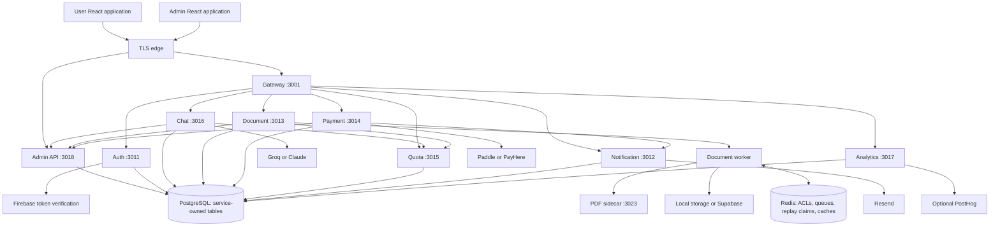
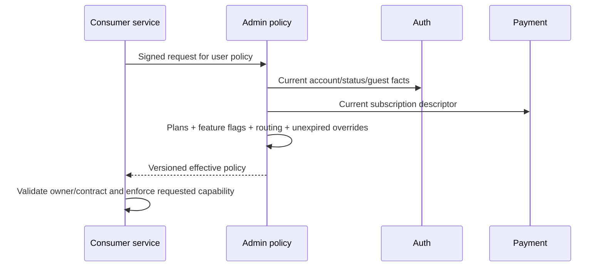
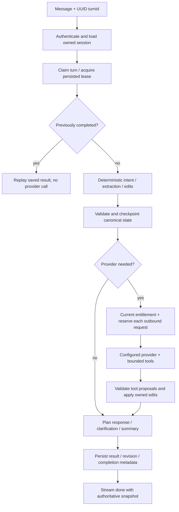
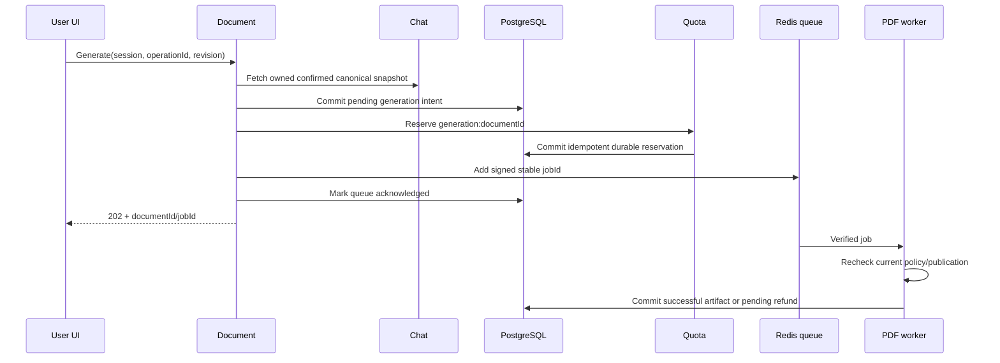
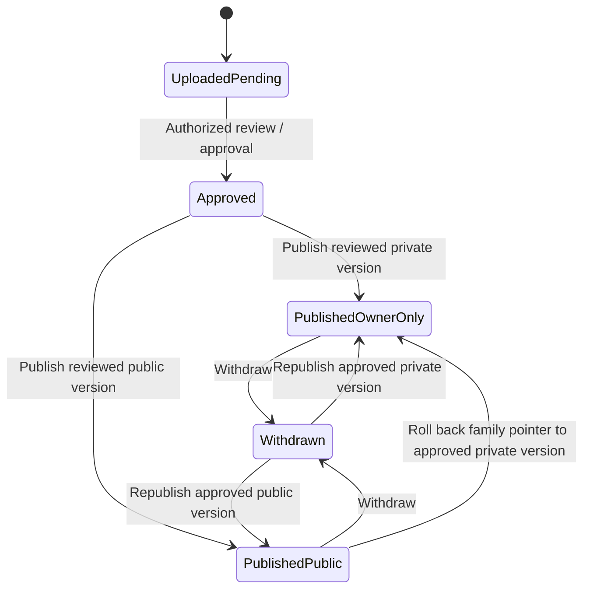

# DocCraft — full technical workflow and business logic

**Current implementation reference: Phase 5, 2026-10-16. Production readiness: NOT READY.**

Phase 5 verification and remaining gates: [staging report](PHASE5_STAGING_VERIFICATION_REPORT.md), [release blockers](PHASE5_RELEASE_BLOCKERS.md), [production checklist](PHASE5_PRODUCTION_READINESS_CHECKLIST.md). Phase 4 evidence remains historical and unchanged.

### Phase 5 payment receipt and runtime trust additions

After a verified payment reducer records a paid `BillingInvoice`, it writes one `receipt:<invoiceId>` outbox effect in the same PostgreSQL transaction. Failed, open and refunded invoice writes do not schedule a success receipt. Different verified events mentioning the same invoice cannot reopen its completed receipt or change its original amount/currency/date/reference snapshot. Paid writes outside the verified transaction are rejected before persistence.

The dispatcher first resolves the account's email through authenticated Auth and commits that recipient in the outbox before sending. Subsequent attempts use the same payload and key even if the profile changes. Notification must return its PostgreSQL-backed `deliveryId` and `durably_accepted`/`completed` status before Payment completes the effect. A lost HTTP acknowledgement leaves the effect pending; retry addresses the same Notification delivery. Redis loss reconstructs pending delivery work. An uncertain attempt beyond the provider's deduplication window requires reconciliation rather than an uncontrolled resend.

`payment_receipt` is a transactional email type authorized for Payment. The body contains the recorded currency-correct paid amount, invoice reference, trusted provider reference and paid timestamp when known. Handlebars escapes invoice facts. This email is not represented as a statutory tax invoice or a PDF attachment. Marketing notification disablement does not suppress the receipt, while the administrator's disabled email provider still blocks delivery. The administrator can select/edit/filter this template type. The Notification build now includes its HTML templates in `dist/templates`.

The staging runtime combines distribution public certificate roots with the private service CA before starting Node/Python services. Certificate and hostname verification remain enabled. Replacing the whole trust store with only the private CA prevented real Groq TLS connections; isolated regression checks now verify both trusted roots and rejection of an unrelated CA. The container entrypoint still requires an actual image build/start on a supported staging host.

Groq remains the initial provider; the authenticated administrator routing configuration can select Claude. Native tests verify that this selection reaches the current entitlement contract. Phase 5's eight approved Groq attempts produced live responses but did not pass successful MCP field persistence; see the report for the exact restricted-model probe scope, failures and budget. Further paid calls were explicitly disabled by the owner. Successful native billing fixtures and local email test transport are not live merchant or email delivery evidence.

This document explains the implemented system from browser interaction to persisted state, asynchronous work, external integrations, recovery and operations. It separates current business rules from older field names and incomplete deployment evidence. A route or UI entry in an appendix is an implementation declaration, not proof that its entire workflow passed staging acceptance.

Release evidence and unresolved acceptance gates are maintained in [Phase 4 findings](docs/system-audit/16-PHASE4_RELEASE_BLOCKERS.md), [staging procedure](docs/system-audit/17-STAGING_DEPLOYMENT_GUIDE.md), [production checklist](docs/system-audit/18-PRODUCTION_READINESS_CHECKLIST.md) and [final integration results](docs/system-audit/19-FINAL_INTEGRATION_TEST_RESULTS.md). Earlier reports contain historical behavior that this document supersedes where stated.

## Contents

1. [Product purpose, actors and approved rules](#1-product-purpose-actors-and-approved-rules)
2. [Architecture and ownership](#2-architecture-and-ownership)
3. [Browser, gateway and receiving-service request lifecycle](#3-browser-gateway-and-receiving-service-request-lifecycle)
4. [Account creation, identity, login and sessions](#4-account-creation-identity-login-and-sessions)
5. [Authoritative entitlements and administrative overrides](#5-authoritative-entitlements-and-administrative-overrides)
6. [Document types, fields, validation and calculations](#6-document-types-fields-validation-and-calculations)
7. [Chat, AI orchestration, tools and persisted conversation state](#7-chat-ai-orchestration-tools-and-persisted-conversation-state)
8. [Canvas editing, assets, confirmation and browser export](#8-canvas-editing-assets-confirmation-and-browser-export)
9. [Server PDF generation, storage, download and retention](#9-server-pdf-generation-storage-download-and-retention)
10. [Quota accounting and recovery](#10-quota-accounting-and-recovery)
11. [Templates: bundled catalog and secure uploaded versions](#11-templates-bundled-catalog-and-secure-uploaded-versions)
12. [Plans, checkout, payment events and subscription reconciliation](#12-plans-checkout-payment-events-and-subscription-reconciliation)
13. [Notifications and durable billing automation](#13-notifications-and-durable-billing-automation)
14. [Administrator access and business workflows](#14-administrator-access-and-business-workflows)
15. [Analytics, reporting, support and privacy](#15-analytics-reporting-support-and-privacy)
16. [Database, queues, consistency and transaction boundaries](#16-database-queues-consistency-and-transaction-boundaries)
17. [Security model and operational controls](#17-security-model-and-operational-controls)
18. [Failure handling and retry playbook](#18-failure-handling-and-retry-playbook)
19. [Configuration, integrations and deployment lifecycle](#19-configuration-integrations-and-deployment-lifecycle)
20. [Worked end-to-end business examples](#20-worked-end-to-end-business-examples)
21. [Verification, limitations and owner decisions](#21-verification-limitations-and-owner-decisions)
22. [Source-derived appendices](#source-derived-appendices)

## 1. Product purpose, actors and approved rules

DocCraft collects structured business facts through conversation and direct editing, validates them against document/template requirements, calculates monetary totals, and produces a document. It supports invoice, quotation, proposal, purchase order and receipt workflows. The canonical purchase-order identifier is `purchase_order`; presentation/API aliases may normalize into it.

| Actor | Allowed responsibility | Important boundary |
| --- | --- | --- |
| Visitor | Read public pages/pricing; start a guest journey; submit supported public contact/support forms | A visitor-supplied user/plan header does not establish identity. |
| Guest | Own a real persisted guest identity and drafts; participate in permitted collection/editing | Guest status is verified server-side. Server generation/sharing restrictions still apply; conversion requires both identities. |
| Free account | Use permitted features and the configured Free allowance | Default allowance is 3 units across all document types. |
| Pro account | Use current Pro entitlements while subscription/override permits | Default allowance is 10, not unlimited. |
| Max account | Use current Max entitlements and allowed model ceiling | Default allowance is 25. Max is a subscription plan, not an unrestricted model bypass. |
| Administrator/staff | Perform actions granted by stable RBAC permissions | Sensitive mutations require a current session, second factor, validation and audit. |
| Super administrator | Manage protected roles/configuration within its privileged scope | A role display name cannot grant this authority. |
| Service/worker | Perform explicitly scoped operations for its own identity | Service authentication is separate from user authentication and plan selection. |

The approved allowance is **one shared account budget**. Each actual outbound AI provider request, including retry/fallback requests, and each server PDF generation consumes one unit. A deterministic field edit or local browser PDF export does not consume a unit. Browser exports do not create server PDF artifact history. All plans reset **20 hours from the first accepted metered request**, with administrator-configurable limits/window length. An exhausted account cannot multiply its allowance by changing document type.

Document retention defaults are **not yet decided**. An explicit configured retention period is enforced; no unapproved Free/Pro/Max retention duration is invented. Uploaded company templates can be owner-only or public after review. Owner-only currently means one account; multi-account company membership/sharing is not implemented as an authorization model.

## 2. Architecture and ownership



Nine backend services are Gateway, Auth, Notification, Document, Payment, Quota, Chat, Analytics and Admin API. The PDF sidecar is a separate rendering boundary. Both frontends are separate applications. Development ports describe logical defaults; isolated tests allocate dynamic loopback ports, and staging exposes the edge at loopback TLS port 8443.

| Component | Implementation and core ownership | Core source |
| --- | --- | --- |
| User UI | React/Vite; public pages, authentication, builder/chat/canvas, dashboard/history/profile/billing/support | [user App](user-frontend/src/App.tsx) |
| Admin UI | React/Vite; authenticated shell, section navigation, customer detail, review/configuration/reporting controls | [admin App](admin/src/App.tsx) |
| Gateway | Express; browser ingress, identity/header handling, rate limits, proxies and SSE transport | [gateway](services/gateway/src/index.ts) |
| Auth | Fastify/Prisma; accounts, credentials, sessions, revocations, user JWT signing, TOTP | [Auth controller](services/auth/src/controllers/auth.controller.ts) |
| Chat | Fastify/Prisma; owner-scoped conversations, tool execution and AI usage | [Chat routes](services/chat/src/routes/chat.routes.ts) |
| Document | FastAPI/SQLAlchemy and BullMQ worker; generation intent, artifacts, storage, sharing, recovery | [Document routes](services/document/app/routers/document.py) |
| PDF | Node/Puppeteer; authenticated bounded HTML-to-PDF rendering | [sidecar](services/document/puppeteer/server.ts) |
| Payment | Express/Prisma; checkout ownership, subscriptions, invoices, provider events/cursors/adjustments/outbox | [Payment services](services/payment/src/services) |
| Quota | Express/Prisma; durable windows, reservations, refunds and administrative quota operations | [ledger](services/quota/src/services/reservation-ledger.service.ts) |
| Notification | Fastify/PostgreSQL/BullMQ; preferences, logs, durable HTTP delivery receipts and email processing | [Notification source](services/notification/src) |
| Analytics | FastAPI; authorized aggregate queries and optional external analytics dispatch | [Analytics](services/analytics/app) |
| Admin API | FastAPI; RBAC, persisted control-plane configuration, entitlements, templates, support, audits and automation | [Admin API](services/admin-api/app) |

The deployment uses one PostgreSQL instance with separately owned table groups, not nine independently deployed databases. Service boundaries are enforced through runtime privileges and scoped internal APIs. Cross-service business changes use signed requests; they are not justified by possession of a common database owner password.

## 3. Browser, gateway and receiving-service request lifecycle

1. The browser calls its configured same-origin API base. User APIs normally enter under `/v1/*`; Admin UI APIs enter Admin API under `/api/v1/*`.
2. The gateway applies security/CORS/body handling, correlation logging and abuse limits. Signed provider webhook bytes retain the form required by each provider's signature verifier.
3. Gateway authentication uses a public route allowlist. Other requests require an access token of the right type. Identity/role/plan/internal headers supplied by the browser are removed before trusted identity is attached.
4. The receiving service independently validates the applicable user token/current account or scoped service credential. A gateway check does not make an otherwise public direct-service port safe.
5. Ownership, RBAC, resource state and current entitlement are checked at the action boundary. An authenticated user is not automatically authorized for another user's session/document/template.
6. The service validates input, makes its owned transaction, and returns a result or durable acceptance receipt. Cross-service processing may continue after an asynchronous acceptance response.

Canonical gateway groups include `/v1/auth`, `/v1/chat`, `/v1/document`, `/v1/payment`, `/v1/quota`, `/v1/notification`, `/v1/analytics`, `/v1/admin` and `/v1/support`. Legacy aliases include users/AI/documents/billing/notifications. Refer to [gateway mounts](services/gateway/src/routes/index.ts) and the route appendix before constructing a URL: a route declaration can be mounted under more than one prefix.

Chat's mounted public shape includes `/v1/chat/api/chat/session/...`. Document's direct prefix is `/v1/document`; Analytics uses `/v1/analytics`. Notification's receiving-service prefix is `/notification`, with gateway aliases translating the browser path. Admin internal APIs have explicit `/api/v1/internal/...` routes and signed service authorization.

Typical error meanings are: 400 invalid request, 401 missing/invalid identity, 403 denied capability/quota, 404 missing or non-owned resource, 409 stale revision/idempotency conflict, 422 valid envelope with invalid document facts, and 503 unavailable authorization/policy/dependency. Some endpoints preserve older response wrappers; the frontend must use the actual typed client rather than assuming every error has the same shape.

## 4. Account creation, identity, login and sessions

### 4.1 Email registration and verification

The UI submits email/password/name to Auth through the gateway. Auth validates the request, checks uniqueness and hashes the password. The account is persisted and an email-verification challenge is issued. The notification request is queued through the Auth-owned signed email queue. A successful registration response proves account creation, not inbox delivery.

Verification checks the submitted challenge, its intended account/purpose and expiry, then updates account verification state. Resend needs a valid staging key and verified sender for the real journey; test fixtures that read a stored challenge prove API state transitions only. Re-requesting a challenge must follow abuse controls; email delivery failures must not produce a fabricated verified account.

### 4.2 Password login and MFA

Auth looks up the account, enforces current status/lock/verification requirements, verifies the password, and either issues the correct MFA challenge or creates a session. Concurrent failed authentications increment the persisted budget and set the lock in one SQL operation. A fully successful authentication resets failure state only after all required factors pass.

Access, refresh and MFA tokens have distinct token types. Access duration defaults to 1 hour, refresh to 30 days, and MFA challenge to 5 minutes unless supported environment configuration changes them. Auth owns the user signing private key; receiving services receive public verification keys. A refresh/MFA token cannot substitute for an access token.

The database stores a digest of refresh tokens. Refresh requires a valid refresh token, matching persisted session, unexpired session and permitted current account; rotation replaces the old session token. Logout removes/revokes the relevant session/token state. Durable access revocations remain authoritative when Redis is lost. Account suspension/deletion is checked against current Auth state rather than trusting an old plan/status claim in a still-unexpired bearer.

### 4.3 TOTP lifecycle

TOTP enrollment/replacement and sensitive account/admin actions require the existing permitted authentication flow. Secrets are encrypted with AES-256-GCM using separate Auth/Admin keyrings, key IDs and identity/account-bound additional authenticated data. Reusing ciphertext for another account fails decryption. Runtime code does not silently accept legacy plaintext.

Successful verification atomically consumes a time step using a persisted high-water mark. Two concurrent requests using one code cannot both succeed. Failed/old/wrong-account codes do not advance an unrelated account's state. Legacy secret migration and real key rotation require the owner-approved procedure in the staging guide.

### 4.4 Firebase/Google and guests

Firebase sign-in accepts a verified ID token for the explicitly configured project, checks issuer/audience/signature/expiry/provider claims and obtains current Admin enablement. Missing project configuration or a disabled integration fails closed. Existing account linking must follow the Auth controller's identity checks; matching a browser-supplied email is not sufficient authentication.

A guest is a persisted unique user, not one shared placeholder ID. Guest login returns a signed guest session credential with expiry. When registering/logging into a full account, the UI retains the old guest credential and invokes guest migration using the new account access token plus the guest credential. Chat verifies both, checks live guest/current-account state and atomically claims that guest to one account. Retrying preserves the same transferred drafts/session IDs; a second account cannot claim them. Expired/ineligible guest data is not arbitrarily reassigned.

## 5. Authoritative entitlements and administrative overrides

Policy implementation: [Admin entitlements](services/admin-api/app/services/entitlements.py), [policy API](services/admin-api/app/api/v1/entitlements.py), [Node contract](shared/entitlements.mjs), [Python contract](shared/entitlements.py).



The evaluator derives baseline guest/free/paid status, verifies paid subscription status and paid-period expiry, applies valid administrative plan/feature/quota overrides, and applies global feature disablement. Suspended/deleted accounts cannot be enabled by a paid subscription or override. A scheduled cancellation can retain the remaining paid term; immediate cancellation without paid-term continuation returns baseline access.

| Policy field | Meaning / consuming boundary |
| --- | --- |
| `version`, `user_id` | Contract version and exact account binding; consumers validate both. |
| `account_enabled`, `plan`, `source` | Current allowed account and effective plan; `source` identifies baseline/subscription/admin override. |
| `subscription_status`, `subscription_expires_at` | Payment facts used for explanation, not a browser authority to grant access. |
| `daily_quota`, `quota_policy` | Effective units, first-use reset contract, configurable hours and browser-export policy. |
| `custom_logo`, `custom_branding` | Logo/branding permission used on assets and generation. |
| `premium_templates` | Premium selection/preview/generation access in addition to publication/ownership. |
| `pdf_watermark` | Whether the server worker must apply the watermark. |
| `priority_processing` | Selects authorized queue priority; callers cannot supply paid priority directly. |
| `retention_days` | Explicit configured server artifact retention; nullable until owner defaults are decided. |
| `ai_enabled`, `ai_provider`, `groq_models`, `claude_models`, `max_model` | Provider and model permissions/ceiling. |
| `feature_flags`, `override_expires_at` | Effective feature values and temporary override lifetime. |

An override requires the appropriate administrative permission, a fresh second factor and a reason. It is persisted/audited, can expire, and can be removed. Expiration restores the current underlying policy, which might have changed since the override was created. Global kill switches and disabled account state dominate otherwise permissive overrides.

Consumers fetch current decisions and validate types, known model/provider values, quota contract and window bounds. Policy/identity dependency failures return unavailable; they do not reuse a cached permissive result. User entitlement state clears on failure, and Admin account detail/Billing display current effective policy. A token's historical `plan`, request header, queue `userPlan` snapshot or optimistic UI selection cannot grant new capability.

Legacy names `monthly_quota`, `daily_quota`, `documentsPerDay` survive for compatibility. The actual approved contract is shared metered units per first-use 20-hour window. User/admin copy must describe that meaning.

## 6. Document types, fields, validation and calculations

[document-contract.json](shared/document-contract.json) is the semantic field/calculation contract. [template-schemas.json](shared/template-schemas.json) adds template requirements. Node [document-contract.mjs](shared/document-contract.mjs) and Python [document_contract.py](services/document/app/services/document_contract.py) apply compatible validation/calculation rules. The appendices list every declared field and each document's required/optional keys.

| Type | Base required facts | Semantic distinction |
| --- | --- | --- |
| Invoice | businessName, clientName, invoiceNumber, issueDate, dueDate, lineItems, currency | `dueDate` is payment due date. |
| Quotation | Same base keys as invoice | `dueDate` is quotation validity end. |
| Proposal | Base keys plus subject | Subject describes project/scope; dueDate is proposal validity end. |
| Purchase order | Base keys | businessName is buyer; clientName is vendor/supplier; dueDate is delivery date. |
| Receipt | businessName, clientName, invoiceNumber, issueDate, lineItems, currency, paymentMethod | Records payment; dueDate is not a base required field. |

Required fields are the union of base document rules, selected template rules and supported required dynamic fields. Conditional requirements activate from other answers: taxable status requires tax rate; bank transfer/cheque can require account details; receipt bank/cheque requires reference number. Unsupported required template fields are rejected rather than making an impossible draft appear ready.

Aliases normalize to canonical keys. Conflicting alias values fail validation. Unknown keys do not silently become trusted semantic data. Dates normalize to valid ISO calendar values; relative phrases use the persisted turn reference time and account timezone. Ambiguous slash-date formats require the selected date format. Replaying a turn must not reinterpret “tomorrow” against a later wall clock.

Contact ownership is explicit: sender/business and client email/phone/address remain separate fields. A bare phone number with no established owner creates clarification; it is not guessed into both parties. A correction updates its intended field. Pending operations, ambiguous item choices and conflicting facts must resolve before final generation.

Line items require a nonempty description, finite positive quantity and finite nonnegative unit price within contract limits. There are at most 100 items; field-specific numeric maxima prevent overflow/excessive totals. Item identifiers distinguish duplicate descriptions and permit targeted edits. Fixed discounts exceeding subtotal are invalid, not silently clipped.

The calculation order is **line item discount → document discount → tax**:

```text
item.grossTotal    = moneyRound(quantity × unitPrice)
item.discount     = moneyRound(item.grossTotal × item.discountRate / 100)
item.total        = item.grossTotal − item.discount
subtotal          = sum(item.total)
documentDiscount  = valid fixed discount, otherwise moneyRound(subtotal × discountRate / 100)
taxableAmount     = subtotal − documentDiscount
taxAmount         = moneyRound(taxableAmount × taxRate / 100)
totalDue          = taxableAmount + taxAmount
```

Rounding follows currency precision and the shared financial expressions, with decimal/minor-unit arithmetic used to avoid ordinary binary-floating-point drift. Server rendering recomputes/validates derived amounts; model/browser-supplied totals are not billing authority. Document currency formatting supports the contract's currencies/locales; **subscription billing** currently supports the explicit provider-compatible USD/LKR choices and has separate validation.

## 7. Chat, AI orchestration, tools and persisted conversation state

### 7.1 Session creation and ownership

The builder selects a document type/template and creates a Chat session. Chat verifies owner/current account, type compatibility, current publication and premium availability, persists the session and returns its canonical snapshot. Uploaded template descriptors are fetched using owner-scoped policy. Titles, accent/presentation state and canonical slots belong to the session.

Session/message reads are owner-scoped. Deletion/lifecycle transitions validate ownership and current state. Cross-session business-detail reuse verifies ownership of the source session and only copies supported, sufficiently certain sender fields; a UUID in a message is not permission to read another account.

### 7.2 One message, from input to durable result



The message route validates a nonempty bounded message and UUID `turnId`, loads the owned session and claims that turn before quota/provider/tool effects. A completed duplicate returns the saved result. An interrupted retry uses checkpointed extraction/provider/result state rather than blindly rerunning every effect. Concurrent writes use expected revisions and persisted leases; stale updates return a conflict.

Deterministic processing handles supported explicit facts, field corrections, item tables and item operations, optional skips, contact ownership, clarification replies, summaries and supported document actions. This path can change facts without an AI request or quota unit. The system keeps conversational intent separate from changed fields: a message can both update a phone number and ask for a summary.

If provider interpretation is needed, Chat builds context from persisted state, known field requirements and bounded history, obtains the current provider/model permission, then meters the actual outbound request. Groq retries/fallbacks and each Claude loop request consume separate units. A provider response is a proposal: the application validates supported tools, schema, ownership, numeric evidence, field semantics and current revision before applying it. Prompt-injection/output checks supplement these controls; they do not make arbitrary model output trusted code.

### 7.3 Provider routing and MCP

Admin configuration selects `groq` or `claude`. The chosen provider must have its operator-injected credential; missing credentials do not trigger a fake success or an unauthorized alternative provider. Groq model access follows configured allowed models. Claude selection uses the supported Haiku/Sonnet model IDs and caps the selected result at the effective account ceiling. The Max plan remains within that configured ceiling.

The current provider wrapper invokes routing with current message/turn facts; do not infer that every older preference/escalation comment is active in every path. The configured wrapper and model cap are the enforcement boundary. Model registry IDs and live availability still require provider validation.

Chat uses an in-process MCP client/server for its controlled document tools. Private resource/status/MCP APIs have their own route authentication. Tool invocation is not direct SQL or arbitrary network execution. Tool records and AI usage records provide diagnostic/accounting evidence; they do not replace Quota's durable authorization ledger.

### 7.4 Streaming and state machine

The route establishes SSE after claim handling, emits structured events and ends with a persisted result/snapshot. Gateway forwarding preserves stream backpressure/abort semantics. Client disconnect/turn timeout aborts outbound work where possible; it cannot prove an already-sent provider request was never charged. The UI reconciles from the authoritative returned snapshot and does not turn an interrupted stream into a fabricated successful turn.

There are separate dimensions of state:

| Dimension | Examples | Why it is separate |
| --- | --- | --- |
| Session lifecycle | ACTIVE, COMPLETED, ABANDONED, derived EXPIRED | Whether the conversation is editable/retained. |
| Collection stage | collecting, clarifying, optional, review | Which semantic step comes next. |
| Turn execution | running, success/completed metadata, failure, incomplete, cancelled | Whether provider/tool work for one idempotent turn finished. |
| Finalization | unconfirmed, requested, confirmed | Whether the user approved the current exact facts/template/assets. |
| Layout revision | Independent numeric revision | Whether presentation edits conflict, independent of semantic facts. |

`dataValid`/`readyToGenerate` and `canGenerate` are different. Unresolved required fields, conflicts, pending operations or recoverable interrupted work prevent readiness. Generation additionally requires confirmation for the current fingerprint. The fingerprint covers document type, selected template, schema requirements, slots and asset hashes. Changing those facts invalidates an old confirmation.

## 8. Canvas editing, assets, confirmation and browser export

The preview derives from canonical conversation state. Canvas presentation stores layout, position/style overrides and supported custom elements separately from semantic slots. Updating a canvas cannot silently replace a validated client name or total in canonical storage. Layout writes use `expectedLayoutRevision`; semantic writes use their own revision. Failed saves remain visibly unsaved.

Images/logos/signatures use bounded validated image data, dimensions and supported roles. Logo use checks `custom_logo` on upload and server generation. Assets are owned by the session; their hashes participate in confirmation. Uploaded HTML previews run in a sandboxed iframe, and untrusted template source is shown as text in administration rather than executed in the administrator origin.

For built-in local canvas export, the browser creates a PDF from its current presentation. This path is **unmetered by the approved policy**, produces a local artifact and does not create a server Document record. It must not decrement the server PDF quota or show a nonexistent server-history record. Browser-export watermark/render behavior requires actual browser acceptance; it is not established by a backend entitlement test.

Uploaded templates use the server generation/poll/download path so publication, isolation and server rendering enforcement apply. That is a metered server PDF operation. This distinction must remain clear in UI copy and billing documentation.

## 9. Server PDF generation, storage, download and retention

### 9.1 Accepted generation

The browser submits a session ID, operation UUID, expected semantic revision and selected document/template information. Document retrieves the owner-scoped saved session from Chat through signed service authentication. It validates type, revision, required fields, current confirmation fingerprint, template ownership/publication/premium permission and branding assets. Browser-supplied raw slots/plan claims do not replace the saved validated facts.

The stable document identity derives from account, session and operation ID. A retry uses the same identity; a new intended PDF uses a new operation ID and consumes a new unit. Document commits a pending `documents` row **before** reserving quota, storing immutable generation facts and `_source` operation/session/revision/queue metadata.



### 9.2 Worker processing

Queue priority is 1 for authorized priority accounts and 10 otherwise, with three configured attempts and exponential backoff on the generation path. A signed job binds queue, producer, name, ID and content. The worker compares the job to the saved document and obtains a per-document PostgreSQL advisory transaction lock. Already successful/terminally failed rows do not render again.

The worker rechecks account/template/branding permissions, builds safe HTML, calls the authenticated PDF sidecar, applies the current watermark policy, stores the PDF and marks the document successful. The sidecar runs with JavaScript disabled, intercepts network requests, enforces input/concurrency/resource limits and requires an OS browser sandbox. Template resource access is denied rather than resolved against local files or internal services.

### 9.3 Partial failures and recovery

If quota responds denied, the intent becomes failed with a quota-denial result. If quota/queue acknowledgement is uncertain, the saved intent remains and a retry/reconciler uses the same reservation/job ID. The service never deletes the only intent merely because it did not receive a queue acknowledgement.

Exhausted generation failures persist `refundState=pending` before refund. A successful idempotent refund changes it to done. Refund outage does not discard the marker. A failed terminal document cannot subsequently render after its unit has been refunded. Recovery periodically rotates through bounded pending rows, reconstructs queue work, retries refunds and processes retention/deletion work.

A successfully persisted PDF remains successful even if its document-ready email cannot be queued. That legacy document email queue path does not yet have billing HTTP intake's complete-loss durability. Product tracking failure also must not invent a PDF failure after success.

### 9.4 Storage, downloads, sharing and deletion

Current Admin policy selects local or Supabase storage. New object keys identify their backend (`local:` or `sb:`). Changing the selected provider does not reinterpret existing keys. Legacy unprefixed keys use the explicitly configured original `LEGACY_STORAGE_PROVIDER`; operators must identify that original backend. Partial/misconfigured Supabase settings and configured-provider failures do not silently fall back to local disk.

Artifact detail/history/download checks ownership/current identity and document state. Local downloads use Document-owned signed capabilities with bounded expiry and path validation. Supabase uses private bucket signed access. Generated download lifetime is capped to 300 seconds and the remaining retention lifetime. A signed download is a temporary capability, not a user JWT.

Sharing creates a scoped share token/expiry under the existing authenticated sharing rules; the public share endpoint still checks token validity and retained artifact availability. Deletion removes the storage object before removing the row, so a failed storage delete remains retryable instead of leaving an invisible retained object. Explicit retention records `retainedUntil` in `_source`; expired reads/signing fail and recovery removes the object/record. Existing unset retention is preserved pending owner policy.

## 10. Quota accounting and recovery

`quota_windows` and `quota_reservations` in PostgreSQL are authoritative. Redis counters are rebuildable caches. Reporting rows preserve compatible fields but cannot grant usage independently.

For a reserve operation, Quota obtains the current entitlement, opens a transaction and takes a per-account advisory lock. It uses the database clock, finds the active window and checks a stable hashed account/reservation receipt. An existing active receipt replays without another increment. A previously refunded receipt does not become a new reservation. A new allowed reservation creates the first-use window if necessary and increments usage once in the same commit. No authorization is returned before that commit.

The default window end is first accepted use plus 20 hours. Status/denial reads do not start a window. When the old window expires, a new accepted use creates the next window. There is no calendar-midnight reset under the approved policy. Administrators can edit window duration/limits; an already-started window's recorded boundary remains stable unless an explicit supported administrative operation changes it.

Refunds identify the original receipt, mark it refunded at most once and decrement only the same still-active window. A late refund from an expired window cannot subtract a new window's usage. Plan upgrade/downgrade changes the available ceiling while preserving usage. Expiring overrides restore the current baseline. An administrative reset is an explicit audited operation, not an automatic side effect of payment renewal/cancellation.

```text
remaining = unlimited ? unlimited : max(0, effectiveLimit - currentWindowUsed)
allowed(new receipt) = accountEnabled AND (unlimited OR used < effectiveLimit)
```

The ledger serializes concurrent AI/PDF requests from every document type. Free example: one AI call and two server PDFs exhaust 3; switching to receipt cannot start a separate budget. Free 3 is also not three guaranteed completed documents: a task requiring multiple provider calls uses multiple units. Failed server generations refund through durable reconciliation. An uncertain AI request after reservation remains an external-outcome ambiguity; it cannot be safely refunded solely because the client disconnected.

Redis data loss cannot reset the persisted allowance. After loss, cache reads reconstruct from PostgreSQL. Replay protection separately rejects service credentials issued before the restarted Redis generation. A sanctioned legacy Redis counter/receipt cutover is still required; resetting all old usage to zero is not an approved migration.

## 11. Templates: bundled catalog and secure uploaded versions

Bundled templates have type/variant aliases, compatibility/field schemas and persisted publication/premium policy. Admin publish/withdraw changes downstream availability. Selecting a stale alias does not bypass a withdrawn family/variant.

Uploaded templates accept restricted HTML, supported scalar placeholders and embedded PNG/JPEG assets. Validation rejects scripts, SVG, iframe/style execution, arbitrary template expressions, local/file/network URLs and unsupported CSS functions/escapes. Assets are decoded and canonicalized to bounded raster data; dimensions, pixel count, size, HTML length and parser complexity are bounded. Values are escaped, and generated item-table markup escapes its text. Untrusted uploaded content is not executed by Jinja or a filesystem loader.



User upload forces the uploader as owner and private pending visibility. Admin upload can select the owner/public choice with the required permission/second factor. Family ownership/document type are immutable. New content/visibility creates a new immutable version and digest. Approval precedes publication; publication changes the family pointer. Rollback points to an earlier approved version, preserving history rather than editing its source.

User availability requires current publication, compatible type, matching owner or public visibility, and premium entitlement where applicable. Listing/preview/Chat selection/generation/worker paths apply these rules. A process-global cached uploaded descriptor is never treated as the catalog for another user; fresh scoped availability excludes that former privacy bypass.

Multi-account company sharing needs organization membership/authorization requirements. Sharing one password/account or marking confidential company source public is not a substitute.

## 12. Plans, checkout, payment events and subscription reconciliation

### 12.1 Pricing and checkout

Admin stores plan codes, active status, explicit prices/cadence/currency/provider price IDs, allowances and feature configuration. Public pricing consumes current plan/effective policy data. Supported subscription reporting keeps USD/LKR separate. Fractional-cent/non-finite prices are rejected; no exchange rate is fabricated.

An authenticated checkout request selects a valid active plan/cycle/provider compatible with current settings. Admin can enable/disable Paddle/PayHere and select an allowed provider strategy. Missing settings/provider credentials or a forced disabled provider fails closed. Checkout ownership, amount, currency and cycle are persisted in `checkout_intents`; browser custom fields and success-page navigation cannot activate paid access.

### 12.2 Verified webhook intake and atomic reduction

Paddle verifies its signed raw JSON; PayHere validates its required merchant/form signature. Provider-facing signature/IP configuration must match the real deployed ingress. Verified intake persists an inbox record before acknowledging/queueing. Signed Redis jobs are reconstructed from the durable inbox after worker interruption.

The reducer uses a PostgreSQL lock shared across event claims and related payment mutations. In one transaction it checks completion/claim, applies subscription/invoice/adjustment changes, records idempotency and writes durable outbox effects. A process death before commit rolls everything back. A duplicate committed event is acknowledged without repeating business writes.

Outbox dispatch uses the same ordering lock, refreshes current entitlement before account/quota synchronization and marks an effect complete only after its required downstream acknowledgement. Failed effects remain with bounded retry timing. Outbox timestamps are timezone-aware so scheduling is independent of PostgreSQL session timezone. Older already-deployed ambiguous Phase 4 timestamp rows would require reviewed interpretation before migration.

### 12.3 Paddle ordering and refunds

Paddle subscription state uses signed `occurred_at` cursors per subscription. Older state cannot overwrite newer state. A stale financial transaction can still create its invoice without regressing the subscription. Missing prerequisite records retry. Equal-time distinct state events remain ambiguous and fail closed pending trusted provider snapshot/operator reconciliation; event IDs do not prove chronological order.

Plan changes use verified provider price mappings and provider period/currency data. Cancellations distinguish immediate access loss from cancellation at the paid period end. Approved adjustment events create idempotent refund records keyed by provider adjustment identity. Gross, refunded and net collection are calculated per currency; a refund does not imply an invented FX conversion or unsupported access policy.

### 12.4 PayHere recurring identity

The checkout intent binds account/plan/amount/currency/cadence. Unauthenticated callback fields such as custom account/plan/subscription/payment hints cannot establish recurring identity. OAuth-protected provider retrieval must uniquely map the owned order to the subscription and verified payments. Ambiguous ownership, unexpected amount/currency/status and missing verified timestamp offset fail reconciliation.

Installments deduplicate by trusted provider payment identity. Calendar periods clamp at month ends rather than adding a fixed number of days. Legacy initial invoice reconciliation avoids double counting. Scheduled reconciliation rotates through a bounded fair set of active/past-due mandates. Cancellation calls the provider and requires acknowledgement; an OAuth/configuration failure does not pretend a cancellation was recorded successfully.

### 12.5 Customer billing behavior

The UI fetches the effective current plan alongside historical subscription data, invoices and permitted portal/cancellation controls. Provider acknowledgement triggers a fresh policy fetch. Clicking cancel does not locally fabricate Free access while the paid term still applies. Administrative trial/refund/override actions require appropriate authorization and real downstream success; unsupported provider portal/payment-method behavior cannot be inferred from a rendered button.

Financial reporting distinguishes collected revenue, refunds/net collection, recurring run rate and plan list price. An annual collected payment contributes its recorded annual amount to collection and its annual/12 amount to monthly normalized run rate. LKR is not added to USD, and unknown historical values are identified instead of guessed.

## 13. Notifications and durable billing automation

### 13.1 Notification delivery paths

Auth and Document have their own signed Redis email producer queues. Notification workers consume only authorized producer/name/job-ID envelopes. HTTP `/notification/send` is service-authenticated and constrains each service's allowed notification types. Browser callers cannot dispatch arbitrary mail.

HTTP intake commits `NotificationDelivery` before returning `durably_accepted`. Stable caller/idempotency identity and content fingerprint suppress duplicates and reject conflicting reuse. The database stores pending payload; queue projection creates a fresh signed stable job. Redis loss/restart or missing/exhausted cached jobs can be reconstructed from pending receipts.

The worker reads the durable saved payload, checks current provider settings/preferences/throttling, uses a stable Resend idempotency key, and completes the receipt after the outcome. Completed payload is scrubbed while the receipt/fingerprint remains for deduplication. Database failure after provider acceptance leaves pending work for retry using the same provider identity.

Resend keys expire after 24 hours. Durable live sends persist the first attempt time and hold uncertain attempts after 23 hours for provider receipt reconciliation; they are not automatically resent outside the deduplication window. See [provider documentation](https://resend.com/docs/dashboard/emails/idempotency-keys). Pending/review records and provider receipts require operational monitoring. External SMTP/inbox delivery is not equivalent to an HTTP acceptance receipt.

Admin can choose Resend/disabled and edit supported branding/templates/sender settings. Fresh policy outage or disabled provider blocks even critical delivery for retry. Noncritical global-disable/preference behavior may produce a recorded skipped outcome. Incomplete/errored Redis throttle transactions fail rather than permitting a send. Corrected logs omit recipients, credentials, message content and raw upstream error text.

Only billing HTTP intake has the new complete Redis-loss durability contract. Legacy direct Auth/Document queue producers still need separate final-delivery recovery acceptance. No real email workflow has passed with the currently rejected staging key.

### 13.2 Billing automation

Payment writes automation outbox effects transactionally with billing state. Dispatch sends a stable event ID through the payment-only signed Admin intake API. Admin commits `automation_event_inbox` before acknowledging. A database-backed consumer serializes processing, evaluates matching active rules/conditions and uses stable hashed action IDs for notification retries. Completed events scrub payload; partial failed action outcomes enter `review` rather than silently replaying successful irreversible actions.

The default cancellation rule only notifies. Authoritative entitlements determine paid-term/Free quota; the obsolete automatic five-unit quota override is removed from new seeds and exact unchanged legacy seeds. Customized administrative rules are preserved for owner review.

Email actions resolve an owned account's recipient when appropriate and use durable Notification intake. Explicit quota-override actions use the scoped administrative Quota API. Webhooks require an operator-approved HTTPS host, public DNS result, certificate validation and no redirects; a stable action idempotency key is supplied. The receiving provider must honor/verify that contract for exactly-once effects. An unconfigured IP-block integration returns manual review, not a false successful block.

Legacy quota pub/sub events and the older manual Redis automation queue remain separate paths. Their delivery guarantees are not upgraded by the billing inbox. Administrative action outcomes, external webhook idempotency, network egress policy and in-flight shutdown still need deployment acceptance.

## 14. Administrator access and business workflows

Admin authentication has its own signing/session domain. Password login, real email challenge/verification and enabled TOTP establish a persisted current session. Role/permission resolution uses stable identifiers; a label such as “Super Admin” cannot create wildcard rights. Sensitive operations require their permission, current session, second factor and audit context. Password/session changes revoke relevant persisted sessions.

| Business area | Administrative workflow and invariants |
| --- | --- |
| Customers | Search/filter and inspect current Auth profile, effective entitlement, actual quota window and measured document count. Suspend/reactivate through Auth-owned mutation; no fabricated usage/activity values. |
| Plan/quota overrides | Select permitted plan/features/limit, supply reason and expiry, confirm second factor, persist/audit, refresh policy. Restore underlying current policy on expiry/removal. |
| Packages/pricing | Create/update active plan code, explicit supported currency/monthly/yearly amounts, provider IDs and entitlement configuration; existing consumers refresh effective policy. |
| Subscriptions/trials/refunds | Inspect server/provider records, call supported provider operations, retain uncertain failures for reconciliation; preserve gross/refund/net currency identity. |
| Templates/documents | Inspect bundled/uploaded versions; validate/review/approve/publish/withdraw/rollback with appropriate permission; control owner/public visibility. |
| Generations | Inspect pending/success/failed server rows and durable refund state; local browser exports are not invented server generations. |
| AI/provider settings | Choose supported provider/model routing/feature gates; secrets are operator configuration; a selected but unconfigured provider is unavailable. |
| Dynamic config | Validate domain schema, acquire domain lock, allocate version, commit config and append-only history atomically; invalid configuration cannot silently grant features. |
| Notifications | Manage announcements, supported email templates/settings and inspect real logs; disabled announcements disappear from fresh feeds. |
| Automation | CRUD rules/conditions/actions, inspect dry-run versus actual execution and review failures; a dry-run response is not a real action outcome. |
| Security/staff/RBAC | Grant scoped permissions, manage current sessions/abuse reports and audit records; protect privileged role mutations and second factors. |
| Support/privacy | Review persisted support/contact/refund/override requests, respond through authorized workflows, run the current soft-purge procedure with owned service mutations. |
| Infrastructure/reporting | Read real readiness/usage/currency-safe metrics; unconfigured external observability and deployment history are unavailable, not fabricated healthy systems. |

The complete navigation inventory is included below. Navigation existence does not establish complete CRUD/provider acceptance for every view. [Admin API route modules](services/admin-api/app/api/v1) and [admin client](admin/src/api) contain the precise request shapes.

## 15. Analytics, reporting, support and privacy

Analytics separates authorized internal reporting from ordinary user events. A public event intake's soft-auth behavior does not grant access to private financial/account reports. Payment supplies currency-aware billing facts; direct Analytics reports cannot invent a conversion or elevate an account plan. Optional PostHog ingestion/query requires separately approved keys/project access; a missing integration must report unavailable or its explicit supported state.

User dashboard/history distinguishes Chat drafts from persisted server PDF artifacts. Profile reads/writes use Auth; Billing reads Payment/current policy; quota cards read Quota/current policy. Support/contact/refund/plan-override request forms persist through the Admin support APIs with public submission budgets and staff RBAC on reads/mutations. A customer refund request is not itself provider refund completion.

The current administrator GDPR-style action is a **soft-purge**, not full content erasure. A durable hashed request journal retains the target identity across retries. Admin calls Auth to anonymize identity/delete credentials/revoke sessions and Document to anonymize stored email, then completes local cleanup/audit. This works with service-specific privileges and survives Auth email renaming between attempts. Documents and financial records are retained by this existing behavior; legal/content retention requirements and complete erasure need explicit product/owner policy.

## 16. Database, queues, consistency and transaction boundaries

| Owner | Authoritative table groups | Other-service access |
| --- | --- | --- |
| Auth | users, sessions, password_resets, login_events, referrals, access_revocations | Approved column-limited reporting reads; credential columns excluded. Mutations through Auth APIs. |
| Chat | document_types, templates, chat_sessions, chat_messages, generated_documents, tool_executions, ai_usages, guest_migrations | Scoped private resources/reporting APIs and approved read-only tables. |
| Document | documents, custom_templates | Approved Admin/Analytics reads; owned artifact/account metadata mutation APIs. |
| Payment | plans, subscriptions, billing_invoices, coupons, checkout_intents, webhook_events, webhook_deliveries, payment_outbox, payment_provider_cursors, billing_adjustments | Scoped descriptors/reporting; no foreign direct credential writes. |
| Quota | quotas, quota_windows, quota_reservations, quota_reset_logs, quota_audit_logs; legacy quota_daily_usage | Durable ledger is authority; legacy/reporting rows are not an alternate grant source. |
| Notification | NotificationPreference, NotificationLog, NotificationDelivery | Scoped dispatch/preferences/log APIs; receipt payload is not broadly readable. |
| Admin | admin users/roles/audits, versioned config, plan/control-plane settings, templates/reviews, entitlement overrides, support/security/automation tables, GDPR request journal | Approved signed policy/read/intake APIs. |
| Analytics | Aggregation/reporting responsibility; no general write ownership of other service domains | Explicit read grants and authorized service calls. |

Redis contains service-scoped queue keys, counters/caches, rate-limit state, replay nonces and approved pub/sub channels. The default Redis user is disabled. Each identity has key/channel/command ACLs. Configuration consumers cannot publish privileged configuration invalidations. PDF has minimal Redis scope for its service auth, not access to arbitrary mail/payment queues.

Important atomic units are: Auth account/session credential transitions; guest transfer; Chat turn claim/revision/checkpoint; Quota account window/receipt transaction; Document saved intent and later worker transition; Payment verified reducer/claim/outbox; Admin config/history; downstream notification/event receipt. There is **no global transaction** spanning PostgreSQL, Redis, providers and object storage. Stable identities, durable intent/outbox/inbox records, bounded retries and reconciliation bridge those boundaries.

At-least-once delivery means a process can retry after losing an acknowledgement. It does not mean an external action is exactly once. External receipts/idempotency windows and operator review resolve uncertainty. Old identifiers cannot be discarded merely because a queue was cleared.

## 17. Security model and operational controls

Service HTTP authentication signs exact method/target/body with pairwise caller-to-receiver key IDs. Receiving authorization matches the method/path and authorized caller from [service-permissions.json](shared/service-permissions.json), validates signature/time/audience/body binding, then atomically claims replay protection. Signed queue/event envelopes separately bind producer, destination/name/ID and payload. A shared legacy header name in a call site is not the active security authority; the shared transport creates the scoped signed credential.

Replay-store outage fails closed. Nonce claims also compare issuance with Redis's process generation so an empty Redis restart cannot resurrect captured old service credentials. Startup has a short fail-closed skew interval. Live `FLUSHDB` is prohibited during recovery; quiesce/restart the owned replay store through the documented procedure.

TOTP ciphertext is account-bound and versioned; secrets, provider keys and private signing material are never public Admin configuration values. Runtime DB roles cannot create schema objects, mutate Auth tables from another service or read password/TOTP columns. Audit/history/claim privileges are append-oriented where appropriate. Schema migration jobs alone receive owner credentials.

TLS is mandatory in generated staging for app HTTP, PostgreSQL and Redis. CA and hostname validation remain enabled. Partial/missing required listener certificates fail startup. The renderer has no provider secrets, no external network, no privileged capability additions and bounded CPU/memory/PIDs/shared memory. Uploaded content has an independent restrictive parser/asset model before rendering.

Authentication/public submission budgets, proxy-IP handling, body size limits, output escaping, scoped downloads and sensitive-log redaction reduce abuse/exposure. Real credential rotation/revocation, image scans, egress enforcement, target-load abuse tests and host browser sandbox acceptance remain separate release gates.

## 18. Failure handling and retry playbook

| Failure boundary | Persisted truth | Correct retry/recovery |
| --- | --- | --- |
| Policy/Auth unavailable | No permissive grant | Return unavailable; retry after dependency readiness. |
| Duplicate completed Chat turn | Saved turn/result/checkpoint | Replay same result; do not request another model call. |
| Chat interrupted after local edits | Persisted revision/proposal/provider checkpoint | Resume same turn, reconcile UI from snapshot. |
| AI reserve succeeded, provider outcome unknown | Durable quota receipt and available usage/tool records | Investigate provider receipt; do not assume no request was sent. |
| Document intent saved, quota call uncertain | Pending intent + stable generation reservation ID | Retry/reconcile same operation. |
| Quota saved, queue acknowledgement lost | Receipt + pending intent | Re-add same signed job ID; do not reserve again. |
| Worker terminal generation failure, refund unavailable | Failed document + refundState pending | Recovery retries same refund receipt; terminal worker cannot render later. |
| Redis complete loss | PostgreSQL windows, receipts, payment/notification/billing-event inboxes | Restart safely; rebuild supported work/caches; reject pre-loss service tokens. Legacy direct Redis-only producers need separate reconciliation. |
| Payment process crash before reducer commit | Verified inbox still pending | Reprocess; claim/business/outbox rolled back together. |
| Downstream billing notification accepted, Redis lost | NotificationDelivery receipt | Reconstruct signed job from PostgreSQL. |
| Provider accepted mail, DB acknowledgement lost | Pending receipt + stable provider identity/attempt start | Retry within safe key window; hold old uncertain attempts for provider reconciliation. |
| Automation action partially fails | Persisted review state and execution outcomes | Owner reconciles successful/failed effects; no blind automatic replay of irreversible successes. |
| Storage upload/sign/delete fails | Generation/deletion state and backend identity | Return failure/retry intended backend; no silent storage switch. |
| Expired artifact | Retention deadline and saved backend key | Deny new access/signing; retry object deletion before row removal. |
| Stale UI revision | Current server revision/fingerprint | Reload/review and resubmit deliberately; do not overwrite newer facts. |

Use actual persisted facts and correlation IDs when investigating. Do not dump bearer tokens, challenge codes, private provider payloads or keys into logs/evidence. The idle native shutdown check does not prove in-flight job drain at production load.

## 19. Configuration, integrations and deployment lifecycle

Control-plane domains include plans, feature flags, AI routing and supported settings. Changes are validated/versioned/audited; current policy remains the business authority. Operational environment configuration supplies URLs, TLS/CA paths, database/Redis credentials, private service identity files, provider secrets and host resource controls. Provider switching requires both an allowed Admin selection and configured approved provider resources.

Initial integration intent is Groq and Resend; later integrations are Claude, Firebase, Paddle/PayHere and Supabase. Existing read-only Groq authentication returned 200 but staging project ownership and an actual completion are unverified. Resend's inspected key returned 401. Other sandbox prerequisites are missing/placeholders. No successful AI/email/payment/Firebase/Supabase live workflow is invented.

The isolated staging generator creates a fresh project, database namespace, CA/certificates, service identities, Redis ACLs and private empty per-service provider environments without copying developer credentials. Build → infrastructure startup → owner migrations → scoped role provisioning → runtime startup → readiness/security/UI/provider acceptance is the deployment order. Only the loopback edge is exposed; direct backend/database/cache ports are private. User/admin frontends are static Nginx builds behind the TLS edge.

The generated staging recipes have passed offline Compose/certificate/isolation checks. This host has no Docker daemon and cannot run the required Chromium sandbox, so image/container/network/browser verification is blocked. A sanitized legacy PostgreSQL copy, old quota/receipt snapshot, approved TOTP encryption migration, backup restore and rollback evidence are required before real cutover.

Read the [deployment guide](docs/system-audit/17-STAGING_DEPLOYMENT_GUIDE.md) for commands, exact missing provider inputs and the proposed owner-approved rotation process. Do not run root development Compose against production. Do not rotate real credentials or migrate a production database based only on this technical description.

## 20. Worked end-to-end business examples

### Example A — Free account creates an invoice

The user signs in, selects an available nonpremium invoice template and creates a session. Supplying “client is Example Buyer” and a correctly owned sender phone may be handled deterministically with no unit. One ambiguous message requiring a single actual provider request consumes one of the shared three units. After required facts/amounts/conditional fields are valid, the user reviews and confirms the exact fingerprint. A server PDF generation creates durable intent, reserves one more unit, renders/stores a watermarked artifact and exposes a short-lived download. Two units are now consumed. Local built-in canvas export consumes none and creates no extra server-history entry.

If a provider fallback made a second outbound request, three units would instead be consumed by two AI attempts plus the PDF. “Three free generations” must not be advertised as three completed AI-assisted documents under this approved meter.

### Example B — Upgrade, downgrade and override expiry

The account has consumed three units in its current Free window. A verified provider event activates Pro. Current policy changes the ceiling to ten while preserving three used; no midnight/reset is introduced. A paid-term cancellation leaves permitted Pro access until the provider period expires. On expiry the Free ceiling is three and used remains three until the recorded window ends. A temporary authorized quota override can change the ceiling, but its expiry restores the then-current baseline without erasing usage. Suspension denies access even if an override would otherwise permit it.

### Example C — Private company template

An authenticated user uploads restricted invoice HTML and embedded raster branding assets. It remains pending/private. An authorized administrator reviews, approves and publishes that owner-only version. Another account cannot list, preview or generate from its ID. Making a new version public requires the reviewed publication workflow. Rolling back to the earlier private approved version removes public availability. Sharing with several employees as a company requires a future organization contract; it is not implicitly authorized.

### Example D — Queue loss during billing processing

A verified subscription/payment event commits one reducer claim, invoice/subscription state and durable outbox. Replays see the completed claim. Notification/Admin intake commit their PostgreSQL receipts before outbox acknowledgement. If Redis is lost, quota usage remains in PostgreSQL, captured old service requests fail after restart and pending billing notification/automation work is reconstructed/processed from its receiving-service records. Actual email/provider acknowledgement still needs its real external receipt and configured sandbox; a test transport does not establish inbox delivery.

### Example E — PDF failure and late refund

The server saves generation intent, reserves `generation:<documentId>` and queues the worker. After bounded attempts the renderer/storage path fails. The document becomes terminally failed with a durable pending refund. If Quota is temporarily unavailable, recovery later refunds the same receipt. A refund from an expired prior window cannot reduce the new window's usage. The failed document cannot later render successfully using the refunded operation; the user must initiate a new deliberate operation.

## 21. Verification, limitations and owner decisions

The final Phase 4 native evidence covers actual PostgreSQL migrations, nine backend processes, sidecar listener authentication, owner/current-policy workflows, concurrent quota/replay tests, scoped role restarts, TLS negatives, empty Redis recovery and billing durable downstream intake. Non-browser unit/regression, builds and lint pass to the precise counts in [final results](docs/system-audit/19-FINAL_INTEGRATION_TEST_RESULTS.md). The current run leaves rendering/browser checks blocked, and frontend full dependency scans still report the unpatched braces build chain.

Remaining release gates are actual image/container startup and isolation, sandboxed PDF/user/admin browser workflows, accessibility/responsiveness, approved external sandbox workflows, sanitized legacy migration/counter cutover, credentials/rotation/backup evidence and target-load/DR acceptance. Decisions still needed include retention defaults/legacy treatment, company membership if multi-account sharing is required, legacy quota import/reset mapping and approved external automation action/idempotency policy.

This document describes implemented workflow and its boundaries. It does not grant production approval, claim every declared administrative view has live integration proof, or replace the explicit NOT READY release decision.

<!-- SOURCE_APPENDICES -->

## Source-derived appendices

Generated by `scripts/build_technical_workflow_appendices.py` from the current source. These enumerate declarations and schemas, not independent completed features or successful integration tests. Regenerate after route/contract/navigation/schema changes.

### A. Every canonical document field

| Field | Type | Validation/configuration | Aliases |
| --- | --- | --- | --- |
| `businessName` | string | {"format": "name", "party": "sender", "editLabels": ["company name", "business name"], "editable": true, "defaultPolicy": "never_invent", "clearPolicy": "only_when_optional", "templateBinding": "businessName"} | business_name, companyName, company_name, senderName, sender_name, buyerName, buyer_name, organization, business, company |
| `clientName` | string | {"format": "name", "party": "recipient", "editLabels": ["client name", "recipient name", "customer name"], "editable": true, "defaultPolicy": "never_invent", "clearPolicy": "only_when_optional", "templateBinding": "clientName"} | client_name, recipientName, recipient_name, customerName, customer_name, vendorName, vendor_name, supplierName, supplier_name, payerName, client |
| `invoiceNumber` | string | {"format": "preserve", "editLabels": ["invoice number"], "editable": true, "defaultPolicy": "never_invent", "clearPolicy": "only_when_optional", "templateBinding": "invoiceNumber"} | invoice_number, documentNumber, document_number, quoteNumber, quote_number, receiptNumber, receipt_number, poNumber, po_number, proposalId |
| `issueDate` | date | {"format": "preserve", "editLabels": ["invoice date"], "editable": true, "defaultPolicy": "never_invent", "clearPolicy": "only_when_optional", "templateBinding": "issueDate"} | issue_date, quoteDate, receiptDate, paymentDate, poDate, date |
| `dueDate` | date | {"dependsOn": ["issueDate"], "format": "preserve", "editable": true, "defaultPolicy": "never_invent", "clearPolicy": "only_when_optional", "templateBinding": "dueDate"} | due_date, validUntil, expiryDate, deliveryDate |
| `lineItems` | items | {"itemLimits": {"maxQuantity": 1000000000.0, "maxUnitPrice": 1000000000000.0, "maxSubtotal": 1000000000000.0, "maxDiscountRate": 100}, "format": "preserve", "itemFormat": {"description": "title"}, "editable": true, "defaultPolicy": "never_invent", "clearPolicy": "only_when_optional", "templateBinding": "lineItems"} | line_items, items |
| `currency` | currency | {"format": "preserve", "editable": true, "defaultPolicy": "never_invent", "clearPolicy": "only_when_optional", "templateBinding": "currency"} | currency_code, currencyCode, currency_symbol, currencySymbol |
| `senderAddress` | string | {"skippable": true, "format": "address", "party": "sender", "editLabels": ["business address", "company address"], "editable": true, "defaultPolicy": "never_invent", "clearPolicy": "only_when_optional", "templateBinding": "senderAddress", "offerWhenComplete": true, "appendable": true} | sender_address, business_address, address, businessAddress, officeAddress, companyAddress |
| `senderEmail` | email | {"skippable": true, "format": "email", "party": "sender", "editLabels": ["business email", "company email"], "editable": true, "defaultPolicy": "never_invent", "clearPolicy": "only_when_optional", "templateBinding": "senderEmail", "offerWhenComplete": true} | sender_email, business_email, email, businessEmail |
| `senderPhone` | phone | {"skippable": true, "format": "preserve", "party": "sender", "editLabels": ["business phone number", "company contact", "my phone", "our phone"], "editable": true, "defaultPolicy": "never_invent", "clearPolicy": "only_when_optional", "templateBinding": "senderPhone", "offerWhenComplete": true} | sender_phone, business_phone, phone, businessPhone |
| `clientAddress` | string | {"skippable": true, "format": "address", "party": "recipient", "editable": true, "defaultPolicy": "never_invent", "clearPolicy": "only_when_optional", "templateBinding": "clientAddress", "offerWhenComplete": true, "appendable": true} | client_address, recipientAddress, customerAddress, recipient address, customer address |
| `clientEmail` | email | {"skippable": true, "format": "email", "party": "recipient", "editable": true, "defaultPolicy": "never_invent", "clearPolicy": "only_when_optional", "templateBinding": "clientEmail", "offerWhenComplete": true} | client_email, recipientEmail, customerEmail, recipient email, customer email |
| `clientPhone` | phone | {"skippable": true, "format": "preserve", "party": "recipient", "editLabels": ["client phone number", "recipient phone number"], "editable": true, "defaultPolicy": "never_invent", "clearPolicy": "only_when_optional", "templateBinding": "clientPhone", "offerWhenComplete": true} | client_phone, recipientPhone, customerPhone, recipient phone, customer phone |
| `subject` | string | {"skippable": true, "format": "title", "editable": true, "defaultPolicy": "never_invent", "clearPolicy": "only_when_optional", "templateBinding": "subject", "appendable": true} | project_description, projectDescription, proposalTitle, scopeOfWork |
| `businessServices` | string | {"skippable": true, "format": "title", "editable": true, "defaultPolicy": "never_invent", "clearPolicy": "only_when_optional", "templateBinding": "businessServices", "appendable": true} | business_services, services, specialization |
| `taxRate` | number | {"skippable": true, "min": 0, "max": 100, "format": "preserve", "editable": true, "defaultPolicy": "never_invent", "clearPolicy": "only_when_optional", "templateBinding": "taxRate"} | tax_rate |
| `notesAndTerms` | string | {"skippable": true, "format": "sentence", "editLabels": ["note", "notes and terms", "note text"], "editable": true, "defaultPolicy": "never_invent", "clearPolicy": "only_when_optional", "templateBinding": "notesAndTerms", "offerWhenComplete": true, "appendable": true} | notes_and_terms, terms, notes |
| `accountDetails` | string | {"skippable": true, "format": "bank", "editLabels": ["bank details", "bank account", "bank account details", "account data"], "editable": true, "defaultPolicy": "never_invent", "clearPolicy": "only_when_optional", "templateBinding": "accountDetails", "offerWhenComplete": true, "appendable": true} | account_details, bankDetails, bank_details, paymentInstructions, accountData, account_data, bank details, bank account details |
| `paymentMethod` | string | {"format": "preserve", "editable": true, "defaultPolicy": "never_invent", "clearPolicy": "only_when_optional", "templateBinding": "paymentMethod", "offerWhenComplete": true} | payment_method |
| `referenceNumber` | string | {"skippable": true, "format": "preserve", "editable": true, "defaultPolicy": "never_invent", "clearPolicy": "only_when_optional", "templateBinding": "referenceNumber"} | reference_number |
| `discountRate` | number | {"skippable": true, "min": 0, "max": 100, "format": "preserve", "editable": true, "defaultPolicy": "never_invent", "clearPolicy": "only_when_optional", "templateBinding": "discountRate"} | discount_rate, discountPercent, discountPercentage |
| `taxStatus` | string | {"skippable": true, "enum": ["taxable", "exempt", "not applicable"], "format": "lower", "editable": true, "defaultPolicy": "never_invent", "clearPolicy": "only_when_optional", "templateBinding": "taxStatus"} | tax_status, taxApplicable |
| `locale` | string | {"skippable": true, "format": "preserve", "editable": true, "defaultPolicy": "never_invent", "clearPolicy": "only_when_optional", "templateBinding": "locale"} | documentLocale |
| `dateFormat` | string | {"skippable": true, "enum": ["YYYY-MM-DD", "DD/MM/YYYY", "MM/DD/YYYY"], "format": "preserve", "editable": true, "defaultPolicy": "never_invent", "clearPolicy": "only_when_optional", "templateBinding": "dateFormat"} | date_format |
| `senderTaxId` | string | {"format": "preserve", "party": "sender", "skippable": true, "editable": true, "defaultPolicy": "never_invent", "clearPolicy": "only_when_optional", "templateBinding": "senderTaxId"} | sender_tax_id, businessTaxId, taxId |
| `clientTaxId` | string | {"format": "preserve", "party": "recipient", "skippable": true, "editable": true, "defaultPolicy": "never_invent", "clearPolicy": "only_when_optional", "templateBinding": "clientTaxId"} | client_tax_id, clientVat |
| `paymentTerms` | string | {"skippable": true, "format": "sentence", "editLabels": ["payment terms"], "appendable": true, "offerWhenComplete": true, "editable": true, "defaultPolicy": "never_invent", "clearPolicy": "only_when_optional", "templateBinding": "paymentTerms"} | payment_terms, paymentTerm |
| `discountFixedAmount` | number | {"skippable": true, "min": 0, "max": 1000000000000, "format": "preserve", "editLabels": ["fixed discount", "discount amount"], "editable": true, "defaultPolicy": "never_invent", "clearPolicy": "only_when_optional", "templateBinding": "discountFixedAmount"} | discount_fixed_amount, fixedDiscount, fixedDiscountAmount |

### B. Complete document requirement sets

#### invoice

- Required: `businessName`, `clientName`, `invoiceNumber`, `issueDate`, `dueDate`, `lineItems`, `currency`.
- Optional: `senderAddress`, `senderEmail`, `senderPhone`, `clientAddress`, `clientEmail`, `clientPhone`, `subject`, `businessServices`, `taxRate`, `notesAndTerms`, `accountDetails`, `locale`, `dateFormat`, `taxStatus`, `discountRate`, `paymentMethod`, `senderTaxId`, `clientTaxId`, `paymentTerms`, `discountFixedAmount`.
- Conditional: `[{"field": "taxRate", "whenField": "taxStatus", "values": ["taxable"]}, {"field": "accountDetails", "whenField": "paymentMethod", "values": ["bank transfer", "cheque"]}]`.
- Specific questions: `{}`.

#### quotation

- Required: `businessName`, `clientName`, `invoiceNumber`, `issueDate`, `dueDate`, `lineItems`, `currency`.
- Optional: `senderAddress`, `senderEmail`, `senderPhone`, `clientAddress`, `clientEmail`, `clientPhone`, `subject`, `businessServices`, `taxRate`, `notesAndTerms`, `accountDetails`, `locale`, `dateFormat`, `taxStatus`, `discountRate`, `paymentMethod`, `senderTaxId`, `clientTaxId`, `paymentTerms`, `discountFixedAmount`.
- Conditional: `[{"field": "taxRate", "whenField": "taxStatus", "values": ["taxable"]}, {"field": "accountDetails", "whenField": "paymentMethod", "values": ["bank transfer", "cheque"]}]`.
- Specific questions: `{"dueDate": "Until when is this quotation valid?"}`.

#### proposal

- Required: `businessName`, `clientName`, `invoiceNumber`, `issueDate`, `subject`, `dueDate`, `lineItems`, `currency`.
- Optional: `senderAddress`, `senderEmail`, `senderPhone`, `clientAddress`, `clientEmail`, `clientPhone`, `businessServices`, `taxRate`, `notesAndTerms`, `accountDetails`, `locale`, `dateFormat`, `taxStatus`, `discountRate`, `paymentMethod`, `senderTaxId`, `clientTaxId`, `paymentTerms`, `discountFixedAmount`.
- Conditional: `[{"field": "taxRate", "whenField": "taxStatus", "values": ["taxable"]}, {"field": "accountDetails", "whenField": "paymentMethod", "values": ["bank transfer", "cheque"]}]`.
- Specific questions: `{"subject": "What is the proposal title or project scope?", "dueDate": "Until when is this proposal valid?"}`.

#### purchase_order

- Required: `businessName`, `clientName`, `invoiceNumber`, `issueDate`, `dueDate`, `lineItems`, `currency`.
- Optional: `senderAddress`, `senderEmail`, `senderPhone`, `clientAddress`, `clientEmail`, `clientPhone`, `subject`, `businessServices`, `taxRate`, `notesAndTerms`, `accountDetails`, `locale`, `dateFormat`, `taxStatus`, `discountRate`, `paymentMethod`, `senderTaxId`, `clientTaxId`, `paymentTerms`, `discountFixedAmount`.
- Conditional: `[{"field": "taxRate", "whenField": "taxStatus", "values": ["taxable"]}, {"field": "accountDetails", "whenField": "paymentMethod", "values": ["bank transfer", "cheque"]}]`.
- Specific questions: `{"businessName": "What is your company / buyer name?", "clientName": "Who is the vendor or supplier?", "dueDate": "What is the delivery date?"}`.

#### receipt

- Required: `businessName`, `clientName`, `invoiceNumber`, `issueDate`, `lineItems`, `currency`, `paymentMethod`.
- Optional: `senderAddress`, `senderEmail`, `senderPhone`, `clientAddress`, `clientEmail`, `clientPhone`, `subject`, `businessServices`, `taxRate`, `notesAndTerms`, `accountDetails`, `referenceNumber`, `locale`, `dateFormat`, `taxStatus`, `senderTaxId`, `clientTaxId`, `paymentTerms`, `discountFixedAmount`, `discountRate`.
- Conditional: `[{"field": "referenceNumber", "whenField": "paymentMethod", "values": ["bank transfer", "cheque"]}, {"field": "taxRate", "whenField": "taxStatus", "values": ["taxable"]}]`.
- Specific questions: `{}`.

### C. Bundled template declarations

| Template ID | Display name | Compatible document types | Additional requirements / conditional rules |
| --- | --- | --- | --- |
| `invoice-classic` | Classic Invoice | invoice, quotation | {"required": ["senderAddress", "clientAddress", "senderEmail", "senderPhone"], "conditional": [{"field": "accountDetails", "whenField": "paymentMethod", "values": ["bank transfer", "cheque"]}, {"field": "taxRate", "whenField": "taxStatus", "values": ["taxable"]}], "questions": {}} |
| `invoice-modern` | Modern Invoice | invoice, quotation | {"required": ["senderAddress", "clientAddress", "senderEmail", "senderPhone"], "conditional": [{"field": "accountDetails", "whenField": "paymentMethod", "values": ["bank transfer", "cheque"]}, {"field": "taxRate", "whenField": "taxStatus", "values": ["taxable"]}], "questions": {}} |
| `invoice-minimal` | Minimalist Invoice | invoice, quotation | {"required": [], "conditional": [{"field": "accountDetails", "whenField": "paymentMethod", "values": ["bank transfer", "cheque"]}, {"field": "taxRate", "whenField": "taxStatus", "values": ["taxable"]}], "questions": {}} |
| `invoice-grid-bordered` | Grid Bordered Invoice | invoice, quotation | {"required": ["senderAddress", "clientAddress", "senderEmail", "senderPhone"], "conditional": [{"field": "accountDetails", "whenField": "paymentMethod", "values": ["bank transfer", "cheque"]}, {"field": "taxRate", "whenField": "taxStatus", "values": ["taxable"]}], "questions": {}} |
| `tmpl_invoice_2023_08` | Invoice 8 (Grid Bordered) | invoice, quotation | {"required": ["senderAddress", "clientAddress", "senderEmail", "senderPhone"], "conditional": [{"field": "accountDetails", "whenField": "paymentMethod", "values": ["bank transfer", "cheque"]}, {"field": "taxRate", "whenField": "taxStatus", "values": ["taxable"]}], "questions": {}} |
| `invoice-odoo-community` | Invoice 2 (Odoo Community) | invoice, quotation | {"required": ["senderAddress", "clientAddress", "senderEmail", "senderPhone"], "conditional": [{"field": "accountDetails", "whenField": "paymentMethod", "values": ["bank transfer", "cheque"]}, {"field": "taxRate", "whenField": "taxStatus", "values": ["taxable"]}], "questions": {}} |
| `tmpl_invoice_odoo_community` | Invoice 2 (Odoo Community) | invoice, quotation | {"required": ["senderAddress", "clientAddress", "senderEmail", "senderPhone"], "conditional": [{"field": "accountDetails", "whenField": "paymentMethod", "values": ["bank transfer", "cheque"]}, {"field": "taxRate", "whenField": "taxStatus", "values": ["taxable"]}], "questions": {}} |
| `quotation-classic` | Classic Quotation | quotation | {"required": ["senderAddress", "clientAddress"], "conditional": [{"field": "accountDetails", "whenField": "paymentMethod", "values": ["bank transfer", "cheque"]}, {"field": "taxRate", "whenField": "taxStatus", "values": ["taxable"]}], "questions": {}} |
| `quotation-modern` | Modern Quotation | quotation | {"required": ["senderAddress", "clientAddress"], "conditional": [{"field": "accountDetails", "whenField": "paymentMethod", "values": ["bank transfer", "cheque"]}, {"field": "taxRate", "whenField": "taxStatus", "values": ["taxable"]}], "questions": {}} |
| `quotation-minimal` | Minimalist Quotation | quotation | {"required": [], "conditional": [{"field": "accountDetails", "whenField": "paymentMethod", "values": ["bank transfer", "cheque"]}, {"field": "taxRate", "whenField": "taxStatus", "values": ["taxable"]}], "questions": {}} |
| `proposal-classic` | Classic Proposal | proposal | {"required": ["senderAddress", "clientAddress"], "conditional": [{"field": "accountDetails", "whenField": "paymentMethod", "values": ["bank transfer", "cheque"]}, {"field": "taxRate", "whenField": "taxStatus", "values": ["taxable"]}], "questions": {}} |
| `proposal-modern` | Modern Proposal | proposal | {"required": ["senderAddress", "clientAddress"], "conditional": [{"field": "accountDetails", "whenField": "paymentMethod", "values": ["bank transfer", "cheque"]}, {"field": "taxRate", "whenField": "taxStatus", "values": ["taxable"]}], "questions": {}} |
| `proposal-minimal` | Minimalist Proposal | proposal | {"required": [], "conditional": [{"field": "accountDetails", "whenField": "paymentMethod", "values": ["bank transfer", "cheque"]}, {"field": "taxRate", "whenField": "taxStatus", "values": ["taxable"]}], "questions": {}} |
| `receipt-classic` | Classic Receipt | receipt | {"required": [], "conditional": [], "questions": {}} |
| `receipt-modern` | Modern Receipt | receipt | {"required": [], "conditional": [], "questions": {}} |
| `receipt-minimal` | Minimalist Receipt | receipt | {"required": [], "conditional": [], "questions": {}} |
| `purchaseOrder-classic` | Classic Purchase Order | purchase_order | {"required": ["senderAddress", "clientAddress"], "conditional": [{"field": "taxRate", "whenField": "taxStatus", "values": ["taxable"]}, {"field": "accountDetails", "whenField": "paymentMethod", "values": ["bank transfer", "cheque"]}], "questions": {}} |
| `purchaseOrder-modern` | Modern Purchase Order | purchase_order | {"required": ["senderAddress", "clientAddress"], "conditional": [{"field": "taxRate", "whenField": "taxStatus", "values": ["taxable"]}, {"field": "accountDetails", "whenField": "paymentMethod", "values": ["bank transfer", "cheque"]}], "questions": {}} |
| `purchaseOrder-minimal` | Minimalist Purchase Order | purchase_order | {"required": [], "conditional": [{"field": "taxRate", "whenField": "taxStatus", "values": ["taxable"]}, {"field": "accountDetails", "whenField": "paymentMethod", "values": ["bank transfer", "cheque"]}], "questions": {}} |
| `tmpl_receipt_purchase_ui` | tmpl_receipt_purchase_ui | receipt | {"required": [], "conditional": [], "questions": {}} |
| `tmpl_quotation_modern` | tmpl_quotation_modern | quotation | {"required": ["senderAddress", "clientAddress"], "conditional": [{"field": "accountDetails", "whenField": "paymentMethod", "values": ["bank transfer", "cheque"]}, {"field": "taxRate", "whenField": "taxStatus", "values": ["taxable"]}], "questions": {}} |
| `tmpl_invoice_2023_01` | tmpl_invoice_2023_01 | invoice, quotation | {"required": ["senderAddress", "clientAddress", "senderEmail", "senderPhone"], "conditional": [{"field": "accountDetails", "whenField": "paymentMethod", "values": ["bank transfer", "cheque"]}, {"field": "taxRate", "whenField": "taxStatus", "values": ["taxable"]}], "questions": {}} |
| `tmpl_quotation_executive` | tmpl_quotation_executive | quotation | {"required": ["senderAddress", "clientAddress"], "conditional": [{"field": "accountDetails", "whenField": "paymentMethod", "values": ["bank transfer", "cheque"]}, {"field": "taxRate", "whenField": "taxStatus", "values": ["taxable"]}], "questions": {}} |
| `tmpl_receipt_compact` | tmpl_receipt_compact | receipt | {"required": [], "conditional": [], "questions": {}} |
| `tmpl_purchase_order_corporate` | tmpl_purchase_order_corporate | purchase_order | {"required": ["senderAddress", "clientAddress"], "conditional": [{"field": "accountDetails", "whenField": "paymentMethod", "values": ["bank transfer", "cheque"]}, {"field": "taxRate", "whenField": "taxStatus", "values": ["taxable"]}], "questions": {}} |
| `tmpl_invoice_2023_52` | tmpl_invoice_2023_52 | invoice, quotation | {"required": ["senderAddress", "clientAddress", "senderEmail", "senderPhone"], "conditional": [{"field": "accountDetails", "whenField": "paymentMethod", "values": ["bank transfer", "cheque"]}, {"field": "taxRate", "whenField": "taxStatus", "values": ["taxable"]}], "questions": {}} |
| `tmpl_purchase_order_cyan_clean` | tmpl_purchase_order_cyan_clean | purchase_order | {"required": ["senderAddress", "clientAddress"], "conditional": [{"field": "accountDetails", "whenField": "paymentMethod", "values": ["bank transfer", "cheque"]}, {"field": "taxRate", "whenField": "taxStatus", "values": ["taxable"]}], "questions": {}} |
| `tmpl_receipt_mobile_app_ui` | tmpl_receipt_mobile_app_ui | receipt | {"required": [], "conditional": [], "questions": {}} |
| `tmpl_purchase_order_templatelab` | tmpl_purchase_order_templatelab | purchase_order | {"required": ["senderAddress", "clientAddress"], "conditional": [{"field": "accountDetails", "whenField": "paymentMethod", "values": ["bank transfer", "cheque"]}, {"field": "taxRate", "whenField": "taxStatus", "values": ["taxable"]}], "questions": {}} |
| `tmpl_invoice_2018_02` | tmpl_invoice_2018_02 | invoice, quotation | {"required": ["senderAddress", "clientAddress", "senderEmail", "senderPhone"], "conditional": [{"field": "accountDetails", "whenField": "paymentMethod", "values": ["bank transfer", "cheque"]}, {"field": "taxRate", "whenField": "taxStatus", "values": ["taxable"]}], "questions": {}} |
| `tmpl_receipt_grid_bordered` | tmpl_receipt_grid_bordered | receipt | {"required": [], "conditional": [], "questions": {}} |
| `tmpl_invoice_2023_03` | tmpl_invoice_2023_03 | invoice, quotation | {"required": ["senderAddress", "clientAddress", "senderEmail", "senderPhone"], "conditional": [{"field": "accountDetails", "whenField": "paymentMethod", "values": ["bank transfer", "cheque"]}, {"field": "taxRate", "whenField": "taxStatus", "values": ["taxable"]}], "questions": {}} |
| `tmpl_purchase_order_classic` | tmpl_purchase_order_classic | purchase_order | {"required": ["senderAddress", "clientAddress"], "conditional": [{"field": "accountDetails", "whenField": "paymentMethod", "values": ["bank transfer", "cheque"]}, {"field": "taxRate", "whenField": "taxStatus", "values": ["taxable"]}], "questions": {}} |
| `tmpl_purchase_order_minimal_grid` | tmpl_purchase_order_minimal_grid | purchase_order | {"required": [], "conditional": [{"field": "accountDetails", "whenField": "paymentMethod", "values": ["bank transfer", "cheque"]}, {"field": "taxRate", "whenField": "taxStatus", "values": ["taxable"]}], "questions": {}} |
| `tmpl_invoice_2023_02` | tmpl_invoice_2023_02 | invoice, quotation | {"required": ["senderAddress", "clientAddress", "senderEmail", "senderPhone"], "conditional": [{"field": "accountDetails", "whenField": "paymentMethod", "values": ["bank transfer", "cheque"]}, {"field": "taxRate", "whenField": "taxStatus", "values": ["taxable"]}], "questions": {}} |
| `tmpl_proposal_corporate` | tmpl_proposal_corporate | proposal | {"required": ["senderAddress", "clientAddress"], "conditional": [{"field": "accountDetails", "whenField": "paymentMethod", "values": ["bank transfer", "cheque"]}, {"field": "taxRate", "whenField": "taxStatus", "values": ["taxable"]}], "questions": {}} |
| `tmpl_purchase_order_standard` | tmpl_purchase_order_standard | purchase_order | {"required": ["senderAddress", "clientAddress"], "conditional": [{"field": "accountDetails", "whenField": "paymentMethod", "values": ["bank transfer", "cheque"]}, {"field": "taxRate", "whenField": "taxStatus", "values": ["taxable"]}], "questions": {}} |
| `tmpl_purchase_order_global_company` | tmpl_purchase_order_global_company | purchase_order | {"required": ["senderAddress", "clientAddress"], "conditional": [{"field": "accountDetails", "whenField": "paymentMethod", "values": ["bank transfer", "cheque"]}, {"field": "taxRate", "whenField": "taxStatus", "values": ["taxable"]}], "questions": {}} |
| `tmpl_invoice_2018_01` | tmpl_invoice_2018_01 | invoice, quotation | {"required": ["senderAddress", "clientAddress", "senderEmail", "senderPhone"], "conditional": [{"field": "accountDetails", "whenField": "paymentMethod", "values": ["bank transfer", "cheque"]}, {"field": "taxRate", "whenField": "taxStatus", "values": ["taxable"]}], "questions": {}} |
| `tmpl_proposal_modern` | tmpl_proposal_modern | proposal | {"required": ["senderAddress", "clientAddress"], "conditional": [{"field": "accountDetails", "whenField": "paymentMethod", "values": ["bank transfer", "cheque"]}, {"field": "taxRate", "whenField": "taxStatus", "values": ["taxable"]}], "questions": {}} |
| `tmpl_receipt_official` | tmpl_receipt_official | receipt | {"required": [], "conditional": [], "questions": {}} |

### D. Complete Prisma model and enum declarations

These are physical model definitions, including compatibility fields and relations. A retained legacy field/table is not automatically an active business authority. Password/TOTP/key field names below are schema metadata; no credential values are included.

#### auth

[services/auth/prisma/schema.prisma](services/auth/prisma/schema.prisma)

```prisma
model User {
  id            String    @id @default(uuid())
  email         String    @unique
  passwordHash  String?
  fullName      String?
  avatarUrl     String?
  authProvider        String    @default("email")
  plan                String    @default("free")
  twoFactorEnabled    Boolean   @default(false)
  lastTotpStep        BigInt @default(-1)
  totpSecret          String?
  pendingTotpSecret   String?
  backupCodes         String?
  failedLoginAttempts Int       @default(0)
  lockedUntil         DateTime?
  timezone            String?
  userClass           String    @default("freelancer")
  isGuest             Boolean   @default(false)
  status              String    @default("active")
  lastLoginAt         DateTime?
  deletedAt           DateTime?
  refreshTokenHash    String?
  createdAt           DateTime  @default(now())
  updatedAt           DateTime  @updatedAt
  emailVerified              Boolean   @default(false)
  verificationToken          String?   @unique
  verificationTokenExpiresAt DateTime?

  sessions      Session[]
  passwordResets PasswordReset[]

  @@map("users")
}

model Session {
  id           String   @id @default(uuid())
  userId       String
  refreshToken String   @unique
  expiresAt    DateTime
  createdAt    DateTime @default(now())

  user User @relation(fields: [userId], references: [id], onDelete: Cascade)

  @@map("sessions")
}

model PasswordReset {
  id        String   @id @default(uuid())
  userId    String
  token     String   @unique
  expiresAt DateTime
  used      Boolean  @default(false)
  createdAt DateTime @default(now())

  user User @relation(fields: [userId], references: [id], onDelete: Cascade)

  @@map("password_resets")
}

model LoginEvent {
  id         String   @id @default(uuid())
  userId     String
  ipAddress  String
  userAgent  String?
  deviceType String?  // desktop | mobile | tablet
  browser    String?
  os         String?
  country    String?
  createdAt  DateTime @default(now())

  @@index([userId])
  @@index([createdAt])
  @@map("login_events")
}

model Referral {
  id            String    @id @default(uuid())
  referrerUserId String
  referredEmail String
  code          String
  status        String    @default("pending") // pending | converted
  rewardGranted Boolean   @default(false)
  createdAt     DateTime  @default(now())
  convertedAt   DateTime?

  @@index([referrerUserId])
  @@index([status])
  @@map("referrals")
}

model AccessRevocation {
  key String @id
  revokedAt DateTime @default(now())
  expiresAt DateTime
  @@index([expiresAt])
  @@map("access_revocations")
}
```

#### chat

[services/chat/prisma/schema.prisma](services/chat/prisma/schema.prisma)

```prisma
model DocumentType {
  id                 String              @id @default(uuid())
  name               String              @unique
  slotSchema         Json                @default("[]")
  createdAt          DateTime            @default(now())
  updatedAt          DateTime            @updatedAt
  sessions           ChatSession[]
  generatedDocuments GeneratedDocument[]
  templates          Template[]

  @@map("document_types")
}

model GuestMigration {
  guestId   String   @id
  userId    String
  sessionIds Json    @default("[]")
  createdAt DateTime @default(now())

  @@map("guest_migrations")
}

model Template {
  id                  String              @id @default(uuid())
  documentTypeId      String
  name                String
  thumbnailUrl        String
  htmlPath            String
  isPremium           Boolean             @default(false)
  colorPalettePresets Json                @default("[]")
  createdAt           DateTime            @default(now())
  updatedAt           DateTime            @updatedAt
  sessions            ChatSession[]
  generatedDocuments  GeneratedDocument[]
  documentType        DocumentType        @relation(fields: [documentTypeId], references: [id])

  @@index([documentTypeId])
  @@map("templates")
}

model ChatSession {
  id              String              @id @default(uuid())
  userId          String
  title           String              @default("Untitled Session")
  isArchived      Boolean             @default(false)
  documentTypeId  String
  templateId      String
  status          ChatSessionStatus   @default(ACTIVE)
  slots           Json                @default("{}")
  accentColor     String?
  createdAt       DateTime            @default(now())
  updatedAt       DateTime            @updatedAt
  completedAt     DateTime?
  expiresAt       DateTime?
  /// User-preferred Claude model for this session (e.g. "claude-sonnet-4-5").
  /// When set, the model router respects it but may still escalate to a
  /// higher-tier model for final document generation.
  modelPreference String?
  aiUsages        AIUsage[]
  messages        ChatMessage[]
  documentType    DocumentType        @relation(fields: [documentTypeId], references: [id])
  template        Template            @relation(fields: [templateId], references: [id])
  generatedDocs   GeneratedDocument[]
  toolExecutions  ToolExecution[]

  @@index([userId])
  @@index([userId, isArchived, createdAt])
  @@index([status])
  @@index([documentTypeId])
  @@index([templateId])
  @@index([createdAt])
  @@map("chat_sessions")
}

model ChatMessage {
  id                     String      @id @default(uuid())
  sessionId              String
  role                   MessageRole
  content                String
  metadata               Json?
  flaggedPromptInjection Boolean     @default(false)
  createdAt              DateTime    @default(now())
  session                ChatSession @relation(fields: [sessionId], references: [id], onDelete: Cascade)

  @@index([sessionId])
  @@index([createdAt])
  @@map("chat_messages")
}

model GeneratedDocument {
  id             String       @id @default(uuid())
  userId         String
  sessionId      String
  templateId     String
  documentTypeId String
  documentNumber String?      @unique
  slots          Json         @default("{}")
  status         String
  pdfUrl         String?
  fileName       String?
  watermarked    Boolean      @default(false)
  createdAt      DateTime     @default(now())
  updatedAt      DateTime     @updatedAt
  generatedAt    DateTime?
  documentType   DocumentType @relation(fields: [documentTypeId], references: [id])
  session        ChatSession  @relation(fields: [sessionId], references: [id], onDelete: Cascade)
  template       Template     @relation(fields: [templateId], references: [id])

  @@index([userId])
  @@index([sessionId])
  @@index([templateId])
  @@index([documentTypeId])
  @@map("generated_documents")
}

model ToolExecution {
  id         String      @id @default(uuid())
  sessionId  String
  toolName   String
  input      Json        @default("{}")
  output     Json?
  status     String
  durationMs Int?
  error      String?
  createdAt  DateTime    @default(now())
  session    ChatSession @relation(fields: [sessionId], references: [id], onDelete: Cascade)

  @@index([sessionId])
  @@index([toolName])
  @@map("tool_executions")
}

model AIUsage {
  id               String      @id @default(uuid())
  sessionId        String
  model            String
  provider         String
  promptTokens     Int
  completionTokens Int
  totalTokens      Int
  estimatedCost    Float?
  responseTimeMs   Int?
  createdAt        DateTime    @default(now())
  session          ChatSession @relation(fields: [sessionId], references: [id], onDelete: Cascade)

  @@index([sessionId])
  @@map("ai_usages")
}

enum ChatSessionStatus {
  ACTIVE
  COMPLETED
  ABANDONED
  EXPIRED
}

enum MessageRole {
  USER
  ASSISTANT
  SYSTEM
  TOOL
}
```

#### payment

[services/payment/prisma/schema.prisma](services/payment/prisma/schema.prisma)

```prisma
model Plan {
  id             String   @id @default(uuid())
  name           String   @unique   // 'free' | 'pro'
  priceMonthly   Float?             // LKR 990
  priceYearly    Float?             // LKR 9,000
  // Paddle price IDs (null for free plan)
  paddlePriceMonthlyId String?
  paddlePriceYearlyId  String?
  // Features JSON blob — documentsPerDay, watermark, customLogo, etc.
  features       Json     @default("{}")
  createdAt      DateTime @default(now())
  updatedAt      DateTime @updatedAt

  subscriptions  Subscription[]

  @@map("plans")
}

model Subscription {
  id                    String    @id @default(uuid())
  userId                String    @unique
  planId                String
  // Which payment gateway was used
  gateway               String    // 'paddle' | 'payhere'
  // Paddle-specific IDs (set when gateway = 'paddle')
  paddleCustomerId      String?
  paddleSubscriptionId  String?   @unique
  // PayHere-specific IDs (set when gateway = 'payhere')
  payhereSubscriptionId String?   @unique
  payhereOrderId        String?
  payhereSyncAt         DateTime?
  status                String    @default("active")  // active | past_due | cancelled
  currentPeriodStart    DateTime
  currentPeriodEnd      DateTime
  billingAmountMinor    Int?
  billingCurrency       String?
  billingCycle          String?
  cancelAtPeriodEnd     Boolean   @default(false)
  createdAt             DateTime  @default(now())
  updatedAt             DateTime  @updatedAt
  cancelledAt           DateTime?

  plan     Plan             @relation(fields: [planId], references: [id])
  invoices BillingInvoice[]

  @@index([userId])
  @@index([status])
  @@map("subscriptions")
}

model BillingInvoice {
  id             String    @id @default(uuid())
  userId         String
  subscriptionId String
  // Gateway-side invoice reference
  gatewayInvoiceId String   @unique  // Paddle transaction ID or PayHere order_id
  gateway        String              // 'paddle' | 'payhere'
  amount         Float
  currency       String    @default("LKR")
  status         String              // paid | open | failed | refunded
  pdfUrl         String?
  createdAt      DateTime  @default(now())
  paidAt         DateTime?

  subscription   Subscription @relation(fields: [subscriptionId], references: [id])

  @@index([userId])
  @@map("billing_invoices")
}

model Coupon {
  id           String    @id @default(uuid())
  code         String    @unique
  discountType String              // 'percent' | 'fixed'
  value        Float
  expiresAt    DateTime
  usageLimit   Int?
  usageCount   Int       @default(0)
  createdAt    DateTime  @default(now())
  deletedAt    DateTime?

  @@index([code])
  @@map("coupons")
}

model WebhookEvent {
  id          String   @id @default(uuid())
  eventId     String   @unique  // Paddle event ID or PayHere md5 hash key
  gateway     String            // 'paddle' | 'payhere'
  eventType   String
  processedAt DateTime @default(now())

  @@index([eventId])
  @@map("webhook_events")
}

model WebhookDelivery {
  id          String    @id
  name        String
  payload     Json
  createdAt   DateTime  @default(now())
  completedAt DateTime?

  @@index([completedAt, createdAt])
  @@map("webhook_deliveries")
}

model CheckoutIntent {
  orderId      String   @id
  userId       String
  planId       String
  billingCycle String
  amountMinor  Int
  currency     String
  createdAt    DateTime @default(now())

  @@index([userId])
  @@map("checkout_intents")
}

model PaymentOutbox {
  id String @id
  kind String
  payload Json
  attempts Int @default(0)
  nextAttemptAt DateTime @default(now()) @db.Timestamptz(3)
  completedAt DateTime? @db.Timestamptz(3)
  updatedAt DateTime @updatedAt @db.Timestamptz(3)
  @@index([completedAt,nextAttemptAt])
  @@map("payment_outbox")
}

model ProviderCursor {
  id String @id
  occurredAt DateTime
  eventId String
  @@map("payment_provider_cursors")
}

model BillingAdjustment {
  providerId String @id
  invoiceId String
  amountMinor Int
  currency String
  createdAt DateTime @default(now())
  @@index([invoiceId])
  @@map("billing_adjustments")
}
```

#### quota

[services/quota/prisma/schema.prisma](services/quota/prisma/schema.prisma)

```prisma
model Quota {
  id                  String   @id @default(uuid())
  userId              String   @unique
  used                Int      @default(0)
  limit               Int      @default(3)         // 3 for free, overridden for pro/admin
  periodStart         DateTime @default(now())
  resetsAt            DateTime                      // daily midnight UTC
  overrideLimit       Int?
  overrideReason      String?
  overriddenByAdminId String?
  updatedAt           DateTime @updatedAt

  @@index([userId])
  @@map("quotas")
}

model QuotaResetLog {
  id          String   @id @default(uuid())
  resetAt     DateTime @default(now())
  usersReset  Int      @default(0)          // count of quota rows reset
  triggeredBy String   @default("cron")    // "cron" | "admin" | "system"

  @@map("quota_reset_logs")
}

model AuditLog {
  id          String   @id @default(uuid())
  action      String                        // e.g. "quota.override"
  targetType  String                        // e.g. "user"
  targetId    String                        // the user the action applied to
  actorId     String                        // admin who performed the action
  reason      String                        // mandatory justification
  requires2FA Boolean  @default(false)      // action was one that required 2FA (enforced upstream)
  metadata    Json     @default("{}")
  createdAt   DateTime @default(now())

  @@index([targetId])
  @@index([action])
  @@map("quota_audit_logs")
}

model QuotaReservation {
  id String @id
  userId String
  reservationId String
  day String
  createdAt DateTime @default(now())
  refundedAt DateTime?
  @@index([userId, day])
  @@map("quota_reservations")
}

model QuotaDailyUsage {
  userId String
  day String
  used Int @default(0)
  @@id([userId, day])
  @@map("quota_daily_usage")
}

model QuotaWindow {
  userId String @id
  windowId String
  startsAt DateTime
  endsAt DateTime
  used Int @default(0)
  @@map("quota_windows")
}
```

### E. Python/SQL-owned persistence entry points

The complete Admin DDL includes compatibility upgrades and both SQLite test/PostgreSQL forms; use the source links for exact column definitions and migration conditions. Document `_source` recovery/retention metadata is stored inside its slots JSON, not separate model columns.

| Owner / function | Exact source |
| --- | --- |
| Document SQLAlchemy model | [services/document/app/models/document.py](services/document/app/models/document.py) |
| Custom document template model | [services/document/app/models/custom_template.py](services/document/app/models/custom_template.py) |
| Document initialization/upgrades | [services/document/app/services/db.py](services/document/app/services/db.py) |
| Admin central schema/upgrades | [services/admin-api/app/db/admin_db.py](services/admin-api/app/db/admin_db.py) |
| Uploaded immutable template versions | [services/admin-api/app/services/uploaded_templates.py](services/admin-api/app/services/uploaded_templates.py) |
| Entitlement overrides | [services/admin-api/app/services/entitlements.py](services/admin-api/app/services/entitlements.py) |
| GDPR soft-purge retry journal | [services/admin-api/app/api/v1/gdpr.py](services/admin-api/app/api/v1/gdpr.py) |
| Durable billing automation receipt | [services/admin-api/app/services/automation_inbox.py](services/admin-api/app/services/automation_inbox.py) |
| Notification preferences/log/receipt schema | [services/notification/src/services/db.service.ts](services/notification/src/services/db.service.ts) |

### F. Complete receiving-service permission declarations

A matching signature alone is insufficient: the receiving service also matches method/path/caller below and validates the request body/time/replay binding. Regexes are the literal receiving-service policy, not browser routes.

| Receiver | Method(s) | Path pattern | Authorized service callers |
| --- | --- | --- | --- |
| auth | POST | `^/internal/verify-token$` | gateway, chat, payment, quota, notification, document, analytics |
| auth | GET | `^/internal/users(?:/[^/]+)?$` | admin-api |
| auth | GET | `^/internal/users/(?:guest_)?[0-9a-f-]{36}$` | payment |
| auth | PATCH | `^/internal/users/[^/]+/plan$` | payment, admin-api |
| auth | PATCH | `^/internal/users/[^/]+/status$` | admin-api |
| auth | GET, POST, PATCH | `^/internal/referrals(?:/[^/]+/convert)?$` | admin-api |
| auth | GET | `^/metrics$` | admin-api |
| auth | POST | `^/internal/users/[^/]+/anonymize$` | admin-api |
| quota | POST | `^/v1/quota/(?:check\|refund)$` | chat, document |
| quota | POST | `^/v1/quota/plan/sync$` | payment, admin-api |
| quota | POST | `^/v1/quota/(?:override\|reset)$` | admin-api |
| quota | DELETE | `^/v1/quota/override/[^/]+$` | admin-api |
| quota | GET | `^/v1/quota/admin/stats$` | admin-api |
| payment | GET, POST, PATCH | `^/v1/payment/admin/[^?#]+$` | admin-api |
| payment | GET | `^/v1/payment/admin/revenue$` | analytics |
| chat | POST | `^/internal/resources$` | admin-api |
| chat | GET | `^/(?:api/\|v1/chat/api/)?internal/status/keys$` | admin-api |
| chat | GET | `^/(?:api/\|v1/chat/api/)?metrics$` | admin-api |
| notification | POST | `^/notification/send$` | auth, payment, document, admin-api |
| notification | GET | `^/notification/logs/admin$` | admin-api |
| analytics | POST | `^/v1/analytics/(?:event\|generation-event)$` | auth, chat, document, payment, quota, admin-api |
| analytics | GET | `^/v1/analytics/[^?#]+$` | admin-api |
| admin-api | GET | `^/api/v1/internal/config/plans$` | quota, payment, chat, document |
| admin-api | GET | `^/api/v1/internal/config/settings$` | gateway, payment, auth, document |
| admin-api | GET | `^/api/v1/internal/config/(?:ai_model_routing\|mcp_tools)$` | chat |
| admin-api | GET | `^/api/v1/internal/config/branding$` | notification |
| admin-api | GET | `^/api/v1/admin/notifications/config/public$` | notification |
| admin-api | POST | `^/api/v1/admin/security/rate-limit-violation$` | gateway |
| admin-api | POST | `^/api/v1/admin/security/(?:bot-detection-event\|auto-suspend)$` | quota |
| admin-api | GET | `^/api/v1/internal/config(?:/[^/]+)?$` | admin-api |
| admin-api | GET | `^/api/v1/internal/config/template_catalog$` | chat, document |
| admin-api | GET | `^/api/v1/internal/entitlements/[^/]+$` | chat, document, quota, payment |
| admin-api | GET | `^/api/v1/internal/uploaded-templates(?:/upl_[a-f0-9]{32}_v[0-9]+)?$` | document, chat |
| admin-api | POST | `^/api/v1/internal/uploaded-templates$` | document |
| admin-api | GET | `^/api/v1/internal/entitlement-plans$` | payment |
| admin-api | POST | `^/api/v1/internal/automation/events$` | payment |
| pdf | POST | `^/generate$` | document |
| pdf | GET | `^/ready$` | document, admin-api |
| document | POST | `^/v1/document/internal/users/[^/]+/anonymize$` | admin-api |

### G. Declared HTTP route catalog

Literal route declarations from production source are listed with source locations. Prefixes, aliases and inherited middleware must be assembled using section 3 and each server/router mount. Wildcard/dynamically generated routes may represent several runtime URLs; the Chat complete/abandon loop and gateway proxies are explained in the main workflow. A declaration is not a live OpenAPI conformance claim.

#### admin-api

| Method | Declared path | Source |
| --- | --- | --- |
| GET | `/overview` | [services/admin-api/app/api/v1/analytics.py:28](services/admin-api/app/api/v1/analytics.py#L28) |
| GET | `/revenue` | [services/admin-api/app/api/v1/analytics.py:50](services/admin-api/app/api/v1/analytics.py#L50) |
| GET | `/generations` | [services/admin-api/app/api/v1/analytics.py:71](services/admin-api/app/api/v1/analytics.py#L71) |
| GET | `/generations/detailed` | [services/admin-api/app/api/v1/analytics.py:77](services/admin-api/app/api/v1/analytics.py#L77) |
| GET | `/journey` | [services/admin-api/app/api/v1/analytics.py:83](services/admin-api/app/api/v1/analytics.py#L83) |
| GET | `/users` | [services/admin-api/app/api/v1/analytics.py:92](services/admin-api/app/api/v1/analytics.py#L92) |
| GET | `/traffic` | [services/admin-api/app/api/v1/analytics.py:98](services/admin-api/app/api/v1/analytics.py#L98) |
| GET | `/posthog/config` | [services/admin-api/app/api/v1/analytics.py:112](services/admin-api/app/api/v1/analytics.py#L112) |
| GET | `/button-clicks` | [services/admin-api/app/api/v1/analytics.py:168](services/admin-api/app/api/v1/analytics.py#L168) |
| GET | `/page-duration` | [services/admin-api/app/api/v1/analytics.py:183](services/admin-api/app/api/v1/analytics.py#L183) |
| POST | `/events` | [services/admin-api/app/api/v1/analytics.py:195](services/admin-api/app/api/v1/analytics.py#L195) |
| GET | `/all` | [services/admin-api/app/api/v1/audit.py:46](services/admin-api/app/api/v1/audit.py#L46) |
| GET | `/{log_id}` | [services/admin-api/app/api/v1/audit.py:56](services/admin-api/app/api/v1/audit.py#L56) |
| POST | `/login` | [services/admin-api/app/api/v1/auth.py:42](services/admin-api/app/api/v1/auth.py#L42) |
| POST | `/verify-login-code` | [services/admin-api/app/api/v1/auth.py:91](services/admin-api/app/api/v1/auth.py#L91) |
| POST | `/forgot-password` | [services/admin-api/app/api/v1/auth.py:199](services/admin-api/app/api/v1/auth.py#L199) |
| POST | `/reset-password` | [services/admin-api/app/api/v1/auth.py:231](services/admin-api/app/api/v1/auth.py#L231) |
| POST | `/change-password` | [services/admin-api/app/api/v1/auth.py:279](services/admin-api/app/api/v1/auth.py#L279) |
| POST | `/totp/setup` | [services/admin-api/app/api/v1/auth.py:302](services/admin-api/app/api/v1/auth.py#L302) |
| POST | `/totp/verify` | [services/admin-api/app/api/v1/auth.py:324](services/admin-api/app/api/v1/auth.py#L324) |
| POST | `/totp/disable` | [services/admin-api/app/api/v1/auth.py:362](services/admin-api/app/api/v1/auth.py#L362) |
| POST | `/request-action-code` | [services/admin-api/app/api/v1/auth.py:394](services/admin-api/app/api/v1/auth.py#L394) |
| GET | `/me` | [services/admin-api/app/api/v1/auth.py:428](services/admin-api/app/api/v1/auth.py#L428) |
| PATCH | `/me` | [services/admin-api/app/api/v1/auth.py:443](services/admin-api/app/api/v1/auth.py#L443) |
| POST | `/logout` | [services/admin-api/app/api/v1/auth.py:474](services/admin-api/app/api/v1/auth.py#L474) |
| GET | `/rules` | [services/admin-api/app/api/v1/automation.py:28](services/admin-api/app/api/v1/automation.py#L28) |
| POST | `/rules` | [services/admin-api/app/api/v1/automation.py:38](services/admin-api/app/api/v1/automation.py#L38) |
| PATCH | `/rules/{rule_id}` | [services/admin-api/app/api/v1/automation.py:67](services/admin-api/app/api/v1/automation.py#L67) |
| DELETE | `/rules/{rule_id}` | [services/admin-api/app/api/v1/automation.py:94](services/admin-api/app/api/v1/automation.py#L94) |
| POST | `/rules/{rule_id}/dry-run` | [services/admin-api/app/api/v1/automation.py:121](services/admin-api/app/api/v1/automation.py#L121) |
| POST | `/dry-run` | [services/admin-api/app/api/v1/automation.py:136](services/admin-api/app/api/v1/automation.py#L136) |
| POST | `/events/emit` | [services/admin-api/app/api/v1/automation.py:163](services/admin-api/app/api/v1/automation.py#L163) |
| GET | `/execution-logs` | [services/admin-api/app/api/v1/automation.py:194](services/admin-api/app/api/v1/automation.py#L194) |
| POST | `/api/v1/internal/automation/events` | [services/admin-api/app/api/v1/automation_intake.py:13](services/admin-api/app/api/v1/automation_intake.py#L13) |
| GET | `/api/v1/internal/config/{domain}` | [services/admin-api/app/api/v1/config.py:18](services/admin-api/app/api/v1/config.py#L18) |
| GET | `/api/v1/internal/config` | [services/admin-api/app/api/v1/config.py:30](services/admin-api/app/api/v1/config.py#L30) |
| GET | `/api/v1/admin/config/{domain}` | [services/admin-api/app/api/v1/config.py:39](services/admin-api/app/api/v1/config.py#L39) |
| PUT | `/api/v1/admin/config/{domain}` | [services/admin-api/app/api/v1/config.py:55](services/admin-api/app/api/v1/config.py#L55) |
| GET | `/api/v1/admin/config/{domain}/history` | [services/admin-api/app/api/v1/config.py:106](services/admin-api/app/api/v1/config.py#L106) |
| DELETE | `/{entry_id}` | [services/admin-api/app/api/v1/cost_ledger.py:87](services/admin-api/app/api/v1/cost_ledger.py#L87) |
| GET | `/summary` | [services/admin-api/app/api/v1/cost_ledger.py:111](services/admin-api/app/api/v1/cost_ledger.py#L111) |
| GET | `/api/v1/internal/entitlements/{user_id}` | [services/admin-api/app/api/v1/entitlements.py:33](services/admin-api/app/api/v1/entitlements.py#L33) |
| GET | `/api/v1/users/{user_id}/entitlements` | [services/admin-api/app/api/v1/entitlements.py:36](services/admin-api/app/api/v1/entitlements.py#L36) |
| PUT | `/api/v1/users/{user_id}/entitlements` | [services/admin-api/app/api/v1/entitlements.py:40](services/admin-api/app/api/v1/entitlements.py#L40) |
| DELETE | `/api/v1/users/{user_id}/entitlements` | [services/admin-api/app/api/v1/entitlements.py:47](services/admin-api/app/api/v1/entitlements.py#L47) |
| GET | `/api/v1/internal/entitlement-plans` | [services/admin-api/app/api/v1/entitlements.py:53](services/admin-api/app/api/v1/entitlements.py#L53) |
| GET | `/export` | [services/admin-api/app/api/v1/gdpr.py:66](services/admin-api/app/api/v1/gdpr.py#L66) |
| POST | `/purge` | [services/admin-api/app/api/v1/gdpr.py:134](services/admin-api/app/api/v1/gdpr.py#L134) |
| GET | `/mcp/sessions` | [services/admin-api/app/api/v1/infrastructure.py:75](services/admin-api/app/api/v1/infrastructure.py#L75) |
| GET | `/mcp/templates` | [services/admin-api/app/api/v1/infrastructure.py:108](services/admin-api/app/api/v1/infrastructure.py#L108) |
| GET | `/health` | [services/admin-api/app/api/v1/infrastructure.py:134](services/admin-api/app/api/v1/infrastructure.py#L134) |
| GET | `/email-logs` | [services/admin-api/app/api/v1/notifications.py:81](services/admin-api/app/api/v1/notifications.py#L81) |
| GET | `/failed` | [services/admin-api/app/api/v1/notifications.py:189](services/admin-api/app/api/v1/notifications.py#L189) |
| GET | `/history` | [services/admin-api/app/api/v1/notifications.py:195](services/admin-api/app/api/v1/notifications.py#L195) |
| GET | `/status` | [services/admin-api/app/api/v1/notifications.py:201](services/admin-api/app/api/v1/notifications.py#L201) |
| GET | `/announcements` | [services/admin-api/app/api/v1/notifications.py:240](services/admin-api/app/api/v1/notifications.py#L240) |
| POST | `/announcements` | [services/admin-api/app/api/v1/notifications.py:246](services/admin-api/app/api/v1/notifications.py#L246) |
| PATCH | `/announcements/{announcement_id}` | [services/admin-api/app/api/v1/notifications.py:270](services/admin-api/app/api/v1/notifications.py#L270) |
| DELETE | `/announcements/{announcement_id}` | [services/admin-api/app/api/v1/notifications.py:291](services/admin-api/app/api/v1/notifications.py#L291) |
| GET | `/templates` | [services/admin-api/app/api/v1/notifications.py:315](services/admin-api/app/api/v1/notifications.py#L315) |
| POST | `/templates` | [services/admin-api/app/api/v1/notifications.py:321](services/admin-api/app/api/v1/notifications.py#L321) |
| PUT | `/templates/{template_id}` | [services/admin-api/app/api/v1/notifications.py:346](services/admin-api/app/api/v1/notifications.py#L346) |
| DELETE | `/templates/{template_id}` | [services/admin-api/app/api/v1/notifications.py:367](services/admin-api/app/api/v1/notifications.py#L367) |
| GET | `/settings` | [services/admin-api/app/api/v1/notifications.py:391](services/admin-api/app/api/v1/notifications.py#L391) |
| PUT | `/settings` | [services/admin-api/app/api/v1/notifications.py:397](services/admin-api/app/api/v1/notifications.py#L397) |
| GET | `/config/public` | [services/admin-api/app/api/v1/notifications.py:422](services/admin-api/app/api/v1/notifications.py#L422) |
| GET | `/plans` | [services/admin-api/app/api/v1/plans.py:29](services/admin-api/app/api/v1/plans.py#L29) |
| GET | `/plans/performance` | [services/admin-api/app/api/v1/plans.py:39](services/admin-api/app/api/v1/plans.py#L39) |
| POST | `/plans` | [services/admin-api/app/api/v1/plans.py:71](services/admin-api/app/api/v1/plans.py#L71) |
| PATCH | `/plans/{plan_id}` | [services/admin-api/app/api/v1/plans.py:119](services/admin-api/app/api/v1/plans.py#L119) |
| POST | `/plans/{plan_id}/archive` | [services/admin-api/app/api/v1/plans.py:161](services/admin-api/app/api/v1/plans.py#L161) |
| POST | `/users/{user_id}/quota-override` | [services/admin-api/app/api/v1/plans.py:202](services/admin-api/app/api/v1/plans.py#L202) |
| DELETE | `/users/{user_id}/quota-override` | [services/admin-api/app/api/v1/plans.py:239](services/admin-api/app/api/v1/plans.py#L239) |
| GET | `/coupons` | [services/admin-api/app/api/v1/plans.py:288](services/admin-api/app/api/v1/plans.py#L288) |
| POST | `/coupons` | [services/admin-api/app/api/v1/plans.py:297](services/admin-api/app/api/v1/plans.py#L297) |
| POST | `/coupons/{coupon_id}/archive` | [services/admin-api/app/api/v1/plans.py:327](services/admin-api/app/api/v1/plans.py#L327) |
| GET | `/trials` | [services/admin-api/app/api/v1/plans.py:368](services/admin-api/app/api/v1/plans.py#L368) |
| POST | `/trials` | [services/admin-api/app/api/v1/plans.py:377](services/admin-api/app/api/v1/plans.py#L377) |
| PATCH | `/trials/{trial_id}/extend` | [services/admin-api/app/api/v1/plans.py:401](services/admin-api/app/api/v1/plans.py#L401) |
| POST | `/trials/{trial_id}/end` | [services/admin-api/app/api/v1/plans.py:426](services/admin-api/app/api/v1/plans.py#L426) |
| GET | `/ab-tests` | [services/admin-api/app/api/v1/promotions.py:28](services/admin-api/app/api/v1/promotions.py#L28) |
| GET | `/referrals` | [services/admin-api/app/api/v1/promotions.py:43](services/admin-api/app/api/v1/promotions.py#L43) |
| POST | `/referrals` | [services/admin-api/app/api/v1/promotions.py:55](services/admin-api/app/api/v1/promotions.py#L55) |
| POST | `/referrals/{referral_id}/convert` | [services/admin-api/app/api/v1/promotions.py:82](services/admin-api/app/api/v1/promotions.py#L82) |
| GET | `/roles` | [services/admin-api/app/api/v1/rbac.py:69](services/admin-api/app/api/v1/rbac.py#L69) |
| POST | `/roles` | [services/admin-api/app/api/v1/rbac.py:77](services/admin-api/app/api/v1/rbac.py#L77) |
| PATCH | `/roles/{role_id}` | [services/admin-api/app/api/v1/rbac.py:108](services/admin-api/app/api/v1/rbac.py#L108) |
| DELETE | `/roles/{role_id}` | [services/admin-api/app/api/v1/rbac.py:147](services/admin-api/app/api/v1/rbac.py#L147) |
| GET | `/permissions` | [services/admin-api/app/api/v1/rbac.py:177](services/admin-api/app/api/v1/rbac.py#L177) |
| GET | `/staff` | [services/admin-api/app/api/v1/rbac.py:184](services/admin-api/app/api/v1/rbac.py#L184) |
| POST | `/staff/invite` | [services/admin-api/app/api/v1/rbac.py:202](services/admin-api/app/api/v1/rbac.py#L202) |
| PATCH | `/staff/{staff_id}` | [services/admin-api/app/api/v1/rbac.py:268](services/admin-api/app/api/v1/rbac.py#L268) |
| DELETE | `/staff/{staff_id}` | [services/admin-api/app/api/v1/rbac.py:330](services/admin-api/app/api/v1/rbac.py#L330) |
| GET | `/users-csv` | [services/admin-api/app/api/v1/reports.py:22](services/admin-api/app/api/v1/reports.py#L22) |
| GET | `/alerts` | [services/admin-api/app/api/v1/security.py:39](services/admin-api/app/api/v1/security.py#L39) |
| PATCH | `/alerts/{alert_id}/resolve` | [services/admin-api/app/api/v1/security.py:48](services/admin-api/app/api/v1/security.py#L48) |
| GET | `/sessions` | [services/admin-api/app/api/v1/security.py:68](services/admin-api/app/api/v1/security.py#L68) |
| DELETE | `/sessions/{session_id}` | [services/admin-api/app/api/v1/security.py:76](services/admin-api/app/api/v1/security.py#L76) |
| GET | `/ip-logs` | [services/admin-api/app/api/v1/security.py:96](services/admin-api/app/api/v1/security.py#L96) |
| GET | `/rate-limits` | [services/admin-api/app/api/v1/security.py:105](services/admin-api/app/api/v1/security.py#L105) |
| GET | `/bot-logs` | [services/admin-api/app/api/v1/security.py:114](services/admin-api/app/api/v1/security.py#L114) |
| GET | `/abuse-reports` | [services/admin-api/app/api/v1/security.py:122](services/admin-api/app/api/v1/security.py#L122) |
| PATCH | `/abuse-reports/{report_id}/resolve` | [services/admin-api/app/api/v1/security.py:131](services/admin-api/app/api/v1/security.py#L131) |
| POST | `/bot-detection-event` | [services/admin-api/app/api/v1/security.py:151](services/admin-api/app/api/v1/security.py#L151) |
| POST | `/rate-limit-violation` | [services/admin-api/app/api/v1/security.py:173](services/admin-api/app/api/v1/security.py#L173) |
| POST | `/auto-suspend` | [services/admin-api/app/api/v1/security.py:194](services/admin-api/app/api/v1/security.py#L194) |
| GET | `/api-keys` | [services/admin-api/app/api/v1/security.py:239](services/admin-api/app/api/v1/security.py#L239) |
| GET | `/subscriptions` | [services/admin-api/app/api/v1/subscriptions.py:18](services/admin-api/app/api/v1/subscriptions.py#L18) |
| GET | `/subscriptions/stats` | [services/admin-api/app/api/v1/subscriptions.py:33](services/admin-api/app/api/v1/subscriptions.py#L33) |
| GET | `/revenue` | [services/admin-api/app/api/v1/subscriptions.py:45](services/admin-api/app/api/v1/subscriptions.py#L45) |
| GET | `/invoices` | [services/admin-api/app/api/v1/subscriptions.py:57](services/admin-api/app/api/v1/subscriptions.py#L57) |
| GET | `/failed-payments` | [services/admin-api/app/api/v1/subscriptions.py:72](services/admin-api/app/api/v1/subscriptions.py#L72) |
| GET | `/refunds` | [services/admin-api/app/api/v1/subscriptions.py:86](services/admin-api/app/api/v1/subscriptions.py#L86) |
| GET | `/admin/support/sessions/{session_id}` | [services/admin-api/app/api/v1/support.py:30](services/admin-api/app/api/v1/support.py#L30) |
| POST | `/support/tickets` | [services/admin-api/app/api/v1/support.py:110](services/admin-api/app/api/v1/support.py#L110) |
| POST | `/support/refunds` | [services/admin-api/app/api/v1/support.py:125](services/admin-api/app/api/v1/support.py#L125) |
| POST | `/support/contact` | [services/admin-api/app/api/v1/support.py:141](services/admin-api/app/api/v1/support.py#L141) |
| POST | `/support/plan-override-requests` | [services/admin-api/app/api/v1/support.py:154](services/admin-api/app/api/v1/support.py#L154) |
| GET | `/admin/support/tickets` | [services/admin-api/app/api/v1/support.py:172](services/admin-api/app/api/v1/support.py#L172) |
| GET | `/admin/support/tickets/{ticket_id}` | [services/admin-api/app/api/v1/support.py:190](services/admin-api/app/api/v1/support.py#L190) |
| PATCH | `/admin/support/tickets/{ticket_id}` | [services/admin-api/app/api/v1/support.py:201](services/admin-api/app/api/v1/support.py#L201) |
| POST | `/admin/support/tickets/{ticket_id}/resolve` | [services/admin-api/app/api/v1/support.py:220](services/admin-api/app/api/v1/support.py#L220) |
| GET | `/admin/support/refunds` | [services/admin-api/app/api/v1/support.py:243](services/admin-api/app/api/v1/support.py#L243) |
| PATCH | `/admin/support/refunds/{refund_id}` | [services/admin-api/app/api/v1/support.py:259](services/admin-api/app/api/v1/support.py#L259) |
| GET | `/admin/support/contact` | [services/admin-api/app/api/v1/support.py:282](services/admin-api/app/api/v1/support.py#L282) |
| PATCH | `/admin/support/contact/{contact_id}` | [services/admin-api/app/api/v1/support.py:298](services/admin-api/app/api/v1/support.py#L298) |
| GET | `/admin/support/plan-overrides` | [services/admin-api/app/api/v1/support.py:319](services/admin-api/app/api/v1/support.py#L319) |
| PATCH | `/admin/support/plan-overrides/{override_id}` | [services/admin-api/app/api/v1/support.py:387](services/admin-api/app/api/v1/support.py#L387) |
| POST | `/admin/support/plan-overrides/{override_id}/approve` | [services/admin-api/app/api/v1/support.py:418](services/admin-api/app/api/v1/support.py#L418) |
| POST | `/{template_id}/publish` | [services/admin-api/app/api/v1/templates.py:62](services/admin-api/app/api/v1/templates.py#L62) |
| POST | `/{template_id}/withdraw` | [services/admin-api/app/api/v1/templates.py:67](services/admin-api/app/api/v1/templates.py#L67) |
| GET | `/api/v1/internal/uploaded-templates` | [services/admin-api/app/api/v1/uploaded_templates.py:25](services/admin-api/app/api/v1/uploaded_templates.py#L25) |
| GET | `/api/v1/internal/uploaded-templates/{identity}` | [services/admin-api/app/api/v1/uploaded_templates.py:28](services/admin-api/app/api/v1/uploaded_templates.py#L28) |
| POST | `/api/v1/internal/uploaded-templates` | [services/admin-api/app/api/v1/uploaded_templates.py:31](services/admin-api/app/api/v1/uploaded_templates.py#L31) |
| POST | `/api/v1/admin/templates/uploads` | [services/admin-api/app/api/v1/uploaded_templates.py:38](services/admin-api/app/api/v1/uploaded_templates.py#L38) |
| GET | `/api/v1/admin/templates/uploads/{identity}` | [services/admin-api/app/api/v1/uploaded_templates.py:44](services/admin-api/app/api/v1/uploaded_templates.py#L44) |
| POST | `/api/v1/admin/templates/uploads/{identity}/approve` | [services/admin-api/app/api/v1/uploaded_templates.py:50](services/admin-api/app/api/v1/uploaded_templates.py#L50) |
| GET | `/` | [services/admin-api/app/api/v1/users.py:18](services/admin-api/app/api/v1/users.py#L18) |
| GET | `/{user_id}` | [services/admin-api/app/api/v1/users.py:50](services/admin-api/app/api/v1/users.py#L50) |
| PATCH | `/{user_id}/status` | [services/admin-api/app/api/v1/users.py:93](services/admin-api/app/api/v1/users.py#L93) |
| PATCH | `/{user_id}/plan` | [services/admin-api/app/api/v1/users.py:122](services/admin-api/app/api/v1/users.py#L122) |
| PATCH | `/{user_id}/quota` | [services/admin-api/app/api/v1/users.py:155](services/admin-api/app/api/v1/users.py#L155) |
| POST | `/{user_id}/override` | [services/admin-api/app/api/v1/users.py:212](services/admin-api/app/api/v1/users.py#L212) |
| GET | `/health` | [services/admin-api/app/main.py:91](services/admin-api/app/main.py#L91) |
| GET | `/` | [services/admin-api/app/main.py:101](services/admin-api/app/main.py#L101) |
| GET | `/ready` | [services/admin-api/app/main.py:109](services/admin-api/app/main.py#L109) |

#### analytics

| Method | Declared path | Source |
| --- | --- | --- |
| GET | `/health` | [services/analytics/app/main.py:66](services/analytics/app/main.py#L66) |
| GET | `/ready` | [services/analytics/app/main.py:70](services/analytics/app/main.py#L70) |
| POST | `/event` | [services/analytics/app/routers/analytics.py:14](services/analytics/app/routers/analytics.py#L14) |
| POST | `/client-event` | [services/analytics/app/routers/analytics.py:37](services/analytics/app/routers/analytics.py#L37) |
| GET | `/overview` | [services/analytics/app/routers/analytics.py:49](services/analytics/app/routers/analytics.py#L49) |
| GET | `/revenue` | [services/analytics/app/routers/analytics.py:70](services/analytics/app/routers/analytics.py#L70) |
| GET | `/generations` | [services/analytics/app/routers/analytics.py:83](services/analytics/app/routers/analytics.py#L83) |
| GET | `/users` | [services/analytics/app/routers/analytics.py:109](services/analytics/app/routers/analytics.py#L109) |
| GET | `/traffic` | [services/analytics/app/routers/analytics.py:143](services/analytics/app/routers/analytics.py#L143) |
| GET | `/journey` | [services/analytics/app/routers/analytics.py:349](services/analytics/app/routers/analytics.py#L349) |

#### auth

| Method | Declared path | Source |
| --- | --- | --- |
| POST | `/login/google` | [services/auth/src/routes/auth.routes.ts:12](services/auth/src/routes/auth.routes.ts#L12) |
| POST | `/guest` | [services/auth/src/routes/auth.routes.ts:22](services/auth/src/routes/auth.routes.ts#L22) |
| POST | `/register` | [services/auth/src/routes/auth.routes.ts:40](services/auth/src/routes/auth.routes.ts#L40) |
| POST | `/login` | [services/auth/src/routes/auth.routes.ts:66](services/auth/src/routes/auth.routes.ts#L66) |
| POST | `/login/2fa` | [services/auth/src/routes/auth.routes.ts:101](services/auth/src/routes/auth.routes.ts#L101) |
| POST | `/refresh` | [services/auth/src/routes/auth.routes.ts:133](services/auth/src/routes/auth.routes.ts#L133) |
| POST | `/logout` | [services/auth/src/routes/auth.routes.ts:156](services/auth/src/routes/auth.routes.ts#L156) |
| POST | `/password/forgot` | [services/auth/src/routes/auth.routes.ts:179](services/auth/src/routes/auth.routes.ts#L179) |
| POST | `/password/reset` | [services/auth/src/routes/auth.routes.ts:202](services/auth/src/routes/auth.routes.ts#L202) |
| POST | `/verify-email` | [services/auth/src/routes/auth.routes.ts:226](services/auth/src/routes/auth.routes.ts#L226) |
| POST | `/verify-email/resend` | [services/auth/src/routes/auth.routes.ts:251](services/auth/src/routes/auth.routes.ts#L251) |
| GET | `/me` | [services/auth/src/routes/auth.routes.ts:275](services/auth/src/routes/auth.routes.ts#L275) |
| PATCH | `/me` | [services/auth/src/routes/auth.routes.ts:307](services/auth/src/routes/auth.routes.ts#L307) |
| GET | `/oauth/google/callback` | [services/auth/src/routes/auth.routes.ts:346](services/auth/src/routes/auth.routes.ts#L346) |
| POST | `/2fa/enable` | [services/auth/src/routes/auth.routes.ts:354](services/auth/src/routes/auth.routes.ts#L354) |
| POST | `/2fa/verify` | [services/auth/src/routes/auth.routes.ts:373](services/auth/src/routes/auth.routes.ts#L373) |
| POST | `/2fa/disable` | [services/auth/src/routes/auth.routes.ts:397](services/auth/src/routes/auth.routes.ts#L397) |
| POST | `/users/:id/anonymize` | [services/auth/src/routes/internal.routes.ts:12](services/auth/src/routes/internal.routes.ts#L12) |
| GET | `/users` | [services/auth/src/routes/internal.routes.ts:18](services/auth/src/routes/internal.routes.ts#L18) |
| GET | `/users/:id` | [services/auth/src/routes/internal.routes.ts:36](services/auth/src/routes/internal.routes.ts#L36) |
| PATCH | `/users/:id/status` | [services/auth/src/routes/internal.routes.ts:50](services/auth/src/routes/internal.routes.ts#L50) |
| PATCH | `/users/:id/plan` | [services/auth/src/routes/internal.routes.ts:71](services/auth/src/routes/internal.routes.ts#L71) |
| GET | `/users/stats-by-plan` | [services/auth/src/routes/internal.routes.ts:92](services/auth/src/routes/internal.routes.ts#L92) |
| GET | `/referrals` | [services/auth/src/routes/internal.routes.ts:96](services/auth/src/routes/internal.routes.ts#L96) |
| POST | `/referrals` | [services/auth/src/routes/internal.routes.ts:100](services/auth/src/routes/internal.routes.ts#L100) |
| PATCH | `/referrals/:id/convert` | [services/auth/src/routes/internal.routes.ts:116](services/auth/src/routes/internal.routes.ts#L116) |
| POST | `/verify-token` | [services/auth/src/routes/internal.routes.ts:124](services/auth/src/routes/internal.routes.ts#L124) |
| GET | `/ready` | [services/auth/src/server.ts:123](services/auth/src/server.ts#L123) |
| GET | `/health` | [services/auth/src/server.ts:124](services/auth/src/server.ts#L124) |

#### chat

| Method | Declared path | Source |
| --- | --- | --- |
| POST | `/chat/guest-migration` | [services/chat/src/routes/chat.routes.ts:29](services/chat/src/routes/chat.routes.ts#L29) |
| POST | `/chat/session` | [services/chat/src/routes/chat.routes.ts:35](services/chat/src/routes/chat.routes.ts#L35) |
| GET | `/chat/sessions` | [services/chat/src/routes/chat.routes.ts:36](services/chat/src/routes/chat.routes.ts#L36) |
| PATCH | `/chat/session/:sessionId` | [services/chat/src/routes/chat.routes.ts:37](services/chat/src/routes/chat.routes.ts#L37) |
| DELETE | `/chat/session/:sessionId` | [services/chat/src/routes/chat.routes.ts:38](services/chat/src/routes/chat.routes.ts#L38) |
| PUT | `/chat/session/:sessionId/canvas` | [services/chat/src/routes/chat.routes.ts:39](services/chat/src/routes/chat.routes.ts#L39) |
| GET | `/chat/session/:sessionId/messages` | [services/chat/src/routes/chat.routes.ts:45](services/chat/src/routes/chat.routes.ts#L45) |
| POST | `/chat/session/:sessionId/confirm` | [services/chat/src/routes/chat.routes.ts:58](services/chat/src/routes/chat.routes.ts#L58) |
| POST | `/chat/session/:sessionId/assets` | [services/chat/src/routes/chat.routes.ts:65](services/chat/src/routes/chat.routes.ts#L65) |
| DELETE | `/chat/session/:sessionId/assets` | [services/chat/src/routes/chat.routes.ts:74](services/chat/src/routes/chat.routes.ts#L74) |
| POST | `/chat/session/:sessionId/` | [services/chat/src/routes/chat.routes.ts:81](services/chat/src/routes/chat.routes.ts#L81) |
| POST | `/chat/session/:sessionId/resolve` | [services/chat/src/routes/chat.routes.ts:90](services/chat/src/routes/chat.routes.ts#L90) |
| POST | `/chat/session/:sessionId/message` | [services/chat/src/routes/chat.routes.ts:102](services/chat/src/routes/chat.routes.ts#L102) |
| POST | `/internal/resources` | [services/chat/src/routes/internal-resources.routes.ts:13](services/chat/src/routes/internal-resources.routes.ts#L13) |
| GET | `/mcp` | [services/chat/src/routes/mcp.routes.ts:11](services/chat/src/routes/mcp.routes.ts#L11) |
| POST | `/mcp/message` | [services/chat/src/routes/mcp.routes.ts:23](services/chat/src/routes/mcp.routes.ts#L23) |
| GET | `/metrics` | [services/chat/src/routes/metrics.routes.ts:6](services/chat/src/routes/metrics.routes.ts#L6) |
| GET | `/internal/status/keys` | [services/chat/src/routes/status.routes.ts:10](services/chat/src/routes/status.routes.ts#L10) |
| GET | `/ready` | [services/chat/src/server.ts:76](services/chat/src/server.ts#L76) |
| GET | `/health` | [services/chat/src/server.ts:77](services/chat/src/server.ts#L77) |

#### document

| Method | Declared path | Source |
| --- | --- | --- |
| GET | `/health` | [services/document/app/main.py:78](services/document/app/main.py#L78) |
| GET | `/ready` | [services/document/app/main.py:94](services/document/app/main.py#L94) |
| GET | `/templates` | [services/document/app/routers/document.py:35](services/document/app/routers/document.py#L35) |
| POST | `/templates/uploads` | [services/document/app/routers/document.py:51](services/document/app/routers/document.py#L51) |
| POST | `/templates/custom` | [services/document/app/routers/document.py:64](services/document/app/routers/document.py#L64) |
| GET | `/templates/custom` | [services/document/app/routers/document.py:105](services/document/app/routers/document.py#L105) |
| GET | `/templates/custom/{template_id}` | [services/document/app/routers/document.py:136](services/document/app/routers/document.py#L136) |
| DELETE | `/templates/custom/{template_id}` | [services/document/app/routers/document.py:157](services/document/app/routers/document.py#L157) |
| GET | `/templates/{template_id}` | [services/document/app/routers/document.py:171](services/document/app/routers/document.py#L171) |
| POST | `/template-preview` | [services/document/app/routers/document.py:193](services/document/app/routers/document.py#L193) |
| POST | `/preview` | [services/document/app/routers/document.py:207](services/document/app/routers/document.py#L207) |
| POST | `/generate` | [services/document/app/routers/document.py:284](services/document/app/routers/document.py#L284) |
| GET | `/job/{job_id}` | [services/document/app/routers/document.py:406](services/document/app/routers/document.py#L406) |
| GET | `/history` | [services/document/app/routers/document.py:450](services/document/app/routers/document.py#L450) |
| GET | `/download-file/{pdf_key}` | [services/document/app/routers/document.py:493](services/document/app/routers/document.py#L493) |
| GET | `/{document_id}` | [services/document/app/routers/document.py:514](services/document/app/routers/document.py#L514) |
| GET | `/{document_id}/download` | [services/document/app/routers/document.py:543](services/document/app/routers/document.py#L543) |
| POST | `/{document_id}/share` | [services/document/app/routers/document.py:575](services/document/app/routers/document.py#L575) |
| DELETE | `/{document_id}` | [services/document/app/routers/document.py:613](services/document/app/routers/document.py#L613) |
| GET | `/shared/{share_token}` | [services/document/app/routers/document.py:636](services/document/app/routers/document.py#L636) |
| POST | `/internal/users/{user_id}/anonymize` | [services/document/app/routers/document.py:655](services/document/app/routers/document.py#L655) |
| GET | `/health` | [services/document/puppeteer/server.ts:47](services/document/puppeteer/server.ts#L47) |
| GET | `/ready` | [services/document/puppeteer/server.ts:48](services/document/puppeteer/server.ts#L48) |
| POST | `/generate` | [services/document/puppeteer/server.ts:85](services/document/puppeteer/server.ts#L85) |

#### gateway

| Method | Declared path | Source |
| --- | --- | --- |
| ALL | `/*` | [services/gateway/src/routes/admin.routes.ts:7](services/gateway/src/routes/admin.routes.ts#L7) |
| ALL | `/*` | [services/gateway/src/routes/analytics.routes.ts:7](services/gateway/src/routes/analytics.routes.ts#L7) |
| ALL | `/*` | [services/gateway/src/routes/auth.routes.ts:7](services/gateway/src/routes/auth.routes.ts#L7) |
| ALL | `/*` | [services/gateway/src/routes/chat.routes.ts:18](services/gateway/src/routes/chat.routes.ts#L18) |
| ALL | `/*` | [services/gateway/src/routes/document.routes.ts:7](services/gateway/src/routes/document.routes.ts#L7) |
| GET | `/ready` | [services/gateway/src/routes/index.ts:15](services/gateway/src/routes/index.ts#L15) |
| GET | `/health` | [services/gateway/src/routes/index.ts:20](services/gateway/src/routes/index.ts#L20) |
| GET | `/health/deep` | [services/gateway/src/routes/index.ts:21](services/gateway/src/routes/index.ts#L21) |
| ALL | `/*` | [services/gateway/src/routes/notification.routes.ts:7](services/gateway/src/routes/notification.routes.ts#L7) |
| ALL | `/*` | [services/gateway/src/routes/payment.routes.ts:7](services/gateway/src/routes/payment.routes.ts#L7) |
| ALL | `/*` | [services/gateway/src/routes/quota.routes.ts:7](services/gateway/src/routes/quota.routes.ts#L7) |
| GET | `/docs.json` | [services/gateway/src/swagger.ts:54](services/gateway/src/swagger.ts#L54) |

#### notification

| Method | Declared path | Source |
| --- | --- | --- |
| GET | `/announcements` | [services/notification/src/routes/notification.routes.ts:15](services/notification/src/routes/notification.routes.ts#L15) |
| GET | `/preferences` | [services/notification/src/routes/notification.routes.ts:34](services/notification/src/routes/notification.routes.ts#L34) |
| PATCH | `/preferences` | [services/notification/src/routes/notification.routes.ts:46](services/notification/src/routes/notification.routes.ts#L46) |
| POST | `/send` | [services/notification/src/routes/notification.routes.ts:62](services/notification/src/routes/notification.routes.ts#L62) |
| GET | `/logs` | [services/notification/src/routes/notification.routes.ts:79](services/notification/src/routes/notification.routes.ts#L79) |
| GET | `/logs/admin` | [services/notification/src/routes/notification.routes.ts:91](services/notification/src/routes/notification.routes.ts#L91) |
| POST | `/webhooks/resend-status` | [services/notification/src/routes/notification.routes.ts:111](services/notification/src/routes/notification.routes.ts#L111) |
| GET | `/ready` | [services/notification/src/server.ts:25](services/notification/src/server.ts#L25) |
| GET | `/health` | [services/notification/src/server.ts:26](services/notification/src/server.ts#L26) |

#### payment

| Method | Declared path | Source |
| --- | --- | --- |
| GET | `/ready` | [services/payment/src/app.ts:35](services/payment/src/app.ts#L35) |
| GET | `/` | [services/payment/src/routes/health.routes.ts:8](services/payment/src/routes/health.routes.ts#L8) |
| GET | `/plans` | [services/payment/src/routes/payment.routes.ts:13](services/payment/src/routes/payment.routes.ts#L13) |
| POST | `/webhook/paddle` | [services/payment/src/routes/payment.routes.ts:26](services/payment/src/routes/payment.routes.ts#L26) |
| POST | `/webhook/payhere` | [services/payment/src/routes/payment.routes.ts:38](services/payment/src/routes/payment.routes.ts#L38) |
| POST | `/subscribe` | [services/payment/src/routes/payment.routes.ts:49](services/payment/src/routes/payment.routes.ts#L49) |
| POST | `/portal` | [services/payment/src/routes/payment.routes.ts:52](services/payment/src/routes/payment.routes.ts#L52) |
| GET | `/subscription` | [services/payment/src/routes/payment.routes.ts:55](services/payment/src/routes/payment.routes.ts#L55) |
| POST | `/cancel` | [services/payment/src/routes/payment.routes.ts:58](services/payment/src/routes/payment.routes.ts#L58) |
| GET | `/invoices` | [services/payment/src/routes/payment.routes.ts:61](services/payment/src/routes/payment.routes.ts#L61) |
| POST | `/coupon/validate` | [services/payment/src/routes/payment.routes.ts:64](services/payment/src/routes/payment.routes.ts#L64) |
| GET | `/methods` | [services/payment/src/routes/payment.routes.ts:67](services/payment/src/routes/payment.routes.ts#L67) |
| POST | `/methods` | [services/payment/src/routes/payment.routes.ts:68](services/payment/src/routes/payment.routes.ts#L68) |
| DELETE | `/methods/:id` | [services/payment/src/routes/payment.routes.ts:69](services/payment/src/routes/payment.routes.ts#L69) |
| POST | `/methods/:id/default` | [services/payment/src/routes/payment.routes.ts:70](services/payment/src/routes/payment.routes.ts#L70) |
| POST | `/admin/payhere/reconcile/:orderId` | [services/payment/src/routes/payment.routes.ts:76](services/payment/src/routes/payment.routes.ts#L76) |
| GET | `/admin/entitlements/:userId` | [services/payment/src/routes/payment.routes.ts:80](services/payment/src/routes/payment.routes.ts#L80) |
| GET | `/admin/subscriptions/stats` | [services/payment/src/routes/payment.routes.ts:86](services/payment/src/routes/payment.routes.ts#L86) |
| GET | `/admin/subscriptions` | [services/payment/src/routes/payment.routes.ts:87](services/payment/src/routes/payment.routes.ts#L87) |
| GET | `/admin/invoices` | [services/payment/src/routes/payment.routes.ts:90](services/payment/src/routes/payment.routes.ts#L90) |
| GET | `/admin/revenue` | [services/payment/src/routes/payment.routes.ts:93](services/payment/src/routes/payment.routes.ts#L93) |
| GET | `/admin/revenue/trajectory` | [services/payment/src/routes/payment.routes.ts:96](services/payment/src/routes/payment.routes.ts#L96) |
| GET | `/admin/failed-payments` | [services/payment/src/routes/payment.routes.ts:99](services/payment/src/routes/payment.routes.ts#L99) |
| GET | `/admin/refunds` | [services/payment/src/routes/payment.routes.ts:102](services/payment/src/routes/payment.routes.ts#L102) |
| GET | `/admin/keys/status` | [services/payment/src/routes/payment.routes.ts:105](services/payment/src/routes/payment.routes.ts#L105) |
| GET | `/admin/coupons` | [services/payment/src/routes/payment.routes.ts:108](services/payment/src/routes/payment.routes.ts#L108) |
| POST | `/admin/coupons` | [services/payment/src/routes/payment.routes.ts:109](services/payment/src/routes/payment.routes.ts#L109) |
| POST | `/admin/coupons/:id/archive` | [services/payment/src/routes/payment.routes.ts:110](services/payment/src/routes/payment.routes.ts#L110) |
| GET | `/admin/trials` | [services/payment/src/routes/payment.routes.ts:113](services/payment/src/routes/payment.routes.ts#L113) |
| POST | `/admin/trials` | [services/payment/src/routes/payment.routes.ts:114](services/payment/src/routes/payment.routes.ts#L114) |
| PATCH | `/admin/trials/:id/extend` | [services/payment/src/routes/payment.routes.ts:115](services/payment/src/routes/payment.routes.ts#L115) |
| POST | `/admin/trials/:id/end` | [services/payment/src/routes/payment.routes.ts:116](services/payment/src/routes/payment.routes.ts#L116) |
| GET | `/docs.json` | [services/payment/src/swagger.ts:391](services/payment/src/swagger.ts#L391) |

#### quota

| Method | Declared path | Source |
| --- | --- | --- |
| GET | `/ready` | [services/quota/src/app.ts:32](services/quota/src/app.ts#L32) |
| GET | `/` | [services/quota/src/routes/health.routes.ts:13](services/quota/src/routes/health.routes.ts#L13) |
| GET | `/entitlements` | [services/quota/src/routes/quota.routes.ts:19](services/quota/src/routes/quota.routes.ts#L19) |
| GET | `/me` | [services/quota/src/routes/quota.routes.ts:23](services/quota/src/routes/quota.routes.ts#L23) |
| POST | `/check` | [services/quota/src/routes/quota.routes.ts:33](services/quota/src/routes/quota.routes.ts#L33) |
| POST | `/plan/sync` | [services/quota/src/routes/quota.routes.ts:34](services/quota/src/routes/quota.routes.ts#L34) |
| POST | `/increment` | [services/quota/src/routes/quota.routes.ts:49](services/quota/src/routes/quota.routes.ts#L49) |
| POST | `/refund` | [services/quota/src/routes/quota.routes.ts:59](services/quota/src/routes/quota.routes.ts#L59) |
| POST | `/reset` | [services/quota/src/routes/quota.routes.ts:68](services/quota/src/routes/quota.routes.ts#L68) |
| POST | `/guest/check` | [services/quota/src/routes/quota.routes.ts:77](services/quota/src/routes/quota.routes.ts#L77) |
| POST | `/guest/increment` | [services/quota/src/routes/quota.routes.ts:84](services/quota/src/routes/quota.routes.ts#L84) |
| POST | `/override` | [services/quota/src/routes/quota.routes.ts:94](services/quota/src/routes/quota.routes.ts#L94) |
| DELETE | `/override/:userId` | [services/quota/src/routes/quota.routes.ts:95](services/quota/src/routes/quota.routes.ts#L95) |
| GET | `/admin/stats` | [services/quota/src/routes/quota.routes.ts:113](services/quota/src/routes/quota.routes.ts#L113) |
| GET | `/docs.json` | [services/quota/src/swagger.ts:254](services/quota/src/swagger.ts#L254) |

### H. All administrator navigation entries

Labels are reproduced literally, including historical naming such as Enterprise. Effective entitlement codes/limits remain the current Free/Pro/Max policy; a navigation label is not a fourth subscription contract.

| Section | Navigation ID | Display label |
| --- | --- | --- |
| Home | `home_dashboard` | Dashboard |
| Users | `users_all` | All Users |
| Users | `users_active` | Active Users |
| Users | `users_suspended` | Suspended / Banned Users |
| Users | `users_guest` | Guest Sessions |
| Users | `users_details` | User Details & Manual Override |
| Subscriptions | `subs_all` | All Subscriptions |
| Subscriptions | `subs_active` | Active Plans |
| Subscriptions | `subs_cancelled` | Cancelled Plans |
| Subscriptions | `subs_failed` | Failed Payments |
| Subscriptions | `subs_refunds` | Refunds |
| Subscriptions | `subs_plan_overview` | Plan Overview (Free / Pro / Enterprise) |
| Revenue | `rev_mrr_arr` | MRR & ARR |
| Revenue | `rev_by_plan` | Revenue by Plan |
| Revenue | `rev_cost_ledger` | Cost Ledger & Expenses |
| Revenue | `rev_churn` | Churn Rate |
| Revenue | `rev_ltv` | LTV per User |
| Revenue | `rev_transactions` | Transaction History |
| Revenue | `rev_payouts` | Payout Summary |
| Promotions | `promo_coupons` | Coupon Codes |
| Promotions | `promo_active` | Active Promotions |
| Promotions | `promo_ab_tests` | A/B Tests |
| Promotions | `promo_referrals` | Referral Program |
| Promotions | `promo_trials` | Trial Management |
| Packages | `pack_current` | Current Plans |
| Packages | `pack_create` | Create New Plan |
| Packages | `pack_flags` | Feature Flags per Plan |
| Packages | `pack_ai_models` | AI Model Routing per Plan |
| Packages | `pack_performance` | Plan Performance |
| Generations | `gen_total` | Total Generations |
| Generations | `gen_by_type` | Generations by Document Type |
| Generations | `gen_by_user` | Generations by User |
| Generations | `gen_failed` | Failed Generations |
| Generations | `gen_free_tier` | Free Tier Usage |
| Generations | `gen_pro_tier` | Pro Tier Usage |
| Generations | `gen_drop_offs` | Drop-off Points in Chat Flow |
| Documents | `doc_all` | All Generated Documents |
| Documents | `doc_templates` | Most Used Templates |
| Documents | `doc_breakdown` | Document Type Breakdown |
| Documents | `doc_links` | Shared Document Links |
| Analytics | `an_traffic` | Traffic Overview |
| Analytics | `an_location` | Users by Location |
| Analytics | `an_device` | Users by Device |
| Analytics | `an_duration` | Page Visit Duration |
| Analytics | `an_clicks` | Button Click Tracking |
| Analytics | `an_funnel` | Subscribe Page Funnel |
| Analytics | `an_conversion` | Conversion Rate |
| Analytics | `an_journey` | Signup to Subscribe Journey |
| Security | `sec_ip_logs` | IP Address Logs |
| Security | `sec_suspicious` | Suspicious Activity |
| Security | `sec_rate_limits` | Rate Limit Violations |
| Security | `sec_bot_logs` | Bot Detection Logs |
| Security | `sec_abuse_reports` | Account Abuse Reports |
| Security | `sec_audit` | Audit Logs |
| Security | `sec_sessions` | Session Management |
| Support | `sup_reported` | User Reported Issues |
| Support | `sup_refunds` | Refund Requests |
| Support | `sup_contact` | Contact Form Submissions |
| Support | `sup_overrides` | Manual Plan Override Requests |
| Notifications & Automation | `not_automation` | Automation Rules & Engine |
| Notifications & Automation | `not_execution_logs` | Automation Execution Logs |
| Notifications & Automation | `not_emit_events` | Emit Domain Events |
| Notifications & Automation | `not_email_logs` | Email Logs |
| Notifications & Automation | `not_system` | System Announcements |
| Notifications & Automation | `not_templates` | Notification Templates |
| Infrastructure | `inf_uptime` | Uptime Monitor |
| Infrastructure | `inf_mcp_chat` | Chat MCP Server Integration |
| Infrastructure | `inf_sentry` | Error Logs (Sentry) |
| Infrastructure | `inf_api_usage` | API Usage & Limits |
| Infrastructure | `inf_db_health` | Database Health |
| Infrastructure | `inf_deployments` | Deployment History |
| Infrastructure | `inf_staging_prod` | Staging vs Production Status |
| Settings | `set_dynamic_config` | Dynamic Config Engine |
| Settings | `set_profile` | Admin Profile |
| Settings | `set_admin_users` | Admin User Management |
| Settings | `set_2fa` | 2FA Settings |
| Settings | `set_api_keys` | API Keys & Integrations |
| Settings | `set_billing` | Billing Configuration |
| Settings | `set_gdpr` | GDPR & Data Management |
| Settings | `set_export_csv` | Export Data (CSV) |
| Settings | `set_preferences` | System Preferences |

### I. Current controlled MCP document tools

| Tool | Business purpose | Enforcement |
| --- | --- | --- |
| `get_session_state` | Retrieve authorized committed draft state | Owned session context; no arbitrary account/session lookup. |
| `update_slots` | Propose supported fields/item operations/clarifications | Literal evidence, supported schema, canonical validation, revision/lease and current ownership. |

Source: [services/chat/src/services/mcp.service.ts](services/chat/src/services/mcp.service.ts). These controlled document tools are distinct from any protected infrastructure/resource MCP endpoints.

### J. Reproduction and evidence index

- Full local checks: `scripts/phase4_regression.py`; actual results: `docs/system-audit/evidence/phase4/regression/summary.json`.
- Native isolated SQL/Redis/API recovery: `scripts/system_audit_phase4_stack.py`, `scripts/system_audit_phase4_probes.py`, `scripts/system_audit_phase4_payment.mts`.
- Real SQL notification receipt expiry/deduplication: `scripts/phase4_notification_receipt_probe.py`.
- Offline staging: `scripts/prepare_staging.py`, `scripts/verify_staging.py`; actual image/container/provider validation remains separately gated.
- Source change hashes: `docs/system-audit/evidence/phase4/change-manifest.json`.
- The workflow inventory JSON contains route/navigation declarations only; it includes no credentials or provider payloads.
