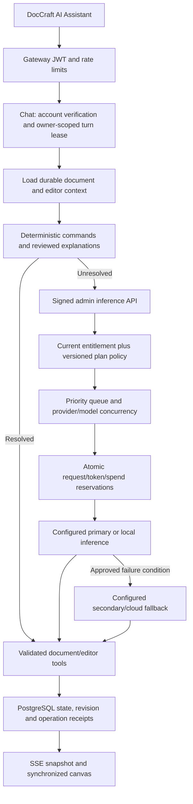

# Optimized hybrid architecture

The upgrade extends the existing Fastify chat orchestrator, Python admin control plane, Express gateway, Prisma conversation storage and React editor. There is no replacement chat service or second document data model.

`hybrid_ai` is a versioned configuration domain in the existing admin database. Providers/models/plan policies are non-secret configuration. AES-GCM credential envelopes occupy a separate table and never enter configuration history or Redis. Admin-api performs upstream inference, keeping credentials out of Chat and both frontends.

Chat pins a routing version for an in-flight turn. Every actual inference rechecks current account status, feature permissions, routing enablement, model/provider revocations and current budgets. Queued calls repeat authorization before dispatch. Assignment-only changes can finish the original turn; disabling a provider/model stops subsequent calls. Current configuration reads go to the database, making authorization correct even during Redis outages. The existing config engine still publishes version changes for other consumers.

Existing owner-scoped optimistic writes, fenced leases and operation receipts make compound updates recoverable. Editor operation arrays are validated before persistence. A business-field update and subsequent style operation can commit separately; a failed turn exposes its saved state and a retry reconciles receipts. No claim of a cross-service distributed transaction is made.

PostgreSQL remains durable storage. Redis handles existing rate limits, leases/caches and service nonce coordination. Budget and queue serialization use PostgreSQL transaction advisory locks; isolated tests use SQLite immediate transactions. This intentionally favors correctness on a single VPS over a new queue service.

Context contains current normalized fields, unresolved decisions and bounded recent history. Large raw provenance/assets are omitted from model prompts. Input admission uses a conservative UTF-8 byte bound plus message overhead rather than pretending one tokenizer fits every provider; operators must allow space for tool schemas. Eight bounded agent iterations prevent infinite tool loops.

Compatibility: managed routing is disabled until explicitly configured and activated. The existing server-environment Groq/Claude routes remain available while disabled. No existing document or billing schema is replaced. Every plan used with managed routing needs an explicit assignment; missing policies fail closed.
