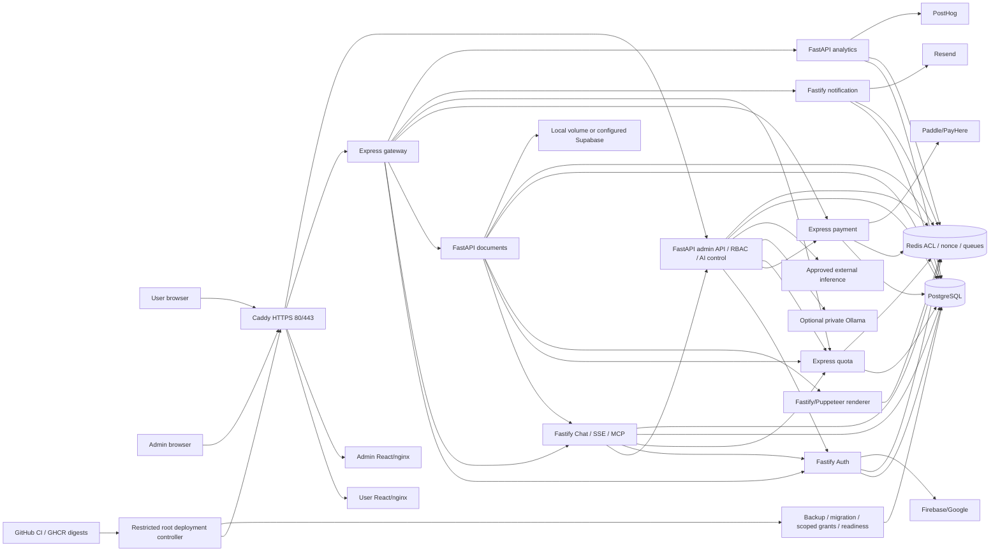

# Current system architecture

Audit date2026-10-21; current dirty working tree is the audit target. Application source was preserved. 21 Compose entries are present:12 application containers (10 backend runtimes and2 frontends), PostgreSQL/Redis/Caddy, optional Ollama, and5 one-shot jobs. Counted from current [Compose](../../deploy/docker/compose.production.yml), package manifests and Python startup files, not prior service-count claims. Native test stack has14 processes/services and omits Caddy/Ollama.

The diagram is a dependency overview; [service-edges.json](evidence/service-edges.json) enumerates170 source URL/helper references and shared/service-permissions.json defines exact receiver/caller/method/path authorization. A graph edge is not proof of a successful live request. SSE chat/MCP is implemented; no explicit WebSocket route declaration was discovered in current application routing. Signed BullMQ queues and signed Redis events carry background work. Runtime tests independently verify selected signed calls/replay and quota chains.

| Service/source | Framework/runtime | Internal port | Build/start | DB/Redis | Exposure/health |
| --- | --- | --- | --- | --- | --- |
| gateway / services/gateway | Express / Node24 | 3001 | npm run build --workspace=doccraft-gateway; ['node', '/app/services/gateway/dist/index.js'] | none; per-service ACL/replay/queue | private/edge-routed or tools-profile job; Dockerfile /health; release verifier /ready |
| auth / services/auth | Fastify / Node24 | 3011 | npm run build --workspace=doccraft-auth; ['node', '/app/services/auth/dist/server.js'] | PostgreSQL scoped role; per-service ACL/replay/queue | private/edge-routed or tools-profile job; Dockerfile /health; release verifier /ready |
| notification / services/notification | Fastify / Node24 | 3012 | npm run build --workspace=doccraft-notification; ['node', '/app/services/notification/dist/server.js'] | PostgreSQL scoped role; per-service ACL/replay/queue | private/edge-routed or tools-profile job; Dockerfile /health; release verifier /ready |
| document / services/document | FastAPI / Python3.13 | 3013 | pip install -c deploy/staging/python.constraints.txt -r services/document/requirements.txt; ['python', '-m', 'uvicorn', 'app.main:app', '--host', '0.0.0.0', '--port', '3013', '--ssl-keyfile', '/run/secrets/service.key', '--ssl-certfile', '/run/secrets/service.crt', '--timeout-graceful-shutdown', '20'] | PostgreSQL scoped role; per-service ACL/replay/queue | private/edge-routed or tools-profile job; Dockerfile /health; release verifier /ready |
| payment / services/payment | Express / Node24 | 3014 | npm run build --workspace=doccraft-payment; ['node', '/app/services/payment/dist/server.js'] | PostgreSQL scoped role; per-service ACL/replay/queue | private/edge-routed or tools-profile job; Dockerfile /health; release verifier /ready |
| quota / services/quota | Express / Node24 | 3015 | npm run build --workspace=doccraft-quota; ['node', '/app/services/quota/dist/server.js'] | PostgreSQL scoped role; per-service ACL/replay/queue | private/edge-routed or tools-profile job; Dockerfile /health; release verifier /ready |
| chat / services/chat | Fastify / Node24 | 3016 | npm run build --workspace=doccraft-ai; ['node', '/app/services/chat/dist/server.js'] | PostgreSQL scoped role; per-service ACL/replay/queue | private/edge-routed or tools-profile job; Dockerfile /health; release verifier /ready |
| analytics / services/analytics | FastAPI / Python3.13 | 3017 | pip install -c deploy/staging/python.constraints.txt -r services/analytics/requirements.txt; ['python', '-m', 'uvicorn', 'app.main:app', '--host', '0.0.0.0', '--port', '3017', '--ssl-keyfile', '/run/secrets/service.key', '--ssl-certfile', '/run/secrets/service.crt', '--timeout-graceful-shutdown', '20'] | PostgreSQL scoped role; per-service ACL/replay/queue | private/edge-routed or tools-profile job; Dockerfile /health; release verifier /ready |
| admin-api / services/admin-api | FastAPI / Python3.13 | 3018 | pip install -c deploy/staging/python.constraints.txt -r services/admin-api/requirements.txt; ['python', '-m', 'uvicorn', 'app.main:app', '--host', '0.0.0.0', '--port', '3018', '--ssl-keyfile', '/run/secrets/service.key', '--ssl-certfile', '/run/secrets/service.crt', '--timeout-graceful-shutdown', '20'] | PostgreSQL scoped role; per-service ACL/replay/queue | private/edge-routed or tools-profile job; Dockerfile /health; release verifier /ready |
| pdf / services/document/puppeteer | Fastify / Node24 | 3023 | npm run build --workspace=doccraft-document; ['node', '/app/services/document/dist/puppeteer/server.js'] | none; per-service ACL/replay/queue | private/edge-routed or tools-profile job; Dockerfile /health; release verifier /ready |
| user-ui / user-frontend | React/Vite→nginx / nginx | 8080 | npm ci && npm run build; image Dockerfile default | none; none | private/edge-routed or tools-profile job; Dockerfile /health; release verifier /ready |
| admin-ui / admin | React/Vite→nginx / nginx | 8080 | npm ci && npm run build; image Dockerfile default | none; none | private/edge-routed or tools-profile job; Dockerfile /health; release verifier /ready |
| postgres / deploy | upstream infrastructure / postgres | 5432 | Pull pinned image / deploy Dockerfile target; ['postgres', '-c', 'ssl=on', '-c', 'ssl_cert_file=/run/doccraft-tls/server.crt', '-c', 'ssl_key_file=/run/doccraft-tls/server.key', '-c', 'ssl_min_protocol_version=TLSv1.2', '-c', 'hba_file=/control/deploy/staging/pg_hba.conf', '-c', 'shared_buffers=128MB', '-c', 'max_connections=160'] | none; none | private/edge-routed or tools-profile job; ['CMD', 'pg_isready', '-U', 'postgres', '-d', '${POSTGRES_DB:?}'] |
| redis / deploy | upstream infrastructure / redis | 6379 | Pull pinned image / deploy Dockerfile target; ['redis-server', '--port', '0', '--tls-port', '6379', '--tls-cert-file', '/run/secrets/redis.crt', '--tls-key-file', '/run/secrets/redis.key', '--tls-ca-cert-file', '/run/secrets/ca.crt', '--tls-auth-clients', 'no', '--aclfile', '/run/secrets/redis.acl', '--appendonly', 'yes', '--appendfsync', 'always', '--maxmemory', '256mb', '--maxmemory-policy', 'noeviction'] | none; persistent Redis service | private/edge-routed or tools-profile job; ['CMD', 'redis-cli', '--tls', '--cacert', '/run/secrets/ca.crt', '--user', 'health', 'ping'] |
| edge / deploy | upstream infrastructure / edge | 80/443 | Pull pinned image / deploy Dockerfile target; image Dockerfile default | none; none | public80/443; ['CMD', 'caddy', 'validate', '--config', '/etc/caddy/Caddyfile'] |
| ollama / deploy | upstream infrastructure / ollama | 11434 | Pull pinned image / deploy Dockerfile target; image Dockerfile default | none; none | private/edge-routed or tools-profile job; ['CMD', 'ollama', 'list'] |
| migrate-node / deploy | one-shot control job / Node24 | None | Pull pinned image / deploy Dockerfile target; ['node', '/app/scripts/staging_migrate_node.mjs'] | owner/migration only; none | private/edge-routed or tools-profile job; bounded process exit + controller gate |
| migrate-python / deploy | one-shot control job / Python3.13 | None | Pull pinned image / deploy Dockerfile target; ['python', '/app/scripts/staging_migrate_python.py'] | owner/migration only; none | private/edge-routed or tools-profile job; bounded process exit + controller gate |
| grant-roles / deploy | one-shot control job / Python3.13 | None | Pull pinned image / deploy Dockerfile target; ['python', '/app/deploy/scripts/database_roles.py'] | owner/migration only; none | private/edge-routed or tools-profile job; bounded process exit + controller gate |
| verify / deploy | one-shot control job / Python3.13 | None | Pull pinned image / deploy Dockerfile target; ['python', '/app/deploy/scripts/verify_release.py'] | none; none | private/edge-routed or tools-profile job; bounded process exit + controller gate |
| backup / deploy | one-shot control job / backup | None | Pull pinned image / deploy Dockerfile target; image Dockerfile default | owner/migration only; none | private/edge-routed or tools-profile job; bounded process exit + controller gate |

[Full service-inventory.json](evidence/service-inventory.json) supplies every service's configuration names, required secret names, internal/external dependencies, auth, health, volumes and resource caps. Secret values are omitted. [configure.py](../../deploy/scripts/configure.py) is the scoped production authority; backend-only identities/TLS and the persistent AI keyring remain separate. PostgreSQL is the durable ledger/state store; Redis is coordination/replay/cache, not sole billing/quota truth.

Inventoried areas include shared JS/Python contracts, four Prisma migration systems, Python schema initializers, notification SQL, PDF workers, payment webhook inbox/outbox, notification delivery/receipts, analytics consumer, recovery loops, quota timers, frontend route stores and the deployment monitor timer. Evidence tiers are in [source-snapshot.json](evidence/source-snapshot.json), API/frontend manifests and pattern-reviewed-files.json. Hashing/pattern enumeration is explicitly not equivalent to line-by-line semantic or runtime verification. Generated dependencies, private env values, model binaries and developer state were excluded from source inventory.
