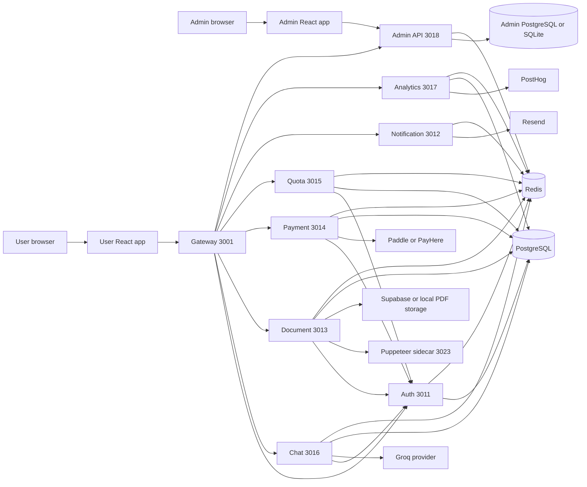
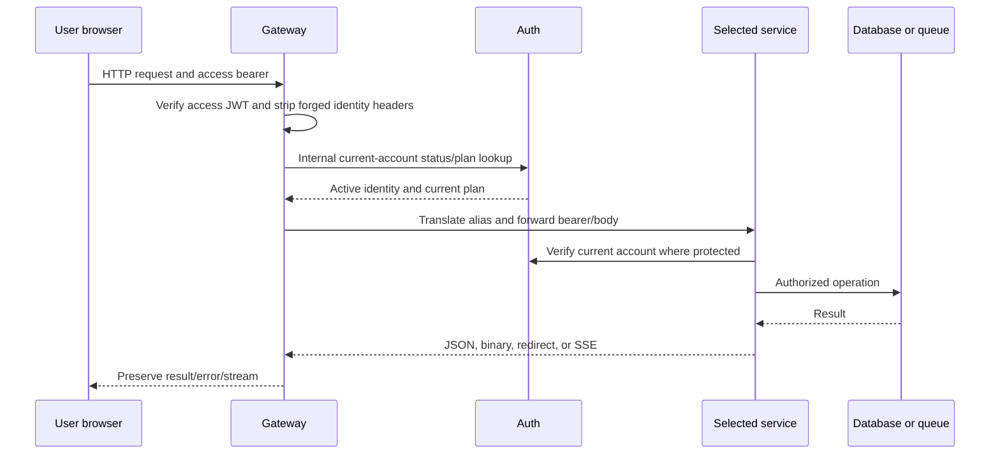
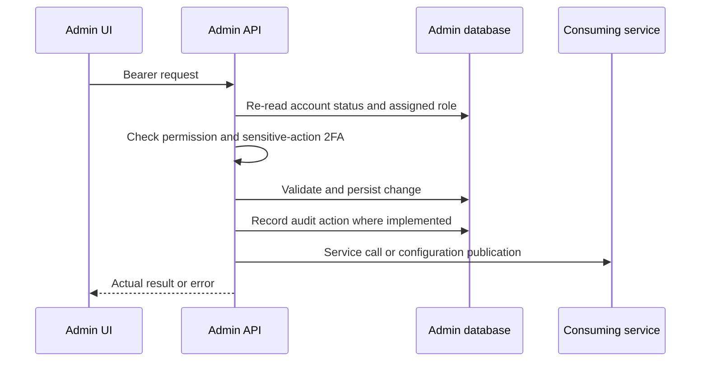
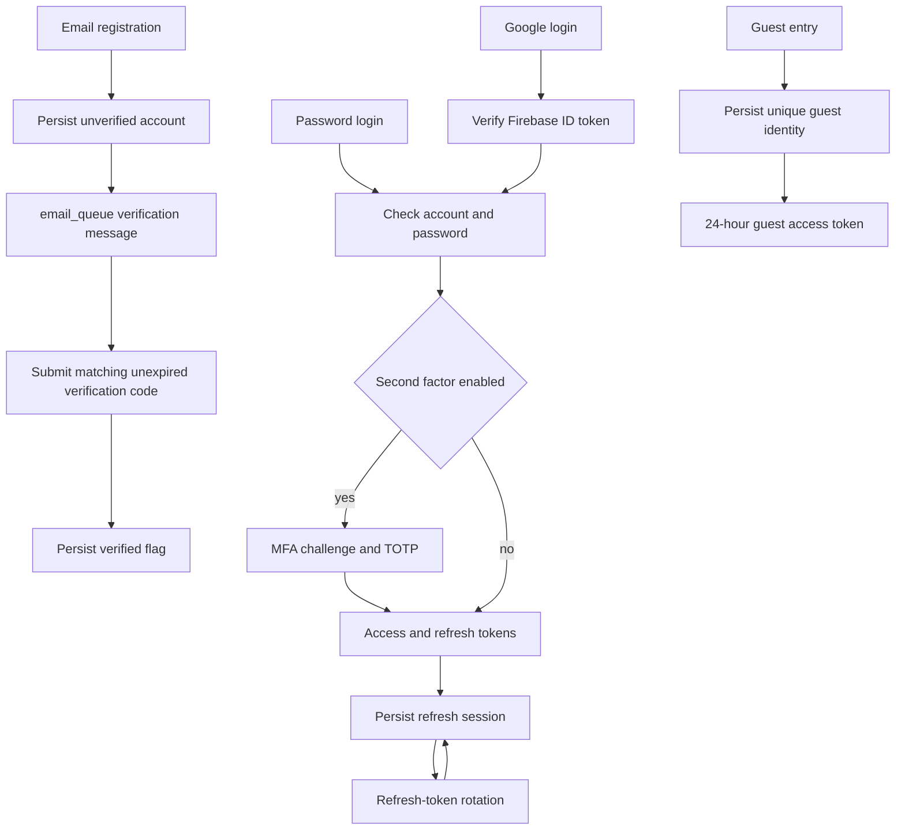
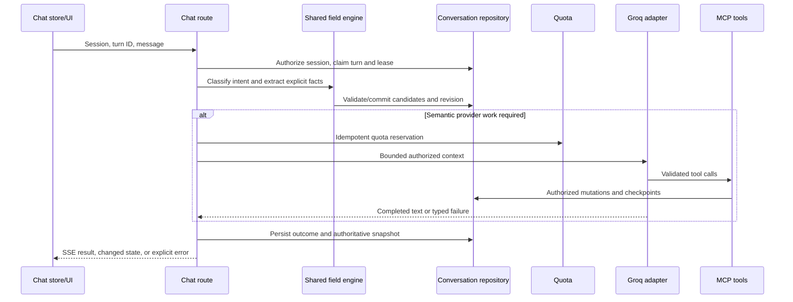
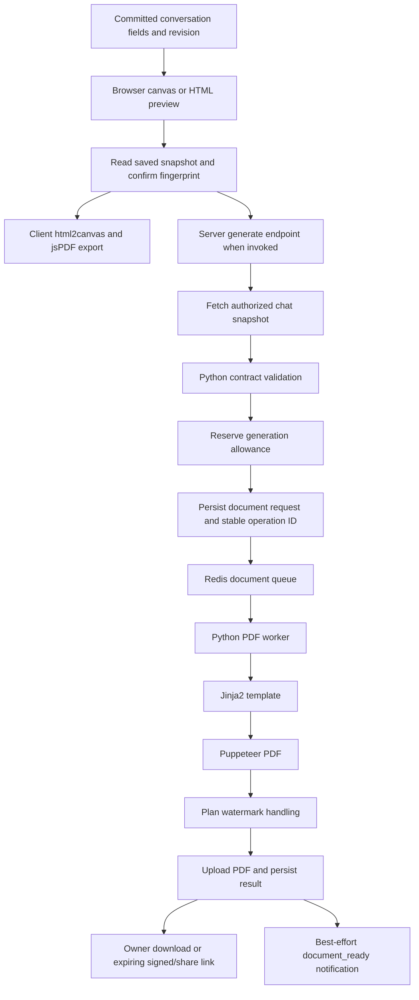
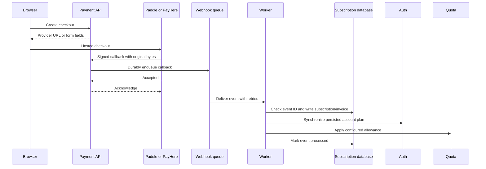
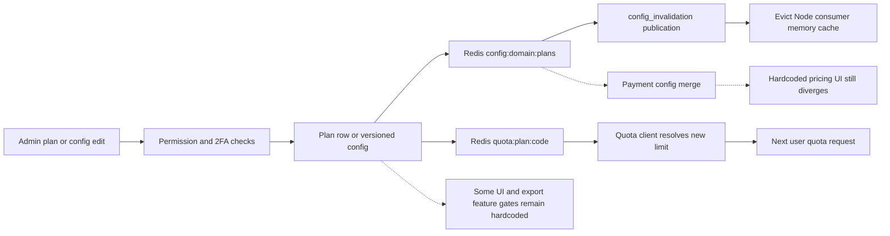
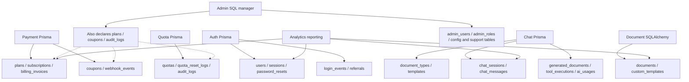

# System architecture

Evidence labels: **VERIFIED** = the stated, limited assertion was exercised; **INFERRED** = source/configuration evidence only; **NOT TESTED** = no execution evidence; **BLOCKED** = safe resources or prerequisites unavailable; **NOT IMPLEMENTED** = absent/placeholder implementation; **FIXED** = correction made in this audit; **UNRESOLVED** = work remains. PASS/FAIL describe a check's observed outcome, not whole-product completeness.

Audit date: 2026-10-15. Tests used isolated fixtures. Existing remote databases, real customers, payment accounts, and email recipients were not mutated. Static discovery counts source definitions, not independent business capabilities.

Observed audit tools: Node v24.20.0, npm 11.19.0, Python 3.13.13 in `.venv-local`. Service virtual environments used a different Python version and lacked pytest. Backend and frontend dependency versions come from the checked-in package manifests/installed local toolchain; this report does not assert that Docker images match those versions.

DocCraft is a document-building application with two browser applications, nine backend services including the gateway, and a PDF-rendering sidecar. It is a mixed Node/TypeScript and Python monorepo. Frontend packages are separate from the root backend workspaces.

The checked-in `.env` and service-specific environment files use **chat 3016** and **notification 3012**. Earlier documentation reversed them. Explicit configuration takes precedence over fallback ports. The audit corrected documentation and relevant fallbacks; it did not start the full remotely configured stack.

## Components

| Component | Source | Responsibility | Port | Dependencies |
| --- | --- | --- | --- | --- |
| User frontend | [user-frontend/src/App.tsx:1](../../user-frontend/src/App.tsx#L1) | React 19, Vite, TypeScript, React Router, Zustand; API clients and builder canvas/export | 5173 configured; 5183 audit | Gateway; browser localStorage/cookies; Firebase; html2canvas/html2pdf/jsPDF |
| Admin frontend | [admin/src/App.tsx:1](../../admin/src/App.tsx#L1) | Separate React/Vite app; 81 navigation IDs, shared subviews, TOTP prompt and admin auth store | 5174 configured; 5184 audit | Direct Admin API; localStorage admin session; Recharts |
| Gateway | [services/gateway/src/index.ts:1](../../services/gateway/src/index.ts#L1) | Express ingress, raw webhook parser, alias translation, JWT/account checks, proxy/SSE, rate limiting | 3001 | Auth, chat, document, payment, quota, notification, analytics, admin API, Redis |
| Auth | [services/auth/src/server.ts:1](../../services/auth/src/server.ts#L1) | Fastify; persistent accounts, guests, password/email/Google/TOTP flows, sessions and internal account APIs | 3011 | Prisma/PostgreSQL, Firebase token verification, Redis email queue, analytics |
| Chat / AI | [services/chat/src/server.ts:1](../../services/chat/src/server.ts#L1) | Fastify SSE and MCP; committed document state, field collection, tool execution, provider orchestration | 3016 | Prisma/PostgreSQL, Redis, Auth, quota, Groq; separate Claude adapter |
| Document | [services/document/app/main.py:1](../../services/document/app/main.py#L1) | FastAPI, SQLAlchemy, Jinja2, embedded BullMQ PDF worker; custom templates, downloads/shares | 3013 | Auth, chat state, quota, Redis document queue, storage, Puppeteer sidecar |
| PDF sidecar | [services/document/puppeteer/server.ts:1](../../services/document/puppeteer/server.ts#L1) | Fastify and Chromium/Puppeteer; self-contained HTML/assets to PDF, loopback-bound | 3023 default; 3029 audit | Node browser process, installed Chromium/fonts; external fetches blocked |
| Payment | [services/payment/src/app.ts:1](../../services/payment/src/app.ts#L1) | Express; plans, subscriptions, provider checkout, webhooks/worker, invoices, coupons, methods | 3014 | Prisma/PostgreSQL, Redis, Paddle, PayHere, Auth, quota, notification |
| Quota | [services/quota/src/app.ts:1](../../services/quota/src/app.ts#L1) | Express; daily counters, atomic Lua reservation, overrides/refunds, guest limits and admin config client | 3015 | Redis, Prisma/PostgreSQL sync, Auth, admin configuration |
| Notification | [services/notification/src/server.ts:1](../../services/notification/src/server.ts#L1) | Fastify; authenticated preferences/logs, internal dispatch, Resend callback, BullMQ email worker | 3012 | Redis email_queue, PostgreSQL, Resend, Auth, admin template/settings feed |
| Analytics | [services/analytics/app/main.py:1](../../services/analytics/app/main.py#L1) | FastAPI, pandas/SQLAlchemy reporting, events and BullMQ/PostHog worker | 3017 | Shared application tables, Redis analytics queue, PostHog |
| Admin API | [services/admin-api/app/main.py:1](../../services/admin-api/app/main.py#L1) | FastAPI control plane; RBAC, TOTP, config/version history, plans, users/support, reporting/automation | 3018 | SQL manager: PostgreSQL or SQLite; Redis; service clients; PostHog/Resend |
| Shared contracts | [shared/document-contract.mjs:1](../../shared/document-contract.mjs#L1) | Cross-runtime field/schema/amount/conversation/stream/assets/tool contracts and tests | Library | JavaScript/TypeScript clients; Python document_contract.py mirror |

## Overall microservices architecture

Database hosting is inferred from configuration only. Several environment files point to a remote Supabase-hosted PostgreSQL project. Database schema/ownership compatibility was not verified against that remote instance. Admin and payment both declare a physical `plans` table with different columns; quota and admin both declare `audit_logs` with different schemas. Treat these as migration blockers rather than assuming their create-if-missing statements reconcile them.

## User request lifecycle

Protected Auth, gateway, chat, payment, quota, and document paths now reject unverified identity headers; current-account lookups prevent stale token plans/status from controlling those workflows. This introduces an Auth availability/latency dependency. Notification user preferences delegate bearer verification to Auth. No load benchmark was performed.

## Admin request lifecycle

The admin browser calls port 3018 directly by default. Gateway admin aliases are also registered, but admin JWTs are distinct from user JWTs; the default direct admin path is the supported browser flow. Do not assume the user gateway accepts admin tokens.

## Authentication workflow

Admin login is a separate password-plus-code flow. Login, password-reset, and sensitive-action email codes now use separate namespaces; codes are not returned in login/reset responses. Admin tokens are checked against current persisted identity/role on each protected request. Missing bootstrap passwords no longer select a source-code fallback. A stable admin signing secret must be configured for sessions to survive process restarts.

## AI chat workflow

The production route's default provider is `runGroqAgenticLoop`. Local extraction may complete a turn without a provider call. Claude adapter/model-router/config helper modules exist, but their plan-ceiling helpers are not called by the active Groq route. Do not describe stored Claude routing preferences as verified enforcement of Groq model access.

## Document generation and export

These are two actual export paths, not a single mandatory pipeline. The primary canvas export can produce a browser PDF without creating a server `documents` row or running the BullMQ worker. Client canvas layout customizations are not generally persisted as the server Jinja template. Automated tests cover semantic synchronization and export guards; a full signed-in browser save/reopen/export journey against PostgreSQL remains BLOCKED.

## Payment and subscription lifecycle

Queue acceptance precedes HTTP success after the fix. Account/quota synchronization failures are retryable worker failures. This is still a distributed sequence, not an atomic transaction/outbox; concurrent duplicate/out-of-order events and crashes between effects need further validation. Provider sandbox behavior was not exercised.

## Admin configuration propagation

Solid quota propagation was exercised with the real admin API, SQLite persistence, Redis, and one long-lived Node consumer. Dashed pricing/flag paths have implementation gaps and are not verified end to end. The historical `monthly_quota` field actually feeds a counter that resets daily at midnight UTC.

## Database and service dependencies

Logical relationships from Prisma include User→Session/PasswordReset/LoginEvent, DocumentType→Template/ChatSession, ChatSession→ChatMessage, and Plan→Subscription→BillingInvoice. Cross-service user IDs and admin role IDs also form logical references; this report does not claim all are enforced foreign keys in the live database. SQLAlchemy `documents` and Prisma `generated_documents` are different tables.

## Infrastructure, configuration and recovery

Root Compose defines Redis plus application containers; it does not define a PostgreSQL container. Service Compose files are separate alternatives, not automatically additional root services. `infrastructure/` contains no implemented deployment stack beyond its checked-in contents. Docker image execution was NOT TESTED because Docker is unavailable in this audit environment.

Auth/chat have checked-in Prisma migrations. Payment/quota declare Prisma schemas but do not have equivalent checked-in migration directories. Document startup performs `create_all` plus selected PostgreSQL `ALTER TABLE` statements; admin database construction performs schema initialization on import. Starting a Python service is therefore not necessarily read-only. No migrations were run against shared resources.

Health endpoints mostly establish process liveness. Redis/database/provider readiness, worker restart recovery, browser state reconciliation, resource caps, and sustained latency need separate checks. Puppeteer launches a browser per request; provider timeouts, chat concurrency/rate limits, payment queue retries, logging, Prometheus/Sentry-related integration points, and graceful shutdown code exist, but full operational reliability is not proven by their presence.
