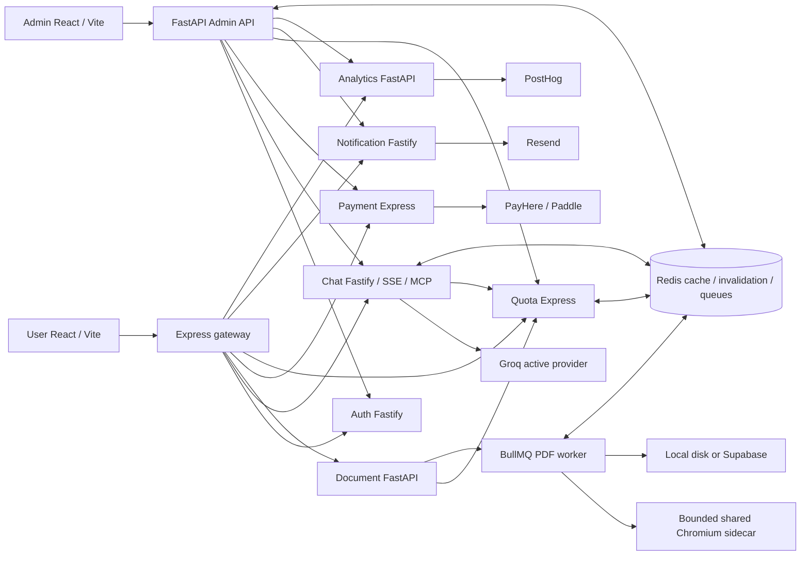
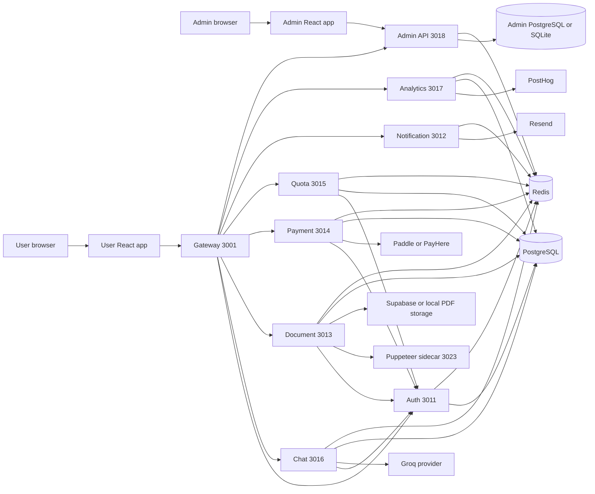
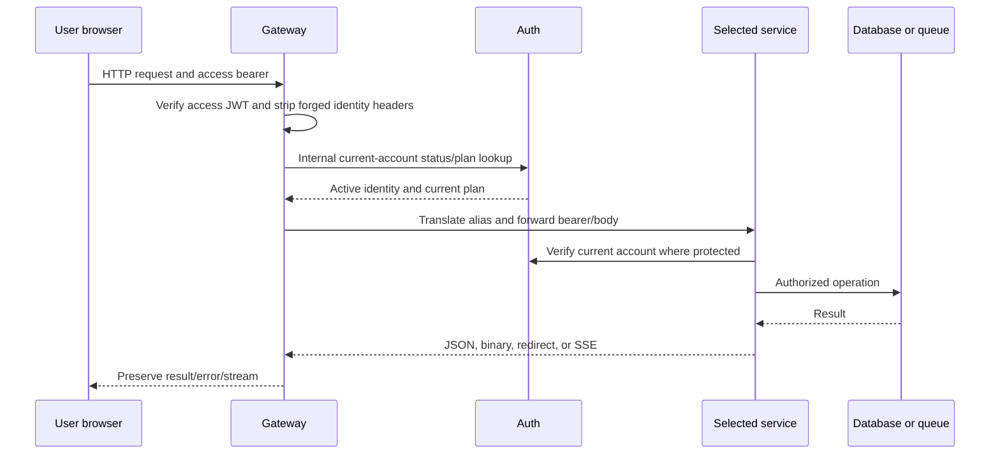
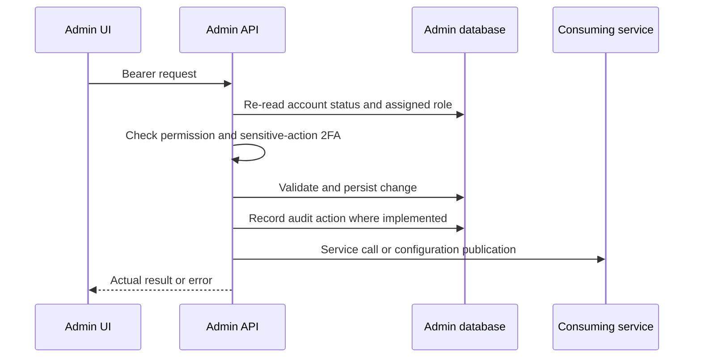
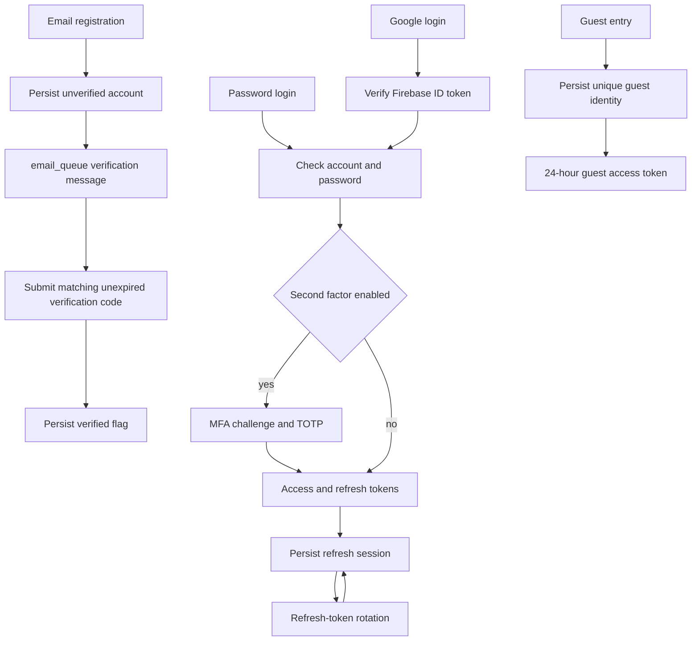
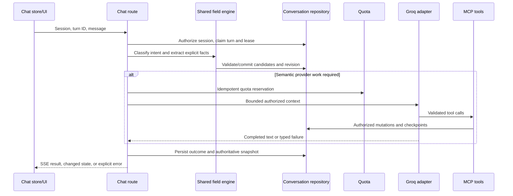
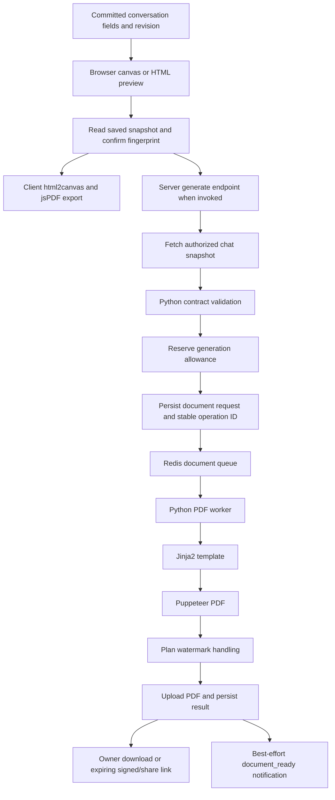
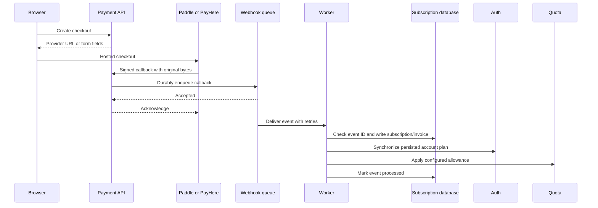
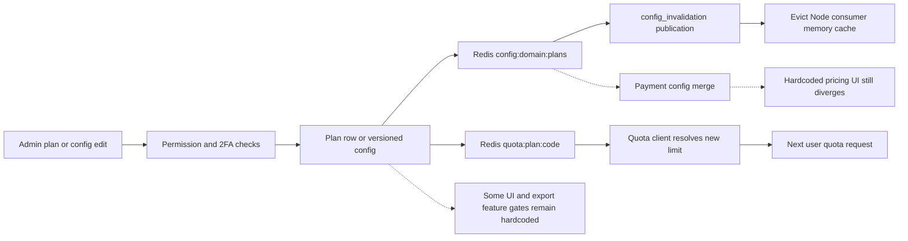
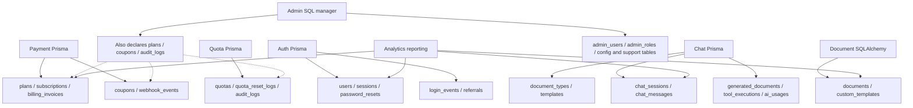

# DocCraft — Full Project Report

## Phase 2 — Remediation and Production Readiness Verification

**Current decision: NOT READY.** Phase 2 resolved **6 of the original 15 source finding groups**; **9 remain partially corrected, unresolved or blocked**. The work corrected **13 additional defect groups**. Original findings are not all code bugs: product gaps, provider access and credential/deployment evidence remain separate.

Both frontend lint checks and all three build commands pass. The latest real local stack run has **89/89 verified assertions**, with **6/6 actual browser assertions**. These overlap by design: the stack includes a browser-harness completion assertion. Mocked tests are not counted as live provider verification.

Current discovery: **694 scanned text files, 1368 source inventory entries, 81 admin navigation IDs**. Phase 1's 666/1369 counts are historical; source deletions/additions change the inventory. Entries are definitions, not independent completed business features. All current entries are listed in the updated coverage appendix; no overall functionality percentage is justified.

Phase 2 changed **171 source/configuration/documentation-tooling files relative to the saved Phase 2 baseline**, plus all 13 requested reports and generated evidence. This is not the count of the entire dirty Git tree; pre-existing Phase 1/unrelated changes were preserved. See [phase2-changed-files.json](docs/system-audit/evidence/phase2/phase2-changed-files.json) and [phase2-summary.json](docs/system-audit/evidence/phase2/phase2-summary.json).

### Product decisions and final behavior

The user decided that administrators select billing currency and explicit prices. Implemented supported choices are **USD and LKR**, with separate monthly/yearly amounts; there is no guessed exchange-rate conversion. Checkout validates the selected currency against the chosen provider. This does not add arbitrary-currency support.

The user also chose **AI chat requests plus generated documents** as the daily quota unit. The UI now says “AI chat requests + server PDF generations per day.” Provider-requiring AI turns and server generations reserve units; deterministic field edits do not call a provider. Browser-side canvas export remains a separate path and does not currently enforce the same server generation meter; that gap remains U-R08/U-R11. The legacy `monthly_quota` field name stores the daily allowance for wire compatibility.

### Actual architecture and execution boundaries

Execution used an owned PostgreSQL 18.4 instance on loopback, independent uniquely named databases per run, an isolated Redis process and synthetic credentials. Four services ran their actual checked-in Prisma migrations; SQLAlchemy/custom SQL components initialized against that isolated database. Node services, two FastAPI apps, the PDF worker, Chromium and both Vite frontends ran as real local processes. The Analytics service's standalone authorization suite used disposable SQLite; it was not part of the live nine-process harness. No configured hosted database, real charge, real email, Firebase account or Supabase bucket was mutated.

The binaries and temporary cluster were outside Git. The database harness accepts only a loopback `PG_AUDIT_URL`, creates a unique database and never resets an existing database. Its local migration/browser/PDF artifacts are reviewable. Fresh-schema success does not validate an upgrade against a deployed legacy database.
### Current overall services

All nine current workflow/dependency diagrams: [01-SYSTEM_ARCHITECTURE.md](docs/system-audit/01-SYSTEM_ARCHITECTURE.md).

### Original 15 findings and final disposition

| ID | Severity | Component | Root cause | Fix plan / implemented correction | Verification / remaining dependency | Status |
| --- | --- | --- | --- | --- | --- | --- |
| U-R01 | High | Admin / Payment / Quota databases | Incompatible physical plans, coupons and audit_logs ownership | Namespaced admin tables and quota audit table; additive legacy-copy compatibility; reconciled checked-in migrations | Fresh PostgreSQL migrate deploy for four Prisma services; 97 admin tests include legacy-copy cases | FIXED |
| U-R02 | High | Pricing / checkout / billing | Static prices and USD values treated as LKR; benefits and actual limits diverged | Admin chooses USD/LKR and explicit amounts; canonical catalog and currency-compatible provider; annual checkout intent and live quota updates | Real admin price UI → PostgreSQL → user pricing reload; signed local annual PayHere lifecycle. Provider sandbox and mixed-currency financial reporting remain open | UNRESOLVED — partial correction |
| U-R03 | High | Active Groq model routing | Unused Claude ceiling did not constrain active Groq fallback | Intersect deployment Groq models with per-plan administrator allowlist; fail closed on policy outage; five-second refresh | Three policy units, provider-loop regressions and builds; actual external model behavior remains BLOCKED | FIXED |
| U-R04 | High | Entitlements / user gates | Plan features and separate feature_flags domain do not consistently control logo, templates, priority, retention or Max behavior | Canonical displayed benefits improved; implement an authoritative entitlement response and connect each remaining consumer | Source traces only for unresolved gates; complete toggle matrix NOT TESTED | UNRESOLVED |
| U-R05 | High | Payment method management | Process-memory metadata imitated payment method persistence | Remove raw card CRUD UI/store; provider-hosted billing portal; unsupported raw-card mutations return 501 | Payment unit regressions, frontend contracts/build; provider-hosted portal remains externally BLOCKED | FIXED — unsafe local flow removed |
| U-R06 | High | Templates / announcements | Placeholder publication modules; no user announcement consumer | Authenticated announcements now reach user banner; empty/error states replace fake template publishing success. Publication pipeline still absent | Actual create/read/disable/delete announcement APIs and user feed verified; template publication NOT IMPLEMENTED | UNRESOLVED — partial correction |
| U-R07 | High | Payment webhook worker | Check/effect/mark spans services; no atomic claim/outbox or ordered reconciliation | Fix callback ownership, recurring IDs, BullMQ IDs and invoice retry behavior; design transactional outbox/order reconciliation separately | Eight concurrent signed local duplicates yield one invoice; worker crash windows, reordered callbacks and real sandbox remain unverified | UNRESOLVED — partial correction |
| U-R08 | High | Quota / document worker | Mixed metering wording, unowned/non-idempotent refunds and incomplete crash recovery | User chose AI requests plus server generations; explicit wording; owned reservation/refund receipts; preserve successful PDF jobs and refund terminal failure once | Real Redis 12-way duplicate reserve/refund tests; quota units; five actual worker exports. Cross-store crash/day-reset reconciliation and browser export metering remain open | UNRESOLVED — partial correction |
| U-R09 | Medium | Both frontends | Unsafe any contracts, invalid effects/ref reads, unused code and purity violations | Explicit API/domain types; committed event callbacks, effect dependencies, ref/state ownership and keyed forms; no rule suppression or exclusion changes | Both npm run lint commands and both frontend builds PASS | FIXED |
| U-R10 | High | Deployment credentials | Formerly embedded defaults may remain active in history/deployments | Owner must revoke/rotate any affected database/provider/signing/internal/bootstrap credentials and verify consistent secret delivery | No production credential validity or revocation attempted; proof is unavailable locally | BLOCKED |
| U-R11 | Medium | Guest / canvas / history | Guest identity transition resets builder; server state, canvas layout and browser PDF/history have distinct persistence contracts | Wire actual chat-session history open/delete and display accurate state/currency; persistent canvas layout and guest migration still require implementation | Actual authenticated session save/reload/delete and server PDF verified; guest-to-account transfer and browser layout/export reload NOT TESTED / NOT IMPLEMENTED | UNRESOLVED — partial correction |
| U-R12 | High | Analytics / admin authentication / abuse | Direct analytics authorization gaps; OTP attempts and submission abuse insufficiently controlled | Protect direct reporting/events with internal secret or Auth verification; atomically limit/consume admin email challenges; secure private notification config feed | Analytics authorization units, admin challenge/concurrency tests and 123 API denial probes. Public support abuse, action-TOTP budgets and full session revocation remain open | UNRESOLVED — partial correction |
| U-R13 | Medium | Readiness / capacity / recovery | Liveness-only checks; repeated Chromium startup and unknown dependency capacity | Shared bounded Chromium process, page/launch timeouts, readiness and explicit overload response; measure narrow local burst/restart behavior | Five queued PDFs plus renderer capacity/recovery probe when recorded; service-wide dependency readiness, capacity and queue-drain benchmarks NOT TESTED | UNRESOLVED — partial correction |
| U-R14 | Medium | Configuration / migrations / test tooling | Chat port drift, missing Prisma migrations and unsafe stale document test entry point | Correct chat fallback port; add schema-compatible checked-in migrations; isolated local harness; legacy document entry point now launches isolated pytest | Four actual Prisma migrate deploy runs, all local services start, document legacy entry point 69 tests PASS. Existing deployment baselines still require review | FIXED — local tooling/schema scope |
| U-R15 | Medium | Admin MCP inspection | Wrong auth/transport lifecycle and no live resource inspection consumer | Private credential-gated read-only Streamable HTTP MCP, initialize/initialized/resources-read lifecycle, audited support RBAC endpoint and actual admin inspection UI | Five real resource reads, two private transport authorization units and live browser session inspection | FIXED |

### New defects and exact corrections

| Bug ID | Severity | Root cause / before | Fix / after | Affected source | Regression status |
| --- | --- | --- | --- | --- | --- |
| P2-N01 | Critical | PayHere trusted mutable custom fields rather than a server-bound purchase | CheckoutIntent binds owner/plan/cadence/amount/currency; validate exact amount, merchant and signature | [services/payment/src/services/subscription.service.ts](services/payment/src/services/subscription.service.ts) | FIXED — Local forged custom fields cannot grant the second user paid access; checkout-security units |
| P2-N02 | High | Annual PayHere purchases recurred/expired monthly | Annual provider recurrence and server-bound yearly entitlement period | [services/payment/src/services/payhere.service.ts](services/payment/src/services/payhere.service.ts) | FIXED — Hosted annual form and signed callback period verified locally |
| P2-N03 | High | Colon-delimited BullMQ job IDs rejected valid callbacks | Hash gateway plus idempotency key into a valid stable job ID | [services/payment/src/queues/payment-webhook.queue.ts](services/payment/src/queues/payment-webhook.queue.ts) | FIXED — Real Redis webhook acceptance and downstream subscription/invoice verified |
| P2-N04 | High | Order/status deduplication discarded later recurring payments | Include provider payment_id in producer and worker event identity | [services/payment/src/controllers/payment.controller.ts](services/payment/src/controllers/payment.controller.ts) | FIXED — Payment regression fixtures; local duplicate deliveries still produce one invoice |
| P2-N05 | High | Billing wrote permanent administrator-style quota overrides | Separate plan baseline sync; clear only legacy system-created overrides and retain explicit staff grants | [services/quota/src/services/plan-sync.service.ts](services/quota/src/services/plan-sync.service.ts) | FIXED — Already-active paid subscriber receives new admin quota without a usage reset |
| P2-N06 | Medium | Admin fake login role controls and transport errors manufactured account/recovery success | Remove local role switching and fake login path; fail on network errors; default missing permissions closed; validate user identity before storing access tokens | [admin/src/store/adminAuthStore.ts](admin/src/store/adminAuthStore.ts) | FIXED — Lint/build and browser API-error regressions; complete live password recovery delivery remains blocked |
| P2-N07 | Medium | History controls, row status, amount and field contracts were disconnected | Use typed real sessions, wire reopen/delete and accurate currency/total/draft labels | [user-frontend/src/hooks/useUserDocuments.ts](user-frontend/src/hooks/useUserDocuments.ts) | FIXED — Unit/build checks and actual API session deletion; all history browser controls NOT TESTED |
| P2-N08 | High | Notification configuration feed exposed internal operational template/settings data | Require internal secret; publish a separate authenticated announcement feed | [services/admin-api/app/api/v1/notifications.py](services/admin-api/app/api/v1/notifications.py) | FIXED — 123 denial probes include protected config feed; actual announcement downstream read |
| P2-N09 | High | Analytics URL normalization stripped SSL options and damaged SQLite URLs | Remove only Prisma-specific PostgreSQL parameters and preserve SQLite/SSL semantics | [services/analytics/app/services/db.py](services/analytics/app/services/db.py) | FIXED — Analytics authorization suite runs on actual isolated SQLite; encrypted hosted connection NOT TESTED |
| P2-N10 | High | Proxied CORS headers overwrote gateway origin policy | Gateway owns Access-Control response headers; localhost exception disabled in production | [services/gateway/src/services/proxyClient.service.ts](services/gateway/src/services/proxyClient.service.ts) | FIXED — Real HTTP upstream/gateway CORS regression and live browser price requests |
| P2-N11 | High | Admin screens fabricated telemetry/subscriptions/user/template data and marked failed mutations successful | Show real zero/empty/error states; no local-only publish/toggle success; wire actual announcement delete and quota removal | [admin/src/pages/subviews/SubscriptionsView.tsx](admin/src/pages/subviews/SubscriptionsView.tsx) | FIXED — Strict types/lint/build and error-state browser probes; each successful CRUD control is not universally verified |
| P2-N12 | High | Unified override ignored plan; quota client referenced nonexistent local_url and swallowed failures | Actually update Auth plan, reject invalid quota values before persistence, use base_url, check downstream HTTP status and expose partial-sync failure | [services/admin-api/app/api/v1/users.py](services/admin-api/app/api/v1/users.py) | FIXED — Actual admin override reaches Auth and Quota APIs; focused unit asserts plan mutation |
| P2-N13 | High | Deleted admin quota override remained in Quota durable mirror and could be resurrected by billing sync | Internal authenticated mirror-removal endpoint; admin removes durable mirror before acknowledging deletion | [services/quota/src/routes/quota.routes.ts](services/quota/src/routes/quota.routes.ts) | FIXED — Real override removal followed by billing plan sync; failure unit preserves admin record |

### Lint, builds, automated tests and integration evidence

| Check | Latest result | Scope / observed count | Evidence |
| --- | --- | --- | --- |
| Backend workspaces build | PASS | PASS | [phase2-build-after-quota-fix](docs/system-audit/evidence/phase2-build-after-quota-fix.json) |
| User frontend lint | PASS | PASS | [phase2-last-user-lint](docs/system-audit/evidence/phase2-last-user-lint.json) |
| Admin frontend lint | PASS | PASS | [phase2-last-admin-lint](docs/system-audit/evidence/phase2-last-admin-lint.json) |
| User frontend build | PASS | PASS | [phase2-last-user-build](docs/system-audit/evidence/phase2-last-user-build.json) |
| Admin frontend build | PASS | PASS | [phase2-last-admin-build](docs/system-audit/evidence/phase2-last-admin-build.json) |
| Shared + chat/frontend contract regressions | PASS | 223 Node tests + 216 Vitest tests passed | [phase2-final-valid-account-regression](docs/system-audit/evidence/phase2-final-valid-account-regression.json) |
| Auth units/contracts | PASS | 35 passed | [phase2-final-auth](docs/system-audit/evidence/phase2-final-auth.json) |
| Payment units/contracts | PASS | 62 passed | [phase2-final-payment](docs/system-audit/evidence/phase2-final-payment.json) |
| Quota units/contracts | PASS | 25 passed; later durable-removal route verified in actual stack | [phase2-final-quota-route-regression](docs/system-audit/evidence/phase2-final-quota-route-regression.json) |
| Gateway / notification security / real CORS | PASS | 37 passed; some root-suite overlap | [phase2-final-gateway-notification](docs/system-audit/evidence/phase2-final-gateway-notification.json) |
| Admin API units/in-process contracts | PASS | 97 passed | [phase2-final-admin-validation](docs/system-audit/evidence/phase2-final-admin-validation.json) |
| Analytics authorization | PASS | 3 passed | [phase2-final-analytics-tests](docs/system-audit/evidence/phase2-final-analytics-tests.json) |
| Legacy document entry point / isolated pytest | PASS | 69 passed | [phase2-final-document-tests](docs/system-audit/evidence/phase2-final-document-tests.json) |
| Mounted admin API denial probes | PASS | 123 denied as expected; 133 mounted method/path operations | [phase2-final-api-auth](docs/system-audit/evidence/phase2-final-api-auth.json) |
| Real migrated stack / admin / billing / chat / worker | PASS | 89/89 VERIFIED | [phase2-final-tax-crud-stack](docs/system-audit/evidence/phase2-final-tax-crud-stack.json) |
| Renderer PDF/security, capacity/recovery, browser error states | PASS | 18 PDF probes; 96 browser scenarios; see exact command result | [phase2-probes-recovery-retest](docs/system-audit/evidence/phase2-probes-recovery-retest.json) |

Environment prerequisites: [environment.json](docs/system-audit/evidence/phase2/environment.json). Exploratory quality diagnostics are retained under `evidence/phase2/manual-quality-diagnostics/`; final wrapped checks above are authoritative. The owned PostgreSQL fixture was stopped after verification; application processes were cleaned up and isolated data files retained.

### User workflow verification

Five document types completed actual deterministic multi-turn chat → persisted slots → confirmation → Redis job → PDF worker → Chromium → local stored PDF → authenticated download, with corrected values extracted from the PDF. Session/document deletion and cross-user access checks passed; four financial exports also contained the expected tax-inclusive total of 43.89. This does not verify external AI intelligence or the separate browser-canvas layout persistence/export path. Actual provider keys were disabled.

### Admin workflow and downstream results

| Admin change | Backend service | Stored state | User effect | Test result |
| --- | --- | --- | --- | --- |
| Isolated test rate policy persists through admin configuration | Admin API → Auth / Quota / Payment / Notification / Chat as applicable | Own local PostgreSQL / Redis fixture | Fresh consuming API / MCP state; browser proof only where separately listed | VERIFIED |
| Admin daily allowance reaches authenticated user quota | Admin API → Auth / Quota / Payment / Notification / Chat as applicable | Own local PostgreSQL / Redis fixture | Fresh consuming API / MCP state; browser proof only where separately listed | VERIFIED |
| Unified admin override persists plan and quota into user APIs | Admin API → Auth / Quota / Payment / Notification / Chat as applicable | Own local PostgreSQL / Redis fixture | Fresh consuming API / MCP state; browser proof only where separately listed | VERIFIED |
| Override removal survives subsequent billing plan synchronization | Admin API → Auth / Quota / Payment / Notification / Chat as applicable | Own local PostgreSQL / Redis fixture | Fresh consuming API / MCP state; browser proof only where separately listed | VERIFIED |
| Admin announcement reaches the authenticated user feed | Admin API → Auth / Quota / Payment / Notification / Chat as applicable | Own local PostgreSQL / Redis fixture | Fresh consuming API / MCP state; browser proof only where separately listed | VERIFIED |
| Disabled announcement disappears from fresh user feed | Admin API → Auth / Quota / Payment / Notification / Chat as applicable | Own local PostgreSQL / Redis fixture | Fresh consuming API / MCP state; browser proof only where separately listed | VERIFIED |
| invoice admin MCP resource read | Admin API → Auth / Quota / Payment / Notification / Chat as applicable | Own local PostgreSQL / Redis fixture | Fresh consuming API / MCP state; browser proof only where separately listed | VERIFIED |
| quotation admin MCP resource read | Admin API → Auth / Quota / Payment / Notification / Chat as applicable | Own local PostgreSQL / Redis fixture | Fresh consuming API / MCP state; browser proof only where separately listed | VERIFIED |
| proposal admin MCP resource read | Admin API → Auth / Quota / Payment / Notification / Chat as applicable | Own local PostgreSQL / Redis fixture | Fresh consuming API / MCP state; browser proof only where separately listed | VERIFIED |
| receipt admin MCP resource read | Admin API → Auth / Quota / Payment / Notification / Chat as applicable | Own local PostgreSQL / Redis fixture | Fresh consuming API / MCP state; browser proof only where separately listed | VERIFIED |
| purchase_order admin MCP resource read | Admin API → Auth / Quota / Payment / Notification / Chat as applicable | Own local PostgreSQL / Redis fixture | Fresh consuming API / MCP state; browser proof only where separately listed | VERIFIED |
| Admin currency and prices reach public pricing | Admin API → Auth / Quota / Payment / Notification / Chat as applicable | Own local PostgreSQL / Redis fixture | Fresh consuming API / MCP state; browser proof only where separately listed | VERIFIED |
| Admin plan change reaches an already-active paid subscriber | Admin API → Auth / Quota / Payment / Notification / Chat as applicable | Own local PostgreSQL / Redis fixture | Fresh consuming API / MCP state; browser proof only where separately listed | VERIFIED |
| Admin suspension invalidates an existing user access token | Admin API → Auth / Quota / Payment / Notification / Chat as applicable | Own local PostgreSQL / Redis fixture | Fresh consuming API / MCP state; browser proof only where separately listed | VERIFIED |
| Admin reactivation restores permitted access | Admin API → Auth / Quota / Payment / Notification / Chat as applicable | Own local PostgreSQL / Redis fixture | Fresh consuming API / MCP state; browser proof only where separately listed | VERIFIED |

Six live browser checks cover admin price/currency mutation and reload, private MCP inspection and user pricing persistence/mobile rendering. All 81 navigation entries are inventoried, but positive CRUD/downstream verification for every control is still incomplete. Announcement persistence/feed, account status, override grant/removal and existing-subscriber allowance propagation have real local API/database evidence. Template publication remains absent.

### Billing and entitlement consistency

Explicit admin currency/prices reach hosted checkout forms, signed local callbacks bind the server-owned account/plan/amount/cadence, duplicate callbacks create one invoice and the actual paid account receives current quota values. Manual plan overrides now mutate Auth and durable quota removal survives later plan sync. Hosted provider method management replaces fake local raw-card storage. Real sandbox lifecycle and cross-currency revenue normalization are not verified; ordered transactional event recovery remains incomplete.

### Six blocked and three unrun categories

| Gate | Previous category | Workflow | Current status | Evidence / exact prerequisite |
| --- | --- | --- | --- | --- |
| EXT01 | Original blocked 1/6 | PostgreSQL-backed CRUD / browser persistence | VERIFIED in tested scope; incomplete overall | Owned local PostgreSQL + checked-in migrations, real Redis and nine running application endpoints; recorded stack checks and six browser checks. Remaining controls in 81 admin sections are NOT TESTED. |
| EXT02 | Original blocked 2/6 | Live Groq/Claude intelligence, provider fallback and cost/quota | BLOCKED | Supply an approved provider sandbox/project and bounded test budget. Local deterministic multi-turn tests and mocked provider-loop units are separate evidence. |
| EXT03 | Original blocked 3/6 | Google/Firebase interactive authentication | BLOCKED | A controlled Firebase project and test identity/browser flow are required; no production identity was used. |
| EXT04 | Original blocked 4/6 | Real Paddle/PayHere sandbox lifecycle | BLOCKED | Register sandbox products/prices and callback endpoints; exercise checkout, renewals, upgrades/downgrades, cancellation, refunds and out-of-order deliveries. Signed local PayHere callbacks are VERIFIED fixtures, not provider delivery. |
| EXT05 | Original blocked 5/6 | Resend delivery and provider callbacks | BLOCKED | Approved sandbox sender/recipient and registered callback are required; local worker uses dummy transport and sends no real communication. |
| EXT06 | Original blocked 6/6 | Supabase bucket lifecycle / signed links | BLOCKED | Approved isolated test bucket and credentials are required. Local-disk signed downloads and PDFs are verified separately. |
| EXT07 | Original not-run 1/3 | Docker image build/deploy/runtime | BLOCKED / NOT TESTED | Docker/Podman unavailable in the accessible environment; Compose parsing and local process startup are not container/deployment evidence. |
| EXT08 | Original not-run 2/3 | Broad load / responsive / accessibility / disaster recovery | PARTIALLY VERIFIED; remainder NOT TESTED | One 390px pricing viewport plus a narrow renderer burst/owned-browser restart probe are recorded when successful; no full accessibility audit, load SLO or disaster recovery rehearsal. |
| EXT09 | Original not-run 3/3 | Unsafe legacy live document test | FIXED / VERIFIED | Replaced with an isolated pytest entry point and executed it: 69 tests passed, no shared data mutation. |

### Production-readiness decision

| Area | Evidence | Gate status |
| --- | --- | --- |
| Builds / types / lint | Backend and both frontends build; both configured lint commands pass | VERIFIED locally |
| Authentication / authorization | Real registration/verification/login/profile/status checks; role and ownership regressions; 123 denial probes | PARTIAL — interactive Google and complete session revocation not verified |
| Database | Checked-in fresh migrations + shared-service CRUD; legacy-copy unit cases | PARTIAL — deployed upgrade/baseline/rollback review required |
| AI chat | Deterministic multi-turn persisted edits; provider/tool mocks and active model policy tests | BLOCKED — live provider intelligence/fallback not tested |
| Documents | Five real worker exports; template PDF/security suite; authenticated persistence/deletion | PARTIAL — browser canvas layout/guest migration/sharing matrix |
| Billing / quotas | Signed local PayHere annual lifecycle, duplicate callbacks, actual entitlements, concurrent Lua receipts | PARTIAL — real provider lifecycle, event order/crash reconciliation and mixed-currency revenue |
| Admin | Real plan UI, MCP inspection, overrides, announcements, status/config propagation | PARTIAL — not every CRUD/control across all 81 sections |
| Infrastructure / recovery | Local startup; bounded renderer readiness/burst/restart where evidenced | PARTIAL — containers, full load, dependency readiness and recovery drills |
| Security / observability | Confirmed local boundary fixes and tests; durable audit/error evidence | BLOCKED — owner credential rotation evidence; abuse/session/outbox gaps |

**NOT READY.** Missing mandatory live provider, full workflow and recovery/security evidence prevents a release-ready or conditionally-ready claim. Passing builds, lint and scoped local tests do not remove these gates.

### Required deployment and rollback considerations

1. Back up and inspect the actual deployment schema read-only. **Do not run the new Payment/Quota initial migrations blindly against populated databases**: establish a reviewed Prisma baseline. Validate legacy plan/coupon/audit-table ownership and compatible copy predicates. Retain old audit history; moving historical quota events to `quota_audit_logs` needs an explicit reviewed copy, not a reset.
2. Preflight Chat status/role values before enum conversion; unexpected legacy text must fail the migration. Rehearse locks, startup order and data preservation on an isolated copy. Auth verification fields and Chat persistence tables must exist before new code starts. Admin namespace copies preserve old tables and do not overwrite current namespaced rows.
3. Deploy the CheckoutIntent schema before enabling new checkouts. Reconcile in-flight legacy PayHere orders without intents from trusted provider/account records; the new worker rejects unbound callbacks. Configure explicit USD/LKR amounts and real sandbox product/price identifiers first. No currency conversion or price-identifier fabrication is provided.
4. Supply rotated stable signing/internal/bootstrap secrets and correct service URLs privately. Keep the read-only MCP endpoint on the private service network; admin RBAC/auditing is enforced at its consuming endpoint. Back up configuration versions and verify Redis invalidation/override recovery.
5. Preserve database backups and queue/event evidence. Roll back compatible application/configuration versions only after checking namespace/ledger compatibility; do not drop the new tables or undo enum conversion against live writers. A blind return to old admin table names can read incompatible/stale rows. Prefer a reviewed forward correction; rehearse recovery before release.
6. Release remains blocked until the original high-risk gaps and mandatory provider/CRUD/operational gates pass or a narrower release scope is explicitly approved. No such narrower approval was supplied in this task.

### Remaining blockers and exact next actions

- Implement and test ordered transactional payment event claims/outbox/reconciliation, quota crash/day-boundary accounting and durable override expiry/recovery; include out-of-order and restart fault injection.
- Finish one authoritative entitlement contract for every feature consumer; complete template publication and the guest/canvas/browser-export persistence contract. Verify successful user/admin CRUD for the remaining inventory entries.
- Repair currency-aware financial aggregation; LKR and USD must not be summed or labeled as USD without an explicit approved conversion policy. Verify real sandbox upgrade/downgrade/cancel/refund/trial/coupon rules and advertised benefits.
- Provide controlled sandbox resources for Groq/Claude, Firebase, Paddle/PayHere, Resend and Supabase, then run their actual workflows. Provider mocks and signed local callbacks cannot clear those gates.
- Obtain credential-rotation proof and a read-only deployed-schema/configuration review; rehearse baseline migrations and rollback. Run container builds, service-wide dependency-readiness checks, load/accessibility/responsive and disaster-recovery tests in a capable environment.

### Detailed reports

- [00-OVERALL_SYSTEM_REPORT.md](docs/system-audit/00-OVERALL_SYSTEM_REPORT.md)
- [01-SYSTEM_ARCHITECTURE.md](docs/system-audit/01-SYSTEM_ARCHITECTURE.md)
- [02-USER_WORKFLOWS.md](docs/system-audit/02-USER_WORKFLOWS.md)
- [03-ADMIN_WORKFLOWS.md](docs/system-audit/03-ADMIN_WORKFLOWS.md)
- [04-CHAT_AND_DOCUMENT_LIFECYCLE.md](docs/system-audit/04-CHAT_AND_DOCUMENT_LIFECYCLE.md)
- [05-API_DATABASE_INTEGRATIONS.md](docs/system-audit/05-API_DATABASE_INTEGRATIONS.md)
- [06-FUNCTIONALITY_COVERAGE.md](docs/system-audit/06-FUNCTIONALITY_COVERAGE.md)
- [07-TEST_RESULTS.md](docs/system-audit/07-TEST_RESULTS.md)
- [08-BUGS_AND_FIXES.md](docs/system-audit/08-BUGS_AND_FIXES.md)
- [09-SECURITY_PERFORMANCE.md](docs/system-audit/09-SECURITY_PERFORMANCE.md)
- [10-IMPROVEMENT_ROADMAP.md](docs/system-audit/10-IMPROVEMENT_ROADMAP.md)
- [11-CHANGE_LOG.md](docs/system-audit/11-CHANGE_LOG.md)

## Phase 1 — Historical comprehensive report (preserved)

The following contains earlier results and unresolved dispositions. The current Phase 2 sections above take precedence. Historical source line references may have moved.

Evidence labels: **VERIFIED** = the stated, limited assertion was exercised; **INFERRED** = source/configuration evidence only; **NOT TESTED** = no execution evidence; **BLOCKED** = safe resources or prerequisites unavailable; **NOT IMPLEMENTED** = absent/placeholder implementation; **FIXED** = correction made in this audit; **UNRESOLVED** = work remains. PASS/FAIL describe a check's observed outcome, not whole-product completeness.

Audit date: 2026-10-15. Tests used isolated fixtures. Existing remote databases, real customers, payment accounts, and email recipients were not mutated. Static discovery counts source definitions, not independent business capabilities.

Observed audit tools: Node v24.20.0, npm 11.19.0, Python 3.13.13 in `.venv-local`. Service virtual environments used a different Python version and lacked pytest. Backend and frontend dependency versions come from the checked-in package manifests/installed local toolchain; this report does not assert that Docker images match those versions.

DocCraft's backend and both browser applications build successfully. Focused automated regressions, 96 browser error-state/rendering probes, 121 mounted admin API authentication probes, 17 real server-template PDFs plus a renderer security probe, and two real Redis/configuration persistence probes passed. Both frontend lint commands still fail. **Release readiness is not established.**

The final check register contains 15 passing commands and 2 failing commands; the failures are lint. Provider and remote-database workflows remain blocked, and additional categories were deliberately not run. Results are scoped in the test report and must not be interpreted as complete production workflow success.

## Discovery and coverage

- 666 repository text files scanned; 1369 inventory entries.
- 892 UI control definitions, 17 JSX route declarations, 81 admin navigation entries, 284 backend route/mount declarations.
- 20 Prisma model definitions, 42 physical-table declarations, 8 worker modules, 25 server/email template definitions.
- 311 HTTP client target expressions, plus 132 actual mounted admin method/path operations.
- 28 corrected defect groups and 15 unresolved/incomplete finding groups. Some fixes have focused runtime regressions; others have static/build verification only.

Source/control discovery is complete for the scanner's documented scope. Individual UI actions, all business workflows and external integrations are **not** fully verified. The coverage report retains NOT TESTED/BLOCKED entries instead of overstating completion.

## Actual architecture

Two React/Vite applications call a mixed Node/Python service system. The user app calls an Express gateway; the admin app directly calls a separate FastAPI control plane. The nine backend services are gateway, Auth, Chat, Document, Payment, Quota, Notification, Analytics and Admin API. Document adds a Fastify/Puppeteer sidecar. Prisma/SQLAlchemy/custom SQL describe database access; Redis supplies quotas, caches, queues and configuration invalidation. Groq is the active default chat provider; Claude helpers also exist. Payment integrates Paddle/PayHere; notifications use Resend; analytics uses PostHog. Storage supports Supabase or a local fallback.

Configured ports are gateway 3001, Auth 3011, Notification 3012, Document 3013, Payment 3014, Quota 3015, Chat 3016, Analytics 3017, Admin API 3018, sidecar 3023, user 5173 and admin 5174. Existing documentation had Chat/Notification reversed. The root Compose file has no PostgreSQL service; configured remote database resources were not exercised.

## Highest-impact corrections

Internal account/payment/notification boundaries and typed user authentication now enforce verification rather than trusting supplied headers. Current accounts/roles/plans are re-read; admin codes are not exposed and have separate purposes. Credential-like defaults and predictable bootstrap fallback were removed. Gateway route translation/raw callbacks, quota outage behavior, local download/guest protection, job ownership, PDF notification semantics, real provider checkout and account entitlement synchronization were corrected. Admin builds/refresh/audit controls and profile timezone persistence were also repaired.

## Admin-to-user results

The real configuration probe changed an isolated plan allowance from 7 to 12. The stored plan row and Redis key matched; an already-cached Node quota consumer observed the new value after actual Pub/Sub invalidation, and a fresh API read retained it. The measured delay is in the evidence. User status/plan and payment entitlement propagation have focused mocked boundary/HTTP-contract regressions. No full provider → PostgreSQL → browser synchronization journey was claimed.

Pricing/currency, active-provider model ceilings, broad feature gates, admin template publication, user announcement delivery, guest migration and distributed retry/refund guarantees still have gaps. These are detailed findings, not passed scenarios.

## Release blockers and decisions

1. Resolve conflicting physical database schemas and establish an isolated, migrated PostgreSQL stack.
2. Agree a single price/currency/entitlement/quota contract and connect all user gates/screens.
3. Complete or explicitly remove publication/delivery and metadata-only payment-method flows.
4. Validate sandbox checkout/webhooks, real identity/email/storage integrations and browser save/reload/export.
5. Complete duplicate/out-of-order/crash accounting, remaining authorization/abuse controls, lint cleanup and operational benchmarks.
6. Rotate any active formerly embedded credentials and supply consistent deployment secrets/configuration.

The source corrections are reviewable and tested to the stated limits. The application should not be described as 100% functional or production-ready on this evidence.

## Detailed reports

- [01-SYSTEM_ARCHITECTURE.md](docs/system-audit/01-SYSTEM_ARCHITECTURE.md)
- [02-USER_WORKFLOWS.md](docs/system-audit/02-USER_WORKFLOWS.md)
- [03-ADMIN_WORKFLOWS.md](docs/system-audit/03-ADMIN_WORKFLOWS.md)
- [04-CHAT_AND_DOCUMENT_LIFECYCLE.md](docs/system-audit/04-CHAT_AND_DOCUMENT_LIFECYCLE.md)
- [05-API_DATABASE_INTEGRATIONS.md](docs/system-audit/05-API_DATABASE_INTEGRATIONS.md)
- [06-FUNCTIONALITY_COVERAGE.md](docs/system-audit/06-FUNCTIONALITY_COVERAGE.md)
- [07-TEST_RESULTS.md](docs/system-audit/07-TEST_RESULTS.md)
- [08-BUGS_AND_FIXES.md](docs/system-audit/08-BUGS_AND_FIXES.md)
- [09-SECURITY_PERFORMANCE.md](docs/system-audit/09-SECURITY_PERFORMANCE.md)
- [10-IMPROVEMENT_ROADMAP.md](docs/system-audit/10-IMPROVEMENT_ROADMAP.md)
- [11-CHANGE_LOG.md](docs/system-audit/11-CHANGE_LOG.md)

- [00-OVERALL_SYSTEM_REPORT.md](docs/system-audit/00-OVERALL_SYSTEM_REPORT.md)

## Architecture

DocCraft is a document-building application with two browser applications, nine backend services including the gateway, and a PDF-rendering sidecar. It is a mixed Node/TypeScript and Python monorepo. Frontend packages are separate from the root backend workspaces.

The checked-in `.env` and service-specific environment files use **chat 3016** and **notification 3012**. Earlier documentation reversed them. Explicit configuration takes precedence over fallback ports. The audit corrected documentation and relevant fallbacks; it did not start the full remotely configured stack.

## Components

| Component | Source | Responsibility | Port | Dependencies |
| --- | --- | --- | --- | --- |
| User frontend | [user-frontend/src/App.tsx:1](user-frontend/src/App.tsx#L1) | React 19, Vite, TypeScript, React Router, Zustand; API clients and builder canvas/export | 5173 configured; 5183 audit | Gateway; browser localStorage/cookies; Firebase; html2canvas/html2pdf/jsPDF |
| Admin frontend | [admin/src/App.tsx:1](admin/src/App.tsx#L1) | Separate React/Vite app; 81 navigation IDs, shared subviews, TOTP prompt and admin auth store | 5174 configured; 5184 audit | Direct Admin API; localStorage admin session; Recharts |
| Gateway | [services/gateway/src/index.ts:1](services/gateway/src/index.ts#L1) | Express ingress, raw webhook parser, alias translation, JWT/account checks, proxy/SSE, rate limiting | 3001 | Auth, chat, document, payment, quota, notification, analytics, admin API, Redis |
| Auth | [services/auth/src/server.ts:1](services/auth/src/server.ts#L1) | Fastify; persistent accounts, guests, password/email/Google/TOTP flows, sessions and internal account APIs | 3011 | Prisma/PostgreSQL, Firebase token verification, Redis email queue, analytics |
| Chat / AI | [services/chat/src/server.ts:1](services/chat/src/server.ts#L1) | Fastify SSE and MCP; committed document state, field collection, tool execution, provider orchestration | 3016 | Prisma/PostgreSQL, Redis, Auth, quota, Groq; separate Claude adapter |
| Document | [services/document/app/main.py:1](services/document/app/main.py#L1) | FastAPI, SQLAlchemy, Jinja2, embedded BullMQ PDF worker; custom templates, downloads/shares | 3013 | Auth, chat state, quota, Redis document queue, storage, Puppeteer sidecar |
| PDF sidecar | [services/document/puppeteer/server.ts:1](services/document/puppeteer/server.ts#L1) | Fastify and Chromium/Puppeteer; self-contained HTML/assets to PDF, loopback-bound | 3023 default; 3029 audit | Node browser process, installed Chromium/fonts; external fetches blocked |
| Payment | [services/payment/src/app.ts:1](services/payment/src/app.ts#L1) | Express; plans, subscriptions, provider checkout, webhooks/worker, invoices, coupons, methods | 3014 | Prisma/PostgreSQL, Redis, Paddle, PayHere, Auth, quota, notification |
| Quota | [services/quota/src/app.ts:1](services/quota/src/app.ts#L1) | Express; daily counters, atomic Lua reservation, overrides/refunds, guest limits and admin config client | 3015 | Redis, Prisma/PostgreSQL sync, Auth, admin configuration |
| Notification | [services/notification/src/server.ts:1](services/notification/src/server.ts#L1) | Fastify; authenticated preferences/logs, internal dispatch, Resend callback, BullMQ email worker | 3012 | Redis email_queue, PostgreSQL, Resend, Auth, admin template/settings feed |
| Analytics | [services/analytics/app/main.py:1](services/analytics/app/main.py#L1) | FastAPI, pandas/SQLAlchemy reporting, events and BullMQ/PostHog worker | 3017 | Shared application tables, Redis analytics queue, PostHog |
| Admin API | [services/admin-api/app/main.py:1](services/admin-api/app/main.py#L1) | FastAPI control plane; RBAC, TOTP, config/version history, plans, users/support, reporting/automation | 3018 | SQL manager: PostgreSQL or SQLite; Redis; service clients; PostHog/Resend |
| Shared contracts | [shared/document-contract.mjs:1](shared/document-contract.mjs#L1) | Cross-runtime field/schema/amount/conversation/stream/assets/tool contracts and tests | Library | JavaScript/TypeScript clients; Python document_contract.py mirror |

## Overall microservices architecture

Database hosting is inferred from configuration only. Several environment files point to a remote Supabase-hosted PostgreSQL project. Database schema/ownership compatibility was not verified against that remote instance. Admin and payment both declare a physical `plans` table with different columns; quota and admin both declare `audit_logs` with different schemas. Treat these as migration blockers rather than assuming their create-if-missing statements reconcile them.

## User request lifecycle

Protected Auth, gateway, chat, payment, quota, and document paths now reject unverified identity headers; current-account lookups prevent stale token plans/status from controlling those workflows. This introduces an Auth availability/latency dependency. Notification user preferences delegate bearer verification to Auth. No load benchmark was performed.

## Admin request lifecycle

The admin browser calls port 3018 directly by default. Gateway admin aliases are also registered, but admin JWTs are distinct from user JWTs; the default direct admin path is the supported browser flow. Do not assume the user gateway accepts admin tokens.

## Authentication workflow

Admin login is a separate password-plus-code flow. Login, password-reset, and sensitive-action email codes now use separate namespaces; codes are not returned in login/reset responses. Admin tokens are checked against current persisted identity/role on each protected request. Missing bootstrap passwords no longer select a source-code fallback. A stable admin signing secret must be configured for sessions to survive process restarts.

## AI chat workflow

The production route's default provider is `runGroqAgenticLoop`. Local extraction may complete a turn without a provider call. Claude adapter/model-router/config helper modules exist, but their plan-ceiling helpers are not called by the active Groq route. Do not describe stored Claude routing preferences as verified enforcement of Groq model access.

## Document generation and export

These are two actual export paths, not a single mandatory pipeline. The primary canvas export can produce a browser PDF without creating a server `documents` row or running the BullMQ worker. Client canvas layout customizations are not generally persisted as the server Jinja template. Automated tests cover semantic synchronization and export guards; a full signed-in browser save/reopen/export journey against PostgreSQL remains BLOCKED.

## Payment and subscription lifecycle

Queue acceptance precedes HTTP success after the fix. Account/quota synchronization failures are retryable worker failures. This is still a distributed sequence, not an atomic transaction/outbox; concurrent duplicate/out-of-order events and crashes between effects need further validation. Provider sandbox behavior was not exercised.

## Admin configuration propagation

Solid quota propagation was exercised with the real admin API, SQLite persistence, Redis, and one long-lived Node consumer. Dashed pricing/flag paths have implementation gaps and are not verified end to end. The historical `monthly_quota` field actually feeds a counter that resets daily at midnight UTC.

## Database and service dependencies

Logical relationships from Prisma include User→Session/PasswordReset/LoginEvent, DocumentType→Template/ChatSession, ChatSession→ChatMessage, and Plan→Subscription→BillingInvoice. Cross-service user IDs and admin role IDs also form logical references; this report does not claim all are enforced foreign keys in the live database. SQLAlchemy `documents` and Prisma `generated_documents` are different tables.

## Infrastructure, configuration and recovery

Root Compose defines Redis plus application containers; it does not define a PostgreSQL container. Service Compose files are separate alternatives, not automatically additional root services. `infrastructure/` contains no implemented deployment stack beyond its checked-in contents. Docker image execution was NOT TESTED because Docker is unavailable in this audit environment.

Auth/chat have checked-in Prisma migrations. Payment/quota declare Prisma schemas but do not have equivalent checked-in migration directories. Document startup performs `create_all` plus selected PostgreSQL `ALTER TABLE` statements; admin database construction performs schema initialization on import. Starting a Python service is therefore not necessarily read-only. No migrations were run against shared resources.

Health endpoints mostly establish process liveness. Redis/database/provider readiness, worker restart recovery, browser state reconciliation, resource caps, and sustained latency need separate checks. Puppeteer launches a browser per request; provider timeouts, chat concurrency/rate limits, payment queue retries, logging, Prometheus/Sentry-related integration points, and graceful shutdown code exist, but full operational reliability is not proven by their presence.

## User workflows

| ID | Workflow | Route | Actual path | Evidence status | Evidence / issue |
| --- | --- | --- | --- | --- | --- |
| U01 | Landing/pricing/navigation | /, /pricing | Page → router → UI actions; plan cards are hardcoded | VERIFIED rendering/error states; UNRESOLVED dynamic pricing | browser-scenarios.json; U-R02 |
| U02 | Email registration and verification | /register, /verify-email | Auth client → gateway → Auth → users → email_queue → verification update | VERIFIED focused controllers; BLOCKED live email/DB journey | final-auth-tests.log |
| U03 | Password login and MFA | /login | Credentials → user lookup → optional MFA token/TOTP → refresh session → access bearer | VERIFIED typed-token/account checks; BLOCKED real account journey | final-auth-tests.log |
| U04 | Google sign-in | /login, /register | Firebase UI → ID token → Auth signature/provider/email checks → existing/new user → session | VERIFIED mocked token/account cases; BLOCKED interactive Firebase | final-auth-tests.log |
| U05 | Password recovery/reset | /password-reset, /reset-password | Token email → stored reset row → password mutation | INFERRED user flow; BLOCKED live delivery | services/auth/src/controllers/auth.controller.ts |
| U06 | Guest creation | Guest CTA / builder | guestLogin → persisted unique guest → 24-hour access bearer → chat session | VERIFIED mocked persistence and failure cases | final-auth-tests.log |
| U07 | Guest restrictions | Builder export and document APIs | Guest identity → frontend gate + no public URL/share bypass | VERIFIED export guards and server regressions | final-chat-tests.log; final-document-python.log |
| U08 | Guest-to-account transition | Login/register while guest | Identity subscription resets chat/document stores; no guest migration endpoint found | NOT IMPLEMENTED preservation/migration; NOT TESTED live transition | user-frontend/src/App.tsx; U-R11 |
| U09 | Dashboard overview | /dashboard | Dashboard queries → APIs/stores → cards/history/quota | VERIFIED unavailable-backend rendering; BLOCKED real data accuracy | browser-scenarios.json |
| U10 | Profile/timezone/security | /dashboard/profile | users client → /auth/me → persisted profile; TOTP endpoints | FIXED timezone persistence; VERIFIED focused controller cases | final-auth-tests.log; browser-scenarios.json |
| U11 | History and reopen | /dashboard/document-history | Chat/session history + document history APIs → restored state | VERIFIED isolated owner/snapshot tests; BLOCKED complete PostgreSQL reopen | final-chat-tests.log |
| U12 | Billing and methods | /dashboard/billing | Payment client → payment routes → subscriptions/invoices/method metadata | FIXED path/serialization/error behavior; UNRESOLVED memory-only methods | final-chat-tests.log; U-R05 |
| U13 | Support submission | /dashboard/support | Public /support endpoints → gateway → Admin API → support tables → admin views | FIXED gateway connection; VERIFIED isolated admin support tests | final-admin-python.log; gateway-notification-tests.log |
| U14 | Document type/template selection | /builder | Builder → template definitions → chat session/template revision | VERIFIED shared schema/template tests; NOT TESTED every browser variant | final-chat-tests.log |
| U15 | Required/optional collection | Builder chat | Intent/local extraction → field validation → conversation revision → next missing field | VERIFIED isolated field/conversation tests | final-chat-tests.log |
| U16 | Multiple values/ambiguous input | Builder chat | Explicit clauses/table extraction → candidates or clarification → commit | VERIFIED shared/route tests; BLOCKED live model accuracy | final-chat-tests.log |
| U17 | Natural-language corrections | Builder chat | Scoped change/remove/add intent → tool/field processing → committed snapshot | VERIFIED isolated provider/tool/field tests | final-chat-tests.log |
| U18 | Amounts/taxes/discounts | All supported types | Shared decimal-safe calculation → preview data → Python equivalent → template | VERIFIED contract tests and exported fixture totals | final-chat-tests.log; final-document-python.log; pdf-scenarios.json |
| U19 | Manual/canvas edits | Builder canvas | Semantic field mapping → revision-checked update → regenerated canvas | VERIFIED store/field tests; NOT TESTED all visual edit controls | final-chat-tests.log |
| U20 | Images/logos/attachments | Builder attachments | Validate/prepare asset → owned session revision → canvas/sidecar asset placement | VERIFIED unit contracts; BLOCKED live persisted asset journey | final-chat-tests.log; final-document-python.log |
| U21 | SSE/resilience | Chat message endpoint | Lease/turn ID → bounded provider/tools → checkpoint → framed completion/error | VERIFIED mocked failures, relay, cancellation and duplicate handling | final-chat-tests.log; gateway-notification-tests.log |
| U22 | Session recovery/ownership | Builder refresh/history | Authenticated account → repository ownership/revision → persisted snapshot | VERIFIED isolated repository cases; BLOCKED live browser recovery | final-chat-tests.log |
| U23 | Client PDF export | Builder download | Re-read/confirm snapshot → clone rendered canvas → image/font capture → jsPDF | VERIFIED mocked capture/guard tests; NOT TESTED full real-user export | final-chat-tests.log |
| U24 | Queued PDF generation | POST /document/generate | Validated chat snapshot → reserve → durable request → queue → Python worker → sidecar → storage | VERIFIED isolated generation contracts + real renderer; BLOCKED full distributed job | final-document-python.log; pdf-scenarios.json |
| U25 | Download/share/delete | Document API | Owner lookup → signed URL or binary; share token+expiry; delete storage/row | FIXED ownership/capability checks; BLOCKED real storage lifecycle | final-document-python.log |
| U26 | Custom reusable templates | Builder save/load template | Canvas elements → custom_templates CRUD → user-scoped restore | INFERRED implementation; NOT TESTED full CRUD/reload | services/document/app/routers/document.py |
| U27 | Checkout and cancellation | Pricing/billing | Actual provider URL/form → signed callback → queue/worker → subscription and Auth/quota | FIXED simulated success; VERIFIED focused handlers; BLOCKED sandbox | final-payment-tests.log; final-chat-tests.log |
| U28 | Coupons/trials | Billing + admin promotions | Admin APIs → Payment service table → validation/checkout/trial functions | VERIFIED focused coupon/config tests; BLOCKED provider application | final-payment-tests.log; final-admin-python.log |
| U29 | Quota and plan updates | Profile/dashboard/builder | Admin plan row → Redis keys/pubsub → cached Node client → user request | VERIFIED real consumer invalidation and isolated counters | synchronization-scenarios.json; final-quota-tests.log |
| U30 | Notifications/preferences | Notification API | Current Auth identity → own preferences/logs; internal send → queue → Resend | FIXED authorization/signature/queue contracts; BLOCKED live delivery | gateway-notification-tests.log; final-document-python.log |
| U31 | Announcements | Admin notifications | Admin persists announcement; no matching user fetch/display consumer found | NOT IMPLEMENTED end-to-end delivery | U-R06 |
| U32 | Responsive/theme/keyboard | Both applications | Responsive utility styles and theme stores; form controls and route shells | VERIFIED desktop render only; NOT TESTED mobile/a11y matrix | browser-scenarios.json |

## Trace the outcomes rather than the screen alone

The complete control inventory links each input, button, form, navigation element, and event-bearing custom component to its source line. An attached handler establishes only a source connection. Validation, API behavior, persistence, and visible success are separate assertions. Controls not exercised have NOT TESTED entries; browser error-state success must not be upgraded to CRUD success.

### Authentication and account state

The browser stores access tokens in localStorage and a JavaScript-readable cookie. Its generic request wrapper clears the session on a matching-token 401; an Auth dependency outage now returns 503 at the protected boundaries instead of falsely expiring a valid session. No claim is made that browser storage protects tokens from all XSS risks. Refresh-token endpoints exist; full automatic frontend refresh behavior was not verified.

Registration/verification no longer substitute process-local users for failed persistence or provision an email-verified account from an arbitrary six-character code. Google verification, account reuse, disabled accounts, guest persistence failure, and MFA-token rejection have focused regression coverage. Profile timezone-only edits now write and serialize the timezone instead of silently discarding it.

### Builder and persistence

User messages can populate several fields, amend existing facts, add/remove items, and ask questions without blindly filling the next field. The shared field engine tracks confirmed/missing/ambiguous states, conditional requirements, provenance, and finalization fingerprints. Saved facts remain authoritative when provider output fails. Business names preserve supplied spelling/capitalization; uncertain identity values are not invented. The tests exercise `Nexora` fixtures, not a guarantee that arbitrary brand normalization is correct.

The JavaScript contract uses `purchase_order`; server template directories also use `purchaseOrder`. This alias is explicit. All five types and 17 server template files were rendered into real PDFs. The fixture includes 3 × 2.675 = 8.03 subtotal, 7.5% tax = 0.60, and total 8.63. Tests also cover supported discounts, dates, item edits, and schema disagreement. This does not cover every locale, discount/tax combination, pagination limit, or provider response.

Semantic session fields and browser layout state have different persistence paths. A downloaded canvas PDF is not proof of a server `documents` record. Custom template CRUD exists independently of admin template publishing, whose module is a placeholder. Browser save/reload, long documents, external storage, and guest migration still need dedicated environment-backed checks.

### Payments and communication

Pricing no longer upgrades a browser after a timer or accepts a simulated card payment. Checkout uses server-returned provider navigation/form data; backend failures propagate. Payment-method stores update UI state after a successful API result. The backend methods implementation remains memory-only metadata; it is not verified provider tokenization or durable storage.

Support submission routes now have both a registry destination and the correct Admin API path. Public support endpoints still accept submitted identity/contact fields and need abuse/ownership validation beyond the existing fixture checks. Announcements can be persisted/administered, but no user-facing announcement feed/display was found.

## Admin workflows and synchronization

All 81 declared navigation IDs were opened in Chromium with a synthetic browser session and intercepted backend 503 responses. No page exception or error boundary was observed. This proves the exercised rendering/error-state path only; it does not authenticate the synthetic session against the real admin backend or execute every action.

| Section ID | Navigation feature | Rendered source | Control trace scope | Verification |
| --- | --- | --- | --- | --- |
| home_dashboard | Dashboard | [admin/src/pages/subviews/HomeView.tsx:229](admin/src/pages/subviews/HomeView.tsx#L229) | 6 definitions shared across this view; 0 direct HTTP calls (most use adminApiClient) | VERIFIED render/error state; NOT TESTED complete CRUD/provider/data accuracy |
| users_all | All Users | [admin/src/pages/subviews/UsersView.tsx:263](admin/src/pages/subviews/UsersView.tsx#L263) | 24 definitions shared across this view; 0 direct HTTP calls (most use adminApiClient) | VERIFIED render/error state; NOT TESTED complete CRUD/provider/data accuracy |
| users_active | Active Users | [admin/src/pages/subviews/UsersView.tsx:101](admin/src/pages/subviews/UsersView.tsx#L101) | 24 definitions shared across this view; 0 direct HTTP calls (most use adminApiClient) | VERIFIED render/error state; NOT TESTED complete CRUD/provider/data accuracy |
| users_suspended | Suspended / Banned Users | [admin/src/pages/subviews/UsersView.tsx:102](admin/src/pages/subviews/UsersView.tsx#L102) | 24 definitions shared across this view; 0 direct HTTP calls (most use adminApiClient) | VERIFIED render/error state; NOT TESTED complete CRUD/provider/data accuracy |
| users_guest | Guest Sessions | [admin/src/pages/subviews/UsersView.tsx:100](admin/src/pages/subviews/UsersView.tsx#L100) | 24 definitions shared across this view; 0 direct HTTP calls (most use adminApiClient) | VERIFIED render/error state; NOT TESTED complete CRUD/provider/data accuracy |
| users_details | User Details & Manual Override | [admin/src/pages/subviews/UsersView.tsx:543](admin/src/pages/subviews/UsersView.tsx#L543) | 24 definitions shared across this view; 0 direct HTTP calls (most use adminApiClient) | VERIFIED render/error state; NOT TESTED complete CRUD/provider/data accuracy |
| subs_all | All Subscriptions | [admin/src/pages/subviews/SubscriptionsView.tsx:279](admin/src/pages/subviews/SubscriptionsView.tsx#L279) | 18 definitions shared across this view; 0 direct HTTP calls (most use adminApiClient) | VERIFIED render/error state; NOT TESTED complete CRUD/provider/data accuracy |
| subs_active | Active Plans | [admin/src/pages/subviews/SubscriptionsView.tsx:151](admin/src/pages/subviews/SubscriptionsView.tsx#L151) | 18 definitions shared across this view; 0 direct HTTP calls (most use adminApiClient) | VERIFIED render/error state; NOT TESTED complete CRUD/provider/data accuracy |
| subs_cancelled | Cancelled Plans | [admin/src/pages/subviews/SubscriptionsView.tsx:152](admin/src/pages/subviews/SubscriptionsView.tsx#L152) | 18 definitions shared across this view; 0 direct HTTP calls (most use adminApiClient) | VERIFIED render/error state; NOT TESTED complete CRUD/provider/data accuracy |
| subs_failed | Failed Payments | [admin/src/pages/subviews/SubscriptionsView.tsx:318](admin/src/pages/subviews/SubscriptionsView.tsx#L318) | 18 definitions shared across this view; 0 direct HTTP calls (most use adminApiClient) | VERIFIED render/error state; NOT TESTED complete CRUD/provider/data accuracy |
| subs_refunds | Refunds | [admin/src/pages/subviews/SubscriptionsView.tsx:371](admin/src/pages/subviews/SubscriptionsView.tsx#L371) | 18 definitions shared across this view; 0 direct HTTP calls (most use adminApiClient) | VERIFIED render/error state; NOT TESTED complete CRUD/provider/data accuracy |
| subs_plan_overview | Plan Overview (Free / Pro / Enterprise) | [admin/src/pages/subviews/SubscriptionsView.tsx:430](admin/src/pages/subviews/SubscriptionsView.tsx#L430) | 18 definitions shared across this view; 0 direct HTTP calls (most use adminApiClient) | VERIFIED render/error state; NOT TESTED complete CRUD/provider/data accuracy |
| rev_mrr_arr | MRR & ARR | [admin/src/pages/subviews/RevenueView.tsx:159](admin/src/pages/subviews/RevenueView.tsx#L159) | 4 definitions shared across this view; 0 direct HTTP calls (most use adminApiClient) | VERIFIED render/error state; NOT TESTED complete CRUD/provider/data accuracy |
| rev_by_plan | Revenue by Plan | [admin/src/pages/subviews/RevenueView.tsx:230](admin/src/pages/subviews/RevenueView.tsx#L230) | 4 definitions shared across this view; 0 direct HTTP calls (most use adminApiClient) | VERIFIED render/error state; NOT TESTED complete CRUD/provider/data accuracy |
| rev_cost_ledger | Cost Ledger & Expenses | [admin/src/pages/subviews/CostLedgerView.tsx:1](admin/src/pages/subviews/CostLedgerView.tsx#L1) | 19 definitions shared across this view; 0 direct HTTP calls (most use adminApiClient) | VERIFIED render/error state; NOT TESTED complete CRUD/provider/data accuracy |
| rev_churn | Churn Rate | [admin/src/pages/subviews/RevenueView.tsx:298](admin/src/pages/subviews/RevenueView.tsx#L298) | 4 definitions shared across this view; 0 direct HTTP calls (most use adminApiClient) | VERIFIED render/error state; NOT TESTED complete CRUD/provider/data accuracy |
| rev_ltv | LTV per User | [admin/src/pages/subviews/RevenueView.tsx:351](admin/src/pages/subviews/RevenueView.tsx#L351) | 4 definitions shared across this view; 0 direct HTTP calls (most use adminApiClient) | VERIFIED render/error state; NOT TESTED complete CRUD/provider/data accuracy |
| rev_transactions | Transaction History | [admin/src/pages/subviews/RevenueView.tsx:395](admin/src/pages/subviews/RevenueView.tsx#L395) | 4 definitions shared across this view; 0 direct HTTP calls (most use adminApiClient) | VERIFIED render/error state; NOT TESTED complete CRUD/provider/data accuracy |
| rev_payouts | Payout Summary | [admin/src/pages/subviews/RevenueView.tsx:467](admin/src/pages/subviews/RevenueView.tsx#L467) | 4 definitions shared across this view; 0 direct HTTP calls (most use adminApiClient) | VERIFIED render/error state; NOT TESTED complete CRUD/provider/data accuracy |
| promo_coupons | Coupon Codes | [admin/src/pages/subviews/PromotionsView.tsx:190](admin/src/pages/subviews/PromotionsView.tsx#L190) | 24 definitions shared across this view; 0 direct HTTP calls (most use adminApiClient) | VERIFIED render/error state; NOT TESTED complete CRUD/provider/data accuracy |
| promo_active | Active Promotions | [admin/src/pages/subviews/PromotionsView.tsx:190](admin/src/pages/subviews/PromotionsView.tsx#L190) | 24 definitions shared across this view; 0 direct HTTP calls (most use adminApiClient) | VERIFIED render/error state; NOT TESTED complete CRUD/provider/data accuracy |
| promo_ab_tests | A/B Tests | [admin/src/pages/subviews/PromotionsView.tsx:191](admin/src/pages/subviews/PromotionsView.tsx#L191) | 24 definitions shared across this view; 0 direct HTTP calls (most use adminApiClient) | VERIFIED render/error state; NOT TESTED complete CRUD/provider/data accuracy |
| promo_referrals | Referral Program | [admin/src/pages/subviews/PromotionsView.tsx:192](admin/src/pages/subviews/PromotionsView.tsx#L192) | 24 definitions shared across this view; 0 direct HTTP calls (most use adminApiClient) | VERIFIED render/error state; NOT TESTED complete CRUD/provider/data accuracy |
| promo_trials | Trial Management | [admin/src/pages/subviews/PromotionsView.tsx:193](admin/src/pages/subviews/PromotionsView.tsx#L193) | 24 definitions shared across this view; 0 direct HTTP calls (most use adminApiClient) | VERIFIED render/error state; NOT TESTED complete CRUD/provider/data accuracy |
| pack_current | Current Plans | [admin/src/pages/subviews/PackagesView.tsx:101](admin/src/pages/subviews/PackagesView.tsx#L101) | 37 definitions shared across this view; 0 direct HTTP calls (most use adminApiClient) | VERIFIED render/error state; NOT TESTED complete CRUD/provider/data accuracy |
| pack_create | Create New Plan | [admin/src/pages/subviews/PackagesView.tsx:101](admin/src/pages/subviews/PackagesView.tsx#L101) | 37 definitions shared across this view; 0 direct HTTP calls (most use adminApiClient) | VERIFIED render/error state; NOT TESTED complete CRUD/provider/data accuracy |
| pack_flags | Feature Flags per Plan | [admin/src/pages/subviews/PackagesView.tsx:104](admin/src/pages/subviews/PackagesView.tsx#L104) | 37 definitions shared across this view; 0 direct HTTP calls (most use adminApiClient) | VERIFIED render/error state; NOT TESTED complete CRUD/provider/data accuracy |
| pack_ai_models | AI Model Routing per Plan | [admin/src/pages/subviews/PackagesView.tsx:105](admin/src/pages/subviews/PackagesView.tsx#L105) | 37 definitions shared across this view; 0 direct HTTP calls (most use adminApiClient) | VERIFIED render/error state; NOT TESTED complete CRUD/provider/data accuracy |
| pack_performance | Plan Performance | [admin/src/pages/subviews/PackagesView.tsx:101](admin/src/pages/subviews/PackagesView.tsx#L101) | 37 definitions shared across this view; 0 direct HTTP calls (most use adminApiClient) | VERIFIED render/error state; NOT TESTED complete CRUD/provider/data accuracy |
| gen_total | Total Generations | [admin/src/pages/subviews/GenerationsView.tsx:129](admin/src/pages/subviews/GenerationsView.tsx#L129) | 4 definitions shared across this view; 0 direct HTTP calls (most use adminApiClient) | VERIFIED render/error state; NOT TESTED complete CRUD/provider/data accuracy |
| gen_by_type | Generations by Document Type | [admin/src/pages/subviews/GenerationsView.tsx:158](admin/src/pages/subviews/GenerationsView.tsx#L158) | 4 definitions shared across this view; 0 direct HTTP calls (most use adminApiClient) | VERIFIED render/error state; NOT TESTED complete CRUD/provider/data accuracy |
| gen_by_user | Generations by User | [admin/src/pages/subviews/GenerationsView.tsx:220](admin/src/pages/subviews/GenerationsView.tsx#L220) | 4 definitions shared across this view; 0 direct HTTP calls (most use adminApiClient) | VERIFIED render/error state; NOT TESTED complete CRUD/provider/data accuracy |
| gen_failed | Failed Generations | [admin/src/pages/subviews/GenerationsView.tsx:265](admin/src/pages/subviews/GenerationsView.tsx#L265) | 4 definitions shared across this view; 0 direct HTTP calls (most use adminApiClient) | VERIFIED render/error state; NOT TESTED complete CRUD/provider/data accuracy |
| gen_free_tier | Free Tier Usage | [admin/src/pages/subviews/GenerationsView.tsx:311](admin/src/pages/subviews/GenerationsView.tsx#L311) | 4 definitions shared across this view; 0 direct HTTP calls (most use adminApiClient) | VERIFIED render/error state; NOT TESTED complete CRUD/provider/data accuracy |
| gen_pro_tier | Pro Tier Usage | [admin/src/pages/subviews/GenerationsView.tsx:311](admin/src/pages/subviews/GenerationsView.tsx#L311) | 4 definitions shared across this view; 0 direct HTTP calls (most use adminApiClient) | VERIFIED render/error state; NOT TESTED complete CRUD/provider/data accuracy |
| gen_drop_offs | Drop-off Points in Chat Flow | [admin/src/pages/subviews/GenerationsView.tsx:359](admin/src/pages/subviews/GenerationsView.tsx#L359) | 4 definitions shared across this view; 0 direct HTTP calls (most use adminApiClient) | VERIFIED render/error state; NOT TESTED complete CRUD/provider/data accuracy |
| doc_all | All Generated Documents | [admin/src/pages/subviews/DocumentsView.tsx:186](admin/src/pages/subviews/DocumentsView.tsx#L186) | 6 definitions shared across this view; 0 direct HTTP calls (most use adminApiClient) | VERIFIED render/error state; NOT TESTED complete CRUD/provider/data accuracy |
| doc_templates | Most Used Templates | [admin/src/pages/subviews/DocumentsView.tsx:94](admin/src/pages/subviews/DocumentsView.tsx#L94) | 6 definitions shared across this view; 0 direct HTTP calls (most use adminApiClient) | VERIFIED render/error state; NOT TESTED complete CRUD/provider/data accuracy |
| doc_breakdown | Document Type Breakdown | [admin/src/pages/subviews/DocumentsView.tsx:186](admin/src/pages/subviews/DocumentsView.tsx#L186) | 6 definitions shared across this view; 0 direct HTTP calls (most use adminApiClient) | VERIFIED render/error state; NOT TESTED complete CRUD/provider/data accuracy |
| doc_links | Shared Document Links | [admin/src/pages/subviews/DocumentsView.tsx:186](admin/src/pages/subviews/DocumentsView.tsx#L186) | 6 definitions shared across this view; 0 direct HTTP calls (most use adminApiClient) | VERIFIED render/error state; NOT TESTED complete CRUD/provider/data accuracy |
| an_traffic | Traffic Overview | [admin/src/pages/subviews/AnalyticsView.tsx:219](admin/src/pages/subviews/AnalyticsView.tsx#L219) | 20 definitions shared across this view; 0 direct HTTP calls (most use adminApiClient) | VERIFIED render/error state; NOT TESTED complete CRUD/provider/data accuracy |
| an_location | Users by Location | [admin/src/pages/subviews/AnalyticsView.tsx:344](admin/src/pages/subviews/AnalyticsView.tsx#L344) | 20 definitions shared across this view; 0 direct HTTP calls (most use adminApiClient) | VERIFIED render/error state; NOT TESTED complete CRUD/provider/data accuracy |
| an_device | Users by Device | [admin/src/pages/subviews/AnalyticsView.tsx:415](admin/src/pages/subviews/AnalyticsView.tsx#L415) | 20 definitions shared across this view; 0 direct HTTP calls (most use adminApiClient) | VERIFIED render/error state; NOT TESTED complete CRUD/provider/data accuracy |
| an_duration | Page Visit Duration | [admin/src/pages/subviews/AnalyticsView.tsx:467](admin/src/pages/subviews/AnalyticsView.tsx#L467) | 20 definitions shared across this view; 0 direct HTTP calls (most use adminApiClient) | VERIFIED render/error state; NOT TESTED complete CRUD/provider/data accuracy |
| an_clicks | Button Click Tracking | [admin/src/pages/subviews/AnalyticsView.tsx:527](admin/src/pages/subviews/AnalyticsView.tsx#L527) | 20 definitions shared across this view; 0 direct HTTP calls (most use adminApiClient) | VERIFIED render/error state; NOT TESTED complete CRUD/provider/data accuracy |
| an_funnel | Subscribe Page Funnel | [admin/src/pages/subviews/AnalyticsView.tsx:598](admin/src/pages/subviews/AnalyticsView.tsx#L598) | 20 definitions shared across this view; 0 direct HTTP calls (most use adminApiClient) | VERIFIED render/error state; NOT TESTED complete CRUD/provider/data accuracy |
| an_conversion | Conversion Rate | [admin/src/pages/subviews/AnalyticsView.tsx:666](admin/src/pages/subviews/AnalyticsView.tsx#L666) | 20 definitions shared across this view; 0 direct HTTP calls (most use adminApiClient) | VERIFIED render/error state; NOT TESTED complete CRUD/provider/data accuracy |
| an_journey | Signup to Subscribe Journey | [admin/src/pages/subviews/AnalyticsView.tsx:751](admin/src/pages/subviews/AnalyticsView.tsx#L751) | 20 definitions shared across this view; 0 direct HTTP calls (most use adminApiClient) | VERIFIED render/error state; NOT TESTED complete CRUD/provider/data accuracy |
| sec_ip_logs | IP Address Logs | [admin/src/pages/subviews/SecurityView.tsx:317](admin/src/pages/subviews/SecurityView.tsx#L317) | 42 definitions shared across this view; 0 direct HTTP calls (most use adminApiClient) | VERIFIED render/error state; NOT TESTED complete CRUD/provider/data accuracy |
| sec_suspicious | Suspicious Activity | [admin/src/pages/subviews/SecurityView.tsx:322](admin/src/pages/subviews/SecurityView.tsx#L322) | 42 definitions shared across this view; 0 direct HTTP calls (most use adminApiClient) | VERIFIED render/error state; NOT TESTED complete CRUD/provider/data accuracy |
| sec_rate_limits | Rate Limit Violations | [admin/src/pages/subviews/SecurityView.tsx:318](admin/src/pages/subviews/SecurityView.tsx#L318) | 42 definitions shared across this view; 0 direct HTTP calls (most use adminApiClient) | VERIFIED render/error state; NOT TESTED complete CRUD/provider/data accuracy |
| sec_bot_logs | Bot Detection Logs | [admin/src/pages/subviews/SecurityView.tsx:319](admin/src/pages/subviews/SecurityView.tsx#L319) | 42 definitions shared across this view; 0 direct HTTP calls (most use adminApiClient) | VERIFIED render/error state; NOT TESTED complete CRUD/provider/data accuracy |
| sec_abuse_reports | Account Abuse Reports | [admin/src/pages/subviews/SecurityView.tsx:320](admin/src/pages/subviews/SecurityView.tsx#L320) | 42 definitions shared across this view; 0 direct HTTP calls (most use adminApiClient) | VERIFIED render/error state; NOT TESTED complete CRUD/provider/data accuracy |
| sec_audit | Audit Logs | [admin/src/pages/subviews/SecurityView.tsx:316](admin/src/pages/subviews/SecurityView.tsx#L316) | 42 definitions shared across this view; 0 direct HTTP calls (most use adminApiClient) | VERIFIED render/error state; NOT TESTED complete CRUD/provider/data accuracy |
| sec_sessions | Session Management | [admin/src/pages/subviews/SecurityView.tsx:321](admin/src/pages/subviews/SecurityView.tsx#L321) | 42 definitions shared across this view; 0 direct HTTP calls (most use adminApiClient) | VERIFIED render/error state; NOT TESTED complete CRUD/provider/data accuracy |
| sup_reported | User Reported Issues | [admin/src/pages/subviews/SupportView.tsx:179](admin/src/pages/subviews/SupportView.tsx#L179) | 26 definitions shared across this view; 0 direct HTTP calls (most use adminApiClient) | VERIFIED render/error state; NOT TESTED complete CRUD/provider/data accuracy |
| sup_refunds | Refund Requests | [admin/src/pages/subviews/SupportView.tsx:308](admin/src/pages/subviews/SupportView.tsx#L308) | 26 definitions shared across this view; 0 direct HTTP calls (most use adminApiClient) | VERIFIED render/error state; NOT TESTED complete CRUD/provider/data accuracy |
| sup_contact | Contact Form Submissions | [admin/src/pages/subviews/SupportView.tsx:408](admin/src/pages/subviews/SupportView.tsx#L408) | 26 definitions shared across this view; 0 direct HTTP calls (most use adminApiClient) | VERIFIED render/error state; NOT TESTED complete CRUD/provider/data accuracy |
| sup_overrides | Manual Plan Override Requests | [admin/src/pages/subviews/SupportView.tsx:499](admin/src/pages/subviews/SupportView.tsx#L499) | 26 definitions shared across this view; 0 direct HTTP calls (most use adminApiClient) | VERIFIED render/error state; NOT TESTED complete CRUD/provider/data accuracy |
| not_automation | Automation Rules & Engine | [admin/src/pages/subviews/AutomationsView.tsx:403](admin/src/pages/subviews/AutomationsView.tsx#L403) | 38 definitions shared across this view; 0 direct HTTP calls (most use adminApiClient) | VERIFIED render/error state; NOT TESTED complete CRUD/provider/data accuracy |
| not_execution_logs | Automation Execution Logs | [admin/src/pages/subviews/AutomationsView.tsx:748](admin/src/pages/subviews/AutomationsView.tsx#L748) | 38 definitions shared across this view; 0 direct HTTP calls (most use adminApiClient) | VERIFIED render/error state; NOT TESTED complete CRUD/provider/data accuracy |
| not_emit_events | Emit Domain Events | [admin/src/pages/subviews/AutomationsView.tsx:910](admin/src/pages/subviews/AutomationsView.tsx#L910) | 38 definitions shared across this view; 0 direct HTTP calls (most use adminApiClient) | VERIFIED render/error state; NOT TESTED complete CRUD/provider/data accuracy |
| not_email_logs | Email Logs | [admin/src/pages/subviews/NotificationsView.tsx:30](admin/src/pages/subviews/NotificationsView.tsx#L30) | 44 definitions shared across this view; 0 direct HTTP calls (most use adminApiClient) | VERIFIED render/error state; NOT TESTED complete CRUD/provider/data accuracy |
| not_system | System Announcements | [admin/src/pages/subviews/NotificationsView.tsx:30](admin/src/pages/subviews/NotificationsView.tsx#L30) | 44 definitions shared across this view; 0 direct HTTP calls (most use adminApiClient) | VERIFIED render/error state; NOT TESTED complete CRUD/provider/data accuracy |
| not_templates | Notification Templates | [admin/src/pages/subviews/NotificationsView.tsx:31](admin/src/pages/subviews/NotificationsView.tsx#L31) | 44 definitions shared across this view; 0 direct HTTP calls (most use adminApiClient) | VERIFIED render/error state; NOT TESTED complete CRUD/provider/data accuracy |
| inf_uptime | Uptime Monitor | [admin/src/pages/subviews/InfrastructureView.tsx:1](admin/src/pages/subviews/InfrastructureView.tsx#L1) | 9 definitions shared across this view; 0 direct HTTP calls (most use adminApiClient) | VERIFIED render/error state; NOT TESTED complete CRUD/provider/data accuracy |
| inf_mcp_chat | Chat MCP Server Integration | [admin/src/pages/subviews/InfrastructureView.tsx:385](admin/src/pages/subviews/InfrastructureView.tsx#L385) | 9 definitions shared across this view; 0 direct HTTP calls (most use adminApiClient) | VERIFIED render/error state; NOT TESTED complete CRUD/provider/data accuracy |
| inf_sentry | Error Logs (Sentry) | [admin/src/pages/subviews/InfrastructureView.tsx:389](admin/src/pages/subviews/InfrastructureView.tsx#L389) | 9 definitions shared across this view; 0 direct HTTP calls (most use adminApiClient) | VERIFIED render/error state; NOT TESTED complete CRUD/provider/data accuracy |
| inf_api_usage | API Usage & Limits | [admin/src/pages/subviews/InfrastructureView.tsx:330](admin/src/pages/subviews/InfrastructureView.tsx#L330) | 9 definitions shared across this view; 0 direct HTTP calls (most use adminApiClient) | VERIFIED render/error state; NOT TESTED complete CRUD/provider/data accuracy |
| inf_db_health | Database Health | [admin/src/pages/subviews/InfrastructureView.tsx:1](admin/src/pages/subviews/InfrastructureView.tsx#L1) | 9 definitions shared across this view; 0 direct HTTP calls (most use adminApiClient) | VERIFIED render/error state; NOT TESTED complete CRUD/provider/data accuracy |
| inf_deployments | Deployment History | [admin/src/pages/subviews/InfrastructureView.tsx:406](admin/src/pages/subviews/InfrastructureView.tsx#L406) | 9 definitions shared across this view; 0 direct HTTP calls (most use adminApiClient) | VERIFIED render/error state; NOT TESTED complete CRUD/provider/data accuracy |
| inf_staging_prod | Staging vs Production Status | [admin/src/pages/subviews/InfrastructureView.tsx:1](admin/src/pages/subviews/InfrastructureView.tsx#L1) | 9 definitions shared across this view; 0 direct HTTP calls (most use adminApiClient) | VERIFIED render/error state; NOT TESTED complete CRUD/provider/data accuracy |
| set_dynamic_config | Dynamic Config Engine | [admin/src/pages/subviews/ConfigView.tsx:1](admin/src/pages/subviews/ConfigView.tsx#L1) | 7 definitions shared across this view; 0 direct HTTP calls (most use adminApiClient) | VERIFIED render/error state; NOT TESTED complete CRUD/provider/data accuracy |
| set_profile | Admin Profile | [admin/src/pages/subviews/SettingsView.tsx:223](admin/src/pages/subviews/SettingsView.tsx#L223) | 50 definitions shared across this view; 0 direct HTTP calls (most use adminApiClient) | VERIFIED render/error state; NOT TESTED complete CRUD/provider/data accuracy |
| set_admin_users | Admin User Management | [admin/src/pages/subviews/SettingsView.tsx:210](admin/src/pages/subviews/SettingsView.tsx#L210) | 50 definitions shared across this view; 0 direct HTTP calls (most use adminApiClient) | VERIFIED render/error state; NOT TESTED complete CRUD/provider/data accuracy |
| set_2fa | 2FA Settings | [admin/src/pages/subviews/SettingsView.tsx:223](admin/src/pages/subviews/SettingsView.tsx#L223) | 50 definitions shared across this view; 0 direct HTTP calls (most use adminApiClient) | VERIFIED render/error state; NOT TESTED complete CRUD/provider/data accuracy |
| set_api_keys | API Keys & Integrations | [admin/src/pages/subviews/SettingsView.tsx:214](admin/src/pages/subviews/SettingsView.tsx#L214) | 50 definitions shared across this view; 0 direct HTTP calls (most use adminApiClient) | VERIFIED render/error state; NOT TESTED complete CRUD/provider/data accuracy |
| set_billing | Billing Configuration | [admin/src/pages/subviews/SettingsView.tsx:1121](admin/src/pages/subviews/SettingsView.tsx#L1121) | 50 definitions shared across this view; 0 direct HTTP calls (most use adminApiClient) | VERIFIED render/error state; NOT TESTED complete CRUD/provider/data accuracy |
| set_gdpr | GDPR & Data Management | [admin/src/pages/subviews/SettingsView.tsx:1176](admin/src/pages/subviews/SettingsView.tsx#L1176) | 50 definitions shared across this view; 0 direct HTTP calls (most use adminApiClient) | VERIFIED render/error state; NOT TESTED complete CRUD/provider/data accuracy |
| set_export_csv | Export Data (CSV) | [admin/src/pages/subviews/SettingsView.tsx:220](admin/src/pages/subviews/SettingsView.tsx#L220) | 50 definitions shared across this view; 0 direct HTTP calls (most use adminApiClient) | VERIFIED render/error state; NOT TESTED complete CRUD/provider/data accuracy |
| set_preferences | System Preferences | [admin/src/pages/subviews/SettingsView.tsx:217](admin/src/pages/subviews/SettingsView.tsx#L217) | 50 definitions shared across this view; 0 direct HTTP calls (most use adminApiClient) | VERIFIED render/error state; NOT TESTED complete CRUD/provider/data accuracy |

## Actions and backend contracts

`admin/src/api/adminApiClient.ts` owns authenticated calls, sensitive-action code prompts/retries, and error propagation. `adminAuthStore.ts` separately handles the two-step login/password/profile flow. Both now honor `VITE_ADMIN_API_BASE_URL`. `DashboardPage.tsx` selects the subview by the actual section ID/prefix. Its top-level refresh now remounts the selected view to trigger its data reads instead of displaying an unearned success toast, and its error boundary resets when the selected view changes.

The coverage report records every source control with its event names and handler expression. Detailed client-call targets are in the integration report. Shared subviews contain multiple section branches, so a control count for a source file must not be interpreted as the number visible on one route.

### Verified backend workflows

Isolated API tests exercise plans/overrides, RBAC/staff lifecycle, config versioning, audit logging, support operations, promotions, analytics response shapes, and automation logic. The mounted API authorization probe exercises every discovered protected method/path without a bearer, using valid internal-event payloads where validation otherwise precedes handler authentication. This proves denial at that boundary; it does not verify successful operations for every method.

Protected admin dependencies re-read persisted account status and role. Suspension/removal and changed permissions cannot be bypassed by an old token's role claims. Analytics requires analytics permissions; notifications/infrastructure use settings permissions; previously enforced but unlisted scopes are now available in the permission catalogue. Restricted support-role regression checks cover unrelated configuration/infrastructure/analytics reads.

### Admin-to-user synchronization

| Admin change | Backend service | Stored state | User effect | Test result |
| --- | --- | --- | --- | --- |
| Plan quota 7 → 12 | Admin API → Redis → QuotaConfigClient | SQLite plan row, config snapshot, quota:plan:free | Long-lived cached Node consumer returns 12 after publication | VERIFIED real probe; measured delay in evidence |
| New read after plan update | Admin API | Stored plan row | Fresh admin API read returns 12 | VERIFIED isolated API/DB |
| User suspension/plan change | Admin API → Auth → gateway/chat/payment/quota/document | Auth-owned current user status/plan | New requests re-read account; stale token claims no longer grant old access/plan | VERIFIED focused mocked boundary regressions; BLOCKED live distributed PostgreSQL |
| Paid activation/downgrade | Payment → Auth + quota | Subscription row, user plan, configured allowance | Subsequent protected requests resolve current Auth plan | VERIFIED mocked HTTP contracts; BLOCKED provider sandbox |
| Plan prices/features | Admin config → Payment config merge | Admin plan/config values | Payment merge has tests; pricing page and some gates remain hardcoded | PARTIAL / UNRESOLVED U-R02,U-R04 |
| AI model ceiling | Admin ai_model_routing config | Versioned config payload | Stored Claude preferences do not cap active Groq route | UNRESOLVED U-R03 |
| Template publishing/disabling | Admin templates module | No implemented admin publishing router found | No validated public template publication path | NOT IMPLEMENTED U-R06 |
| Announcements | Admin notification repository | Announcement row | No user feed/display consumer found | NOT IMPLEMENTED U-R06 |
| Notification templates/settings | Admin API → Notification fetchAdminConfig | Active templates and server settings | Consumer code reads the feed; worker respects applicable preferences/settings | INFERRED plus signature/auth units; BLOCKED live email |
| Coupons/trials | Admin API → Payment | Payment-owned coupon/subscription data | Validation helpers and isolated API tests exist | VERIFIED focused fixtures; BLOCKED real checkout application |

### Incomplete areas

`services/admin-api/app/api/v1/templates.py`, `dashboard.py`, `monitoring.py`, and `settings.py` are placeholder modules, not mounted functional routers. Some equivalent data comes from other implemented routers; module names alone cannot establish functionality. Admin template/version model files also include placeholders. Revenue/payout/deployment/Sentry/PostHog screens require external data sources and were not validated for numerical accuracy or successful integration.

CSV/GDPR operations, real refunds, trial expiration, active-session revocation semantics, automation delivery, and every individual CRUD control remain explicitly NOT TESTED or BLOCKED where no dedicated execution evidence exists. A local security-session row is not demonstrated token revocation for all clients.

## Chat and document lifecycle

The active chat route is `services/chat/src/routes/chat.routes.ts`. `ConversationRepository` owns authorized reads, optimistic revision updates, turn leases, idempotent turn/operation receipts, persisted checkpoints, finalization, and asset ownership. No provider request runs inside its short database transaction. `shared/` owns the field/amount/stream contracts consumed by stores and the service.

## Implemented state transitions

1. Create a session for a supported type/template and validated timezone.
2. Load the user's session; enforce lifecycle/ownership and claim a unique turn.
3. Classify the current intent; extract explicit scalar/item/table facts locally.
4. Validate values, required/conditional fields, proposed edits, and any ambiguous choices. Commit evidence-backed facts with a new revision.
5. If semantic work remains, reserve quota, build bounded context, call the configured Groq candidate, and execute permitted MCP tools. Both providers/tools and transport failures remain explicit failures.
6. Reconcile committed state and assistant text; persist checkpoints/outcomes, then emit the authoritative completion snapshot. Retrying the same turn reconciles prior work instead of blindly duplicating it.
7. Browser stores apply snapshots, update semantic fields/canvas, and retain the server's readiness/finalization state.
8. Export re-reads state and confirms its fingerprint/revision. Client capture and queued server generation are different output paths.

## Verified behavior and limits

The shared and Vitest suites exercise required/optional collection, multiple supplied fields, uncertain answers, scoped corrections, add/remove/price/quantity changes, stale revisions, missing facts, provider explanations, truthful acknowledgements, duplicate operations, stream corruption/interruption, cancellation, assets, history ownership, and export race guards. These are isolated contracts and mocked provider executions, not a live model-quality evaluation.

JavaScript/Python calculation tests verify amounts and rounding across the contract. The real sidecar probe rendered all 17 server templates for five types and extracted names/totals from the actual PDFs. It also used a local trap server and script-bearing HTML to verify blocked internal fetches and page-script execution. There is no claim of a complete SSRF/security proof or all browser layouts/font combinations.

Generation validates the authorized chat state rather than accepting client-injected fields/assets. Stable generation operation IDs and persisted queue-pending state permit reconciliation. Quota-service outages now prevent new provider/generation work with a retryable error instead of unmetered access. Job polling first checks durable ownership and preserves failed status even when queue data is gone.

The PDF worker now emits the consumer's actual `document_ready` event and `documentUrl`/recipient fields. A notification queue failure cannot mark an already persisted successful PDF failed or refund it. Pro and Max avoid the free-tier worker watermark; broad admin-managed feature-flag enforcement is still incomplete.

Local downloads use an HMAC-protected 24-hour URL; tampering, expiry, and directory traversal have regression tests. Guests do not receive download URLs from document detail/history or create share links to bypass their download restriction. Server storage uploads/deletes and public share behavior against actual Supabase were BLOCKED.

## Remaining lifecycle concerns

- The same quota counter is charged for provider-reaching chat turns and server document generation. UI descriptions call it documents/day. Defining distinct AI/document budgets or documenting the combined unit requires a product decision.
- Worker refund does not carry an idempotent reservation/refund operation ID. Retry/crash reconciliation and terminal retry accounting are not established for the whole distributed pipeline.
- Payment and PDF effects lack a durable transactional outbox/reconciliation guarantee across SQL, Redis, external providers and notifications.
- Browser-only layout changes and custom canvas elements are not necessarily the server template's layout. The legacy document API export/layout/content wrappers also reference endpoints that are absent; primary browser export avoids some of those paths.
- Guest-to-account migration is absent; an identity change resets chat/document state. No preservation guarantee is made.
- Live provider fallback/tool quality, long-document paging, all asset placements, every template in the interactive editor, browser reload/export against PostgreSQL, and multi-worker failure recovery remain NOT TESTED or BLOCKED.

## Real PDF artifacts

| Type | Template | Result | Pages | Evidence |
| --- | --- | --- | --- | --- |
| invoice | classic | PASS | 1 | [PDF](docs/system-audit/evidence/pdf-invoice-classic.pdf) |
| invoice | grid-bordered | PASS | 1 | [PDF](docs/system-audit/evidence/pdf-invoice-grid-bordered.pdf) |
| invoice | minimal | PASS | 1 | [PDF](docs/system-audit/evidence/pdf-invoice-minimal.pdf) |
| invoice | modern | PASS | 1 | [PDF](docs/system-audit/evidence/pdf-invoice-modern.pdf) |
| invoice | odoo-community | PASS | 1 | [PDF](docs/system-audit/evidence/pdf-invoice-odoo-community.pdf) |
| proposal | classic | PASS | 1 | [PDF](docs/system-audit/evidence/pdf-proposal-classic.pdf) |
| proposal | minimal | PASS | 1 | [PDF](docs/system-audit/evidence/pdf-proposal-minimal.pdf) |
| proposal | modern | PASS | 1 | [PDF](docs/system-audit/evidence/pdf-proposal-modern.pdf) |
| purchase_order | classic | PASS | 1 | [PDF](docs/system-audit/evidence/pdf-purchase_order-classic.pdf) |
| purchase_order | minimal | PASS | 1 | [PDF](docs/system-audit/evidence/pdf-purchase_order-minimal.pdf) |
| purchase_order | modern | PASS | 1 | [PDF](docs/system-audit/evidence/pdf-purchase_order-modern.pdf) |
| quotation | classic | PASS | 1 | [PDF](docs/system-audit/evidence/pdf-quotation-classic.pdf) |
| quotation | minimal | PASS | 1 | [PDF](docs/system-audit/evidence/pdf-quotation-minimal.pdf) |
| quotation | modern | PASS | 1 | [PDF](docs/system-audit/evidence/pdf-quotation-modern.pdf) |
| receipt | classic | PASS | 1 | [PDF](docs/system-audit/evidence/pdf-receipt-classic.pdf) |
| receipt | minimal | PASS | 1 | [PDF](docs/system-audit/evidence/pdf-receipt-minimal.pdf) |
| receipt | modern | PASS | 1 | [PDF](docs/system-audit/evidence/pdf-receipt-modern.pdf) |

## Verification

## Final check commands

| Check | Working directory | Command | Result | Evidence scope/count | Output |
| --- | --- | --- | --- | --- | --- |
| final-backend-build | . | npm run build | PASS | Command completion | [log](docs/system-audit/evidence/final-backend-build.log) |
| final-user-build | . | npm run build --prefix user-frontend | PASS | Command completion | [log](docs/system-audit/evidence/final-user-build.log) |
| final-admin-build | . | npm run build --prefix admin | PASS | Command completion | [log](docs/system-audit/evidence/final-admin-build.log) |
| final-user-lint | . | npm run lint --prefix user-frontend | FAIL | 154 errors, 6 warnings | [log](docs/system-audit/evidence/final-user-lint.log) |
| final-admin-lint | . | npm run lint --prefix admin | FAIL | 349 errors, 6 warnings | [log](docs/system-audit/evidence/final-admin-lint.log) |
| final-chat-tests | . | npm run test:chat | PASS | 223 shared Node cases, 209 cases | [log](docs/system-audit/evidence/final-chat-tests.log) |
| final-auth-tests | . | npm run test -w doccraft-auth | PASS | 35 cases | [log](docs/system-audit/evidence/final-auth-tests.log) |
| final-payment-tests | . | npm run test -w doccraft-payment | PASS | 53 cases | [log](docs/system-audit/evidence/final-payment-tests.log) |
| final-quota-tests | . | npm run test -w doccraft-quota | PASS | 24 cases | [log](docs/system-audit/evidence/final-quota-tests.log) |
| final-document-python | services/document | /home/eranda/Projects/doc-craft/.venv-local/bin/python -m pytest tests -q | PASS | 69 cases | [log](docs/system-audit/evidence/final-document-python.log) |
| final-admin-python | services/admin-api | /home/eranda/Projects/doc-craft/.venv-local/bin/python -m pytest tests -q | PASS | 90 cases | [log](docs/system-audit/evidence/final-admin-python.log) |
| gateway-notification-tests | . | node_modules/.bin/vitest run services/gateway/src/services/__tests__ services/gateway/src/middleware/__tests__ services/notification/src/security.test.ts | PASS | 36 cases | [log](docs/system-audit/evidence/gateway-notification-tests.log) |
| mounted-api-authorization | . | .venv-local/bin/python scripts/system_audit_api.py | PASS | 121/121 scenarios | [log](docs/system-audit/evidence/mounted-api-authorization.log) |
| browser-error-states | . | node scripts/system_audit_browser.cjs | PASS | 96/96 scenarios | [log](docs/system-audit/evidence/browser-error-states.log) |
| chromium-pdf-templates | . | .venv-local/bin/python scripts/system_audit_pdf.py | PASS | 18/18 scenarios | [log](docs/system-audit/evidence/chromium-pdf-templates.log) |
| live-admin-quota-sync | . | .venv-local/bin/python scripts/system_audit_sync.py | PASS | 2/2 scenarios | [log](docs/system-audit/evidence/live-admin-quota-sync.log) |
| artifact-validation | . | .venv-local/bin/python scripts/system_audit_validate.py | PASS | Command completion | [log](docs/system-audit/evidence/artifact-validation.log) |

Counts belong to the named check. Gateway SSE/auth tests run both in the root chat suite and in the focused gateway run; do not sum those rows as unique test cases without deduplication. Repeated final commands replace the corresponding final evidence file. Baseline/intermediate evidence is retained separately where named.

The backend build succeeds independently of frontend builds. The admin build initially failed with 31 unused-declaration errors. The original admin lint invocation had no configuration. Adding the configuration exposes genuine violations; the audit did not disable lint rules to manufacture a pass. User lint already failed at baseline. Baseline admin Python execution produced 74 passes and three failures: two stale hardcoded-invitation-password test fixtures and an unsupported PostHog “connected” expectation. Fixture tests now seed/use actual state and test the reported partial configuration honestly.

Admin pytest fixtures now always allocate disposable SQLite state and test transport settings instead of trusting the developer's configured database. Python runs also used an external-network guard. TestClient exercises real FastAPI HTTP routing in process without entering service lifespan, so production workers/bootstrap were not started. The Redis synchronization probe starts/stops its own Redis process and writes only its temporary SQLite database. Browser probes intercept API traffic and use synthetic identities; error-state rendering is the verified property.

## Blocked or unexecuted categories

| ID | Workflow | Expected prerequisite | Actual limitation | Status | Evidence/issue |
| --- | --- | --- | --- | --- | --- |
| EXT01 | Full PostgreSQL-backed user/admin CRUD and browser persistence | Working isolated PostgreSQL and migrated compatible schema | Shared/remote configuration not mutated; no approved isolated instance available | BLOCKED | U-R01 |
| EXT02 | Live Groq/Claude provider intelligence/fallback/entitlements | Controlled provider test resources | Only isolated/mocked provider adapters exercised | BLOCKED | U-R03 |
| EXT03 | Interactive Firebase/Google account login | Test browser account and provider configuration | JWT/Firebase controller cases mocked; no external interactive sign-in | BLOCKED | final-auth-tests.log |
| EXT04 | Real Paddle/PayHere checkout, refunds, upgrades/downgrades | Confirmed sandbox account and products/webhook setup | Signed fixture/unit tests only; no real charges or refunds | BLOCKED | U-R02,U-R07 |
| EXT05 | Resend email delivery and registered callback | Controlled recipient, sandbox/approved transport, callback registration | No real communications sent | BLOCKED | gateway-notification-tests.log |
| EXT06 | Supabase upload/delete/share and cross-instance storage | Isolated bucket/test project | Renderer and mock storage tests do not prove remote object lifecycle | BLOCKED | final-document-python.log |
| EXT07 | Docker build/start and deployment readiness | Docker runtime | Tool unavailable; Compose parsed statically only | NOT TESTED | 01-SYSTEM_ARCHITECTURE.md |
| EXT08 | Load/performance/recovery, all visual and mobile/a11y cases | Defined load targets/test stack and browser matrix | No benchmark or complete accessibility/responsive evaluation | NOT TESTED | U-R13 |
| EXT09 | Legacy live document script | Isolated configured stack and corrected routes | Script mutates data and uses stale paths; deliberately not executed | NOT TESTED | services/document/test_document.py |

## Bugs, fixes and remaining findings

The counts below are defect/root-cause groups. Some combine related manifestations across services. FIXED describes the source correction; the regression column states its actual verification scope. This does not mean every deployment or provider workflow is verified.

| Bug ID | Severity | Root cause | Affected files / primary source | Fix | Regression status |
| --- | --- | --- | --- | --- | --- |
| B01 | High | Gateway aliases preserved incorrect upstream paths; support registry entry missing | [services/gateway/src/services/upstreamPath.ts:1](services/gateway/src/services/upstreamPath.ts#L1) | Canonical path translation for REST/SSE and registered support destination | FIXED — gateway-notification-tests |
| B02 | High | Gateway parsed/re-serialized signed provider payloads | [services/gateway/src/middleware/bodyParser.middleware.ts:1](services/gateway/src/middleware/bodyParser.middleware.ts#L1) | Preserve raw payment/Resend callback bytes | FIXED — gateway-notification-tests |
| B03 | Medium | 100 KB ingress conflicted with bounded image asset payloads | [services/gateway/src/middleware/bodyParser.middleware.ts:1](services/gateway/src/middleware/bodyParser.middleware.ts#L1) | Bound normal JSON ingress at 2 MB; callbacks retain 100 KB limit | FIXED — Build/static; complete upload journey BLOCKED |
| B04 | Critical | Auth service accepted user headers and exposed internal user mutations without authentication | [services/auth/src/middleware/auth.middleware.ts:1](services/auth/src/middleware/auth.middleware.ts#L1) | Require typed access tokens/current accounts and internal shared-secret hook | FIXED — final-auth-tests |
| B05 | High | Quota internal reset/refund accepted ordinary gateway identity headers | [services/quota/src/middleware/authenticate.ts:1](services/quota/src/middleware/authenticate.ts#L1) | Require service secret for internal mutations and verify user bearer for reads | FIXED — final-quota-tests |
| B06 | Critical | Payment admin namespace lacked a shared authentication gate | [services/payment/src/routes/payment.routes.ts:1](services/payment/src/routes/payment.routes.ts#L1) | Require internal secret for the entire /admin namespace | FIXED — final-payment-tests |
| B07 | Critical | Admin login/reset responses disclosed codes; code purposes overlapped; TOTP could skip password challenge | [services/admin-api/app/api/v1/auth.py:1](services/admin-api/app/api/v1/auth.py#L1) | No code hints; separate code namespaces; require live login challenge | FIXED — final-admin-python |
| B08 | High | Admin token role/status claims outlived account changes | [services/admin-api/app/security/dependencies.py:1](services/admin-api/app/security/dependencies.py#L1) | Re-read account and current persisted role/permissions | FIXED — final-admin-python |
| B09 | High | Untrusted forwarded IP headers controlled allowlist checks; IPv6 addresses were truncated | [services/admin-api/app/security/middleware.py:1](services/admin-api/app/security/middleware.py#L1) | Explicit trusted-proxy peers and correct address parsing | FIXED — final-admin-python |
| B10 | Critical | Source supplied hosted DB/provider credentials and predictable signing/internal/bootstrap fallbacks | [services/admin-api/app/core/config.py:1](services/admin-api/app/core/config.py#L1) | Remove credential-like defaults; local DB fallback/random process keys; explicit bootstrap password | FIXED — final-admin-python; external rotation UNRESOLVED U-R10 |
| B11 | High | Notification APIs permitted arbitrary dispatch or caller-chosen user data | [services/notification/src/security.ts:1](services/notification/src/security.ts#L1) | Internal send/log gates and Auth-verified preference/log ownership | FIXED — gateway-notification-tests; focused ownership units |
| B12 | High | Unsigned Resend delivery events could trigger configured relays | [services/notification/src/security.ts:1](services/notification/src/security.ts#L1) | Raw-body signature and freshness verification; unavailable config fails closed | FIXED — gateway-notification-tests |
| B13 | High | Document identities trusted headers; job status was not owner-scoped | [services/document/app/services/authentication.py:1](services/document/app/services/authentication.py#L1) | Verify bearer/current Auth profile, scope status lookup, retain durable failure state | FIXED — final-document-python |
| B14 | High | Document and chat quota dependency failures granted unmetered work | [services/chat/src/services/quotaClient.service.ts:1](services/chat/src/services/quotaClient.service.ts#L1) | Retryable quota-unavailable error before provider/generation work | FIXED — final-chat-tests; final-document-python |
| B15 | High | Local URLs had no expiry/signature; guests could obtain URLs or shares | [services/document/app/services/storage.py:1](services/document/app/services/storage.py#L1) | HMAC capability URLs, safe local paths, guest download/share gates | FIXED — final-document-python |
| B16 | High | Worker notification name/payload mismatched consumer; notification failure invalidated completed PDF | [services/document/app/workers/pdf_worker.py:1](services/document/app/workers/pdf_worker.py#L1) | document_ready/documentUrl/recipient contract; preserve persisted PDF success | FIXED — final-document-python |
| B17 | High | Pricing simulated payment and changed browser plan; API failures fabricated success | [user-frontend/src/pages/PricingPage.tsx:1](user-frontend/src/pages/PricingPage.tsx#L1) | Hosted checkout response controls navigation; propagate real errors | FIXED — final-chat-tests; browser-error-states |
| B18 | High | Payment client duplicated /v1, double-serialized bodies, and used absent legacy billing routes | [user-frontend/src/api/payment.ts:1](user-frontend/src/api/payment.ts#L1) | Canonical payment endpoints/object bodies, normalize subscription/portal results | FIXED — final-chat-tests |
| B19 | High | Callbacks acknowledged before durable enqueue; account plan was not synchronized; renewal used fabricated quota | [services/payment/src/services/subscription.service.ts:1](services/payment/src/services/subscription.service.ts#L1) | Ack after queue acceptance; Auth/quota entitlement sync and retryable errors; configured renewal allowance | FIXED — final-payment-tests |
| B20 | Medium | Timezone profile field was accepted by schema but discarded/not serialized | [services/auth/src/controllers/auth.controller.ts:1](services/auth/src/controllers/auth.controller.ts#L1) | Validate, persist and serialize timezone-only edits | FIXED — final-auth-tests |
| B21 | Critical | Database failures substituted temporary auth users; any six-character verification code could create a verified account | [services/auth/src/controllers/auth.controller.ts:1](services/auth/src/controllers/auth.controller.ts#L1) | Persistent-only account operations; existing matching unexpired verification required; failed writes do not report verification success | FIXED — final-auth-tests |
| B22 | Medium | Admin build failed on unused declarations; lint script lacked configuration | [admin/eslint.config.js:1](admin/eslint.config.js#L1) | Remove unused declarations; provide actual lint config without disabling rules | FIXED — final-admin-build; lint debt remains U-R09 |
| B23 | Medium | Admin refresh only emitted success; audit filters/pagination/error state were disconnected | [admin/src/pages/DashboardPage.tsx:1](admin/src/pages/DashboardPage.tsx#L1) | Remount/refetch instead of fake toast; reset boundary; wire audit filter/error/pagination UI | FIXED — final-admin-build; rendering only, successful audit filter data NOT TESTED |
| B24 | High | Analytics/notification/infrastructure used generic admin authentication without domain permissions; required scopes absent in catalogue | [services/admin-api/app/repositories/permission_repository.py:1](services/admin-api/app/repositories/permission_repository.py#L1) | Apply existing domain permissions and expose already-enforced scope keys | FIXED — final-admin-python |
| B25 | Medium | Refresh session expiry multiplied access-token lifetime into an incorrect retention period | [services/auth/src/controllers/auth.controller.ts:1](services/auth/src/controllers/auth.controller.ts#L1) | Persist 30-day refresh session expiry consistently | FIXED — INFERRED source correction; build/auth regression suite |
| B26 | High | Max tier was collapsed to free in boundaries and received a free worker watermark | [services/document/app/workers/pdf_worker.py:1](services/document/app/workers/pdf_worker.py#L1) | Preserve current tier; treat Pro/Max as paid worker exports | FIXED — final-payment-tests; final-quota-tests; final-document-python |
| B27 | High | Long-lived user tokens retained suspended status or old plan at protected service boundaries | [services/gateway/src/security/jwtVerifier.ts:1](services/gateway/src/security/jwtVerifier.ts#L1) | Current Auth status/plan checks at gateway/chat/quota/payment/document; retryable dependency failures | FIXED — final-chat-tests; final-payment-tests; final-document-python |
| B28 | Medium | Read-only admin MCP adapter returned a fabricated found resource on HTTP failure | [services/admin-api/app/integrations/mcp/chat_client.py:1](services/admin-api/app/integrations/mcp/chat_client.py#L1) | Raise an explicit 503 resource-unavailable error instead of mock success | FIXED — final-admin-python; actual transport remains U-R15 |

## Remaining findings

| Issue | Severity | Status | Evidence-backed limitation | Source | Next step |
| --- | --- | --- | --- | --- | --- |
| U-R01 | High | UNRESOLVED / BLOCKED | Different services declare incompatible physical plans/coupons/audit_logs schemas; PostgreSQL compatibility unknown | [services/admin-api/app/db/admin_db.py:1](services/admin-api/app/db/admin_db.py#L1) | Review actual schema read-only, select ownership/namespaces, prepare/back up/test migration before approval |
| U-R02 | High | UNRESOLVED | Hardcoded pricing/limits disagree with admin config; USD admin fields merge into values used as LKR checkout amounts | [services/payment/src/services/plan.service.ts:1](services/payment/src/services/plan.service.ts#L1) | Agree currency/effective-date/provider-price contract; wire all pricing/plan views to that contract; sandbox test |
| U-R03 | High | UNRESOLVED | Claude ceiling helpers have no active caller; production chat defaults to Groq | [services/chat/src/services/planConfigClient.service.ts:1](services/chat/src/services/planConfigClient.service.ts#L1) | Define per-plan Groq model policy and integrate it into active provider routing |
| U-R04 | High | UNRESOLVED | Plan feature flags, logos/templates/priority/retention and Max UI behavior are not consistently consumed | [user-frontend/src/store/documentStore.ts:1](user-frontend/src/store/documentStore.ts#L1) | Inventory each gate and use a shared authoritative entitlement response; test toggles end to end |
| U-R05 | High | NOT IMPLEMENTED | Payment methods are process-memory metadata with no durable provider tokenization | [services/payment/src/services/paymentMethod.service.ts:1](services/payment/src/services/paymentMethod.service.ts#L1) | Use provider-hosted method management or implement verified tokenized persistence; decide removal of metadata-only flow |
| U-R06 | High | NOT IMPLEMENTED | Admin template publishing modules are placeholders; announcements have no user consumer | [services/admin-api/app/api/v1/templates.py:1](services/admin-api/app/api/v1/templates.py#L1) | Specify publication/audience semantics; implement router/storage consumers and user display before calling these workflows complete |
| U-R07 | High | UNRESOLVED / NOT TESTED | Webhook idempotency is check-then-write across non-atomic effects; ordering and crash reconciliation unproven | [services/payment/src/services/subscription.service.ts:1](services/payment/src/services/subscription.service.ts#L1) | Transactional event claim/outbox and reconciliation; concurrent duplicate/out-of-order sandbox tests |
| U-R08 | High | UNRESOLVED | Quota counts provider chat turns and server generations; refunds lack idempotent reservation IDs; retry/crash accounting incomplete | [services/quota/src/services/quota.service.ts:1](services/quota/src/services/quota.service.ts#L1) | Agree metering unit; track reservation/refund lifecycle; test SQL/Redis/worker crashes and concurrent retries |
| U-R09 | Medium | UNRESOLVED | Both frontend lint checks fail on substantive existing violations | [admin/eslint.config.js:1](admin/eslint.config.js#L1) | Resolve type/unused/React hook/state issues in focused batches without relaxing rules |
| U-R10 | High | BLOCKED | Removed credential-like source defaults may remain in history/deployments; live validity/revocation not verified | [services/admin-api/app/core/config.py:1](services/admin-api/app/core/config.py#L1) | Owner must rotate any active exposed credentials and supply stable private signing/internal keys; audit deployment configuration |
| U-R11 | Medium | NOT IMPLEMENTED / NOT TESTED | Guest identity change resets builder state; layout/export/history paths have different persistence semantics and absent legacy endpoints | [user-frontend/src/App.tsx:1](user-frontend/src/App.tsx#L1) | Agree guest migration and editable-document persistence contract, implement missing paths, verify save/reload/export |
| U-R12 | High | UNRESOLVED / NOT TESTED | Direct analytics reporting lacks equivalent independent authorization; public submission abuse and OTP attempt limits need work | [services/analytics/app/routers/analytics.py:1](services/analytics/app/routers/analytics.py#L1) | Restrict direct service exposure or add independently enforced authorization/rate controls and adversarial tests |
| U-R13 | Medium | UNRESOLVED / NOT TESTED | Health can be green despite dependency failure; per-request Auth lookups and Chromium launches need capacity/recovery measurements | [services/document/puppeteer/server.ts:1](services/document/puppeteer/server.ts#L1) | Readiness probes, bounded pools/timeouts, load tests, multi-worker restart and queue-drain checks |
| U-R14 | Medium | UNRESOLVED | Root and service configuration drift, partial migrations and an unsafe stale live document test script | [RUNNING_THE_PROJECT.md:1](RUNNING_THE_PROJECT.md#L1) | Consolidate documented environment contract; add reproducible isolated PostgreSQL setup/migrations; replace stale live test entry point |
| U-R15 | Medium | UNRESOLVED / NOT TESTED | Read-only admin MCP adapter posts JSON-RPC with an admin bearer to a user-session-authenticated SSE endpoint; no successful resource-read wiring verified | [services/admin-api/app/integrations/mcp/chat_client.py:1](services/admin-api/app/integrations/mcp/chat_client.py#L1) | Define the read-only control-plane authorization/transport contract and use the supported MCP connection lifecycle; SQL-backed infrastructure session lists are a separate path |

## Security and reliability

## Security conclusions

Critical/High findings fixed in source include unauthenticated internal account/payment/notification operations, identity-header trust, token-type confusion, exposed admin verification codes, non-persistent verified account creation, forwarded-IP spoofing, stale account-role/plan authorization, quota fail-open behavior, unsigned local file capabilities, guest bypasses, unauthenticated configuration reads and signed webhook body corruption. Focused tests substantiate the corrected boundaries; this is not a comprehensive penetration test.

Credential-like defaults were removed from current admin source. No attempt was made to authenticate with them, rotate external credentials, rewrite Git history, or change deployed secrets. Active credentials must be handled by the owner using the appropriate provider/deployment controls. User access-token secrets across services were compared without recording their values; root/shared configuration drift remains documented.

Resend callbacks now check raw-body signatures and timestamp freshness. The sidecar binds to loopback, disables page scripts and blocks external/file resource requests. Synthetic callback and actual Chromium/trap-server checks passed. Signed callbacks inside the freshness window still need any required event-ID deduplication/reconciliation policy; these controls are not an all-purpose delivery guarantee.

Admin read/write permission checks have been tightened and current roles/status reloaded. OTP attempt budgets, TOTP replay handling, all session-revocation semantics, credential storage/history, public support submission abuse, direct analytics authorization and every file/SSRF input variation were not exhaustively tested. See the unresolved finding table.

## Reliability conclusions

Quota and account-verification failures now stop protected work with retryable dependency errors, and payment acknowledgements require accepted queue writes. Auth's process-local fallback users were removed. Completed PDF state survives a notification failure. These improve failure truthfulness but do not provide an atomic distributed transaction.

Outstanding concerns include schema ownership conflicts, webhook check-then-write races, out-of-order provider events, non-idempotent quota refunds, queue/SQL crash windows, best-effort notification loss, Pub/Sub message loss and pending-state recovery. Database create/alter-on-start behavior and absent service migrations need isolated deployment validation. Readiness must check dependencies, not merely HTTP liveness.

## Performance conclusions

No throughput, concurrency, latency percentile or resource budget was measured. Current-account authorization adds network/database work to protected requests; repeated lookups can amplify Auth load. The Puppeteer sidecar launches Chromium per render; the 17-template probe establishes functionality, not capacity. Review browser pooling/concurrency limits, SQL/connection pools, Redis command/timeout behavior, analytics SQL/aggregation costs, memory caches and queue backpressure with explicit load targets.

Native builds warn about large frontend bundles; no bundle-size budget or user performance requirement was supplied. Broad lint/React hook issues can affect maintainability and state correctness and remain unresolved rather than suppressed.

## Severity register

| Finding | Severity | Status | Practical impact |
| --- | --- | --- | --- |
| B01 | High | FIXED | Gateway aliases preserved incorrect upstream paths; support registry entry missing |
| B02 | High | FIXED | Gateway parsed/re-serialized signed provider payloads |
| B03 | Medium | FIXED | 100 KB ingress conflicted with bounded image asset payloads |
| B04 | Critical | FIXED | Auth service accepted user headers and exposed internal user mutations without authentication |
| B05 | High | FIXED | Quota internal reset/refund accepted ordinary gateway identity headers |
| B06 | Critical | FIXED | Payment admin namespace lacked a shared authentication gate |
| B07 | Critical | FIXED | Admin login/reset responses disclosed codes; code purposes overlapped; TOTP could skip password challenge |
| B08 | High | FIXED | Admin token role/status claims outlived account changes |
| B09 | High | FIXED | Untrusted forwarded IP headers controlled allowlist checks; IPv6 addresses were truncated |
| B10 | Critical | FIXED | Source supplied hosted DB/provider credentials and predictable signing/internal/bootstrap fallbacks |
| B11 | High | FIXED | Notification APIs permitted arbitrary dispatch or caller-chosen user data |
| B12 | High | FIXED | Unsigned Resend delivery events could trigger configured relays |
| B13 | High | FIXED | Document identities trusted headers; job status was not owner-scoped |
| B14 | High | FIXED | Document and chat quota dependency failures granted unmetered work |
| B15 | High | FIXED | Local URLs had no expiry/signature; guests could obtain URLs or shares |
| B16 | High | FIXED | Worker notification name/payload mismatched consumer; notification failure invalidated completed PDF |
| B17 | High | FIXED | Pricing simulated payment and changed browser plan; API failures fabricated success |
| B18 | High | FIXED | Payment client duplicated /v1, double-serialized bodies, and used absent legacy billing routes |
| B19 | High | FIXED | Callbacks acknowledged before durable enqueue; account plan was not synchronized; renewal used fabricated quota |
| B20 | Medium | FIXED | Timezone profile field was accepted by schema but discarded/not serialized |
| B21 | Critical | FIXED | Database failures substituted temporary auth users; any six-character verification code could create a verified account |
| B22 | Medium | FIXED | Admin build failed on unused declarations; lint script lacked configuration |
| B23 | Medium | FIXED | Admin refresh only emitted success; audit filters/pagination/error state were disconnected |
| B24 | High | FIXED | Analytics/notification/infrastructure used generic admin authentication without domain permissions; required scopes absent in catalogue |
| B25 | Medium | FIXED | Refresh session expiry multiplied access-token lifetime into an incorrect retention period |
| B26 | High | FIXED | Max tier was collapsed to free in boundaries and received a free worker watermark |
| B27 | High | FIXED | Long-lived user tokens retained suspended status or old plan at protected service boundaries |
| B28 | Medium | FIXED | Read-only admin MCP adapter returned a fabricated found resource on HTTP failure |
| U-R01 | High | UNRESOLVED / BLOCKED | Different services declare incompatible physical plans/coupons/audit_logs schemas; PostgreSQL compatibility unknown |
| U-R02 | High | UNRESOLVED | Hardcoded pricing/limits disagree with admin config; USD admin fields merge into values used as LKR checkout amounts |
| U-R03 | High | UNRESOLVED | Claude ceiling helpers have no active caller; production chat defaults to Groq |
| U-R04 | High | UNRESOLVED | Plan feature flags, logos/templates/priority/retention and Max UI behavior are not consistently consumed |
| U-R05 | High | NOT IMPLEMENTED | Payment methods are process-memory metadata with no durable provider tokenization |
| U-R06 | High | NOT IMPLEMENTED | Admin template publishing modules are placeholders; announcements have no user consumer |
| U-R07 | High | UNRESOLVED / NOT TESTED | Webhook idempotency is check-then-write across non-atomic effects; ordering and crash reconciliation unproven |
| U-R08 | High | UNRESOLVED | Quota counts provider chat turns and server generations; refunds lack idempotent reservation IDs; retry/crash accounting incomplete |
| U-R09 | Medium | UNRESOLVED | Both frontend lint checks fail on substantive existing violations |
| U-R10 | High | BLOCKED | Removed credential-like source defaults may remain in history/deployments; live validity/revocation not verified |
| U-R11 | Medium | NOT IMPLEMENTED / NOT TESTED | Guest identity change resets builder state; layout/export/history paths have different persistence semantics and absent legacy endpoints |
| U-R12 | High | UNRESOLVED / NOT TESTED | Direct analytics reporting lacks equivalent independent authorization; public submission abuse and OTP attempt limits need work |
| U-R13 | Medium | UNRESOLVED / NOT TESTED | Health can be green despite dependency failure; per-request Auth lookups and Chromium launches need capacity/recovery measurements |
| U-R14 | Medium | UNRESOLVED | Root and service configuration drift, partial migrations and an unsafe stale live document test script |
| U-R15 | Medium | UNRESOLVED / NOT TESTED | Read-only admin MCP adapter posts JSON-RPC with an admin bearer to a user-session-authenticated SSE endpoint; no successful resource-read wiring verified |

## Prioritized roadmap

| Priority | Work | Required decision/resource | Acceptance evidence |
| --- | --- | --- | --- |
| P0 | Resolve schema/table ownership and migrations | Read-only actual-schema inspection; explicit migration/backup approval before modifying a shared database | Fresh isolated PostgreSQL can migrate/start every service without incompatible columns/tables |
| P0 | Establish safe environment and credentials | Provider/deployment owner rotation/configuration; stable admin secret and consistent service URLs | No source defaults; secret equality/availability and authenticated sandbox health checks without printing values |
| P1 | Define authoritative pricing/currency/entitlements | Agree USD/LKR conversion and provider prices, effective dates, quota units, plan/feature semantics | Admin edit → checkout + user pricing/feature behavior verified after reload |
| P1 | Complete distributed billing/quota recovery | Choose event claim/outbox/reconciliation and reservation/refund ownership | Concurrent duplicate/out-of-order/crash/retry tests do not lose entitlements or over/under-charge usage |
| P1 | Apply model policies to the active provider | Choose supported Groq per-plan model ceilings/fallback rules | Changing admin model access affects actual provider candidate selection |
| P1 | Complete missing publication/delivery paths | Agree admin template publishing and announcement audiences; guest migration/persistence policy | Real CRUD/publish/feed/display and guest save/reopen journeys pass |
| P1 | Replace metadata-only payment methods | Decide provider portal/tokenization/persistence behavior | No fabricated methods; durable provider-backed lifecycle validated with sandbox |
| P2 | Repair lint and UI state issues in focused batches | No broad rule suppression; preserve business behavior | Both frontend lint commands and focused interaction regressions pass |
| P2 | Harden remaining boundaries and operations | Analytics access, abuse/OTP budgets, session revocation, readiness and monitoring requirements | Authorization/abuse/revocation tests and dependency-failure alerts succeed |
| P2 | Benchmark and expand workflow matrix | Isolated complete stack, load targets, desktop/mobile/a11y requirements | Measured capacity plus browser save/reload/export, worker restart and sandbox integration coverage |

Major migration, currency/entitlement policy, provider-routing policy, and new publication/migration workflows are concrete remaining decisions, not silently introduced product requirements. The audit has not applied a destructive migration or speculative rewrite. Review these proposals and authorize the chosen design before implementation against shared resources.

## Audit change log

Baseline revision: `a09e7b2b1f45d85ee8f8a8c2901d9c6ed22ac4d5`. The working tree already contained extensive tracked/untracked changes. This list compares source hashes captured before this audit to the final inventory; it does not attribute the entire Git diff to the audit. The prompt file and existing reports were preserved. Build outputs and temporary test databases are not source changes.

| Audit-touched source/configuration | Purpose / scope |
| --- | --- |
| [RUNNING_THE_PROJECT.md:1](RUNNING_THE_PROJECT.md#L1) | Focused correction, regression coverage, safe audit tooling or setup documentation; see bug groups and source diff |
| [admin/eslint.config.js:1](admin/eslint.config.js#L1) | Focused correction, regression coverage, safe audit tooling or setup documentation; see bug groups and source diff |
| [admin/src/api/adminApiClient.ts:1](admin/src/api/adminApiClient.ts#L1) | Focused correction, regression coverage, safe audit tooling or setup documentation; see bug groups and source diff |
| [admin/src/pages/DashboardPage.tsx:1](admin/src/pages/DashboardPage.tsx#L1) | Focused correction, regression coverage, safe audit tooling or setup documentation; see bug groups and source diff |
| [admin/src/pages/subviews/AnalyticsView.tsx:1](admin/src/pages/subviews/AnalyticsView.tsx#L1) | Focused correction, regression coverage, safe audit tooling or setup documentation; see bug groups and source diff |
| [admin/src/pages/subviews/AutomationsView.tsx:1](admin/src/pages/subviews/AutomationsView.tsx#L1) | Focused correction, regression coverage, safe audit tooling or setup documentation; see bug groups and source diff |
| [admin/src/pages/subviews/CostLedgerView.tsx:1](admin/src/pages/subviews/CostLedgerView.tsx#L1) | Focused correction, regression coverage, safe audit tooling or setup documentation; see bug groups and source diff |
| [admin/src/pages/subviews/HomeView.tsx:1](admin/src/pages/subviews/HomeView.tsx#L1) | Focused correction, regression coverage, safe audit tooling or setup documentation; see bug groups and source diff |
| [admin/src/pages/subviews/SecurityView.tsx:1](admin/src/pages/subviews/SecurityView.tsx#L1) | Focused correction, regression coverage, safe audit tooling or setup documentation; see bug groups and source diff |
| [admin/src/pages/subviews/SubscriptionsView.tsx:1](admin/src/pages/subviews/SubscriptionsView.tsx#L1) | Focused correction, regression coverage, safe audit tooling or setup documentation; see bug groups and source diff |
| [admin/src/pages/subviews/SupportView.tsx:1](admin/src/pages/subviews/SupportView.tsx#L1) | Focused correction, regression coverage, safe audit tooling or setup documentation; see bug groups and source diff |
| [admin/src/store/adminAuthStore.ts:1](admin/src/store/adminAuthStore.ts#L1) | Focused correction, regression coverage, safe audit tooling or setup documentation; see bug groups and source diff |
| [docker-compose.yml:1](docker-compose.yml#L1) | Focused correction, regression coverage, safe audit tooling or setup documentation; see bug groups and source diff |
| [scripts/system_audit_api.py:1](scripts/system_audit_api.py#L1) | Focused correction, regression coverage, safe audit tooling or setup documentation; see bug groups and source diff |
| [scripts/system_audit_browser.cjs:1](scripts/system_audit_browser.cjs#L1) | Focused correction, regression coverage, safe audit tooling or setup documentation; see bug groups and source diff |
| [scripts/system_audit_check.py:1](scripts/system_audit_check.py#L1) | Focused correction, regression coverage, safe audit tooling or setup documentation; see bug groups and source diff |
| [scripts/system_audit_inventory.cjs:1](scripts/system_audit_inventory.cjs#L1) | Focused correction, regression coverage, safe audit tooling or setup documentation; see bug groups and source diff |
| [scripts/system_audit_pdf.py:1](scripts/system_audit_pdf.py#L1) | Focused correction, regression coverage, safe audit tooling or setup documentation; see bug groups and source diff |
| [scripts/system_audit_quota_probe.ts:1](scripts/system_audit_quota_probe.ts#L1) | Focused correction, regression coverage, safe audit tooling or setup documentation; see bug groups and source diff |
| [scripts/system_audit_reports.py:1](scripts/system_audit_reports.py#L1) | Focused correction, regression coverage, safe audit tooling or setup documentation; see bug groups and source diff |
| [scripts/system_audit_sync.py:1](scripts/system_audit_sync.py#L1) | Focused correction, regression coverage, safe audit tooling or setup documentation; see bug groups and source diff |
| [scripts/system_audit_validate.py:1](scripts/system_audit_validate.py#L1) | Focused correction, regression coverage, safe audit tooling or setup documentation; see bug groups and source diff |
| [services/admin-api/app/api/v1/analytics.py:1](services/admin-api/app/api/v1/analytics.py#L1) | Focused correction, regression coverage, safe audit tooling or setup documentation; see bug groups and source diff |
| [services/admin-api/app/api/v1/auth.py:1](services/admin-api/app/api/v1/auth.py#L1) | Focused correction, regression coverage, safe audit tooling or setup documentation; see bug groups and source diff |
| [services/admin-api/app/api/v1/config.py:1](services/admin-api/app/api/v1/config.py#L1) | Focused correction, regression coverage, safe audit tooling or setup documentation; see bug groups and source diff |
| [services/admin-api/app/api/v1/infrastructure.py:1](services/admin-api/app/api/v1/infrastructure.py#L1) | Focused correction, regression coverage, safe audit tooling or setup documentation; see bug groups and source diff |
| [services/admin-api/app/api/v1/notifications.py:1](services/admin-api/app/api/v1/notifications.py#L1) | Focused correction, regression coverage, safe audit tooling or setup documentation; see bug groups and source diff |
| [services/admin-api/app/cli/bootstrap.py:1](services/admin-api/app/cli/bootstrap.py#L1) | Focused correction, regression coverage, safe audit tooling or setup documentation; see bug groups and source diff |
| [services/admin-api/app/core/config.py:1](services/admin-api/app/core/config.py#L1) | Focused correction, regression coverage, safe audit tooling or setup documentation; see bug groups and source diff |
| [services/admin-api/app/integrations/config_client.py:1](services/admin-api/app/integrations/config_client.py#L1) | Focused correction, regression coverage, safe audit tooling or setup documentation; see bug groups and source diff |
| [services/admin-api/app/integrations/mcp/chat_client.py:1](services/admin-api/app/integrations/mcp/chat_client.py#L1) | Focused correction, regression coverage, safe audit tooling or setup documentation; see bug groups and source diff |
| [services/admin-api/app/integrations/services/auth_client.py:1](services/admin-api/app/integrations/services/auth_client.py#L1) | Focused correction, regression coverage, safe audit tooling or setup documentation; see bug groups and source diff |
| [services/admin-api/app/repositories/permission_repository.py:1](services/admin-api/app/repositories/permission_repository.py#L1) | Focused correction, regression coverage, safe audit tooling or setup documentation; see bug groups and source diff |
| [services/admin-api/app/repositories/verification_repository.py:1](services/admin-api/app/repositories/verification_repository.py#L1) | Focused correction, regression coverage, safe audit tooling or setup documentation; see bug groups and source diff |
| [services/admin-api/app/schemas/auth.py:1](services/admin-api/app/schemas/auth.py#L1) | Focused correction, regression coverage, safe audit tooling or setup documentation; see bug groups and source diff |
| [services/admin-api/app/security/dependencies.py:1](services/admin-api/app/security/dependencies.py#L1) | Focused correction, regression coverage, safe audit tooling or setup documentation; see bug groups and source diff |
| [services/admin-api/app/security/middleware.py:1](services/admin-api/app/security/middleware.py#L1) | Focused correction, regression coverage, safe audit tooling or setup documentation; see bug groups and source diff |
| [services/admin-api/app/services/automation_engine.py:1](services/admin-api/app/services/automation_engine.py#L1) | Focused correction, regression coverage, safe audit tooling or setup documentation; see bug groups and source diff |
| [services/admin-api/app/services/email_service.py:1](services/admin-api/app/services/email_service.py#L1) | Focused correction, regression coverage, safe audit tooling or setup documentation; see bug groups and source diff |
| [services/admin-api/tests/conftest.py:1](services/admin-api/tests/conftest.py#L1) | Focused correction, regression coverage, safe audit tooling or setup documentation; see bug groups and source diff |
| [services/admin-api/tests/test_analytics_and_posthog.py:1](services/admin-api/tests/test_analytics_and_posthog.py#L1) | Focused correction, regression coverage, safe audit tooling or setup documentation; see bug groups and source diff |
| [services/admin-api/tests/test_audit_logging.py:1](services/admin-api/tests/test_audit_logging.py#L1) | Focused correction, regression coverage, safe audit tooling or setup documentation; see bug groups and source diff |
| [services/admin-api/tests/test_audit_regressions.py:1](services/admin-api/tests/test_audit_regressions.py#L1) | Focused correction, regression coverage, safe audit tooling or setup documentation; see bug groups and source diff |
| [services/admin-api/tests/test_automation_engine.py:1](services/admin-api/tests/test_automation_engine.py#L1) | Focused correction, regression coverage, safe audit tooling or setup documentation; see bug groups and source diff |
| [services/admin-api/tests/test_config_engine.py:1](services/admin-api/tests/test_config_engine.py#L1) | Focused correction, regression coverage, safe audit tooling or setup documentation; see bug groups and source diff |
| [services/admin-api/tests/test_rbac_engine.py:1](services/admin-api/tests/test_rbac_engine.py#L1) | Focused correction, regression coverage, safe audit tooling or setup documentation; see bug groups and source diff |
| [services/admin-api/tests/test_security_and_api.py:1](services/admin-api/tests/test_security_and_api.py#L1) | Focused correction, regression coverage, safe audit tooling or setup documentation; see bug groups and source diff |
| [services/auth/src/controllers/auth.controller.ts:1](services/auth/src/controllers/auth.controller.ts#L1) | Focused correction, regression coverage, safe audit tooling or setup documentation; see bug groups and source diff |
| [services/auth/src/controllers/googleLogin.test.ts:1](services/auth/src/controllers/googleLogin.test.ts#L1) | Focused correction, regression coverage, safe audit tooling or setup documentation; see bug groups and source diff |
| [services/auth/src/controllers/internal.controller.ts:1](services/auth/src/controllers/internal.controller.ts#L1) | Focused correction, regression coverage, safe audit tooling or setup documentation; see bug groups and source diff |
| [services/auth/src/middleware/auth.middleware.test.ts:1](services/auth/src/middleware/auth.middleware.test.ts#L1) | Focused correction, regression coverage, safe audit tooling or setup documentation; see bug groups and source diff |
| [services/auth/src/middleware/auth.middleware.ts:1](services/auth/src/middleware/auth.middleware.ts#L1) | Focused correction, regression coverage, safe audit tooling or setup documentation; see bug groups and source diff |
| [services/auth/src/routes/auth.routes.ts:1](services/auth/src/routes/auth.routes.ts#L1) | Focused correction, regression coverage, safe audit tooling or setup documentation; see bug groups and source diff |
| [services/auth/src/routes/internal.routes.test.ts:1](services/auth/src/routes/internal.routes.test.ts#L1) | Focused correction, regression coverage, safe audit tooling or setup documentation; see bug groups and source diff |
| [services/auth/src/routes/internal.routes.ts:1](services/auth/src/routes/internal.routes.ts#L1) | Focused correction, regression coverage, safe audit tooling or setup documentation; see bug groups and source diff |
| [services/auth/src/services/email.service.ts:1](services/auth/src/services/email.service.ts#L1) | Focused correction, regression coverage, safe audit tooling or setup documentation; see bug groups and source diff |
| [services/auth/src/services/jwt.service.test.ts:1](services/auth/src/services/jwt.service.test.ts#L1) | Focused correction, regression coverage, safe audit tooling or setup documentation; see bug groups and source diff |
| [services/auth/src/services/jwt.service.ts:1](services/auth/src/services/jwt.service.ts#L1) | Focused correction, regression coverage, safe audit tooling or setup documentation; see bug groups and source diff |
| [services/chat/src/middleware/__tests__/rate-limit.test.ts:1](services/chat/src/middleware/__tests__/rate-limit.test.ts#L1) | Focused correction, regression coverage, safe audit tooling or setup documentation; see bug groups and source diff |
| [services/chat/src/middleware/auth.middleware.ts:1](services/chat/src/middleware/auth.middleware.ts#L1) | Focused correction, regression coverage, safe audit tooling or setup documentation; see bug groups and source diff |
| [services/chat/src/services/__tests__/intelligence.test.ts:1](services/chat/src/services/__tests__/intelligence.test.ts#L1) | Focused correction, regression coverage, safe audit tooling or setup documentation; see bug groups and source diff |
| [services/chat/src/services/__tests__/quotaClient.service.test.ts:1](services/chat/src/services/__tests__/quotaClient.service.test.ts#L1) | Focused correction, regression coverage, safe audit tooling or setup documentation; see bug groups and source diff |
| [services/chat/src/services/planConfigClient.service.ts:1](services/chat/src/services/planConfigClient.service.ts#L1) | Focused correction, regression coverage, safe audit tooling or setup documentation; see bug groups and source diff |
| [services/chat/src/services/quotaClient.service.ts:1](services/chat/src/services/quotaClient.service.ts#L1) | Focused correction, regression coverage, safe audit tooling or setup documentation; see bug groups and source diff |
| [services/document/app/main.py:1](services/document/app/main.py#L1) | Focused correction, regression coverage, safe audit tooling or setup documentation; see bug groups and source diff |
| [services/document/app/routers/document.py:1](services/document/app/routers/document.py#L1) | Focused correction, regression coverage, safe audit tooling or setup documentation; see bug groups and source diff |
| [services/document/app/services/authentication.py:1](services/document/app/services/authentication.py#L1) | Focused correction, regression coverage, safe audit tooling or setup documentation; see bug groups and source diff |
| [services/document/app/services/storage.py:1](services/document/app/services/storage.py#L1) | Focused correction, regression coverage, safe audit tooling or setup documentation; see bug groups and source diff |
| [services/document/app/workers/pdf_worker.py:1](services/document/app/workers/pdf_worker.py#L1) | Focused correction, regression coverage, safe audit tooling or setup documentation; see bug groups and source diff |
| [services/document/puppeteer/server.ts:1](services/document/puppeteer/server.ts#L1) | Focused correction, regression coverage, safe audit tooling or setup documentation; see bug groups and source diff |
| [services/document/requirements.txt:1](services/document/requirements.txt#L1) | Focused correction, regression coverage, safe audit tooling or setup documentation; see bug groups and source diff |
| [services/document/tests/conftest.py:1](services/document/tests/conftest.py#L1) | Focused correction, regression coverage, safe audit tooling or setup documentation; see bug groups and source diff |
| [services/document/tests/test_authentication.py:1](services/document/tests/test_authentication.py#L1) | Focused correction, regression coverage, safe audit tooling or setup documentation; see bug groups and source diff |
| [services/document/tests/test_generation_integration.py:1](services/document/tests/test_generation_integration.py#L1) | Focused correction, regression coverage, safe audit tooling or setup documentation; see bug groups and source diff |
| [services/document/tests/test_storage_signing.py:1](services/document/tests/test_storage_signing.py#L1) | Focused correction, regression coverage, safe audit tooling or setup documentation; see bug groups and source diff |
| [services/document/tests/test_worker_delivery.py:1](services/document/tests/test_worker_delivery.py#L1) | Focused correction, regression coverage, safe audit tooling or setup documentation; see bug groups and source diff |
| [services/gateway/src/config/env.ts:1](services/gateway/src/config/env.ts#L1) | Focused correction, regression coverage, safe audit tooling or setup documentation; see bug groups and source diff |
| [services/gateway/src/index.ts:1](services/gateway/src/index.ts#L1) | Focused correction, regression coverage, safe audit tooling or setup documentation; see bug groups and source diff |
| [services/gateway/src/middleware/__tests__/bodyParser.test.ts:1](services/gateway/src/middleware/__tests__/bodyParser.test.ts#L1) | Focused correction, regression coverage, safe audit tooling or setup documentation; see bug groups and source diff |
| [services/gateway/src/middleware/__tests__/chat-auth.test.ts:1](services/gateway/src/middleware/__tests__/chat-auth.test.ts#L1) | Focused correction, regression coverage, safe audit tooling or setup documentation; see bug groups and source diff |
| [services/gateway/src/middleware/auth.middleware.ts:1](services/gateway/src/middleware/auth.middleware.ts#L1) | Focused correction, regression coverage, safe audit tooling or setup documentation; see bug groups and source diff |
| [services/gateway/src/middleware/bodyParser.middleware.ts:1](services/gateway/src/middleware/bodyParser.middleware.ts#L1) | Focused correction, regression coverage, safe audit tooling or setup documentation; see bug groups and source diff |
| [services/gateway/src/security/jwtVerifier.ts:1](services/gateway/src/security/jwtVerifier.ts#L1) | Focused correction, regression coverage, safe audit tooling or setup documentation; see bug groups and source diff |
| [services/gateway/src/services/__tests__/routing.test.ts:1](services/gateway/src/services/__tests__/routing.test.ts#L1) | Focused correction, regression coverage, safe audit tooling or setup documentation; see bug groups and source diff |
| [services/gateway/src/services/configClient.service.ts:1](services/gateway/src/services/configClient.service.ts#L1) | Focused correction, regression coverage, safe audit tooling or setup documentation; see bug groups and source diff |
| [services/gateway/src/services/proxyClient.service.ts:1](services/gateway/src/services/proxyClient.service.ts#L1) | Focused correction, regression coverage, safe audit tooling or setup documentation; see bug groups and source diff |
| [services/gateway/src/services/serviceRegistry.ts:1](services/gateway/src/services/serviceRegistry.ts#L1) | Focused correction, regression coverage, safe audit tooling or setup documentation; see bug groups and source diff |
| [services/gateway/src/services/sseRelay.service.ts:1](services/gateway/src/services/sseRelay.service.ts#L1) | Focused correction, regression coverage, safe audit tooling or setup documentation; see bug groups and source diff |
| [services/gateway/src/services/upstreamPath.ts:1](services/gateway/src/services/upstreamPath.ts#L1) | Focused correction, regression coverage, safe audit tooling or setup documentation; see bug groups and source diff |
| [services/notification/src/controllers/notification.controller.ts:1](services/notification/src/controllers/notification.controller.ts#L1) | Focused correction, regression coverage, safe audit tooling or setup documentation; see bug groups and source diff |
| [services/notification/src/routes/notification.routes.ts:1](services/notification/src/routes/notification.routes.ts#L1) | Focused correction, regression coverage, safe audit tooling or setup documentation; see bug groups and source diff |
| [services/notification/src/security.test.ts:1](services/notification/src/security.test.ts#L1) | Focused correction, regression coverage, safe audit tooling or setup documentation; see bug groups and source diff |
| [services/notification/src/security.ts:1](services/notification/src/security.ts#L1) | Focused correction, regression coverage, safe audit tooling or setup documentation; see bug groups and source diff |
| [services/notification/src/server.ts:1](services/notification/src/server.ts#L1) | Focused correction, regression coverage, safe audit tooling or setup documentation; see bug groups and source diff |
| [services/notification/src/services/email.service.ts:1](services/notification/src/services/email.service.ts#L1) | Focused correction, regression coverage, safe audit tooling or setup documentation; see bug groups and source diff |
| [services/payment/src/__tests__/authentication.test.ts:1](services/payment/src/__tests__/authentication.test.ts#L1) | Focused correction, regression coverage, safe audit tooling or setup documentation; see bug groups and source diff |
| [services/payment/src/__tests__/subscription-quota.test.ts:1](services/payment/src/__tests__/subscription-quota.test.ts#L1) | Focused correction, regression coverage, safe audit tooling or setup documentation; see bug groups and source diff |
| [services/payment/src/__tests__/webhook-delivery.test.ts:1](services/payment/src/__tests__/webhook-delivery.test.ts#L1) | Focused correction, regression coverage, safe audit tooling or setup documentation; see bug groups and source diff |
| [services/payment/src/config/env.ts:1](services/payment/src/config/env.ts#L1) | Focused correction, regression coverage, safe audit tooling or setup documentation; see bug groups and source diff |
| [services/payment/src/controllers/payment.controller.ts:1](services/payment/src/controllers/payment.controller.ts#L1) | Focused correction, regression coverage, safe audit tooling or setup documentation; see bug groups and source diff |
| [services/payment/src/middleware/authenticate.ts:1](services/payment/src/middleware/authenticate.ts#L1) | Focused correction, regression coverage, safe audit tooling or setup documentation; see bug groups and source diff |
| [services/payment/src/routes/payment.routes.ts:1](services/payment/src/routes/payment.routes.ts#L1) | Focused correction, regression coverage, safe audit tooling or setup documentation; see bug groups and source diff |
| [services/payment/src/services/paddle.service.ts:1](services/payment/src/services/paddle.service.ts#L1) | Focused correction, regression coverage, safe audit tooling or setup documentation; see bug groups and source diff |
| [services/payment/src/services/paymentConfigClient.service.ts:1](services/payment/src/services/paymentConfigClient.service.ts#L1) | Focused correction, regression coverage, safe audit tooling or setup documentation; see bug groups and source diff |
| [services/payment/src/services/paymentMethod.service.ts:1](services/payment/src/services/paymentMethod.service.ts#L1) | Focused correction, regression coverage, safe audit tooling or setup documentation; see bug groups and source diff |
| [services/payment/src/services/subscription.service.ts:1](services/payment/src/services/subscription.service.ts#L1) | Focused correction, regression coverage, safe audit tooling or setup documentation; see bug groups and source diff |
| [services/quota/src/__tests__/authentication.test.ts:1](services/quota/src/__tests__/authentication.test.ts#L1) | Focused correction, regression coverage, safe audit tooling or setup documentation; see bug groups and source diff |
| [services/quota/src/middleware/authenticate.ts:1](services/quota/src/middleware/authenticate.ts#L1) | Focused correction, regression coverage, safe audit tooling or setup documentation; see bug groups and source diff |
| [services/quota/src/services/quotaConfigClient.service.ts:1](services/quota/src/services/quotaConfigClient.service.ts#L1) | Focused correction, regression coverage, safe audit tooling or setup documentation; see bug groups and source diff |
| [shared/chat-errors.mjs:1](shared/chat-errors.mjs#L1) | Focused correction, regression coverage, safe audit tooling or setup documentation; see bug groups and source diff |
| [user-frontend/src/api/__tests__/payment.test.ts:1](user-frontend/src/api/__tests__/payment.test.ts#L1) | Focused correction, regression coverage, safe audit tooling or setup documentation; see bug groups and source diff |
| [user-frontend/src/api/billing.ts:1](user-frontend/src/api/billing.ts#L1) | Focused correction, regression coverage, safe audit tooling or setup documentation; see bug groups and source diff |
| [user-frontend/src/api/payment.ts:1](user-frontend/src/api/payment.ts#L1) | Focused correction, regression coverage, safe audit tooling or setup documentation; see bug groups and source diff |
| [user-frontend/src/pages/PricingPage.tsx:1](user-frontend/src/pages/PricingPage.tsx#L1) | Focused correction, regression coverage, safe audit tooling or setup documentation; see bug groups and source diff |
| [user-frontend/src/store/paymentStore.ts:1](user-frontend/src/store/paymentStore.ts#L1) | Focused correction, regression coverage, safe audit tooling or setup documentation; see bug groups and source diff |
| [user-frontend/src/store/quotaStore.ts:1](user-frontend/src/store/quotaStore.ts#L1) | Focused correction, regression coverage, safe audit tooling or setup documentation; see bug groups and source diff |

## Artifacts

The master report and twelve numbered reports were generated, alongside a complete source/control/route inventory, sanitized baseline/configuration evidence, command logs, browser scenario data/screenshots, 17 synthetic PDFs, renderer security checks, mounted API authorization results and real Redis synchronization evidence.

Temporary databases and Redis data live only in audit-created system temporary directories. The live synchronization probe owns and stops its Redis/Node processes. Audit-owned browser and sidecar dev processes were stopped at completion; see [cleanup.json](docs/system-audit/evidence/cleanup.json). Pre-existing processes/data were preserved.

## Material risks of the corrections

- Internal HTTP clients/deployments must supply the matching service secret; unauthenticated shortcuts now fail.
- Admin credentials/signing configuration must be explicitly supplied; old unsigned download links and leaked code-hint response contracts no longer work.
- Account/quota outages now block work instead of granting unmetered access; operational readiness must account for this availability dependency.
- Provider checkout replaces the simulated pricing modal. Payment-method metadata is still not durable/provider-tokenized.
- The sidecar blocks remote fonts/resources and page scripts; templates need self-contained assets/local fonts. Visual/font parity with all previous exports was not established.
- Shared/live PostgreSQL migrations and provider behavior remain unverified; these changes are not a production-ready declaration.
