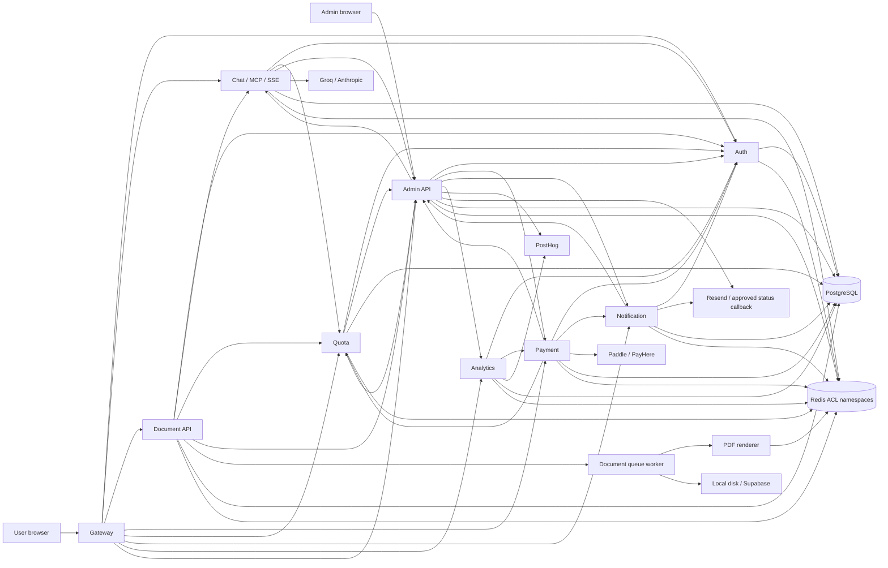
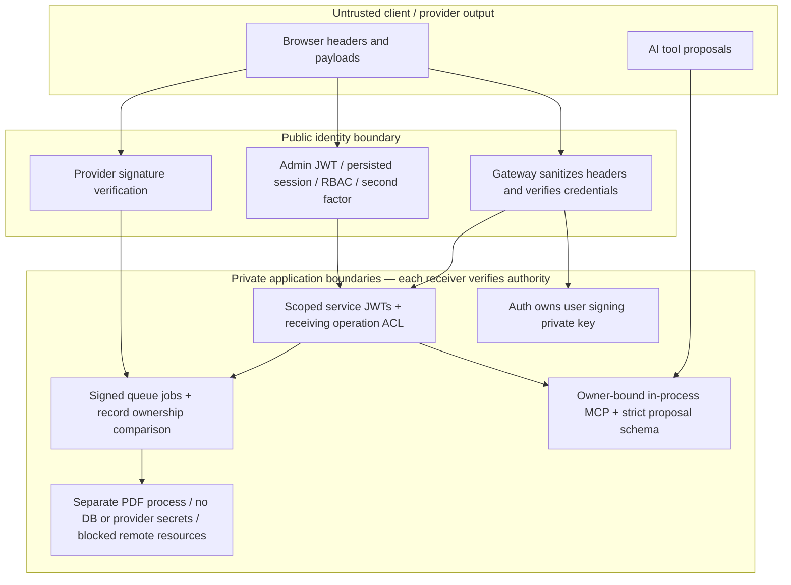
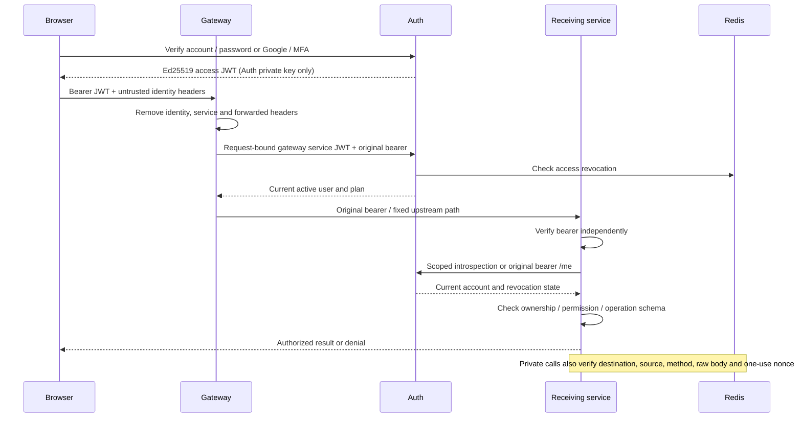

# Phase 3 — Inter-service communication

Date: 2026-10-15. Inventory follows the Phase 2 architecture; it does not restart the original audit.

Source evidence: **135 communication call sites** and **262 route declarations** in [connection-callsites.json](evidence/phase3/connection-callsites.json) and [api-inventory.json](evidence/phase3/api-inventory.json). Declarations include aliases/dormant helpers and are not successful workflow counts. The method/path/caller policy below is authoritative for private HTTP operations.

**Transport notation.** `S` is a pairwise HS256 service JWT (`doccraft-service+jwt`, issuer `doccraft-services`, destination audience, source subject, kid, 60-second expiry, UUID nonce, exact HTTP method/path/query and SHA-256 raw-body binding). Receiver verifies its method/path/caller policy and atomically claims the nonce in its own Redis namespace; missing credentials → 401, forbidden identity → 403, replay → 409, replay-store failure → 503. No receiver accepts the former universal secret as authorization. HTTP clients strip it before signing. `Q` is a seven-day signed producer/queue/name/job-ID envelope; it authenticates a job, not encryption or exactly-once delivery. `E` is a 60-second, producer/type-scoped automation event with receiver replay protection.

All local HTTP is plaintext over owned loopback sockets. Compose declares a private backend network and no backend host ports; several services need egress for providers/hosted PostgreSQL. This is configuration evidence only. Public HTTPS termination, private encrypted networking/mTLS, Redis TLS, firewall/egress policy and deployed certificates have **not** been exercised. No test disabled certificate validation.

**mTLS deployment decision:** application service JWTs authenticate operations but do not encrypt traffic. A single private Compose bridge reduces exposure but does not establish a production confidentiality guarantee. Require verified TLS for public ingress, PostgreSQL and Redis; use mTLS through a managed proxy/mesh or a demonstrated encrypted workload network for cross-host service traffic, prioritizing Admin, Payment, Auth and Quota. A mesh also requires workload certificate issuance, CA trust, renewal, revocation and failure monitoring. No such production control plane was accessible, so mTLS is a deployment requirement/evaluation, not an implemented or tested claim. Keep receiver operation ACLs after enabling transport identity.
## Complete discovered communication matrix

Responses are validated to different depths: schemas, ownership/revision/confirmation checks on document/AI operations; status checks and selected shape checks on generic HTTP clients. Generic configuration/provider responses do not all have strict runtime schemas. Logs use gateway request IDs and service-local/queue IDs; there is no verified fleet-wide trace exporter. Sensitive notification fields are redacted, but universal log/PII/URL scrubbing is not claimed.

| Source | Destination | Method / operation | Endpoint / channel | Authentication / identity headers | Authorization / validation | Timeout | Retry / recovery | Error / monitoring |
| --- | --- | --- | --- | --- | --- | --- | --- | --- |
| User browser | Gateway | GET/POST/PATCH/PUT/DELETE | /v1/auth/users/chat/ai/document/documents/templates/payment/billing/quota/notifications/analytics/support | User bearer, provider signatures, or explicit public capability | JWT + current account; body limits; fixed destination registry; downstream validates ownership | 30s REST; 135s SSE; 15s heartbeat | No automatic operation replay; client disconnect aborts | 401/403/413/429/503; request ID |
| Admin browser | Admin API | GET/POST/PATCH/PUT/DELETE | /api/v1/admin/**; /api/v1/users/** | Independent admin JWT + stored session; X-Admin-2FA for sensitive routes | Fresh account/role/permission lookup; one-time email code; shared attempt budget | Browser request lifetime; downstream clients bounded | No generic automatic financial retry | 403 permission/TOTP; 429 abuse; failure states persisted/visible |
| Gateway | Auth | POST | /internal/verify-token | S: gateway→auth + original user bearer in body | Token subject match + current account, revocation, plan | 3s | None | Fail closed 401/403/503 |
| Chat / Payment / Quota | Auth | POST | /internal/verify-token | S: caller→auth + original user token | Only introspection; cannot list/administer users | 3s | None | Fail closed |
| Document / Notification / Analytics / Chat profile | Auth | GET | /v1/auth/me | Original user bearer | Auth validates current status, token profile and revocation; profile subject matched | Document/Notification 3s; Analytics 5s; profile 2s | None | Reject unavailable/invalid account |
| Gateway | Backend APIs | Corresponding user method | Alias translation in upstreamPath.ts; fixed target per serviceRegistry | Original bearer; browser identity/internal/service headers stripped | Every sensitive receiver reauthenticates; user headers alone have no authority | 30s / 135s SSE | None | Upstream status retained; gateway owns CORS; cancellation propagated |
| Gateway | Admin API | GET / POST | /api/v1/internal/config/settings; /api/v1/admin/security/rate-limit-violation | S: gateway→admin-api | Settings read and rate-limit report only | 5s default | Config cache; reporting best effort | Policy/cache failure behavior documented in rate limiter |
| Chat | Admin API | GET | /api/v1/internal/config/ai_model_routing; /plans; /template_catalog | S: chat→admin-api | Model/plan/template policy only | Model 2s; default 5s | 5s model cache; template no stale allow | Provider/template policy unavailable rejects |
| Chat | Quota | POST | /v1/quota/check | S: chat→quota | User-scoped reservation namespaced to Chat; AI calls metered | Client bounded HTTP; see quotaClient source | Owned stable reservation ID | Quota denied/outage stops provider |
| Document API | Chat | GET | /api/chat/session/:id/messages | Original user bearer | Chat checks session owner; Document rechecks state owner, revision, confirmation | 10s | Same generation operation ID for recovery | 401/403/404/409/422/503 |
| Document API / worker | Quota | POST | /v1/quota/check; /refund | S: document→quota | Reservation/refund receipt owned by Document; stable generation ID | 5s | Owned/idempotent receipt; terminal failure refund | No unrestricted increment/reset permission; refund outage not durably repaired |
| Document | Admin API | GET | /api/v1/internal/config/template_catalog | S: document→admin-api | Published variant availability; alias-aware | 3s | No stale allow | 503 on policy outage; 403 withdrawn |
| Document worker | PDF | POST / GET | /generate; /ready | S: document→pdf | Only Document can render; schema/raw-body binding; no remote resources/scripts | 30s client; 15s renderer page/launch limits | Bounded document queue attempts | 503 overload; bounded concurrency; typed failure |
| Payment | Auth | GET / PATCH | /internal/users/:uuid; /internal/users/:id/plan | S: payment→auth | Single recipient profile or plan sync; status/list/stats denied | 5s | Webhook-owned retry through inbox/queue | Non-2xx throws to worker |
| Payment | Quota | POST | /v1/quota/plan/sync | S: payment→quota | Plan baseline only; overrides/resets denied | 5s | Idempotent baseline sync | Non-2xx throws to worker |
| Payment / Auth / Document / Admin | Notification | POST | /notification/send | S: caller→notification | Allowed notification types per caller; Admin approved control-plane messages | 5s default | Auth queue fallback; queue retry policies | Provider success not inferred from queue acceptance |
| Auth / Chat / Document / Payment / Quota / Admin | Analytics | POST | /v1/analytics/event; /generation-event | S: caller→analytics | Backend event ingestion only; reports require Admin identity | 5s default; explicit caller overrides in inventory | Usually best effort; Analytics queue bounded | Telemetry failure does not invent workflow success |
| Analytics | Payment | GET | /v1/payment/admin/revenue | S: analytics→payment | Currency-safe revenue read only | 5s | None | 503 on unavailable reporting |
| Quota | Admin API | POST | /api/v1/admin/security/bot-detection-event; /auto-suspend | S: quota→admin-api | Quota security reporting only | 5s default | Abuse/cooldown keys; best effort | Failure logged; no general admin authority |
| Admin API | Auth | GET / POST / PATCH | /internal/users/**; /internal/referrals/** | S: admin-api→auth | Admin endpoint first enforces current RBAC and sensitive-action verification | 10s | No generic mutation retry | HTTP error propagated |
| Admin API | Payment | GET / POST / PATCH | /v1/payment/admin/** | S: admin-api→payment | Billing reports, coupons/trials/configured mutations; receiving method/path ACL | 10s | No generic mutation retry | 503/502 on dependency failure; provider workflow not claimed |
| Admin API | Quota | GET / POST / DELETE | /v1/quota/admin/stats; /override; /override/:id; /reset; /plan/sync | S: admin-api→quota | Admin-only operations; receiving quota validation/audit | HTTP clients 5–10s | Explicit retries only; durable mirror deletion before acknowledgement | Partial sync failures exposed |
| Admin API | Chat MCP | POST | /internal/resources | S: admin-api→chat | Read-only initialize/initialized/resources/read; support RBAC and audit; no tool mutation | 10s | Separate fresh credential per HTTP request | 503 unavailable; no synthetic session data |
| Admin API | Chat | GET | /api/internal/status/keys; /api/metrics | S: admin-api→chat | Status/metrics only; no model key value | Status 5s | None | Receiver denies other caller identities |
| Admin API | Analytics | GET / POST | /v1/analytics/* reports; /event | S: admin-api→analytics | Read reporting; ingest approved events | 5s; traffic 15s | None | Unavailable values are not proof of actual provider telemetry |
| Notification | Admin API | GET | /api/v1/admin/notifications/config/public; /api/v1/internal/config/branding | S: notification→admin-api | Private delivery templates/settings/branding only; full config/plan read denied | 5s default | Config caching | No admin JWT/database/provider signing key returned |
| Admin API | Configured services | GET | /health | Public minimal liveness | No user secrets; health is not readiness proof | 4s | Periodic dashboard polling | Unavailable service shown offline/degraded |
| Auth / Document / Notification | Redis → Notification worker | Queue add / consume | email_queue_auth; email_queue_document; email_queue_notification | Q: scoped Redis account + signed job | Producer, email type, queue, name, immutable job ID verified | Redis reconnect / worker lifetime | Configured attempts/delay; email send crash window remains | Poison jobs fail; delivery deduplication is not globally exactly once |
| Document API | Redis → PDF worker | Queue add / consume | document | Q: document account + signed job | Persisted document owner/type/template/plan/facts must match | Redis queue / 30s renderer HTTP | Stable document job ID; bounded queue attempts | Completed PDF never undone by notification failure |
| Payment | PostgreSQL → Redis → Payment worker | Inbox insert / queue add / consume | webhook_deliveries; payment-webhook | Q: payment account + signed job | Signature verified before durable intake; queue identity and stable DB event | 30s reconciliation schedule; HTTP side effects 5s | 3 immediate attempts/backoff; failed jobs retried to bounded 10 attempts; manual DLQ repair | ACK after DB commit, independent of Redis delivery; ordering still open |
| Quota | Redis → Quota worker | Scheduled queue | quota-reset | Quota-only Redis key ACL | Worker owns reporting reset; Redis TTL owns day rollover | Midnight UTC schedule | One scheduled attempt | Late cron preserves current Redis usage; poison scope limited by Redis ACL |
| Payment / Quota | Redis → Admin event subscriber | PUBLISH/SUBSCRIBE | doccraft:events | E: per-producer signed event + Redis channel ACL | Payment only payment.failed/subscription.cancelled; Quota only quota.warning; Admin nonce check | 60s event token; reconnect 5s | Ephemeral pub/sub; no durable redelivery guarantee | Wrong type/unsigned/replayed events rejected |
| Admin API | Redis → Admin worker | LPUSH / BRPOP / retry / DLQ | automation:queue; automation:dedup:*; automation:dlq | Admin-only key ACL | Rules loaded from Admin DB; no foreign producer access | Worker lifetime | Bounded exponential retry; BRPOP crash-loss window remains | Not an acknowledged durable queue; production recovery gate |
| Analytics API | Redis → Analytics worker | Queue add / consume | analytics | Q: analytics producer/consumer key | Signed queue payload; PII redaction/anonymization option | Worker lifetime | 3 attempts | External PostHog delivery NOT TESTED |
| Auth / Chat / Payment / Quota / Document / Notification / Analytics / Admin | PostgreSQL | Parameterized Prisma/SQLAlchemy/pg/SQL | Owned tables plus existing reporting cross-table reads | Database credentials from environment | Ownership checks in APIs; least-privilege runtime DB roles NOT proven | Pool/client-specific; not universally bounded | Pool pre-ping and client reconnection | Local fixture uses migration owner; production account separation/TLS remain gates |
| All services except stateless PDF | Redis | GET/SET/Lua/queues/cache/pubsub | Per-service key/channel patterns | Per-service Redis ACL user/password | Read-only configuration consumer keys; dangerous commands denied; default user off | Replay store 2s; other client reconnect bounds vary | Client-specific; AOF configured in Compose | Dev transport plaintext; rediss supported; TLS/failover not exercised |
| Chat | Groq / Anthropic | HTTPS POST | Provider chat APIs | Provider API keys held server-side | Deployment/plan model allowlist; strict tool arguments; owner-scoped tool context | Groq configured deadline + overall turn timeout | Bounded model fallback within allowlist | Mock/deterministic tests only; external AI NOT TESTED |
| Auth | Google / Firebase | HTTPS JWK / OAuth calls | Google JWKS/userinfo/OAuth | Google RS256 token; project issuer/audience/provider verification | Verified email and Google provider; account status enforced | SDK/client-specific | JWKS cache | Live Google sign-in NOT TESTED |
| Payment | Paddle / PayHere | HTTPS API / hosted form | Checkout/portal/cancel; provider callbacks through public gateway | Provider API credentials; Paddle signature or PayHere checksum | Server checkout ownership, amount/currency/cadence | SDK/provider-specific; not all direct SDK deadlines proven | No real charges; synthetic callbacks only | Recurring reconciliation and approved sandbox lifecycle remain BLOCKED |
| Notification / Admin | Resend | HTTPS SDK / callback | Email API; /notification/webhooks/resend-status | Resend key / age-bound Svix signature | Approved notification type; recipient/preference; redacted stored metadata | SDK-specific; outbound relay 5s | Delivery queue retries; callback replay/idempotency not fully proven | No real delivery tested; optional status relay HTTPS operator allowlist, no redirects |
| Document worker | Storage | Local disk or HTTPS Supabase | PDF upload/download/delete | Document storage credential; expiring capability links | Owner-scoped metadata; safe storage paths; dedicated signing key | Provider-specific | Stable PDF filename; no global transactional storage guarantee | Local disk verified; Supabase sandbox/retention/backup NOT TESTED |
| Admin API | PostHog | HTTPS API | Project analytics/query APIs | Server project/personal key | Admin analytics RBAC | 10s/client-specific | No claim of actual remote data | NOT TESTED externally |

## Service authorization / internal API inventory

This is generated directly from `shared/service-permissions.json`. A valid key for another source/destination pair is insufficient. No PDF identity has an outgoing HTTP grant. A user bearer does not grant these internal operations. Gateway strips browser internal credentials before proxying.

| Receiving service | HTTP methods | Path matcher (anchored) | Authorized service identities |
| --- | --- | --- | --- |
| auth | POST | `^/internal/verify-token$` | gateway, chat, payment, quota, notification, document, analytics |
| auth | GET | `^/internal/users(?:/[^/]+)?$` | admin-api |
| auth | GET | `^/internal/users/(?:guest_)?[0-9a-f-]{36}$` | payment |
| auth | PATCH | `^/internal/users/[^/]+/plan$` | payment, admin-api |
| auth | PATCH | `^/internal/users/[^/]+/status$` | admin-api |
| auth | GET,POST,PATCH | `^/internal/referrals(?:/[^/]+/convert)?$` | admin-api |
| auth | GET | `^/metrics$` | admin-api |
| quota | POST | `^/v1/quota/(?:check/refund)$` | chat, document |
| quota | POST | `^/v1/quota/plan/sync$` | payment, admin-api |
| quota | POST | `^/v1/quota/(?:override/reset)$` | admin-api |
| quota | DELETE | `^/v1/quota/override/[^/]+$` | admin-api |
| quota | GET | `^/v1/quota/admin/stats$` | admin-api |
| payment | GET,POST,PATCH | `^/v1/payment/admin/[^?#]+$` | admin-api |
| payment | GET | `^/v1/payment/admin/revenue$` | analytics |
| chat | POST | `^/internal/resources$` | admin-api |
| chat | GET | `^/(?:api//v1/chat/api/)?internal/status/keys$` | admin-api |
| chat | GET | `^/(?:api//v1/chat/api/)?metrics$` | admin-api |
| notification | POST | `^/notification/send$` | auth, payment, document, admin-api |
| notification | GET | `^/notification/logs/admin$` | admin-api |
| analytics | POST | `^/v1/analytics/(?:event/generation-event)$` | auth, chat, document, payment, quota, admin-api |
| analytics | GET | `^/v1/analytics/[^?#]+$` | admin-api |
| admin-api | GET | `^/api/v1/internal/config/plans$` | quota, payment, chat, document |
| admin-api | GET | `^/api/v1/internal/config/settings$` | gateway, payment |
| admin-api | GET | `^/api/v1/internal/config/(?:ai_model_routing/mcp_tools)$` | chat |
| admin-api | GET | `^/api/v1/internal/config/branding$` | notification |
| admin-api | GET | `^/api/v1/admin/notifications/config/public$` | notification |
| admin-api | POST | `^/api/v1/admin/security/rate-limit-violation$` | gateway |
| admin-api | POST | `^/api/v1/admin/security/(?:bot-detection-event/auto-suspend)$` | quota |
| admin-api | GET | `^/api/v1/internal/config(?:/[^/]+)?$` | admin-api |
| admin-api | GET | `^/api/v1/internal/config/template_catalog$` | chat, document |
| pdf | POST | `^/generate$` | document |
| pdf | GET | `^/ready$` | document, admin-api |

## Service communication diagram

## Trust boundaries

## User and service authentication flow

## Exposure and credential ownership

| Component | Host exposure in root Compose | Credential / storage authority | Deployment limitation |
| --- | --- | --- | --- |
| Gateway | Loopback published | Gateway→Auth/config/report keys; user public verification keys; rate-limit namespace | TLS reverse proxy required; native dev listens on all interfaces |
| Admin API | Loopback published | Own admin JWT key, RBAC/session/config DB, scoped service clients; automation Redis | Restrict operator network; stable secret and shared DB required |
| Auth | No published port | Only user signing private key; Auth DB; Auth email queue producer | Do not distribute its private key to consumers; revoke affected historical keys |
| Chat / Payment / Quota / Document / Notification / Analytics | No published port | Individual HTTP/queue/event keys and Redis ACL account; service environment DB/provider credentials | Database credentials are still deployment-managed and not proven least privilege |
| PDF | No published port; private backend only | Dedicated PDF identity and replay Redis namespace; no DB, storage, provider or user signing key | Chromium sandbox/OS image, seccomp and production egress controls unverified |
| Redis | No published port; backend internal | Default user disabled; hashed ACL passwords; health account PING only; AOF/noeviction configured | ACLs do not encrypt traffic; rediss, failover, encrypted backups unverified |
| PostgreSQL | External deployment, absent from root Compose | Per-service environment connections; migrations/schema initialization currently need broader owner rights | Separate migration/runtime roles, column/view grants, TLS verification and encrypted backups are release gates |
| Legacy per-service Compose files | Include root topology; do not publish old standalone ports | Same generated identities/ACLs as root topology | Requires Compose include support; container runtime not available for execution |
| Native development | Node APIs bind 0.0.0.0 unless launcher override; owned test fixtures use loopback/random ports | Private identity files via scripts/with-service-identity.cjs | Do not treat developer ports as production network isolation |

Service credential generator writes per-service JSON with mode 0600 and refuses overwrites. Browser bundles receive no internal key. Redis credential generator creates separate users, key/channel patterns, read-only config consumers and a health account. Download signing belongs only to Document. Queue tokens contain data in readable JWT payloads: network/storage encryption is still required.

The local download-signing implementation currently has one active key; rotating it invalidates existing local signed download URLs. Plan reissuance or implement a verification-key overlap before a production rotation. No transparent download-key rotation is claimed.

**Rotation order:** provision a new kid in receiving keyrings; distribute receiver config and verification public keys; switch only the corresponding sender; wait out token/queue lifetimes or reconcile old jobs; remove old key IDs. Test old/new overlap and then revocation. Source rotation support is tested; no deployed rotation or revocation is asserted. User signing key rotation requires public-key rollout before Auth switches signing key. Admin key rotation invalidates existing admin signatures; legacy refresh-token migration deliberately signs users out.

## Database and queues

Prisma/SQLAlchemy/pg queries use parameter binding for normal values; identifiers in audit fixtures are generated and constrained. Admin namespaces separate plan/coupon/audit ownership. Document and admin schema initialization still run DDL, and reporting services read other domains' tables. The local integration account is an owned fixture migration account. No service-specific production grants/RLS/column views were tested; signing HTTP does not restrict SQL authority.

Redis ACL execution rejects anonymous access, foreign queues/keys, dangerous CONFIG access, unauthorized config writes/publication, and Document reading Auth verification jobs. Producer scope and record comparison reject forged jobs before effects. Redis Lua reserves/refunds atomically; signed HTTP replay protection is shared across process restarts while Redis state survives. Compose AOF everysec can lose recent writes during power failure; only pause/resume was tested. Pub/sub is ephemeral. Admin automation uses BRPOP and can lose an in-flight job on crash. Notification may resend after a provider-send/database-log crash. These are explicit recovery gaps.

The durable payment inbox improves intake and queue reconstruction; it does not create a distributed atomic transaction with Auth and Quota. General reordered callbacks and concurrent distinct lifecycle events remain a release blocker. PayHere renewal identification cannot depend on unsigned payment_id/message_type/subscription_id. See [official recurring verification](https://support.payhere.lk/api-%26-mobile-sdk/recurring-api) and [Retrieval API](https://support.payhere.lk/api-%26-mobile-sdk/retrieval-api). No Retrieval workflow was exercised.

## Dormant or incomplete connections

`DocumentServiceClient.validate_template_html` targets an absent authoring endpoint and now returns invalid/unavailable instead of fabricated validation success. It is not the implemented bundled-template publication pipeline. The alternate notification invitation helper now uses the real signed dispatch contract; actual provider delivery remains unverified. Generic gateway admin aliases forward user credentials; the supported Admin UI uses Admin API directly. AI MCP mutation is in-process and requires a current turn lease; external user MCP is owner-scoped, and support MCP is separately read-only. The complete source declaration inventory includes these distinctions.
